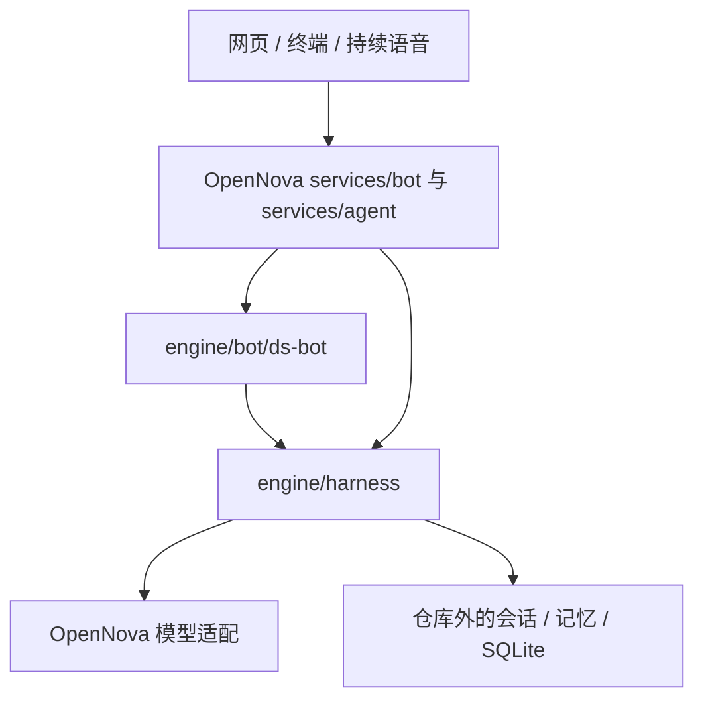

# OpenNova

OpenNova 是面向工作协同与持续交流的 AI 助手。当前包含网页聊天、持久 Bot、文件与命令工具、记忆、任务，以及 macOS 持续语音入口。

DeepSeek Harness、DeepSeek-Bot 和 SIWC DevKit 的完整工程源码已通过 **Git subtree** 纳入本仓库。普通 clone 或源码压缩包包含这三部分，无需相邻目录、私有 GitHub SSH 仓库、submodule 或源码软链接。安装 npm/Python 依赖仍需要网络；模型授权、语音服务与模型权重按需配置。

## 快速开始

目前支持和验证的开发环境是 **macOS、Node 24、pnpm 11.28.5**。完整离线回归另需 Python 3.11、uv、FFmpeg；原生构建和语音需要 Xcode Command Line Tools。持续语音要求 macOS 15+，Studio 本地 TTS 要求 Apple Silicon。其他系统尚未完成产品验证。

在仓库根目录执行：

```sh
corepack enable
corepack prepare pnpm@11.28.5 --activate
pnpm run setup
pnpm run build
pnpm run doctor
pnpm test
pnpm run test:bot
```

请使用 **`pnpm run setup`**：`pnpm setup` 是 pnpm 自身的命令。`setup` 安装根工程、三个引擎和桌面桥接各自锁定的依赖；`build` 构建 Harness、Bot、SIWC 和 OpenNova 网页。`doctor` 只检查本地源码与构建，不登录、不访问模型、不打开麦克风。上述测试使用本地模拟模型和临时数据目录。

当前产品模型适配使用 OpenNova 独立的 Sign in with ChatGPT。SDK 已随默认构建生成；在 macOS 上准备 Keychain helper，再由本人授权：

```sh
pnpm run setup -- --chatgpt
pnpm run build
pnpm run test:chatgpt
node services/agent/authorize.mjs
pnpm start
```

`--chatgpt` 仅为缺失的 Keychain helper 编译可执行程序，已有程序保持不变，不会触发登录。SIWC 源码、依赖和构建均位于仓库内，工具调用扩展已纳入源码。已有授权会继续复用。实际模型可用性取决于账号权限。

更换 ChatGPT 账号可运行 `node services/agent/authorize.mjs --add-account`，在官方页面选择另一个账号并完成授权。新账号成功后才切换，原账号、会话和记忆保留。`--list-accounts` 查看已保存账号，`--select-account ID` 切换已保存账号；未完成的注册可用相同 ID 继续授权。切换时请先停止正在执行的任务并暂停语音，完成后核对账号权限。

启动后默认只打开右侧 OpenNova 对话窗口；点击“打开工作窗口”或要求助手浏览网页时，再打开工作窗口。网页地址为 [本地网页聊天](http://127.0.0.1:18560/)。首次使用需按终端提示加载工程内 `extensions/browser` 并配对；`pnpm start -- --no-ui` 可仅运行后台服务。需要代理时通过 `OPENNOVA_PROXY` 设置自己的代理地址。网页和语音共用一个 Bot；默认允许助手在当前 OpenNova 工程工作，文件、Shell 等操作具有当前用户的权限。

默认支持增量回答：模型明确标记的最终答案会提前显示在右侧窗口，并按稳定语句开始合成；播放当前句时最多预合成下一句。未提供可靠回答标记的响应继续等待完整结果。工具执行、来源和会话提交仍以完整校验后的结果为准；取消或失败后的部分文字会标明未完成。启动已有 Bot 时沿用该进程的模式，更新后需在结束当前工作并退出语音后重启 Bot。

回退时，在停止现有 Bot 后使用 `OPENNOVA_REPLY_MODE=settled OPENNOVA_TTS_PREFETCH=0 ./start.command --tts-provider doubao`。实现、测速命令和验证边界见 [回复速度与流式播报验收](docs/research/opennova-reply-streaming-verification.md)。

支持把明确的测试、构建和脚本命令放到后台运行。右侧“任务”页可以查看排队状态、增量日志、结果文件，取消作业或重试失败的执行；后台运行时仍可继续聊天。任务记录和日志默认保存在仓库外，刷新不重复提交，服务重启不自动重跑已经启动的命令。使用方法与恢复边界见 [后台任务第一阶段验收](docs/research/opennova-background-tasks-verification.md)。

第二阶段支持独立 Agent 工作任务：在仓库外 Git 工作目录中分析、修改并验证，后台执行时仍可继续交流；支持补充要求、暂停、接续原会话、查看执行步骤和文件差异，再显式应用到原工程。使用方法与边界见 [独立 Agent 任务验收](docs/research/opennova-agent-tasks-verification.md)。

第三阶段支持事件驱动接续：在明确启用、次数和期限受限的规则下，测试／构建完成、指定文件变化或 GitHub 讨论评论可以接续同一任务。面板提供暂停、来源与消费记录，文件修改仍需审阅后应用。使用方式见 [事件接续说明与验收](docs/research/opennova-event-continuation-verification.md)。

团队员工可以承接通用工作，职责和擅长方向用于分工。新建任务默认“通用工作”模板与“完整执行”权限，可使用已接入且获授权的文件、命令、联网和浏览器工具；“只读”允许读取和检索。任务模板只决定输入与目录准备，资料任务也可运行处理脚本。成果、会话和来源记录保存在仓库外，后台浏览器操作与前台排队协调。已有任务沿用创建时的权限。详见 [通用员工执行能力与验收](docs/research/opennova-generic-execution-verification.md)。

团队版已支持成果版本、总管后台验收与有限返工、待处理问题、员工交接及明确前置依赖。员工任务默认由独立总管会话跟进，验收通过后才释放依赖任务；查看成果、验收和合入代码各自独立。历史任务不自动补跑，配置、授权、会话、记忆和任务数据继续保留在仓库外。入口与验证边界见 [团队 M2 使用与验证](docs/research/opennova-team-m2-verification.md)。

新 Agent 任务的步骤、Token、运行时长及总管累计预算默认不限制，预算字段留空即可；旧任务保留原设置。任务详情展示当前执行阶段和最近活动，总管验收有独立活动记录。团队运行、恢复与交付验收见 [M3 验证记录](docs/research/opennova-team-m3-verification.md)，停机备份和恢复步骤见 [状态恢复说明](docs/research/opennova-team-recovery.md)。

任务页提供“正在做 / 需要你处理 / 最近成果”团队总览，支持按员工查询全部任务和加载历史。总管值守提醒临近截止、逾期、持续阻塞及无新进展；默认只提醒，可明确开启逾期排队提优先级。语音或对话可直接询问团队进展、确认提醒，执行完成与验收记录分开汇总。详见 [M4 使用与验证](docs/research/opennova-team-m4-verification.md)。

不再需要的任务可以在详情点击“关闭任务”，也可以用语音或对话提出关闭。停止后续跟进并确认进程清理后，任务移出默认列表；原执行结果、日志和成果仍保留。通过“任务记录 → 已关闭”查看或恢复；恢复只重新显示，执行需另行接续或重试。“取消执行”仍只停止本次执行，不等同于关闭。

## 工程结构

| 目录 | 职责 |
| --- | --- |
| `engine/harness/` | 完整 Harness：Agent 运行时、SDK、工具、存储、插件与原生界面 |
| `engine/bot/` | 完整 DeepSeek-Bot 上游；实际插件位于 `ds-bot/` |
| `engine/siwc/` | 完整 SIWC DevKit 及已应用的 OpenNova 工具流扩展 |
| `services/runtime/` | 仓库内源码定位、版本验证与 Harness 包解析 |
| `services/agent/` | OpenNova 模型适配、授权、流式会话与联网策略 |
| `services/bot/` | OpenNova Bot 宿主、请求与记忆策略、网页及工具操作记录 |
| `services/tts/` | Studio Vivian / MLX、豆包云端 TTS |
| `tools/voice/`、`tools/asr/` | 音频、VAD、ASR、持续语音与播放 |
| `scripts/` | 根目录安装、构建、诊断和离线回归 |
| `config/` | 配置模板；真实配置保存在忽略的 `*.local.json` |
| `upstream.lock.json` | Harness/Bot/SIWC 来源、导入提交和保留补丁 |
| `output/` | 本机产物、扩展构建和日志，不进入 Git |



## 语音与本地配置

首次配置可复制模板，已有文件请保留：

```sh
cp -n config/secrets.example.json config/secrets.local.json
chmod 600 config/secrets.local.json
cp -n config/voice.example.json config/voice.local.json
```

按 [语音说明](tools/voice/README.md) 配置豆包 ASR、Studio TTS 或豆包云端 TTS。完成依赖、授权和服务配置后：

```sh
pnpm run start:voice -- --help
./start.command
# 云端 TTS 示例
./start.command --tts-provider doubao
```

语音 `--check` 与 `pnpm run doctor` 不同：前者会检查实际服务和授权；豆包 TTS 模式会合成一段探针音频并产生少量计费用量。真人麦克风、声学打断和云端效果需要在目标设备另行验收。

已有 Bot 数据仍在 `~/.local/share/opennova/bot-spike/`，独立 Harness 语音会话仍在 `~/.local/share/opennova/harness-home/`。迁移不搬动会话、记忆、权限或 Keychain。`agent.harness_root`、`agent.siwc_root` 和用户传入的 `OPENNOVA_HARNESS_ROOT`、`OPENNOVA_SIWC_ROOT` 不再选择外部源码；授权存储和 TTS 的机器配置继续有效。Keychain helper 及旧 `agent.keychain_helper` / `OPENNOVA_KEYCHAIN_HELPER` 路径覆盖已收拢为工程内 `output/bin/siwc-keychain`，由仓库内 Swift 源码构建；原 Keychain 身份保持不变。

## 开发与许可

- [开发、构建、上游同步与回归](docs/development.md)
- [贡献指南](CONTRIBUTING.md)
- [Agent 适配](services/agent/README.md)、[TTS 配置](services/tts/README.md)
- [Bot 能力与历史验证](docs/research/opennova-bot-spike.md)
- [MVP PRD](docs/product/opennova-mvp-prd.md)

OpenNova 自有代码采用 [Apache-2.0](LICENSE)。引入组件保留各自许可：Harness 为 MIT，DeepSeek-Bot 为 Apache-2.0，SIWC 使用 **Sign-in with ChatGPT DevKit Noncommercial License v1.0（非商业许可）**；根 Apache-2.0 不覆盖 SIWC。详情见 [第三方声明](THIRD_PARTY_NOTICES.md)。本仓库是 OpenNova 的独立整合项目，不代表上游官方发行版。

桌面交互已与同一个 Bot 和语音会话整合。`./start.command --tts-provider doubao` 自动开窗并启动语音；`pnpm start` 自动开窗，仅启动文字服务。`--check` / `--list-devices` 不开窗。浏览器程序与外部 profile 可在 `desktop.browser_executable`、`desktop.browser_user_data_dir` 中配置，原有环境变量仍可覆盖。配对数据和浏览器 profile 必须保留在工程外。
