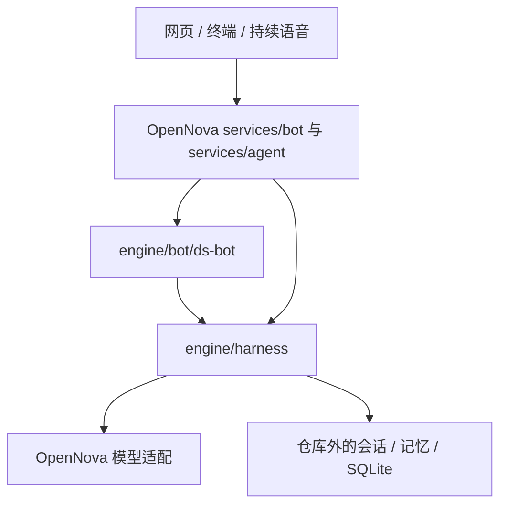

# OpenNova

OpenNova 是面向工作协同与持续交流的 AI 助手。当前包含网页聊天、持久 Bot、文件与命令工具、记忆、任务，以及 macOS 持续语音入口。

DeepSeek Harness、DeepSeek-Bot 和 SIWC DevKit 的完整工程源码已通过 **Git subtree** 纳入本仓库。普通 clone 或源码压缩包包含这三部分，无需相邻目录、私有 GitHub SSH 仓库、submodule 或源码软链接。安装 npm/Python 依赖仍需要网络；模型授权、语音服务与模型权重按需配置。

## 快速开始

目前支持和验证的开发环境是 **macOS、Node 24、pnpm 11.28.5**。完整离线回归另需 Python 3.11、uv、FFmpeg；原生构建和语音需要 Xcode Command Line Tools。持续语音要求 macOS 15+，Studio 本地 TTS 要求 Apple Silicon。其他系统尚未完成产品验证。

在仓库根目录执行：

```sh
corepack enable
corepack prepare pnpm@11.28.5 --activate
pnpm run setup
pnpm run build
pnpm run doctor
pnpm test
pnpm run test:bot
```

请使用 **`pnpm run setup`**：`pnpm setup` 是 pnpm 自身的命令。`setup` 安装四个项目各自锁定的依赖；`build` 构建 Harness、Bot、SIWC 和 OpenNova 网页。`doctor` 只检查本地源码与构建，不登录、不访问模型、不打开麦克风。上述测试使用本地模拟模型和临时数据目录。

当前产品模型适配使用 OpenNova 独立的 Sign in with ChatGPT。SDK 已随默认构建生成；在 macOS 上准备 Keychain helper，再由本人授权：

```sh
pnpm run setup -- --chatgpt
pnpm run build
pnpm run test:chatgpt
node services/agent/authorize.mjs
pnpm start
```

`--chatgpt` 仅为缺失的 Keychain helper 编译可执行程序，已有程序保持不变，不会触发登录。SIWC 源码、依赖和构建均位于仓库内，工具调用扩展已纳入源码。已有授权会继续复用。实际模型可用性取决于账号权限。

启动后打开 [本地网页聊天](http://127.0.0.1:18560/)。需要代理时通过 `OPENNOVA_PROXY` 设置自己的代理地址。网页和语音共用一个 Bot；默认允许助手在当前 OpenNova 工程工作，文件、Shell 等操作具有当前用户的权限。

## 工程结构

| 目录 | 职责 |
| --- | --- |
| `engine/harness/` | 完整 Harness：Agent 运行时、SDK、工具、存储、插件与原生界面 |
| `engine/bot/` | 完整 DeepSeek-Bot 上游；实际插件位于 `ds-bot/` |
| `engine/siwc/` | 完整 SIWC DevKit 及已应用的 OpenNova 工具流扩展 |
| `services/runtime/` | 仓库内源码定位、版本验证与 Harness 包解析 |
| `services/agent/` | OpenNova 模型适配、授权、流式会话与联网策略 |
| `services/bot/` | OpenNova Bot 宿主、请求与记忆策略、网页及工具操作记录 |
| `services/tts/` | Studio Vivian / MLX、豆包云端 TTS |
| `tools/voice/`、`tools/asr/` | 音频、VAD、ASR、持续语音与播放 |
| `scripts/` | 根目录安装、构建、诊断和离线回归 |
| `config/` | 配置模板；真实配置保存在忽略的 `*.local.json` |
| `upstream.lock.json` | Harness/Bot/SIWC 来源、导入提交和保留补丁 |
| `output/` | 本机产物、扩展构建和日志，不进入 Git |



## 语音与本地配置

首次配置可复制模板，已有文件请保留：

```sh
cp -n config/secrets.example.json config/secrets.local.json
chmod 600 config/secrets.local.json
cp -n config/voice.example.json config/voice.local.json
```

按 [语音说明](tools/voice/README.md) 配置豆包 ASR、Studio TTS 或豆包云端 TTS。完成依赖、授权和服务配置后：

```sh
pnpm run start:voice -- --help
./start.command
# 云端 TTS 示例
./start.command --tts-provider doubao
```

语音 `--check` 与 `pnpm run doctor` 不同：前者会检查实际服务和授权；豆包 TTS 模式会合成一段探针音频并产生少量计费用量。真人麦克风、声学打断和云端效果需要在目标设备另行验收。

已有 Bot 数据仍在 `~/.local/share/opennova/bot-spike/`，独立 Harness 语音会话仍在 `~/.local/share/opennova/harness-home/`。迁移不搬动会话、记忆、权限或 Keychain。`agent.harness_root`、`agent.siwc_root` 和用户传入的 `OPENNOVA_HARNESS_ROOT`、`OPENNOVA_SIWC_ROOT` 不再选择外部源码；授权存储、Keychain helper、TTS 的机器配置继续有效。

## 开发与许可

- [开发、构建、上游同步与回归](docs/development.md)
- [贡献指南](CONTRIBUTING.md)
- [Agent 适配](services/agent/README.md)、[TTS 配置](services/tts/README.md)
- [Bot 能力与历史验证](docs/research/opennova-bot-spike.md)
- [MVP PRD](docs/product/opennova-mvp-prd.md)

OpenNova 自有代码采用 [Apache-2.0](LICENSE)。引入组件保留各自许可：Harness 为 MIT，DeepSeek-Bot 为 Apache-2.0，SIWC 使用 **Sign-in with ChatGPT DevKit Noncommercial License v1.0（非商业许可）**；根 Apache-2.0 不覆盖 SIWC。详情见 [第三方声明](THIRD_PARTY_NOTICES.md)。本仓库是 OpenNova 的独立整合项目，不代表上游官方发行版。
