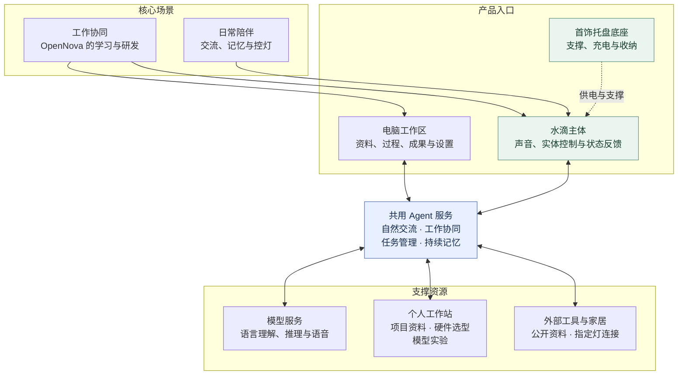

# openNova MVP 产品需求文档

版本：0.2 草案 · 2026 年 10 月 7 日

局部更新：2026 年 11 月 15 日，A1 项目上下文首版已实现，用户已结束本轮人工测试；自然话题转场、同名项目消歧、长上下文摘要换段和失败恢复完成工程回归（986 项 JavaScript、252 项 Python），34 条真实模型路由样本通过。原数据备份、迁移及原目录源码同步、构建和启动核验已完成；设备播放证据边界见 6.2.1 节和 [A1 验证记录](../research/opennova-project-context-verification.md)。其余条目仍为产品范围定义。

2026 年 11 月 16 日补充：A2 已核对现有模型通道与文件工具能力，按验证结果调整为现成能力接入、来源关联和研究成果接续。附件原生通道验证通过不等于产品入口已发布；当前状态见 6.2.2 节和 [文件能力验证](../research/opennova-file-capability-verification.md)。

2026 年 11 月 20 日调整了代码开发场景。用户使用现有 AI 编程工具实现功能，Nova 协助梳理需求、讨论方案、记录决定和整理验收要点。原 A5.2「开发执行与预览」退出 MVP，同时取消 A4 第四批原定的两项工作，即 TXT/Markdown 编辑审阅和按批撤销后台代码补丁。A4.2 的首版范围由已验收的 Nova 自有 Word/PDF 修改对照、确认、放弃与撤销覆盖。[A4 开发与验收记录](../superpowers/plans/2026-11-19-a4-change-review.md)

2026 年 11 月 25 日将自我进化、多场景工作台和动态界面生成纳入首版功能清单，新增条目暂按 P0 排列。各项开发状态见第 2.2 节。

依据：[产品概念文档](opennova-product-concept.md)。

**已确认：MVP 优先实现工作协同与日常陪伴，采用 D 水滴主体及居家底座方向。本文按已确认的八章框架展开，具体功能边界、交互和架构为本轮草案定义。** 文中标注“建议”的方案和数值供后续讨论，不代表已确定的工程规格。

## 1. 产品概述

### 1.1 产品定位

openNova 是一款协作工作、随时交流、陪伴生活的 AI 超级助手。它通过自然交互与持续记忆，理解用户的目标与偏好：工作时，一起研究问题、推敲方案并推进任务；外出时，随身交流、分享见闻、接续讨论；居家时，自然聊天、分享感受、处理日常事务。无论在书桌前、出行途中还是床头，同一个助手都能延续已有的上下文与交流习惯。

产品采用软硬一体的形态，将水滴硬件与云端大模型、Agent 服务结合，让用户通过随身携带或归座放置的水滴直接开口交流，并在电脑端查看和完善工作成果。

### 1.2 MVP 目标

首版围绕两个场景提供可使用的完整体验：

- **工作协同：** 用户自然表达目标，助手结合共享资料参与研究、讨论和创作，调用已接入的工具，把交流推进成可查看、可继续调整的成果。
- **日常陪伴：** 用户在床头自然开口，助手围绕当下话题交流，恰当地使用已有记忆，支持打断、结束和简单控灯。
- **共同体验：** 在书桌与床头延续同一助手身份、交流习惯和已有记录。用户需要接续时能接上，想换话题时也能自然切换。

## 2. MVP 范围

### 2.1 场景范围

MVP 聚焦 **工作协同与日常陪伴**，两类场景共用同一助手身份、语音交互、持续记忆和任务记录。

| 场景 | 首版内容 | 主要成果或体验 |
| --- | --- | --- |
| 工作协同 | 结合项目资料和个人工作站开展研发协作、AI医美视频制作和自媒体内容创作 | 需求与验收要点、设计方案、学习笔记、实验记录、视频和运营素材 |
| 日常陪伴 | 书桌或床头的语音闲聊、感受与经历分享、已聊话题接续，以及一盏指定灯的控制 | 连贯自然的交流、可按用户意愿保存的记忆、明确的操作结果 |
| 跨场景接续 | 同一水滴在不同放置位置继续交流；电脑端查看已有成果和后台任务进展 | 延续话题、研发任务、决定与下一步，减少重复交代背景 |

**工作协同的首个核心场景是 OpenNova 的学习与研发。** Nova 结合项目资料与历史决定帮助用户明确需求、比较方案和整理验收要点，并通过个人工作站处理资料、运行模型实验和交付成果。

电脑工作台首批支持「AI医美视频」和「自媒体」两个内容创作场景。前者已有分镜、素材和成片剪辑流程，后者已有个人 IP、内容策划与运营素材。两者共用员工、项目、任务和成果，统一界面进度见 2.2 节 C1。[医美视频工作流](../../workspaces/aesthetic-video-workflow/README.md) · [自媒体项目](../../workspaces/自媒体IP/README.md)

OpenNova 学习与研发的四个工作方向、工具需求和主要成果如下。

| 工作方向 | 工具需求 | 主要成果 |
| --- | --- | --- |
| 代码项目协同 | 改进 OpenNova 自身时由内部员工验证候选版。其他工程可交给用户指定的 Codex 等工具，由 Nova 核对交付 | 任务说明、候选补丁与回执、逐项验收记录 |
| 硬件功能设计 | 资料检索、文本型规格书读取、器件参数整理、设计文档与选型及接口表编辑 | 硬件功能定义、候选器件清单、接口与布局建议、待解决问题 |
| 语音与模型研发 | 数据与配置文件处理、实验脚本、Spark 任务提交与状态查询、音频播放 | 数据清单、实验配置、运行记录、样音与候选模型版本 |
| 大模型前沿技术学习 | 网页与文本型 PDF 读取、笔记编辑、代码运行、结果比较 | 带来源的学习笔记、方法对比、复现代码与实验结论 |

典型过程是“学习研究 → 共同设计 → 实现或实验 → 查看结果 → 继续迭代”，简单任务可只完成其中一部分。学习本身也可以是完整目标，成果可以止于理解、笔记和小实验。

随身户外交流与连续视觉感知暂不进入首版范围。硬件设计先围绕数字资料、规格与方案讨论展开，纸面草图的摄像头讨论后置。

### 2.2 功能列表与优先级

功能按 **一级能力 → 二级功能 → 三级功能** 组织。一级划分能力模块，二级划分模块中的功能，三级明确具体操作或设计要求；同一功能不因用于不同场景而重复列出。

本稿将 **Agent Harness（智能体运行与协作能力）** 作为通用软件能力的一级分类：它组织模型、上下文、记忆和工具，为工作协同与日常陪伴提供支持。其中研究学习和讨论决策由模型与工具共同完成，Harness 负责组织它们参与任务。

一次软件需求讨论可直接复用 A1 的项目背景、A2 的资料读取、A3 的决定记录和 A4 的文档交付。代码实现和软件预览由用户在自己的编程环境中完成。

硬件设计也使用这些共用能力：规格资料通过研究与学习读取，器件取舍通过讨论与决策完成，设计文档通过成果管理保存，基础硬件设计工具负责整理参数、选型和接口表。E 类则定义 OpenNova 自身的硬件形态、结构与运行能力，详细规格在第 5 章展开。

以下优先级为本稿建议：**P0 为首版需实现的操作能力，P1 为后续扩展。** 专业工具按明确接口逐项接入；实验操作以选定模型、配置好的环境和分配的资源为边界。列为 P0 不代表相关工作站服务已经部署。

本章是本轮更新的范围定义；第 3、4、6 章中的研发流程、工作站分工和工具细节将随逐章讨论同步展开。

开发进度核对至 2026 年 11 月 25 日。「已完成」表示本项主流程已在说明所列环境中验证。「待样机」表示仍需完成相应硬件或固件集成，并在水滴实机上验证。

| 一级能力 | 二级功能 | 三级功能 | 功能说明 | 优先级 | 开发状态 | 说明 |
| --- | --- | --- | --- | --- | --- | --- |
| **A. Agent Harness** | A1. 项目上下文 | A1.1 资料与对象关联 | 建立项目及资料关联，区分项目资料与本轮文件、网页、选区，固定请求和任务的项目归属及对象版本 | P0 | 已完成 | 已支持创建项目、关联资料和本轮引用。提交请求或后台任务时会记录所属项目和对象版本。[A1 验证](../research/opennova-project-context-verification.md) |
| **A. Agent Harness** | A1. 项目上下文 | A1.2 上下文接续 | 根据自然语言意图跟随话题，保留可恢复的项目背景；结合有效决定、成果和真实任务状态接续，切换项目时使用对应上下文 | P0 | 已完成 | 工作和日常话题可自然切换。回到项目时能接续有效决定、成果和任务进度，切换期间的后台任务保留原归属。 |
| **A. Agent Harness** | A2. 研究与学习 | A2.1 资料检索与读取 | 搜索公开资料，读取网页与文本型 PDF，保留来源链接 | P0 | 已完成 | 可检索公开网页、按文件名或当前文件读取 PDF，保留链接、文件版本和页段。较长 PDF 可按页读取。[文件入口验证](../research/opennova-a2-native-file-entry.md) |
| **A. Agent Harness** | A2. 研究与学习 | A2.2 讲解与归纳 | 解释概念、梳理论文和方法，形成带来源的学习笔记 | P0 | 已完成 | 可将研究结论整理为笔记，并逐条回查对应文件版本、页码和原文摘录。[引文验证](../research/opennova-a2-claim-evidence.md) |
| **A. Agent Harness** | A3. 讨论与决策 | A3.1 方案比较 | 根据目标比较功能、器件、技术和模型方案，说明依据及取舍 | P0 | 已完成 | 已用两份报价 PDF 验证按交期、预算分别比较方案，能说明推荐依据并引用原页。[A3 验收](../research/opennova-a3-decision-verification.md) |
| **A. Agent Harness** | A3. 讨论与决策 | A3.2 澄清与决定记录 | 澄清影响结果的问题，将明确决定和下一步交由记忆与任务功能保存 | P0 | 已完成 | 缺少关键约束时会追问。可分别保存备选、明确决定和下一步，收到执行要求后再派工。 |
| **A. Agent Harness** | A4. 成果管理 | A4.1 内容生成与编辑 | 创建和修改文档、笔记、清单及简单对比表，包括硬件功能定义、选型依据与接口说明 | P0 | 已完成 | 可生成研究笔记、清单、对照表和中文多页 Word/PDF，并按要求修订 Nova 生成的文档。[文档工具验收](../research/opennova-a2-document-tools.md) |
| **A. Agent Harness** | A4. 成果管理 | A4.2 修改对照与版本 | 修改 Nova 生成的 Word/PDF 时显示前后值，可确认或放弃，按版本保存并支持撤销 | P0 | 已完成 | 修改前可看差异、确认或放弃。确认时复查原文件，有手改时保留双方内容重新核对，已应用的版本可按条件撤销。[修改与撤销验收](../superpowers/plans/2026-11-19-a4-change-review.md) |
| **A. Agent Harness** | A4. 成果管理 | A4.3 实验成果关联 | 关联数据、模型版本、配置、日志、样音与结论，支持查看和比较 | P0 | 已完成 | 两轮真实 TTS 实验已验证关联输入、模型版本、配置、日志和样音，可按轮次比较时长并播放样音。 |
| **A. Agent Harness** | A4. 成果管理 | A4.4 成果导出与引用 | 导出文字成果，提供文件、预览和模型产物位置等查看入口 | P0 | 已完成 | 可回查指定轮次，导出该轮 Word/PDF 并追溯来源。大型实验产物可保留位置与文件校验信息。[成果验收](../superpowers/plans/2026-11-19-a4-change-review.md) |
| **A. Agent Harness** | A5. 工具接入 | A5.1 项目文件操作 | 使用已有文件工具读取项目资料、源码和配置，保存任务所需的成果 | P0 | 已完成 | 可读取项目资料、源码和配置，并将成果写入指定位置。只读任务与可写任务使用各自的工具权限。 |
| **A. Agent Harness** | A5. 工具接入 | A5.3 TTS 实验操作 | 接入一种 TTS 推理与微调流程，处理数据与配置、提交 Spark 实验并返回样音和候选版本 | P0 | 部分完成 | Studio 和豆包推理已能生成样音。TTS 微调的数据准备、Spark 提交和候选模型返回仍待接通。18 |
| **A. Agent Harness** | A5. 工具接入 | A5.4 家居设备控制 | 调用已绑定灯的开关与状态查询，返回设备回执 | P0 | 待开发 | 待接入一盏真实灯具，验证绑定后的开灯、关灯、状态查询和失败回执。 |
| **A. Agent Harness** | A5. 工具接入 | A5.5 基础硬件设计工具 | 将规格资料中的器件参数、适用条件及来源整理为结构化条目，维护候选器件清单、选型对比和接口表 | P0 | 部分完成 | 已产出麦克风和播放链路的选型表、接口表及播放链路样机 BOM。两次均有人协助选页和续跑，自主定位、恢复与 BOM 持续维护待验。[麦克风](../../workspaces/水滴硬件/A5.5-麦克风选型/验收记录.md) · [播放链路](../../workspaces/水滴硬件/A5.5-播放链路/选型与接口.md) |
| **A. Agent Harness** | A5. 工具接入 | A5.6 专业硬件工具 | 接入 CAD/EDA、电路与结构仿真、仪器及样机操作 | P1 | 待开发 | 现阶段可研究规格书和整理接口。CAD/EDA 编辑、电路与结构仿真、仪器和样机操作均后置。 |
| **A. Agent Harness** | A5. 工具接入 | A5.7 扩展模型实验 | 适配更多模型与后训练流程、自动配置搜索、多机训练及从零训练 | P1 | 待开发 | 后续接入更多后训练流程、自动搜索实验配置、多机训练和从零训练。 |
| **A. Agent Harness** | A5. 工具接入 | A5.8 扩展内容与应用工具 | 接入图片与扫描件理解、复杂办公文件编辑、任意桌面应用操作 | P1 | 部分完成 | 已验证图片、扫描 PDF 和基础 Office 文件读取。复杂办公文件编辑、任意桌面应用操作仍待开发。[文件能力验证](../research/opennova-file-capability-verification.md) |
| **A. Agent Harness** | A5. 工具接入 | A5.9 扩展家居操作 | 接入更多家居设备及灯光渐变等动作 | P1 | 待开发 | 待单灯开关和状态回执接通后，再扩展设备类型和灯光渐变。 |
| **A. Agent Harness** | A6. 任务执行 | A6.1 任务组织与环境选择 | 明确目标、必要步骤、执行节点与所需工具，在授权范围内提交任务 | P0 | 部分完成 | 已可向内部员工派工，指定工作目录和执行权限。按任务选择本机、Studio 或 Spark 节点仍缺完整验收。 |
| **A. Agent Harness** | A6. 任务执行 | A6.2 进度与结果反馈 | 查询运行状态，展示执行结果，区分完成、失败和待确认 | P0 | 已完成 | 任务详情能显示执行步骤、增量日志、结果文件和验收状态。完成、失败或需要用户处理时均有对应记录。 |
| **A. Agent Harness** | A6. 任务执行 | A6.3 取消与恢复 | 取消后续步骤，断线后查询原任务并接续，避免重复执行 | P0 | 已完成 | 可取消执行，断线后查回原任务。固定文件研究已验证重启后复用已完成步骤，同一版本的 8 小时耐久测试仍待复验。[恢复验证](../research/opennova-a2-background-research.md) · [长测记录](../research/opennova-team-soak.md) |
| **A. Agent Harness** | A7. 持续记忆 | A7.1 分类保存 | 按保存设置记录决定、灵感、待办、偏好及来源，区分项目记录与个人记忆 | P0 | 部分完成 | 项目记录与个人记忆已分开保存，可记录决定、待办、偏好和来源。按用户留存设置控制写入仍待接入。 |
| **A. Agent Harness** | A7. 持续记忆 | A7.2 检索与引用 | 为当前话题和任务提供相关记录，支持跨时段、跨入口使用 | P0 | 部分完成 | 同一桌面 Bot 的文字和语音可跨轮召回项目或个人记录。电脑与水滴之间的记忆接续待验。 |
| **A. Agent Harness** | A7. 持续记忆 | A7.3 纠正与删除 | 修改错误记录、删除条目并同步有效状态 | P0 | 部分完成 | 桌面端可更正、撤回记忆并屏蔽旧内容。跨设备同步以及摘要、检索副本的一致清理仍待验证。 |
| **A. Agent Harness** | A8. 自我进化 | A8.1 按用户反馈改进 OpenNova | 用户在对话中提出改进，Nova 修改并验证自身行为，确认后在日用版实时生效 | P0 | 部分完成 | “无音频设备时仅文字启动”已走通内部修复、构建和候选验证。日用版实时生效和多人环境下的语音指向判断仍待开发与验收。[候选版验收](../superpowers/plans/2026-11-19-a4-change-review.md) |
| **A. Agent Harness** | A8. 自我进化 | A8.2 从任务经验学习技能 | 从已验收的工作中自动总结可复用的方法，保存为有版本的技能，供员工在后续任务中调用 | P0 | 已完成 | 默认自动生成技能候选，用户可检查、编辑、保存并分配。新任务复用技能已有验证，自动启用默认关闭。[技能提炼与复用验收](../research/opennova-team-m5-verification.md) |
| **B. 自然交互与陪伴** | B1. 语音与文字交流 | B1.1 自然开口与接话 | 保持可交流状态，处理停顿、补充和改口 | P0 | 已完成 | 桌面真人多轮对话已验证自然开口、停顿后的补充和改口。[语音验证](../research/opennova-demo-architecture-status.md) |
| **B. 自然交互与陪伴** | B1. 语音与文字交流 | B1.2 语音回应与文字输入 | 语音和文字进入同一会话，按场景选择播放与展示方式 | P0 | 已完成 | 文字与语音共用当前会话。可仅文字启动，之后开启语音并选择麦克风和扬声器。 |
| **B. 自然交互与陪伴** | B1. 语音与文字交流 | B1.3 打断与结束 | 停止当前播报、接收新表达、结束当前交流 | P0 | 已完成 | 真人试听已验证插话停止旧播报并接续追问。结束语音后仍可使用文字交流。[真人试听](../research/opennova-reply-streaming-verification.md) |
| **B. 自然交互与陪伴** | B2. 陪伴交流 | B2.1 话题与情绪回应 | 跟随日常话题，回应感受，按相关性使用已有记忆 | P0 | 部分完成 | 可跟随日常话题、回应感受。情绪回应是否贴切，以及何时引用已有记忆，仍待陪伴场景专项验收。 |
| **B. 自然交互与陪伴** | B2. 陪伴交流 | B2.2 交流风格与安静陪同 | 调整回应长度和追问方式，接受沉默与话题切换 | P0 | 部分完成 | 已支持简短口播、切换话题和沉默待机。减少追问、按用户偏好调整回应长度、道晚安后保持安静仍待专项验收。 |
| **B. 自然交互与陪伴** | B3. 主动交互 | B3.1 任务相关提示 | 按用户的交流状态反馈必要澄清、执行结果和设备异常 | P0 | 部分完成 | 桌面任务可主动汇报结果或请求处理，语音空闲时可播报。水滴断连、低电量和充电异常提示待接入。[主动汇报验证](../research/opennova-task-notifications.md) |
| **B. 自然交互与陪伴** | B3. 主动交互 | B3.2 定时提醒 | 按用户约定的时间主动提醒 | P1 | 待开发 | 团队任务已有临近截止和逾期提醒。按用户约定时间发出通用提醒仍待开发。 |
| **C. 用户端界面** | C1. 工作界面 | C1.1 项目与任务工作区 | 在「工作台」选择场景和项目、浏览共享资料。在「任务」按负责人和状态查找任务，处理需要补充信息或验收的事项 | P0 | 部分完成 | 现有任务页可创建、筛选、接续或关闭任务。按场景和项目接入新工作台待开发。 |
| **C. 用户端界面** | C1. 工作界面 | C1.2 成果与执行面板 | 从任务详情查看交付与验收、执行记录、协作与接续。项目内可独立查看资料、文档修改对照和实验结果 | P0 | 部分完成 | 已有任务交付与验收、工具回执、文档对照、版本回溯和样音播放。新工作台将从任务列表的「最近交付」筛选直达原任务。 |
| **C. 用户端界面** | C1. 工作界面 | C1.3 多场景工作台 | 在独立工作窗口通过「工作台」「员工」「任务」三个一级入口，开展「AI医美视频」「自媒体」等场景的工作 | P0 | 待开发 | 两个首批场景已有真实工作流和产出。统一工作台、场景切换及与现有数据的联动待开发。 |
| **C. 用户端界面** | C1. 工作界面 | C1.4 员工 | 通过「员工名册」「技能库」「总管值守」管理员工、分配技能、查看值守提醒，并从员工或提醒进入关联任务 | P0 | 部分完成 | 现有任务页已提供员工管理、技能分配、任务派工和值守提醒。工作台内的员工入口及与任务的联动展示待接入。[团队功能验证](../research/opennova-team-m2-verification.md) |
| **C. 用户端界面** | C2. 交流与记录界面 | C2.1 对话界面 | 查看转写、输入文字、切换话题与查看反馈 | P0 | 已完成 | 对话窗口支持文字输入、语音转写、增量回复、停止回复和自然切换话题，可查看本轮引用及执行反馈。 |
| **C. 用户端界面** | C2. 交流与记录界面 | C2.2 记忆与设置界面 | 查看和管理记录、声音、设备及数据设置 | P0 | 部分完成 | 已有项目记录、对话记忆操作和电脑音频设备选择。统一的记忆管理、设备及数据设置入口待补齐。 |
| **C. 用户端界面** | C3. 移动界面 | C3.1 独立手机应用 | 提供移动端查看、配置和接续入口 | P1 | 待开发 | 网页已适配窄屏。独立手机应用的移动查看、配置和接续入口后置。 |
| **C. 用户端界面** | C4. 动态界面生成 | C4.1 按反馈生成与调整交互界面 | 用户在对话中描述想要的视图或操作，Nova 在当前场景的工作台实时生成可操作的界面，并可随下一轮反馈调整 | P0 | 待开发 | 当前面板由预先编写的组件呈现。按反馈生成布局、绑定真实项目数据与操作、在工作台即时更新待开发。 |
| **D. 账号、设备与权限** | D1. 身份与设备管理 | D1.1 登录与设备绑定 | 维护单用户身份，完成水滴绑定、配网和解绑 | P0 | 部分完成 | 已有模型账号授权、本地认证和浏览器扩展配对。水滴与用户账号绑定、首次配网和解绑待接入。 |
| **D. 账号、设备与权限** | D1. 身份与设备管理 | D1.2 设备状态与设置 | 查看连接、电量、充电及版本，调整音量与输出入口 | P0 | 部分完成 | 电脑可查看语音连接状态，选择麦克风和外放。水滴电量、充电、版本上报及设备音量控制待接入。 |
| **D. 账号、设备与权限** | D1. 身份与设备管理 | D1.3 软件与固件更新 | 在明确时机更新，并保留失败后的恢复方式 | P0 | 部分完成 | 桌面启动器可自动重建过期版本，自身工程可先验证候选版。水滴固件的受控更新及失败恢复待开发。 |
| **D. 账号、设备与权限** | D2. 权限管理 | D2.1 内容共享授权 | 明确文件与项目访问范围，支持停止共享 | P0 | 部分完成 | 可关联或移除项目资料。项目目录用于组织文件，按所选范围限制访问、停止共享后撤销读取权限仍待实现。 |
| **D. 账号、设备与权限** | D2. 权限管理 | D2.2 工具操作授权 | 明确工具、执行节点和操作边界，按规则确认写入与执行 | P0 | 部分完成 | 已有只读任务、独立验收和文档写入确认。按工具和执行节点统一管理、撤回授权仍待补齐。[任务权限边界](../research/opennova-generic-execution-verification.md) |
| **D. 账号、设备与权限** | D3. 数据管理 | D3.1 留存与同步设置 | 设置会话和数据保存方式，展示同步状态 | P0 | 待开发 | 待提供首次留存提示、关闭文字留存和「本次不保存」选项，并显示电脑与水滴的同步状态。 |
| **D. 账号、设备与权限** | D3. 数据管理 | D3.2 会话与项目数据删除 | 按会话、任务或账号范围删除数据及相关副本 | P0 | 待开发 | 已能删除单条记忆。按会话、任务或账号范围删除关联数据及副本，并说明成果和版本的处理范围，仍待实现。 |
| **E. 硬件产品定义与能力** | E1. 声音输入输出 | E1.1 拾音与播放 | 支持书桌和床头语音交流，处理播放回声与用户插话 | P0 | 待样机 | 已有麦克风、扬声器和功放候选。待装机验证书桌及床头拾音、外放回声和播放中插话。[样机验证计划](../../workspaces/水滴硬件/A5.5-播放链路/选型与接口.md) |
| **E. 硬件产品定义与能力** | E2. 实体控制与反馈 | E2.1 静音与按键操作 | 实体静音、按键打断及主动发起交流 | P0 | 待样机 | 待接入实体静音与按键，并验证按键发起交流、打断播放及断网时的本地操作。 |
| **E. 硬件产品定义与能力** | E2. 实体控制与反馈 | E2.2 状态灯反馈 | 表达交流、静音、连接和充电等状态 | P0 | 待样机 | 待接入实体状态灯，验证倾听、静音、断连和充电时的灯态切换。 |
| **E. 硬件产品定义与能力** | E2. 实体控制与反馈 | E2.3 轻震反馈 | 通过触觉补充状态提示 | P1 | 待开发 | 轻震反馈已列入后续范围，触觉器件和具体提示场景待确定。 |
| **E. 硬件产品定义与能力** | E3. 供电与归座 | E3.1 电池与离座交流 | 支持离座供电、低电量提示及当前交流延续 | P0 | 待样机 | 待集成电池和电源管理，验证离座后交流延续、低电量提示和实际续航。 |
| **E. 硬件产品定义与能力** | E3. 供电与归座 | E3.2 归座识别与充电 | 识别实际充电状态，归座后充电并保持交流，明确反馈充电结果 | P0 | 待样机 | 待联调主体与底座，验证归座识别、实际充电回执，以及归座时交流能否持续。 |
| **E. 硬件产品定义与能力** | E3. 供电与归座 | E3.3 充电与温度异常处理 | 充电或温度异常时停止相关充电过程并反馈状态 | P0 | 待样机 | 待实现充电和温度异常检测，并在样机上验证停止充电及状态提示。 |
| **E. 硬件产品定义与能力** | E4. 连接与随身能力 | E4.1 室内联网 | 连接服务、维护设备连接并提示异常 | P0 | 待样机 | 已有无线主控候选。水滴连接室内网络、维持服务连接和异常提示待固件联调。 |
| **E. 硬件产品定义与能力** | E4. 连接与随身能力 | E4.2 户外交流与随身视觉 | 支持户外连接、交流和视觉感知，具体摄像头配置后续确定 | P1 | 待开发 | 户外联网与随身视觉列入后续范围，摄像头配置待定。 |
| **E. 硬件产品定义与能力** | E4. 连接与随身能力 | E4.3 本地配置与维护连接 | 提供首次配网和固件维护所需的本地连接能力，具体接口待硬件方案确定 | P0 | 待样机 | 首次配网和固件维护所用的本地连接方式待选定，之后需在真机验证。 |
| **E. 硬件产品定义与能力** | E5. 工业与结构设计 | E5.1 主体外观与结构 | 定义水滴轮廓、尺寸重量、材质、内部布局和开孔要求，兼顾声学、天线及操作区域 | P0 | 部分完成 | 已有水滴轮廓和外形尺寸比对。内部厚度、材质、声腔、天线与开孔布局仍需结构样件验证。 |
| **E. 硬件产品定义与能力** | E5. 工业与结构设计 | E5.2 底座结构与取放 | 定义支撑、定位、防滑、充电配合和链条收纳，保持拿取便利及拾音出声通畅 | P0 | 部分完成 | 已有托盘式底座和取放方案。定位、防滑、充电配合、链条收纳及声孔避让仍待打样验证。 |
| **E. 硬件产品定义与能力** | E5. 工业与结构设计 | E5.3 佩戴配件与连接结构 | 定义吊链、磁吸背片及主体连接方式，兼顾佩戴稳定性与舒适度 | P1 | 待开发 | 已有吊链和磁吸背片概念。连接结构、佩戴稳定性及舒适度待后续打样验证。 |
| **E. 硬件产品定义与能力** | E6. 电子与端侧处理 | E6.1 电子架构与器件集成 | 明确计算、音频、无线、控制和电源模块的职责与接口，结合结构选择器件和布局 | P0 | 部分完成 | 已整理主控、麦克风、功放和扬声器的接口及局部 BOM。电源方案、整机布局与上板联调仍待完成。 |
| **E. 硬件产品定义与能力** | E6. 电子与端侧处理 | E6.2 本地音频与设备控制 | 本地完成基础音频处理、按键、静音、灯光和连接维护，服务断开后仍可使用必要实体控制 | P0 | 待样机 | 待开发并联调端侧音频和设备控制固件，验证服务断开后仍可静音、停止播放和显示本地状态。 |

### 2.3 支持范围与限制

- **使用关系：** 本稿建议按一个用户账号绑定一枚水滴展开，可在书桌和床头使用。同一底座可随主体移动，也可在不同位置配置兼容底座，首版套装数量尚未确定；多成员身份识别和多枚水滴同时响应后置。
- **项目与内容：** 首版支持输入或粘贴文本、读取授权项目目录中的文档、源码和配置，以及公开网页和可提取文字的 PDF。实验日志、样音和模型产物按任务关联管理；模型权重保存在执行节点，通过版本与位置引用，不直接作为普通对话附件。扫描材料、图纸视觉理解和复杂办公文件后置。
- **个人工作站：** 以 infra 项目规划的三机工作站作为首轮研发执行环境。Air 作为交互与查看入口，Studio 建议承载 Agent 服务、项目工作区和任务管理，Spark 承担按需调用的模型训练与重型计算。每个工具调用明确执行节点；这些职责是部署方向，已安装软件与可用服务需以实际接入情况为准。
- **代码项目协同**中，改进 OpenNova 自身优先由内部员工在独立工作树修复，总管根据候选补丁的完整回执做技术验收。启用候选版需用户另行确认。对于其他工程，Nova 可以关联已有项目，整理给 Codex 等工具的任务说明，等结果带回后核对证据。
- **硬件设计：** 首版支持需求、器件、接口和布局方案的研究与文档产出；涉及尺寸、功耗、声学或结构的推断需要注明依据及待确认条件。直接编辑 CAD/EDA、自动驱动测量仪器和自动烧录样机后续接入。
- **语音与模型实验：** 首版建议选定一种具备可运行推理与微调流程的 TTS 模型，围绕样音生成、数据准备、小规模微调和结果比较展开。模型与框架尚未选定，需确认中文能力及 Spark 环境兼容性。后训练学习和小实验可通过通用研发工具开展，多种训练流程的专门适配后置。
- **实验执行与日常服务：** Spark 实验记录模型版本、数据版本、配置、执行状态和成果位置，支持中止与事后接续查看；断线先查询原任务，不重复提交。按工作站既有规则分配 GPU 资源，不默认并行占用已有重型任务资源。日常语音使用稳定的服务版本，实验不会自动替换在线服务。
- **家居范围：** 绑定一盏支持控制结果反馈的灯，首版完成开关。具体设备与接入方式需要选择，软件使用统一控灯能力对接。
- **交互语言：** 本稿以普通话语音与简体中文界面为首版建议，其他语言与方言后续扩展。
- **运行条件：** 以室内网络环境为主，连接个人工作站与所需云端服务；完整离线交流后置。离线时仍能使用实体静音、按键停止播放、充电与本地状态提示。
- **视觉范围：** 摄像头是否实装在 5.4 节列为硬件选择；首版的两个核心场景不依赖摄像头理解画面。

## 3. 核心使用流程

### 3.1 工作协同流程

**典型任务：用户与助手一起研究一个问题，并形成可继续完善的方案。**

| 步骤 | 用户行为 | 助手与系统行为 |
| --- | --- | --- |
| 进入任务 | 在电脑端打开工作区，说“我们继续昨天的方案” | 找到相关任务，简短说明已完成内容和未完成问题；存在多个候选时澄清 |
| 提供上下文 | 共享资料、粘贴链接或选择当前内容 | 显示已共享范围，把内容关联到当前项目；涉及任务时同时关联对应任务 |
| 研究与讨论 | 说“找些相关资料”“比较下这两种方案” | 在目标清楚时直接开展研究；缺少影响结果的关键信息时提问；区分资料事实与助手建议 |
| 形成成果 | 说“整理成一份方案”或“把这一段改具体” | 调用工具，创建成果或生成修改建议；完整内容呈现在电脑上，语音只说明重点 |
| 继续调整 | 核对 Nova 生成的 Word/PDF，确认、放弃或提出新的要求 | 确认后保存新版，可在该文档的修改卡上撤销 |
| 保存进度 | 说“采用方案 A，成本留到下次讨论” | 保存明确决定和未完成问题，将成果、来源与讨论关联起来 |
| 离开或结束 | 关闭工作界面或结束当前交流 | 保存已完成的进度；正在运行的任务按 7.5 节处理，不把关掉界面当作任务已成功 |

工作协同允许在研究、讨论和创作之间往返，无需每次重新建立任务。简单任务可直接完成，不必固定经过所有步骤。

### 3.2 日常陪伴流程

**典型体验：用户把水滴放在床头，与助手聊一会儿，随后关灯休息。**

1. 水滴归座并连接服务，保持可交流状态；用户直接说“今天有点累，陪我聊会儿”。
2. 助手回应当下情绪并跟随用户话题。用户讲起大学宵夜的经历，助手围绕故事自然接话，不自行转成工作复盘。
3. 已有记录确实相关时可以简短引用；记忆不清楚时询问或说明，不编造共同经历。
4. 用户随时插话、换话题或保持沉默；助手停止被打断的回答，不强行补完。
5. 用户说“关灯吧”，系统调用已绑定灯的控制工具。用户也可预先设置“有点困了，睡了”为关灯短语；未设置时，这句话只表示结束交流。
6. 系统根据设备回执说明结果。用户道晚安后，助手简短回应并停止主动接话，状态灯进入低亮或熄灭，水滴继续充电并保持可交流。

### 3.3 跨场景接续流程

同一水滴从书桌移到床头时，助手身份与保存的内容保持一致。归座不创建新账号、不清空任务，也不自动触发工作总结。

- 用户说“接着刚才聊”，优先延续最近明确的话题；多个任务并存或指代含糊时简短澄清。
- 用户说“今天的方案做到哪了”，从对应任务读取成果、决定和未完成项，按当前语音场景给出简短回顾。
- 用户自然聊起日常经历、感受或其他话题时，助手跟随交流，无需固定话术或先操作模式开关。“先不聊工作”只是表达方式之一；短暂闲聊不清空项目背景、不取消后台任务，闲聊内容不会自动写入项目决定或工作成果。
- 用户自然回到工作问题时，根据明确指代恢复相关项目和对象；日常话题本身也保持连续上下文。多个候选影响回答对象或执行目标时才简短澄清，不因一般闲聊要求用户选择项目。
- 联网中断后恢复时，先同步已保存状态。无法确定某个操作是否完成时，核对执行记录或工具状态后再继续。

## 4. 产品架构

### 4.1 产品架构与组成

OpenNova 由 **水滴硬件、用户端界面和共用 Agent 服务**组成，借助模型服务、个人工作站及已接入工具，实现工作协同与日常陪伴。水滴承担语音与实体交互，底座负责充电与支撑，电脑端呈现工作内容；各入口共用同一助手身份、任务记录和持续记忆。

下图展示 MVP 的产品组成及协作关系。工作协同同时使用水滴与电脑工作区，日常陪伴主要通过水滴完成。

| 组成 | 主要职责 | MVP 定义 |
| --- | --- | --- |
| 水滴主体 | 拾音、播放、实体控制、状态反馈、设备连接及离座供电 | 主要语音入口；本地处理音频与设备控制 |
| 首饰托盘底座 | 放置、定位、充电与收纳 | 供电与支撑；不增加独立麦克风、扬声器或计算单元 |
| 电脑工作区 | 工作台按场景组织员工、项目与任务、成果及动态生成的交互界面，对话窗口承载自然交流 | Air 作为首轮交互入口，外部网页和本地文件继续由对应窗口打开 |
| Agent 服务 | 组织会话、上下文、模型、工具、任务和记忆，向不同入口提供一致的助手体验 | 建议由 Studio 常驻承载，连接所需云端模型服务 |
| 模型服务 | 提供语言理解与生成、语音识别和语音合成 | LLM 以云端调用为基线；语音模型按能力、资源和响应要求选择本地或云端服务 |
| 个人工作站与工具 | 处理项目资料、整理硬件选型和运行模型实验，返回可查看的成果 | Studio 承载常用工具，Spark 承担按需模型实验 |
| 手机端 | 提供移动查看、配置和接续入口 | 独立应用后置，首版配网与管理由电脑端覆盖 |

主体的声学、电池与联网能力能否同时容纳在当前造型内仍需工程确认。若改变底座职责，应同步调整本章与第 5 章。

### 4.2 系统架构

系统采用 **终端交互、Studio 常驻 Agent 服务、云端模型与按需实验节点**协同的架构。本节定义终端、Agent Harness、模型服务、工具执行和数据存储之间的职责与连接。

交互过程划分为 **ASR 输入链路、Agent 业务链路、TTS 输出链路**。ASR 识别服务负责音频到文本，Agent Harness 负责结合上下文处理业务，TTS 合成服务负责文本到音频。三条链路由会话管理关联，统一维护会话标识、轮次和打断状态；电脑文字输入直接进入 Agent 业务链路。

**Agent Harness 为工作协同与日常陪伴提供共用的 Agent 能力，组织上下文、模型、工具、任务与记忆。** Master Agent 的具体机制及 Harness 内部设计留待第 6 章“软件产品定义”讨论。

**系统总图**分别展示识别服务、Agent 处理、合成服务及其模型依赖。LLM 适配独立连接大模型，ASR 适配和 TTS 适配分别归入对应语音服务，各自管理接口、服务地址与模型版本。Studio 内的模块可在同一服务进程中实现；ASR、TTS 的模型实例按选型部署在 Studio 或云端。

[查看可编辑图源](assets/opennova-system-architecture.mmd)

实线表示运行时调用、数据传输或结果返回；虚线表示能力定义或产物引用。执行节点通过通用接口接收任务、管理资源并返回状态与产物，具体业务由已接入的 Skill 与工具承载。

| 技术模块 | 主要职责与边界 |
| --- | --- |
| 声学前端与水滴固件 | 采集与播放音频，结合端侧资源承担回声消除、降噪和 VAD 语音活动检测；本地执行静音、停止播放和状态反馈。检测到声音仅表示存在语音活动，是否应回应还需会话判断 |
| 设备接入与会话管理 | 验证账号和设备身份，维护连接、会话标识、轮次及输出入口，协调识别、业务处理、合成和播放状态；同步转写、文字回复与任务事件，分发打断和取消播报指令 |
| ASR 识别服务与适配 | 接收音频流和识别控制，调用选定 ASR 模型，管理识别请求、转写状态与取消；中间转写用于展示，确认的本轮输入文本关联会话后交给 Harness |
| ASR 模型 | 将输入音频识别为文本，通过 ASR 适配接入；具体流式识别能力、语言与部署位置待选型 |
| Agent Harness | 接收语音转写或电脑文字及相关上下文，调用 LLM、工具和数据服务；输出回复文本、任务状态与成果，需播报的文本按会话输出设置提交 TTS 服务 |
| LLM 适配与大模型 | 管理 LLM 接口、服务地址和版本，传入上下文并接收回复或结构化工具请求；工具操作由 Harness 组织执行，模型生成的文字不能作为执行成功回执 |
| TTS 合成服务与适配 | 接收待播报文本和播放控制，调用选定 TTS 模型，管理文本分段、音频流、合成状态与取消；通过接入服务向选定终端交付音频，并处理已取消轮次的剩余输出 |
| TTS 模型 | 将文本合成为音频，通过 TTS 适配接入；在线使用稳定模型版本，具体流式合成能力、声音及部署位置待选型 |
| 上下文与记忆管理 | 管理当前对象、项目资料、会话历史、相关记忆、设备状态和任务进度，向任务提供上下文与已注册能力定义；记忆保存与删除遵循第 8 章 |
| Skill 与 Tool 目录 | Skill 描述资料研究、器件选型、TTS 实验等任务的方法、步骤和约束。Tool 描述实际可调用的操作、输入输出、权限和执行节点。首版可通过配置与项目文件维护 |
| 执行调度与任务状态 | 为任务分配标识，保存步骤、进度和工具回执，处理等待确认、取消、失败与恢复。实验等长任务提交后返回任务标识，由事件或查询更新状态，语音会话可继续接收新输入 |
| 工具执行网关 | 按当前用户权限验证工具参数与操作范围，在需要时请求确认，再路由到对应执行器；按接入情况使用 MCP、API 或 CLI。Skill 中的流程和模型提出的工具请求均须经过相同的授权路径 |
| 执行器与成果管理 | Studio 提供本地文件、进程和工具运行环境，Spark 提供按需计算与实验任务执行环境，外部连接器对接服务与设备。各执行器返回状态、结果与产物位置；配置、日志和结果文件按节点及版本管理 |

ASR、TTS 模型分别承担识别和合成推理，其外围服务负责请求状态、流式传输和取消控制。三条链路通过文本与会话事件衔接；关闭语音播放或 TTS 发生异常时，Agent 的文字结果与任务进度仍可在电脑端查看。具体业务流见 4.4 节，详细交互在第 6 章展开。

### 4.3 部署与运行方式

首轮采用 **个人工作站承载 Agent 服务与工具执行、云端提供主要 LLM 能力**的部署方向。以下为计划分工，实际可用能力以完成接入的服务为准。

| 节点 | 建议承载内容 | 在线依赖 |
| --- | --- | --- |
| 水滴 | 固件、音频输入输出、实体交互与设备连接 | 交流时室内网络与 Agent 服务；基础实体控制可独立响应 |
| Air | 电脑客户端、工作成果查看、输入与设置 | 需要电脑界面时开启；床头交流不依赖 Air 客户端在线 |
| Studio | 设备接入与会话管理、ASR 识别服务及适配、Agent Harness 与 LLM 适配、TTS 合成服务及适配，以及能力目录、执行网关、存储和本地执行器 | 作为 MVP 常驻服务节点；Air 关闭后仍需在线。各逻辑模块首版可同进程部署 |
| 云端模型服务 | 主要 LLM 推理；按选型需要提供 ASR、TTS 服务 | 使用对应云端模型时需要可用网络及服务连接 |
| Spark | 按需计算与实验任务、资源管理及产物存储 | 按任务启动并分配资源；不作为日常交流必须保持运行的训练节点 |

**语音服务与实验的关系：** ASR、TTS 的请求管理与适配模块常驻 Studio，分别连接选定的本地或云端模型实例；模型与部署位置通过选型确定。Spark 首先承载训练和推理实验，实验输出为候选版本。若后续选择 Spark 承载在线语音推理，应明确常驻推理资源与实验资源的分配，保证实验不会中断日常交流。

- **联网基线：** 水滴通过室内 Wi-Fi 直接连接常驻 Agent 服务；配网方式在 USB、蓝牙辅助等方案中确定。手机不作为首版必需中继。
- **书桌与床头：** 书桌时水滴负责声音，Air 提供工作内容与成果；默认只使用一个语音播放入口。床头时水滴直接使用常驻服务完成交流、记忆查询和控灯。本文“电脑关闭仍可交流”指 Air 客户端关闭，Studio 及所需模型服务仍需可用。
- **离座状态：** 电池维持连接和当前交流，取放无需重新登录。离座不自动进入户外识别模式。
- **断线与服务中断：** 水滴提示并暂停在线交流；运行在 Studio、Spark 或云端且不依赖当前连接的任务可继续，需要新输入或确认的步骤等待。恢复后按任务标识查询原状态；断网期间不持续缓存环境音频等待补传。

### 4.4 数据与任务流转

前三条链路共用会话标识与轮次标识，后台任务另有任务标识；会话管理负责关联它们并协调输入、输出和打断。

1. **ASR 输入链路：** 水滴采集并处理音频，经设备接入交给 ASR 识别服务，再由 ASR 适配调用模型。识别服务返回中间转写及识别状态供会话管理和界面使用；确认的本轮输入文本携带会话与轮次信息进入 Harness。
2. **Agent 业务链路：** Harness 接收语音转写，或由电脑端直接提交的文字、共享对象及版本信息，结合项目、记忆等上下文经 LLM 适配调用大模型。需要工具操作时，在授权范围内经执行网关交给指定执行器；返回的状态、结果与成果位置关联到任务。文字回复、进度、修改对照或预览入口同步到电脑工作区，需播报的回复文本提交 TTS 服务。
3. **TTS 输出链路：** TTS 合成服务按会话输出设置接收待播报文本，经 TTS 适配调用模型，生成带轮次与播报请求标识的音频流，通过设备接入送到水滴播放。合成与播放状态回传会话管理；关闭语音播放时继续提供文字结果，合成失败时保留文字成果并反馈异常。
4. **打断与任务控制：** 用户插话或按键时，水滴先停止本地播放，会话管理通知 TTS 服务取消当前合成并丢弃已取消轮次的待播音频。ASR 继续接收新的表达并关联后续轮次；取消研发或实验任务需由 Harness 向执行器单独提交取消请求并核对结果。
5. **TTS 实验：** Harness 结合实验方法与工具组织数据、配置和模型版本，经授权后提交 Spark 任务；执行器返回任务标识、进度、日志、样音及候选模型位置，供用户查看和比较。只有收到明确的版本更新指令后，才按部署流程更新 TTS 服务所用的模型版本或实例配置，训练完成不会自动切换服务。
6. **记忆与成果：** Harness 按第 8 章的保存设置记录决定、待办、灵感和用户信息，关联来源与项目；后续会话检索相关记录。文档、代码、样音和模型文件保存在对应工作区或执行节点，通过版本与位置关联到任务。
7. **家居控制与状态同步：** Harness 经家居连接器提交指定灯的操作，收到设备或接入服务回执后报告结果。服务侧保存任务状态与版本，各入口订阅或查询进度；同步失败时保留本地编辑内容，不显示为已同步，重连先核对原任务以避免重复执行。

## 5. 硬件产品定义

### 5.1 形态与外观

沿用 D 水滴主体与暖白首饰托盘底座。银色水滴保持小巧、精致的轮廓；主体上的拾音、出声、操作和状态反馈区域应在归座时可用。

| 项目 | 本稿定义 |
| --- | --- |
| 主体轮廓 | 延续已认可的水滴方案；正面保持简洁，操作部位便于盲按 |
| 尺寸参考 | 概念文档中的主体约宽 25 × 高 32 毫米、托盘约长 72 × 宽 52 毫米作为外观比例参考；厚度与内部堆叠尚未确定 |
| 材质方向 | 主体延续银色金属质感，底座延续暖白浅盘；实际材料、无线信号开口和声学开孔需共同设计 |
| 重量与厚度 | 本稿不填写未经依据的数值；需在电池、声学与结构方案确定时给出可实现目标 |
| 正面布局 | 保留状态提示区域；摄像头区域按 5.4 节处理 |

### 5.2 使用与放置方式

首版以书桌和床头归座使用为主。底座应能稳定支撑水滴，放入时自然定位，取出时不轻易带起底座。链条收纳区域应与充电接触、拾音和出声区域分开。

主体拿起后可继续交流，放回后自动开始充电。用户不需要为归座重新配对。设备判断是否正在充电应依据实际充电状态，不能只凭靠近底座。

外形与连接位置继续兼顾吊坠、磁吸胸佩的设计方向；首版优先完成居家使用和拿取动作。全天佩戴、户外防护与相关配件的完整体验后置。

### 5.3 拾音与播放

- 书桌上应支持正常坐姿下自然说话；床头应支持靠坐或躺卧时交流，无需一直手持水滴靠近嘴边。
- 本稿建议以主体与用户相距约 **0.5–1.5 米**的日常位置作为声学设计起点。该距离为建议目标，尚未证明当前尺寸可以满足。
- 拾音与出声口在归座、握持和链条收纳时尽量保持通畅；避免桌面接触振动和底座结构影响声音。
- 助手播放时仍需识别用户打断，处理自身声音引起的回声与误触发。
- 支持电脑端和语音调整音量；床头使用允许更低音量。用户静音麦克风后仍可通过电脑端调整播放设置。
- 麦克风数量、扬声器规格和具体处理方案由工程设计确定，优先保证上述两个场景的可交流性。

### 5.4 感知与实体交互

| 部件或能力 | 首版需求 |
| --- | --- |
| 麦克风静音控制 | 建议采用可辨识位置的实体开关，切断麦克风采集通路；软件不能自行恢复实体静音 |
| 交互按键 | 建议单击停止当前语音播放；待机时单击可主动发起交流。按键是补充入口，自然开口仍为主要方式 |
| 状态灯 | 表达可交流、正在交互、静音、异常和充电等状态；具体灯效见 7.3 |
| 归座与充电识别 | 区分已放置、正在充电和充电异常；拿起或归座不会自动提交工作操作 |
| 摄像头 | 概念造型保留镜头区域。建议首版硬件预留结构与接口，是否实装模组待定；首版软件不启用持续视觉采集 |
| 轻震 | 保留后续加入空间，首版可后置；必要状态由声音和灯光承担 |

### 5.5 供电与充电

主体包含电池，支持从书桌拿到床头时继续交流。底座接外部电源，主体归座后充电，并可在充电时保持在线交流。

- 归座短暂反馈实际充电结果，持续充电时保持安静。
- 低电量时提示一次并在电脑端持续显示状态，避免反复打断；电量不足以继续运行时先保存已完成进度，再说明即将停止。
- 充电或温度异常时停止相关充电过程并给出状态，恢复前不显示正常充电。
- 充电接触方式、接口、防误接结构与电池容量需结合体积确定。触点或无线充电方案尚未定案。
- 电池续航应分别定义可交流待机与连续对话时长。数值在音频、无线和计算功耗方案明确后补入；当前外观尺寸不作为续航能力依据。

### 5.6 连接与计算能力

建议主体支持 Wi-Fi 联网，并提供首次配置与固件维护所需的本地连接方式。对电脑端的依赖限于工作内容展示、用户设置及需要本地资源的操作，床头对话不依赖电脑持续在线。

设备本地承担静音控制、按键响应、指示灯、音量设置执行、充电状态、基础音频处理和连接维护。模型对话、长期记忆与在线工具由服务提供。断开服务后实体静音、按键停止播放和本地状态提示仍应响应。

芯片、存储、无线模组与固件实现方式在上述职责下选择。本稿建议暂不要求在水滴本体运行完整大模型。

## 6. 软件产品定义

### 6.1 语音交流

语音体验沿用自然开口的方向：设备完成配置、在线且未静音时保持可交流，用户无需每次手动开启会话或固定使用唤醒词。是否应回应，需结合当前交流、明确呼叫和语音上下文判断。

- **开始交流：** 明确对助手提出的问题可直接回应；无法判断是否在对助手说话时保持安静，或在已有对话中简短澄清。按键可明确触发倾听。
- **接话：** 允许用户停顿、补充和改口，避免将短暂停顿一律当作发言结束。
- **回应：** 普通聊天用自然简洁的语音；工作成果优先在电脑展示，语音说明要点。长任务可先说明正在处理，再返回结果。
- **打断：** 用户向 Nova 插话或按下交互键时停止当前播报，接收新指令。多人环境中的语音指向判断见 6.2.5，停止播报与取消后台任务分别处理，见 7.5。
- **结束：** “先这样”“不聊了”“晚安”等结束当前交流，随后保持安静；结束交流不等于切断麦克风。
- **文字输入：** 电脑端文字与语音共享对应话题、项目和任务上下文；普通交流无需创建任务。用户可在界面关闭语音播放，继续通过文字交流。

### 6.2 工作协同

工作协同围绕共同任务展开，文档是成果类型之一。每个任务关联目标、输入资料、会话、工具过程、成果、决定和未完成项。

| 细分场景 | 用户需求示例 | 首版行为与成果 |
| --- | --- | --- |
| 资料研究 | “找几份相关资料，整理主要差异” | 搜索公开内容、读取正文，形成带来源链接的摘要或比较；无法读取的网页明确说明 |
| 讨论决策 | “这两个方向哪个更符合我们的目标” | 根据共享材料分析取舍，提出建议；将用户明确采纳的选择记录为决定 |
| 内容创作 | “把刚才讨论整理成一份方案” | 创建可编辑的文字成果，保留所依据的任务与资料 |
| 内容修改 | “把刚才生成的 Word 方案第二段改具体些” | 定位文档与段落，展示修改对照，可确认、放弃或撤销已应用的修改 |
| 信息整理 | “把材料里的未决问题和下一步列出来” | 提取清单，区分资料原文、用户决定与助手建议，允许修正 |
| 工具执行 | “把这份结果保存下来” | 在授权范围内操作工作区内容，反馈真实结果，提供查看入口 |

共享资料可以按项目或任务持续使用，电脑端始终能查看当前共享范围。用户明确指向选区时，指令绑定到该选区；目标可由明确文件名、页面或上下文唯一确定时直接处理，存在多个候选且影响回答或操作时才澄清，不能擅自选择修改目标。

新成果可直接生成到工作区。修改 Nova 生成的 Word/PDF 时显示对照，确认时再次核对磁盘版本，恢复内容时另存新版。TXT/Markdown 用于读取资料、保存研究笔记或导出文字成果。

工作区允许并行保存多个任务。执行指令必须明确项目、对象及适用的任务归属；普通讨论与日常交流可以不创建任务。用户切换话题或项目后，旧任务的工具输出仍进入原任务和项目，不混入当前讨论。

#### 6.2.1 A1 项目上下文与自然话题转场

**2026 年 11 月 12 日确认：工作与日常交流按自然语言语义及连续上下文转场，不要求固定口令或手动切换模式。** 当前话题与项目归属分别维护：用户可以在同一段交流中讨论工作、顺便闲聊，再自然回到原问题。项目、资料、决定和后台任务保持原有归属；只有用户意图明确指向另一个项目时才切换项目。

**实现状态（2026 年 11 月 15 日）：首版工程收尾完成，用户已结束本轮人工测试，原运行目录启动核验通过。** 已接入项目建立与归档恢复、项目及日常会话隔离、自然话题路由、资料和当前对象关联、决定与未决事项、任务归属及接续摘要；网页、语音和任务提交使用项目版本检查。全量回归通过（986 项 JavaScript、252 项 Python），34 条真实模型路由样本、原生长上下文摘要换段、语音跨项目清除与迟到事件协议、390×844 与 320×600 恢复界面检查通过。模型失败后可“仅补汇总／仅重试验收”，复用原证据，不重跑业务步骤。原数据备份、恢复、迁移及原目录源码同步、构建和启动核验已完成；记录集中维护在 [A1 验证记录](../research/opennova-project-context-verification.md)。用户现场反馈和自动协议测试分别记录，不将后者写作设备声学验收。

| 功能块 | 首版要求 |
| --- | --- |
| 项目建立与选择 | 创建、重命名、选择和归档项目，保存目标及可选工作目录；支持代码、资料和无目录项目，不要求 Git |
| 项目资料关联 | 关联文件、目录、网页和任务成果，记录用途、来源及可用状态；区分可持续使用的项目资料与本轮临时引用 |
| 当前对象绑定 | 每条请求固定实际使用的项目、任务（可空）、文件、网页或选区及版本；对象变化后重新核对，存在影响操作的歧义时澄清 |
| 项目内会话与任务 | 项目讨论历史可恢复；请求、任务、成果、来源和通知保持明确项目归属，切换不改变已提交任务的目录与执行状态 |
| 决定与未完成项 | 区分明确决定、备选、未决问题和下一步，关联用户发言或任务成果；更正后旧记录失效，模型建议不自动成为用户决定 |
| 自然话题转场 | 跟随日常话题和混合表达，保持闲聊自身的连续上下文；不因“好累”等情绪表达自动结束交流、取消工作或创建任务 |
| 工作上下文恢复 | 按用户指代恢复相关项目、有效决定、最近成果、真实任务状态和未决问题；多个候选时按必要程度澄清 |
| 查看与修正 | 查看当前关联范围、纠正归属、清除临时引用及移除资料关联；归档保留历史，移除关联停止后续自动使用，不等同文件删除或权限撤回 |

例如，“今天有点累”可直接获得自然回应；继续说“刚才那个方案，第二点再解释一下”时恢复原方案；“我有点累，你继续在后台跑测试”同时包含感受和工作要求，应分别处理。按完整语义识别实际请求，不执行被否定的动作或引用、假设中的动作；“不要 A，改用 B”中的新目标及对项目澄清的简短回答仍应正常处理。

界面沿用双窗口与按需展开的项目入口，不增加常驻项目侧栏或必须点击的“工作／日常”模式开关。日常交流时可保留可接续项目提示，但它不代表本轮正在读取项目资料。项目选择器用于明确选择，语音和文字使用相同规则。

A1 负责上下文关联与恢复，复用 A3 的决定、A4 的成果、A6 的任务和 A7 的记忆；权限与数据留存继续由 D2／D3 定义。项目目录不是 Full Access 的权限沙箱，话题转场也不等于关闭会话留存。详细设计见 [A1 功能设计](../superpowers/specs/2026-11-12-project-context-design.md)，实施顺序与验收见 [A1 开发计划](../superpowers/plans/2026-11-12-project-context.md)。

#### 6.2.2 A2 研究与学习：复用现有文件能力

**2026 年 11 月 18 日状态：前台支持通过文件名／路径或当前文件读取；PDF 可以指定原文件的连续物理页。** 正式 Word／PDF 生成工具已接入前台 Agent Harness，本机 TC02 PDF 打开补测通过。前台支持研究结论溯源和自有 Word／PDF 分版修订。后台文件研究在提交时固定项目和输入文件版本，服务重启后可沿用已确认的工具结果继续研究。GPT 的理解、讲解、归纳、比较和撰写，以及已接入的网页搜索和原生文本文件工具，均直接复用。

**`document_generate` 首版已实现，支持新建 `docx`／`pdf` 两种格式。** 模型组织结构化内容并选择调用，Harness 调度工具；固定生成实现负责字体、分页、表格和本地核验，OpenNova 管理二进制原子保存、项目归属、来源身份和成果版本。常规生成不要求模型每次重新编写脚本。已有同名文件明确报冲突，首版不覆盖；取消、重复请求与重启对账均保留实际保存状态。前台项目及对象未切换时绑定最终成果，内部核验不激活预览文件。研究笔记中的关键结论现可绑定已读文件的版本、位置和经快照核对的原文；普通来源列表仍仅证明来源身份；每次运行的自动检查不等于逐页视觉验收。技术契约与范围见 [文档生成工具方案](../superpowers/specs/2026-11-17-a2-document-generation-design.md)，真实调用与验收见 [工具接入记录](../research/opennova-a2-document-tools.md)。

前台研究笔记可按结论追问“这句话依据哪里”。Markdown、Word、PDF 的笔记回执保留当时引用的版本，原件变更或删除不会把旧结论改绑到新文件。PDF 按物理页、Word 按正文段、Excel 按工作表和单元格、网页按保存的正文观察定位。只核实原文是否出现；扫描无文字层、只有搜索摘要或引文不匹配时，明确标为待核实。详见[研究笔记与出处](../research/opennova-a2-claim-evidence.md)。

修改 Nova 生成的 Word 或 PDF 时，可以说“把当前报告的标题改成季度总结”，也可以指定文件路径。Nova 核对本项目的生成底稿与磁盘版本，先在对话里列出修改前后的内容。用户确认后另存新版，放弃则关闭方案。确认时发现已保存的外部编辑，会保留原件与原方案，能可靠读取时以磁盘上的实际值重新出对照。编辑器内尚未保存的改动无法通过磁盘核验。[A4 计划](../superpowers/plans/2026-11-19-a4-change-review.md)

**文件入口已确认仅保留两种：直接说文件名或路径、引用当前文件。** 文件名结合当前项目、已关联资料与上下文定位，明确路径沿用已有权限；有影响操作的同名歧义时再澄清。用户说“我正在 WPS 里看的 PDF”时，macOS 桌面宿主固定发送时的文档窗口；用户说“Nova 刚才读的那份”时沿用项目关联。窗口身份或文件路径不确定时请用户明确目标。读取的是磁盘上已保存的内容。文字和语音使用同一读取工具，操作记录显示实际文件和来源。本阶段不新增选择文件、拖拽上传、“添加资料”或从项目资料选用的对话入口；已有项目资料管理继续承担关联维护。

同一授权通道的合成样本已验证文字 PDF、无文字层的扫描 PDF、PNG 和基础 DOCX/XLSX 内容读取；PDF 另在生产 Node 24 下复测。现有工具链的读取、写入和局部修改按实际文件与执行回执核验。所有格式都需区分读取能力、实际生成/修改能力和排版/公式等保真能力；详细结果与限制见 [文件能力验证](../research/opennova-file-capability-verification.md)。

当前实现通过 `document_read` 将已定位的 PDF、PNG/JPEG/WebP、DOCX、XLSX 磁盘快照送入当前模型的原生附件通道，主对话接收带来源的读取内容。单个模型附件上限 20 MiB。前台按明确物理页段读取 PDF 时，可在本地从最多 64 MiB 的原件提取页段；真实样本已覆盖 PDF、扫描 PDF、PNG 和基础 DOCX/XLSX，JPEG/WebP 编码路径仅离线验证。打开文件不等于已读正文，读取一次不自动加入长期项目资料。当前对象和操作记录显示读取状态；文件变化、同名、缺失、读取不完整与取消均有明确结果。后台快照继承、复杂格式与长文专项验证尚未完成，详见 [本轮接入记录](../research/opennova-a2-native-file-entry.md)。

用户说“解释这份 PDF 第 3 到第 5 页”，Nova 从固定的原件版本提取这三页送给模型，回执列出原文页码和总页数。实际模型已验证按文件名读取第 5–6 页和引用当前文件读取第 1 页，送出的附件页数和内容均与原页一致。按章节名或问题提问而没有可靠页码时，仍可能提交整份附件，不把传入附件的范围当作已理解或逐字核实的范围。遇到 PDF 模型请求超时，可缩小页段重试一次；若只取得部分结果，说明尚待读取的页码。取消或失败不改动原件，不触发重新生成。详见[原生读取接入与范围验证](../research/opennova-a2-native-file-entry.md)。

前期从零生成补测通过通用工具验证了可复用基础，原始证据见 [文档生成验证](../research/opennova-document-generation-verification.md)。本次固定执行器使用 Python 标准库生成可编辑 DOCX、macOS Swift 系统框架生成多页 PDF，未引入第三方生成库。真实模型通过正式工具生成两种成果，修复后的独立样本为 Word 4 页、PDF 3 页，正文、24 行明细、合计、页码及逐页外观通过；更长 PDF 的 72 行／6 页另有独立检查。未覆盖跨 Office 应用排版一致性、复杂图表及 Word 审阅修订。生成工具只依赖本地核验，不以模型整份读回作为完成条件。

产品开发进度与后续顺序：

1. 从文件名/路径或当前文件指代定位对象，兼容当前 Harness 的内容传递与消息组装路径，使用当前授权把实际文件交给模型。
2. 读取明确页段时核对原件版本，回执区分可确认内容、部分结果和失败；继续观察复杂长文的耗时及章节定位边界。用户当前文件保持为原文档，不关联中间页段。
3. 已完成结构化内容、`document_generate` 与 Word／PDF 固定执行器的前台接入，以及新建文件的原子保存、冲突检查、取消/幂等和本地核验。A2 建立了另存新版所需的底稿与版本记录。A4 第一批已将前台修订入口改为先审阅差异。
4. 已为研究笔记中的结论关联实际读取的文件/网页、版本、页码或其他可靠定位及摘录。
5. Word／PDF 新建成果已核对真实文件、保存位置和内容/版式验证状态，并在上下文仍有效时绑定当前文件。复用现有 Markdown 写入工具保存带出处的笔记；修改自有 Word/PDF 前核对磁盘版本并保留旧版。
6. 后台文件研究支持按文件名、路径或当前文件提交。任务详情可查启动时的资料版本。切换项目后按原项目交付，前台继续使用新项目。服务重启后核对旧进程与工具回执，从已确认进度接续；遇到无法确认的写入或用户主动暂停时，保留现场供核对。见[后台研究与接续](../research/opennova-a2-background-research.md)。

本阶段正式封装已验证的生成流程，范围限定于基础报告，不另建完整 Office 编辑平台。专用 PDF 解析/OCR 或新文档库按实际缺口评估；Codex bundled 验证工具不作为 OpenNova 的运行依赖。基础 Office 读取、局部 ZIP/XML 修改或新建报告不等于复杂 Office 编辑、公式重算或格式保真已交付。Nova 自有 Word/PDF 的修改审阅和撤销由 A4.2 提供，完整记忆和留存控制由 A7/D3 推进。完整开发顺序与验收见 [A2 开发计划](../superpowers/plans/2026-11-16-a2-research-learning.md)。

#### 6.2.3 A3 讨论与决策

在工作项目里，用户可以围绕交期、预算等目标比较已有方案。Nova 结合实际读到的资料说明推荐、取舍和依据。约束变化时重新比较；缺少会改变选择的信息时，问清该条件或给出条件式建议。文件版本、位置和原文可沿用 A2 的读取与研究笔记。

推荐、用户倾向和已采纳的决定分别处理。用户明确拍板后，通过 A1 的项目记录保存选择和用户给出的理由；切回项目后可以回查。“记下下一步”保存待办。“现在按这个决定开始做”可以交给 A6 后台任务，提交时传入选定方案、适用约束和所需输入文件，查询进展沿用原任务。

正式对话的验收场景、原始证据和同轮改选派工的修复见 [A3 验收记录](../research/opennova-a3-decision-verification.md)。

#### 6.2.4 A4 开发交接、验收成果与自有文档版本

在 OpenNova 自身工程中，内部员工执行回归与候选验证，任务卡保留最终回执、对应补丁和各次命令。总管在只读会话中打开同一组证据。已被后续有效结果覆盖的同项失败可解除，缺项、最终失败和候选补丁变化都阻止通过。首个验收场景为无音频设备时启动文字对话。宿主提供可复用的隔离验证工具，员工可以直接构建候选版，通过候选网页会话核对一次真实文字往返，再验证复用启动并回收进程和端口。

其他代码项目已接入 A4.1 的两轮人工交接。Nova 从当前项目的资料与已确认决定生成带版本的任务说明。用户将 Codex 的差异与测试带回后，Nova 按验收项记录通过、失败、缺证或外部自报，返工沿用已通过项和对应证据，采纳决定单独保存。A4.4 可以按指定轮次打开说明和验收记录，查看关联版本，导出当时的 Word 或 PDF。自动向外部编码工具派工和查询进度留待 A5/A6 评估。[开发顺序与验收条件](../superpowers/plans/2026-11-19-a4-change-review.md#代码项目的开发与验收顺序)

A4.3 已用两轮真实中文 TTS 实验验证。可以保存输入、模型版本、配置、日志、样音和结论，按项目对比固定记录，从对话或项目概览播放当时的样音。大型数据或模型文件可仅保存位置、版本和内容校验值。A4.2 的自有 Word/PDF 修改与撤销已完成三批开发和验收。

对话中的修改卡显示基准文档、版本和实际前后值。可以点击“确认应用”或“放弃修改”，也可以在对话中决定。有多份方案时，用户可以用文件名、格式或修改编号指明。应用前会再核验磁盘原件和保存的候选。重复确认同一方案只返回同一份正式版本，关闭窗口会保留待确认方案。

预览后用户若改了文件，Nova 保留手改原件和原方案。对于能可靠还原的内容，会以当前磁盘版本生成另一份对照。用户核对新旧值并再次确认后才另存新版。遇到文件缺失、无法保留的格式或 PDF 批注时，会保留冲突记录，允许重新核对或放弃。切换项目或重启后仍能找回上述状态。

用户可以从已应用的修改卡或在对话中撤销一份文档最近一次已应用的修改。若 v2 仍是该文档的当前版本，且磁盘文件与应用时一致，Nova 取回该次确认前的成品及底稿，另存为 v3。v1、v2 可继续打开。若当时确认的是基于手改文件重新生成的对照，v3 恢复手改后的基准。v2 已被手改、替换、删除或已有更新版本时，撤销停止，保留现场。重复撤销同一次修改返回已保存的恢复版本。[开发与验收计划](../superpowers/plans/2026-11-19-a4-change-review.md)

#### 6.2.5 A8 自我进化

**用户提出改进。** 用户可以直接对 Nova 说“旁边的人在聊天时，别接他们的话”。Nova 要能把这句话转成可验证的行为改动。支持在线调整的行为，目标是在确认后从下一次交互起生效。涉及代码的改动沿用内部员工修复、隔离构建、候选验证和确认启用流程，用户可在原对话查看结果。

这个语音用例按说话对象验收。在同一环境里，用户向 Nova 发问并自然追问时应得到回答；用户转头跟同事聊天、或两位同事相互交谈时，Nova 应保持安静，这些话也不应进入用户对 Nova 的对话记录。用户再次向 Nova 发问时应能接话。现有桌面语音已验证转写和打断，多人环境下的误回应和漏回应仍待实测。

**Nova 总结技能。** 一项任务通过验收后，Nova 可从该轮的报告和成果中提炼出操作步骤及适用条件，生成技能候选。用户可以检查并保存，再交给员工处理新的输入。当前执行轮保留原技能版本，新任务可使用已启用的新版本。[技能学习与复用](../research/opennova-team-m5-verification.md)

### 6.3 工具接入与执行

首版建议提供以下工具能力，不把具体供应商写成产品依赖：

| 工具能力 | 首版操作 | 结果呈现 |
| --- | --- | --- |
| 网页搜索 | 按任务查询公开信息 | 标题、来源链接与摘要 |
| 网页读取 | 读取用户提供或搜索得到的可访问正文 | 正文摘取、来源链接；失败说明 |
| 工作区内容 | 读取已共享资料并创建成果。修改 Nova 自有 Word/PDF 时可确认、放弃或撤销 | 成果文件、文档修改对照和版本记录 |
| 记录管理 | 保存、读取和修正任务决定、灵感、待办及授权记忆 | 可查看的记录条目 |
| 指定灯控制 | 查询可用状态，开启或关闭已绑定灯 | 设备返回的当前状态或失败原因 |

执行过程包括准备、执行中、等待用户、完成、失败和已取消。电脑端显示必要进度；交流期间，语音在需要用户参与或结果返回时说明。用户结束交流后的反馈遵循 7.4 节。

工具结果是判断操作完成的依据。超时或连接丢失时标记为“状态待确认”，先查询已有执行或目标状态；不能直接报告成功，也不能盲目重复写入。用户取消后，尚未开始的步骤不再执行；已生效的步骤需明确告知。

外部网页、文件和工具返回的文字作为任务资料，不能自动扩大权限、触发新的外部操作或替用户确认执行。公开信息查询在授权能力内直接进行；写入与控灯规则见 8.1。

### 6.4 日常陪伴

助手跟随用户的当前兴趣和表达，允许轻松闲聊、讲故事、倾诉感受和短暂沉默。工作与日常话题自然往返，无需固定切换话术；用户不提出任务时，交流不必产出总结、建议或待办。

- 对情绪作自然回应，不把每次分享都变成解决问题；是否需要建议可以结合语境判断。
- 追问围绕用户正在讲的内容展开，避免机械地连续提问。
- 只有确有记录且与话题相关时才引用记忆。用户讲述的过去不表述为助手亲身经历。
- 用户自然回到工作话题时按指代读取相关项目与任务；闲聊期间普通工作结果保留文字通知，按 7.4 节处理语音反馈，不主动拉回工作。
- 指定灯开关支持直接命令；含糊短语只有在用户预先配置动作后才执行。灯名和动作对应关系可查看、修改和删除。
- 用户结束交流后不继续追问、不自动播报全天总结。灯光渐变和更多家居动作后置。

### 6.5 记忆与任务管理

以下自动记录规则以用户开启相应保存设置为前提。“本次不保存”时，仅临时使用会话上下文，不自动持久保存新决定、灵感或待办；用户明确要求保存的成果和条目按 8.2 节单独处理。

| 信息类型 | 保存规则 | 使用方式 |
| --- | --- | --- |
| 会话上下文 | 按用户的会话保存设置记录交流 | 支持当次交流与近期话题接续 |
| 已确认决定 | 用户明确表达采纳或排除时记录，并关联来源 | 用于后续执行与回顾；新决定可替代旧决定并标明变更 |
| 暂存灵感 | 保留“也许”“考虑一下”等不确定状态 | 作为备选，不自动升级为决定 |
| 待办与未完成项 | 按明确请求或用户确认的下一步记录 | 支持查看与更新；首版不自动触发定时通知 |
| 个人偏好与长期记忆 | 用户明确要求记住，或确认建议保存的条目后写入 | 用于相关话题与交流偏好，不把一次情绪当作长期特征 |
| 工作成果与执行状态 | 每次成功更新后保存版本、任务归属与结果 | 跨时段恢复，区分已完成、待确认与失败 |

记录包含内容、类型、时间、所属任务或适用范围及来源。回顾时优先使用有效的明确记录，不能将推测当成历史事实。记录互相冲突且无法确定先后意图时向用户澄清。

用户可在界面或对话中纠正、删除记录。跨任务共享的个人偏好与仅适用于某个任务的决定分开保存，避免错误套用。

### 6.6 用户端界面

电脑端采用「工作窗口＋Nova 对话窗口」。工作窗口可承载 OpenNova 自有工作台，也可打开外部网页或由本地应用显示原文件。对话窗口持续承载语音、文字、当前引用与协作反馈。浏览器协作和本地文件打开已有实现，多场景工作台与动态生成界面是本次新增的产品范围。

#### 6.6.1 双窗口布局

| 窗口 | 布局与职责 | 主要内容与操作 |
| --- | --- | --- |
| 工作窗口 | 浏览器模式默认位于左侧，本地文件由对应应用承载 | 在工作台选场景、派工、看进度和成果，也可打开外部网站、在线文档或本地原件 |
| 对话窗口 | 默认位于右侧，占据较窄区域 | 顶部呈现环形 Nova，中部展示对话，底部保留当前引用、文字输入与语音控制；在对话中反馈必要进度和结果入口 |

浏览器工作窗口与 Nova 对话窗口初始并排、等高，上下边缘对齐，可独立移动和调整大小。窄屏预览采用上下排列，保持内容与操作可读。本地应用窗口由应用决定位置与打开方式，首版不自动排列或置顶，用户可自行调整。两类窗口表示交互角色，打开不同文件时可能存在多个实际应用窗口。

工作台使用 OpenNova 自己的场景导航和功能面板。打开外部网站或本地文件时沿用目标应用的原生界面。对话窗口保留当前项目、引用和必要的任务反馈，用户可从反馈进入工作台中的对应任务或成果。原有对话布局沿用按需展开的项目入口，详细日志和结果按需打开。

A1 增加轻量项目选择器及按需展开的项目概览，展示资料、决定与未决问题、相关任务；输入区呈现当前项目和实际引用对象。自然话题转场不要求用户操作选择器，日常交流不强制关联任务。

#### 6.6.2 网页与文件协作

- **直接打开工作页面：** 用户提出打开网站或页面的请求后，Nova 定位目标并在工作窗口打开原页面，完成后简短反馈。文档和其他成果提供对应文件或预览入口，由已有页面或工具展示。
- **直接打开本地文件：** 用户提出打开文档、PDF、图片或代码文件时，Nova 定位本机原文件，调用系统默认或用户指定的已安装应用。无法确定同名文件时先澄清对象；文件不存在或应用不可用时说明原因。打开成功的系统回执与正文读取结果分别呈现。
- **共享同一上下文：** Nova 通过浏览器协作能力关联当前标签页、页面地址、标题、可读取内容与选区，并将它们与会话、项目和任务关联。语音和文字接续同一段讨论，切换输入方式不需要重新交代背景。
- **明确引用对象：** 对话输入区显示当前网页 / 选区或关联文件提示。经 Nova 打开的文件成为本轮文件引用，显示文件名、所属目录、打开方式与回执；浏览器后台刷新不覆盖该引用。网页中的“解释这一段”可关联选区；原生应用的当前选区首版尚未同步。
- **按请求操作页面：** 在已接入的浏览器能力范围内执行读取、点击、输入和跳转。用户要求打开页面或查看结果时切换工作内容；后台任务完成后先在对话中提供结果入口，不自动覆盖用户正在阅读的页面。
- **呈现真实结果：** 执行进度、完成、失败与取消状态依据工具回执展示。用户可以继续讨论或停止当前回复，后台任务是否取消按任务指令处理。

典型体验：用户说“帮我打开雪球上的华工科技”，Nova 在工作窗口打开对应的雪球原站页面，右侧简短回复“已打开”，当前上下文标注为“雪球 · 华工科技”。用户继续说“看看最新公告”，Nova 在同一工作窗口打开对应公告；用户选中一段文字后说“解释一下这一段”，对话区显示引用并围绕该选区回答。

本地文件体验：用户说“打开 OpenNova 的 PRD”，Nova 定位 Markdown 文件并交给编辑器，右侧显示该文件引用。继续问“解释第 4 章”时，Nova 通过既有文件工具读取磁盘上的已保存内容。PDF、Word、Excel、PPT 首版支持打开给用户查看，其正文解析及原生应用内的点击、编辑、光标、选区与未保存内容同步后置；不能把文件已打开等同于 Nova 已读取。应用内手动切换文件也不会被首版自动跟踪。

#### 6.6.3 深空工作台与环形 Nova

| 设计要素 | 已确认的表达方式 |
| --- | --- |
| 对话窗口风格 | 深蓝背景、分层深色内容面、细描边与柔和圆角；以少量青蓝色强调当前引用和主要操作 |
| 工作窗口风格 | 自有工作台沿用桌面配色，外部网站、文档和本地软件保留各自的界面与操作方式 |
| Nova 形象 | 位于对话窗口顶部中央，采用外层细圆环、中层分段圆环、内层圆形核心；下方显示 NOVA 名称与简短陪伴文案 |
| 圆环比例与光效 | 当前确认稿的圆环直径约 72 px，使用柔和青蓝光晕，与对话窗口留白协调；该尺寸作为原型参考，随实际窗口宽度适配 |
| 交流状态 | 待机时保持安静的圆环形象；进入倾听时轻微提亮并强化内层核心，退出后恢复。文字状态同时说明含义，减少动态效果时保留静态状态提示 |
| 对话与输入 | 延续深空工作台的圆角消息、引用提示和输入框；环形 Nova 是对话窗口的视觉焦点，正文与输入仍保持清晰可用 |

#### 6.6.4 其他入口与原型范围

记忆与记录页、设备与设置页保留为按需打开的入口，用于查看和纠正记录，以及调整配对、网络、音量、语音播放、数据设置与指定灯绑定。它们不占据工作协同主界面的常驻区域。

工作时完整信息留在电脑端，水滴不需要新增屏幕。日常陪伴可独立完成语音主流程；需要详细查看或调整设置时由电脑端承接。手机独立应用后置，首版不将关键设置入口仅放在手机上。

归档原型使用模拟数据，保留文字发送、选区引用与圆环倾听状态的演示，作为 Nova 对话窗口的视觉参考。真实页面关联、读取、选区同步和页面操作，以及本地文件打开与统一引用，均属于后续待接入能力；打开链接或文件本身不代表 Nova 已获得正文。原型尚未连接真实麦克风、Agent 或工程文件。

实现拆分见 [双窗口交互技术方案](../superpowers/specs/2026-10-18-desktop-interaction-design.md) 与 [开发计划](../superpowers/plans/2026-10-18-desktop-interaction.md)。首版通过 Chrome 扩展连接网页，通过 macOS 文件打开器调用本地应用，复用现有 Bot、对话网页和原生语音链路。2026-10-19，桌面开发分支已实现 M0–M4：页面协作、文件打开、深空对话窗口、环形语音联动和一键启动；真人声学与长时间运行仍需现场验收。实现状态与产品完整范围分开记录。

#### 6.6.5 多场景工作台与动态界面

工作窗口左侧设三个一级入口。切换入口时，二级导航随所选入口更新。

| 一级入口 | 二级导航 | 主要操作 |
| --- | --- | --- |
| 工作台 | 场景及其项目 | 在「AI医美视频」查看分镜、素材和样片，在「自媒体」查看内容稿和封面。项目内可独立打开共享资料和实验结果。 |
| 员工 | 员工名册、技能库、总管值守 | 在名册查看员工状态、编辑职责、分配技能，点开员工在办的任务。在技能库管理版本、经验候选和学习设置。在总管值守配置提醒、标记已知晓，或打开相关任务。 |
| 任务 | 全部任务、进行中、待我处理、已关闭 | 按负责人筛选，或从「新建任务」选择 Agent 工作任务、直接运行命令。「全部任务」提供「最近交付」筛选。「待我处理」集中需要补充信息、作出判断或验收的任务。 |

同一项任务从员工名册、值守提醒和任务列表打开时，共用一份详情。「交付与验收」汇集本轮报告、文件、交付版本和验收或返工操作。「执行记录」可按轮次查看步骤、日志和实际使用的技能。「协作与接续」用于补充要求、查看依赖以及跟进后续执行。切换场景后，后台任务继续执行，交付仍归入原项目。

用户可以对 Nova 说“给这个医美视频做一个分镜审片表，每镜都能预览、标记需要重做”，工作台应当场显示该项目的真实镜头和可操作控件。点选后将标记保存到对应镜头。接着说“只看需要重做的镜头”，同一视图应立即调整并保留已做的标记。该用例用于验收 C4.1 的生成、实际操作和按反馈修改。

### 6.7 账号与设备管理

首版采用单用户账号。水滴绑定后获取对应助手和设置；电脑端登录同一账号，显示设备连接、充电、电量和同步状态。

- 支持设备首次绑定、重新配网、解绑与故障后的重连。
- 多个语音入口同时可用时，用户能明确选择当前输出设备；默认水滴出声。
- 解绑后撤销设备访问账号内容的凭证；重新绑定不能直接读取上一账号的记录。
- 提供软件与固件版本信息。更新由用户发起或在确认的时机进行，不在正在交流或执行工作操作时突然中断。
- 更新失败需能保留或恢复可运行状态，具体维护方式随硬件方案确定。

## 7. 统一交互与状态

### 7.1 首次使用

1. 用户为底座接电并放入水滴，设备提示待配置。
2. 电脑端引导登录、发现设备、绑定并完成联网；具体发现方式随本地连接方案确定。
3. 用户设置声音与音量，了解实体静音、打断方式及会话保存范围。
4. 设备进入可交流状态，用户可直接发起对话。
5. 使用工作协同前共享相应资料；使用控灯前绑定指定灯。两类配置按实际使用发生，不要求首次设置时全部完成。

### 7.2 状态定义

交互、连接、供电是可同时存在的状态。例如设备可以“充电中 + 静音”，充电提示不能覆盖静音反馈。

| 状态 | 含义 | 用户可以做什么 |
| --- | --- | --- |
| 可交流 | 在线且麦克风可用，等待自然开口 | 直接说话或按键发起 |
| 倾听 | 正在接收当前发言 | 继续说、停顿、改口 |
| 回应 | 正在播放助手语音 | 插话或按键停止播放 |
| 执行中 | 正在调用工具或生成成果 | 查看进度、继续交流或取消任务 |
| 等待用户 | 缺少必要信息或等待应用修改 | 回答、确认、拒绝或取消 |
| 麦克风静音 | 实体开关已停止采集 | 使用文字交互；拨回开关恢复 |
| 语音播放关闭 | 用户关闭助手声音输出 | 查看文字结果；重新开启播放 |
| 离线或连接异常 | 在线能力不可用 | 检查网络，使用本地控制 |
| 充电或电量不足 | 当前供电状态 | 继续交流或归座充电 |
| 错误或状态待确认 | 某个执行或设备状态尚未确定 | 查看原因、核对状态或重试 |

### 7.3 多端反馈规则

- **声音：** 用于交流、必要澄清与执行结果；不朗读所有工具日志。充电成功、轻微状态变化优先用短暂灯光。
- **灯光：** 用亮度和节奏区分主要状态，不只依赖颜色；床头可调低亮度。正常待机保持低亮或熄灭，交流时短暂显现。
- **实体静音：** 保持可辨识的实体开关位置，必要时配合低亮灯光；即使关闭日常灯效，用户仍能确认静音状态。
- **电脑界面：** 呈现完整材料、任务过程、来源与成果。水滴已播报的简短信息可保留为文字，但电脑默认不重复出声。
- **并发状态：** 静音与阻止当前操作的错误优先于普通灯效；充电仅作短暂提示，持续状态在电脑端查看。具体灯效方案在交互设计时确定。

### 7.4 主动交互规则

首版主动出现限于当前任务的必要澄清、执行完成或失败、低电量与连接异常等直接相关事件。

待机不主动开启新话题。用户明确结束交流后，普通任务的完成、失败和待确认信息继续保存并显示在电脑端，不主动语音播报；用户再次开口时可以查询。影响设备当前运行的必要异常提示仍按设备设置处理。多人的环境或电视声音导致对话意图不明确时，不把听到的所有话都当作命令。

自然转入日常话题后，普通工作完成、失败和待处理通知继续保存并标明原项目，语音提示暂缓，不抢占话题或自动切换项目。用户主动询问进展时按实际状态回答；自然返回工作话题也不集中补播积压通知。用户在混合表达中明确要求继续或提交工作时，正常响应该要求；必要设备异常仍沿用既有提示规则。

用户可选择安静陪同，关闭非必要声音提示。定时提醒、基于环境主动建议和视觉发现事件后续扩展。

### 7.5 异常与恢复

| 情况 | 处理方式 |
| --- | --- |
| 没听清或指代不明 | 简短请用户补充，保留当前任务与对象；不反复重启整段交流 |
| 用户自然转入日常话题 | 跟随当前表达，保留可恢复的项目背景与后台任务；不自动保存为项目决定，工作反馈按 7.4 节处理 |
| 用户自然回到工作话题 | 按明确指代恢复项目、有效记录与真实任务状态；候选不唯一且影响回答或操作时澄清 |
| 用户打断播报 | 立即停止当前播放，接收新的表达；后台任务默认继续，除非新指令取消或改变任务 |
| 用户说“取消这个任务” | 停止未执行步骤，说明已生效内容；不能撤回的步骤保持真实记录 |
| 用户结束聊天 | 停止主动接话；已经授权的后台任务可以继续，结果按 7.4 节安静呈现。等待用户确认的步骤暂停，不将结束聊天当作确认 |
| 用户关闭界面或电脑 | 不自动取消已授权的云端任务；依赖已断开电脑或等待确认的步骤暂停，其余继续并保存结果，下次打开时展示状态 |
| 资料不可访问或共享已撤回 | 停止相关读取与后续操作，说明受影响范围，允许用户补充材料 |
| 自有 Word/PDF 版本冲突 | 保留用户最新编辑和助手建议。能还原磁盘内容时重新生成对照，等待用户再次确认 |
| 记忆有误 | 接受纠正并更新关联条目，不持续引用已纠正的信息 |
| 网络或工具超时 | 说明不可用或状态待确认；保留已完成成果，重连后先核对执行结果 |
| 灯控制无回执 | 说明尚未确认灯的状态，不宣称已关灯；允许查询或明确重试 |
| 低电量或异常关机 | 尽可能保存已完成状态；下次恢复不把中断操作自动标为成功 |

## 8. 数据与权限

### 8.1 访问与操作授权

| 对象或操作 | 首版规则 |
| --- | --- |
| 麦克风 | 开启可交流状态前说明采集方式；实体静音停止采集，结束一段聊天不自动静音 |
| 文件与工作上下文 | 仅访问用户已共享的内容或已授权的工作区；明确显示范围并允许停止共享 |
| 公开网页检索与读取 | 在用户任务和已启用工具范围内直接进行，无需逐条确认 |
| 新建工作成果 | 可直接创建到工作区，用户可查看、修改和删除 |
| 修改 Nova 自有 Word/PDF | 呈现修改对照，确认时核对当前版本，遇到外部编辑时保留原件与方案 |
| 长期个人记忆 | 用户明确要求保存或确认保存条目；临时会话不自动转为长期偏好 |
| 指定灯开关 | 设备绑定后，明确控灯命令可直接执行；预设短语按已确认的映射执行，不每次重复询问 |
| 更大范围的外部操作 | 尚未接入或授权的能力说明不可执行，不伪装成已完成 |

### 8.2 数据保存与同步

本稿建议默认保存工作任务、成果与文字会话，方便用户接续；首次使用时清楚展示此设置。用户可关闭会话文字留存，或按次选择不保存。

原始音频默认只用于当前语音处理，不写入 openNova 的长期记录。持续可交流不等于持续保存全天环境录音；静音后停止采集。首版视觉未启用时不采集摄像头画面。

关闭会话留存或选择“本次不保存”后，本次交流仍可使用临时上下文，但不自动持久保存新决定、灵感或待办。用户明确要求创建或保存的成果、记忆单独保留，并在界面显示；已有成果的确认修改仍按用户操作保存。工作区副本、版本和来源内容按所属任务管理。

电脑与水滴通过共同服务同步账号、任务和记忆；设备本地只保留运行需要的数据。调用外部模型或工具时仅传递任务所需内容；实际服务选择时需要明确数据发送范围与保留方式，不能将本节的产品目标表述为供应商已具备的承诺。

### 8.3 用户控制

- 用户可通过实体开关停止麦克风采集，通过电脑端停止共享、关闭语音播放或撤回工具授权。
- 停止共享阻止后续读取和使用该来源参与新的处理；已生成成果是否保留由用户选择，停止共享不默认为删除所有成果。
- 记忆条目可查看来源、纠正和删除。删除后从活动记忆及相关摘要、检索副本中移除，避免再次被自动提取使用。
- 提供按会话、任务及全部账号内容删除的入口，并说明是否同时包含成果和版本。用户已导出的外部文件不随账号数据自动删除。
- 执行中的调用被撤回授权时，停止后续步骤；已经提交且无法撤回的操作说明实际状态。
- 删除、纠正与解绑需要同步到各入口；同步尚未完成时明确显示状态。下一次接续优先采用最新有效设置。
