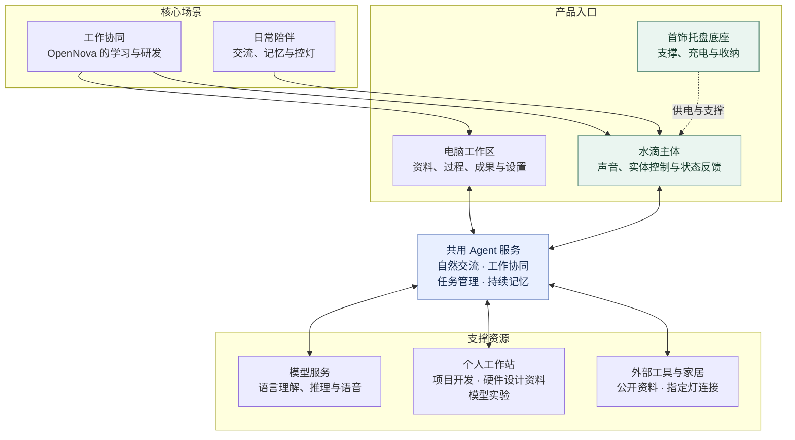

# openNova MVP 产品需求文档

版本：0.2 草案 · 2026 年 10 月 7 日

依据：[产品概念文档](opennova-product-concept.md)。

**已确认：MVP 优先实现工作协同与日常陪伴，采用 D 水滴主体及居家底座方向。本文按已确认的八章框架展开，具体功能边界、交互和架构为本轮草案定义。** 文中标注“建议”的方案和数值供后续讨论，不代表已确定的工程规格。

## 1. 产品概述

### 1.1 产品定位

openNova 是一款协作工作、随时交流、陪伴生活的 AI 超级助手。它通过自然交互与持续记忆，理解用户的目标与偏好：工作时，一起研究问题、推敲方案并推进任务；外出时，随身交流、分享见闻、接续讨论；居家时，自然聊天、分享感受、处理日常事务。无论在书桌前、出行途中还是床头，同一个助手都能延续已有的上下文与交流习惯。

产品采用软硬一体的形态，将水滴硬件与云端大模型、Agent 服务结合，让用户通过随身携带或归座放置的水滴直接开口交流，并在电脑端查看和完善工作成果。

### 1.2 MVP 目标

首版围绕两个场景提供可使用的完整体验：

- **工作协同：** 用户自然表达目标，助手结合共享资料参与研究、讨论和创作，调用已接入的工具，把交流推进成可查看、可继续调整的成果。
- **日常陪伴：** 用户在床头自然开口，助手围绕当下话题交流，恰当地使用已有记忆，支持打断、结束和简单控灯。
- **共同体验：** 在书桌与床头延续同一助手身份、交流习惯和已有记录。用户需要接续时能接上，想换话题时也能自然切换。

## 2. MVP 范围

### 2.1 场景范围

MVP 聚焦 **工作协同与日常陪伴**，两类场景共用同一助手身份、语音交互、持续记忆和任务记录。

| 场景 | 首版内容 | 主要成果或体验 |
| --- | --- | --- |
| 工作协同 | 以 OpenNova 的学习与研发为首个核心场景，结合个人工作站开展研究、设计、开发与实验 | 产品文档、设计方案、代码、可运行功能、学习笔记、实验记录和模型成果 |
| 日常陪伴 | 书桌或床头的语音闲聊、感受与经历分享、已聊话题接续，以及一盏指定灯的控制 | 连贯自然的交流、可按用户意愿保存的记忆、明确的操作结果 |
| 跨场景接续 | 同一水滴在不同放置位置继续交流；电脑端查看已有成果和后台任务进展 | 延续话题、研发任务、决定与下一步，减少重复交代背景 |

**工作协同的首个核心场景是 OpenNova 的学习与研发。** 用户与助手围绕 OpenNova 的持续建设，共同开展软件研发、硬件设计、语音与模型实验、大模型前沿技术学习。助手结合项目资料与历史决策参与研究和方案讨论，调用个人工作站上的工具推进实现与实验，形成可查看、可修改、可继续迭代的成果。

四个工作方向及其工具需求、主要成果如下。方向描述用户要开展的工作，功能列表描述支撑这些工作的共用能力。

| 工作方向 | 工具需求 | 主要成果 |
| --- | --- | --- |
| 软件功能研发 | 项目文件读写、代码编辑、Git 差异、终端执行、应用预览 | 需求与交互方案、代码修改、可运行功能及运行结果 |
| 硬件功能设计 | 资料检索、文本型规格书读取、器件参数整理、设计文档与选型及接口表编辑 | 硬件功能定义、候选器件清单、接口与布局建议、待解决问题 |
| 语音与模型研发 | 数据与配置文件处理、实验脚本、Spark 任务提交与状态查询、音频播放 | 数据清单、实验配置、运行记录、样音与候选模型版本 |
| 大模型前沿技术学习 | 网页与文本型 PDF 读取、笔记编辑、代码运行、结果比较 | 带来源的学习笔记、方法对比、复现代码与实验结论 |

典型过程是“学习研究 → 共同设计 → 实现或实验 → 查看结果 → 继续迭代”，简单任务可只完成其中一部分。学习本身也可以是完整目标，成果可以止于理解、笔记和小实验。

随身户外交流与连续视觉感知暂不进入首版范围。硬件设计先围绕数字资料、规格与方案讨论展开，纸面草图的摄像头讨论后置。

### 2.2 功能列表与优先级

功能按 **一级能力 → 二级功能 → 三级功能** 组织。一级划分能力模块，二级划分模块中的功能，三级明确具体操作或设计要求；同一功能不因用于不同场景而重复列出。

本稿将 **Agent Harness（智能体运行与协作能力）** 作为通用软件能力的一级分类：它组织模型、上下文、记忆和工具，为工作协同与日常陪伴提供支持。其中研究学习和讨论决策由模型与工具共同完成，Harness 负责组织它们参与任务。

软件功能研发等属于 2.1 节的工作场景，与功能之间是多对多关系。例如，一次软件研发任务会组合项目上下文、研究学习、讨论决策、成果管理和任务执行，并调用代码与开发工具。代码编辑、终端运行和应用预览在下表作为具体工具操作列出。

硬件设计也使用这些共用能力：规格资料通过研究与学习读取，器件取舍通过讨论与决策完成，设计文档通过成果管理保存，基础硬件设计工具负责整理参数、选型和接口表。E 类则定义 OpenNova 自身的硬件形态、结构与运行能力，详细规格在第 5 章展开。

以下优先级为本稿建议：**P0 为首版需实现的操作能力，P1 为后续扩展。** 专业工具按明确接口逐项接入；实验操作以选定模型、配置好的环境和分配的资源为边界。列为 P0 不代表相关工作站服务已经部署。

本章是本轮更新的范围定义；第 3、4、6 章中的研发流程、工作站分工和工具细节将随逐章讨论同步展开。

| 一级能力 | 二级功能 | 三级功能 | 功能说明 | 优先级 |
| --- | --- | --- | --- | --- |
| **A. Agent Harness** | A1. 项目上下文 | A1.1 资料与对象关联 | 关联授权项目中的文档、代码、配置、选区及实验记录，明确当前讨论对象 | P0 |
| **A. Agent Harness** | A1. 项目上下文 | A1.2 上下文接续 | 结合历史决定与任务状态恢复讨论，切换项目时使用对应上下文 | P0 |
| **A. Agent Harness** | A2. 研究与学习 | A2.1 资料检索与读取 | 搜索公开资料，读取网页与文本型 PDF，保留来源链接 | P0 |
| **A. Agent Harness** | A2. 研究与学习 | A2.2 讲解与归纳 | 解释概念、梳理论文和方法，形成带来源的学习笔记 | P0 |
| **A. Agent Harness** | A3. 讨论与决策 | A3.1 方案比较 | 根据目标比较功能、器件、技术和模型方案，说明依据及取舍 | P0 |
| **A. Agent Harness** | A3. 讨论与决策 | A3.2 澄清与决定记录 | 澄清影响结果的问题，将明确决定和下一步交由记忆与任务功能保存 | P0 |
| **A. Agent Harness** | A4. 成果管理 | A4.1 内容生成与编辑 | 创建和修改文档、笔记、清单及简单对比表，包括硬件功能定义、选型依据与接口说明 | P0 |
| **A. Agent Harness** | A4. 成果管理 | A4.2 修改对照与版本 | 展示文档或代码差异，确认应用，保留版本并支持撤销 | P0 |
| **A. Agent Harness** | A4. 成果管理 | A4.3 实验成果关联 | 关联数据、模型版本、配置、日志、样音与结论，支持查看和比较 | P0 |
| **A. Agent Harness** | A4. 成果管理 | A4.4 成果导出与引用 | 导出文字成果，提供文件、预览和模型产物位置等查看入口 | P0 |
| **A. Agent Harness** | A5. 工具接入 | A5.1 项目文件与代码操作 | 在授权工作目录读写源码、配置和相关文件 | P0 |
| **A. Agent Harness** | A5. 工具接入 | A5.2 开发执行与预览 | 运行项目命令和检查，启动开发预览，返回执行输出与访问入口 | P0 |
| **A. Agent Harness** | A5. 工具接入 | A5.3 TTS 实验操作 | 接入一种 TTS 推理与微调流程，处理数据与配置、提交 Spark 实验并返回样音和候选版本 | P0 |
| **A. Agent Harness** | A5. 工具接入 | A5.4 家居设备控制 | 调用已绑定灯的开关与状态查询，返回设备回执 | P0 |
| **A. Agent Harness** | A5. 工具接入 | A5.5 基础硬件设计工具 | 将规格资料中的器件参数、适用条件及来源整理为结构化条目，维护候选器件清单、选型对比和接口表 | P0 |
| **A. Agent Harness** | A5. 工具接入 | A5.6 专业硬件工具 | 接入 CAD/EDA、电路与结构仿真、仪器及样机操作 | P1 |
| **A. Agent Harness** | A5. 工具接入 | A5.7 扩展模型实验 | 适配更多模型与后训练流程、自动配置搜索、多机训练及从零训练 | P1 |
| **A. Agent Harness** | A5. 工具接入 | A5.8 扩展内容与应用工具 | 接入图片与扫描件理解、复杂办公文件编辑、任意桌面应用操作 | P1 |
| **A. Agent Harness** | A5. 工具接入 | A5.9 扩展家居操作 | 接入更多家居设备及灯光渐变等动作 | P1 |
| **A. Agent Harness** | A6. 任务执行 | A6.1 任务组织与环境选择 | 明确目标、必要步骤、执行节点与所需工具，在授权范围内提交任务 | P0 |
| **A. Agent Harness** | A6. 任务执行 | A6.2 进度与结果反馈 | 查询运行状态，展示执行结果，区分完成、失败和待确认 | P0 |
| **A. Agent Harness** | A6. 任务执行 | A6.3 取消与恢复 | 取消后续步骤，断线后查询原任务并接续，避免重复执行 | P0 |
| **A. Agent Harness** | A7. 持续记忆 | A7.1 分类保存 | 按保存设置记录决定、灵感、待办、偏好及来源，区分项目记录与个人记忆 | P0 |
| **A. Agent Harness** | A7. 持续记忆 | A7.2 检索与引用 | 为当前话题和任务提供相关记录，支持跨时段、跨入口使用 | P0 |
| **A. Agent Harness** | A7. 持续记忆 | A7.3 纠正与删除 | 修改错误记录、删除条目并同步有效状态 | P0 |
| **B. 自然交互与陪伴** | B1. 语音与文字交流 | B1.1 自然开口与接话 | 保持可交流状态，处理停顿、补充和改口 | P0 |
| **B. 自然交互与陪伴** | B1. 语音与文字交流 | B1.2 语音回应与文字输入 | 语音和文字进入同一会话，按场景选择播放与展示方式 | P0 |
| **B. 自然交互与陪伴** | B1. 语音与文字交流 | B1.3 打断与结束 | 停止当前播报、接收新表达、结束当前交流 | P0 |
| **B. 自然交互与陪伴** | B2. 陪伴交流 | B2.1 话题与情绪回应 | 跟随日常话题，回应感受，按相关性使用已有记忆 | P0 |
| **B. 自然交互与陪伴** | B2. 陪伴交流 | B2.2 交流风格与安静陪同 | 调整回应长度和追问方式，接受沉默与话题切换 | P0 |
| **B. 自然交互与陪伴** | B3. 主动交互 | B3.1 任务相关提示 | 按用户的交流状态反馈必要澄清、执行结果和设备异常 | P0 |
| **B. 自然交互与陪伴** | B3. 主动交互 | B3.2 定时提醒 | 按用户约定的时间主动提醒 | P1 |
| **C. 用户端界面** | C1. 工作界面 | C1.1 项目与任务工作区 | 浏览项目、任务和共享资料，选择当前工作对象 | P0 |
| **C. 用户端界面** | C1. 工作界面 | C1.2 成果与执行面板 | 展示修改对照、工具过程、应用预览、实验结果及样音播放 | P0 |
| **C. 用户端界面** | C2. 交流与记录界面 | C2.1 对话界面 | 查看转写、输入文字、切换话题与查看反馈 | P0 |
| **C. 用户端界面** | C2. 交流与记录界面 | C2.2 记忆与设置界面 | 查看和管理记录、声音、设备及数据设置 | P0 |
| **C. 用户端界面** | C3. 移动界面 | C3.1 独立手机应用 | 提供移动端查看、配置和接续入口 | P1 |
| **D. 账号、设备与权限** | D1. 身份与设备管理 | D1.1 登录与设备绑定 | 维护单用户身份，完成水滴绑定、配网和解绑 | P0 |
| **D. 账号、设备与权限** | D1. 身份与设备管理 | D1.2 设备状态与设置 | 查看连接、电量、充电及版本，调整音量与输出入口 | P0 |
| **D. 账号、设备与权限** | D1. 身份与设备管理 | D1.3 软件与固件更新 | 在明确时机更新，并保留失败后的恢复方式 | P0 |
| **D. 账号、设备与权限** | D2. 权限管理 | D2.1 内容共享授权 | 明确文件与项目访问范围，支持停止共享 | P0 |
| **D. 账号、设备与权限** | D2. 权限管理 | D2.2 工具操作授权 | 明确工具、执行节点和操作边界，按规则确认写入与执行 | P0 |
| **D. 账号、设备与权限** | D3. 数据管理 | D3.1 留存与同步设置 | 设置会话和数据保存方式，展示同步状态 | P0 |
| **D. 账号、设备与权限** | D3. 数据管理 | D3.2 会话与项目数据删除 | 按会话、任务或账号范围删除数据及相关副本 | P0 |
| **E. 硬件产品定义与能力** | E1. 声音输入输出 | E1.1 拾音与播放 | 支持书桌和床头语音交流，处理播放回声与用户插话 | P0 |
| **E. 硬件产品定义与能力** | E2. 实体控制与反馈 | E2.1 静音与按键操作 | 实体静音、按键打断及主动发起交流 | P0 |
| **E. 硬件产品定义与能力** | E2. 实体控制与反馈 | E2.2 状态灯反馈 | 表达交流、静音、连接和充电等状态 | P0 |
| **E. 硬件产品定义与能力** | E2. 实体控制与反馈 | E2.3 轻震反馈 | 通过触觉补充状态提示 | P1 |
| **E. 硬件产品定义与能力** | E3. 供电与归座 | E3.1 电池与离座交流 | 支持离座供电、低电量提示及当前交流延续 | P0 |
| **E. 硬件产品定义与能力** | E3. 供电与归座 | E3.2 归座识别与充电 | 识别实际充电状态，归座后充电并保持交流，明确反馈充电结果 | P0 |
| **E. 硬件产品定义与能力** | E3. 供电与归座 | E3.3 充电与温度异常处理 | 充电或温度异常时停止相关充电过程并反馈状态 | P0 |
| **E. 硬件产品定义与能力** | E4. 连接与随身能力 | E4.1 室内联网 | 连接服务、维护设备连接并提示异常 | P0 |
| **E. 硬件产品定义与能力** | E4. 连接与随身能力 | E4.2 户外交流与随身视觉 | 支持户外连接、交流和视觉感知，具体摄像头配置后续确定 | P1 |
| **E. 硬件产品定义与能力** | E4. 连接与随身能力 | E4.3 本地配置与维护连接 | 提供首次配网和固件维护所需的本地连接能力，具体接口待硬件方案确定 | P0 |
| **E. 硬件产品定义与能力** | E5. 工业与结构设计 | E5.1 主体外观与结构 | 定义水滴轮廓、尺寸重量、材质、内部布局和开孔要求，兼顾声学、天线及操作区域 | P0 |
| **E. 硬件产品定义与能力** | E5. 工业与结构设计 | E5.2 底座结构与取放 | 定义支撑、定位、防滑、充电配合和链条收纳，保持拿取便利及拾音出声通畅 | P0 |
| **E. 硬件产品定义与能力** | E5. 工业与结构设计 | E5.3 佩戴配件与连接结构 | 定义吊链、磁吸背片及主体连接方式，兼顾佩戴稳定性与舒适度 | P1 |
| **E. 硬件产品定义与能力** | E6. 电子与端侧处理 | E6.1 电子架构与器件集成 | 明确计算、音频、无线、控制和电源模块的职责与接口，结合结构选择器件和布局 | P0 |
| **E. 硬件产品定义与能力** | E6. 电子与端侧处理 | E6.2 本地音频与设备控制 | 本地完成基础音频处理、按键、静音、灯光和连接维护，服务断开后仍可使用必要实体控制 | P0 |

### 2.3 支持范围与限制

- **使用关系：** 本稿建议按一个用户账号绑定一枚水滴展开，可在书桌和床头使用。同一底座可随主体移动，也可在不同位置配置兼容底座，首版套装数量尚未确定；多成员身份识别和多枚水滴同时响应后置。
- **项目与内容：** 首版支持输入或粘贴文本、读取授权项目目录中的文档、源码和配置，以及公开网页和可提取文字的 PDF。实验日志、样音和模型产物按任务关联管理；模型权重保存在执行节点，通过版本与位置引用，不直接作为普通对话附件。扫描材料、图纸视觉理解和复杂办公文件后置。
- **个人工作站：** 以 infra 项目规划的三机工作站作为首轮研发执行环境。Air 作为交互与查看入口，Studio 建议承载 Agent 服务、项目工作区和任务管理，Spark 承担按需调用的模型训练与重型计算。每个工具调用明确执行节点；这些职责是部署方向，已安装软件与可用服务需以实际接入情况为准。
- **软件开发：** 在授权项目目录和独立开发分支或工作目录内修改代码、运行检查和预览。助手持续保存任务状态；修改后的软件或模型先作为候选版本供查看，再按用户明确指令更新正在使用的版本。部署、现有系统服务调整和工具权限扩展单独明确操作范围。
- **硬件设计：** 首版支持需求、器件、接口和布局方案的研究与文档产出；涉及尺寸、功耗、声学或结构的推断需要注明依据及待确认条件。直接编辑 CAD/EDA、自动驱动测量仪器和自动烧录样机后续接入。
- **语音与模型实验：** 首版建议选定一种具备可运行推理与微调流程的 TTS 模型，围绕样音生成、数据准备、小规模微调和结果比较展开。模型与框架尚未选定，需确认中文能力及 Spark 环境兼容性。后训练学习和小实验可通过通用研发工具开展，多种训练流程的专门适配后置。
- **实验执行与日常服务：** Spark 实验记录模型版本、数据版本、配置、执行状态和成果位置，支持中止与事后接续查看；断线先查询原任务，不重复提交。按工作站既有规则分配 GPU 资源，不默认并行占用已有重型任务资源。日常语音使用稳定的服务版本，实验不会自动替换在线服务。
- **家居范围：** 绑定一盏支持控制结果反馈的灯，首版完成开关。具体设备与接入方式需要选择，软件使用统一控灯能力对接。
- **交互语言：** 本稿以普通话语音与简体中文界面为首版建议，其他语言与方言后续扩展。
- **运行条件：** 以室内网络环境为主，连接个人工作站与所需云端服务；完整离线交流后置。离线时仍能使用实体静音、按键停止播放、充电与本地状态提示。
- **视觉范围：** 摄像头是否实装在 5.4 节列为硬件选择；首版的两个核心场景不依赖摄像头理解画面。

## 3. 核心使用流程

### 3.1 工作协同流程

**典型任务：用户与助手一起研究一个问题，并形成可继续完善的方案。**

| 步骤 | 用户行为 | 助手与系统行为 |
| --- | --- | --- |
| 进入任务 | 在电脑端打开工作区，说“我们继续昨天的方案” | 找到相关任务，简短说明已完成内容和未完成问题；存在多个候选时澄清 |
| 提供上下文 | 共享资料、粘贴链接或选择当前内容 | 显示已共享范围，把内容关联到当前任务 |
| 研究与讨论 | 说“找些相关资料”“比较下这两种方案” | 在目标清楚时直接开展研究；缺少影响结果的关键信息时提问；区分资料事实与助手建议 |
| 形成成果 | 说“整理成一份方案”或“把这一段改具体” | 调用工具，创建成果或生成修改建议；完整内容呈现在电脑上，语音只说明重点 |
| 继续调整 | 查看结果、确认修改，或提出新的要求 | 按目标范围更新成果，保留版本与撤销入口；用户拒绝的建议不应用 |
| 保存进度 | 说“采用方案 A，成本留到下次讨论” | 保存明确决定和未完成问题，将成果、来源与讨论关联起来 |
| 离开或结束 | 关闭工作界面或结束当前交流 | 保存已完成的进度；正在运行的任务按 7.5 节处理，不把关掉界面当作任务已成功 |

工作协同允许在研究、讨论和创作之间往返，无需每次重新建立任务。简单任务可直接完成，不必固定经过所有步骤。

### 3.2 日常陪伴流程

**典型体验：用户把水滴放在床头，与助手聊一会儿，随后关灯休息。**

1. 水滴归座并连接服务，保持可交流状态；用户直接说“今天有点累，陪我聊会儿”。
2. 助手回应当下情绪并跟随用户话题。用户讲起大学宵夜的经历，助手围绕故事自然接话，不自行转成工作复盘。
3. 已有记录确实相关时可以简短引用；记忆不清楚时询问或说明，不编造共同经历。
4. 用户随时插话、换话题或保持沉默；助手停止被打断的回答，不强行补完。
5. 用户说“关灯吧”，系统调用已绑定灯的控制工具。用户也可预先设置“有点困了，睡了”为关灯短语；未设置时，这句话只表示结束交流。
6. 系统根据设备回执说明结果。用户道晚安后，助手简短回应并停止主动接话，状态灯进入低亮或熄灭，水滴继续充电并保持可交流。

### 3.3 跨场景接续流程

同一水滴从书桌移到床头时，助手身份与保存的内容保持一致。归座不创建新账号、不清空任务，也不自动触发工作总结。

- 用户说“接着刚才聊”，优先延续最近明确的话题；多个任务并存或指代含糊时简短澄清。
- 用户说“今天的方案做到哪了”，从对应任务读取成果、决定和未完成项，按当前语音场景给出简短回顾。
- 用户说“先不聊工作”，切换到日常交流。工作记录继续保留，闲聊内容不会自动写入工作成果。
- 联网中断后恢复时，先同步已保存状态。无法确定某个操作是否完成时，核对执行记录或工具状态后再继续。

## 4. 产品架构

### 4.1 产品架构与组成

OpenNova 由 **水滴硬件、用户端界面和共用 Agent 服务**组成，借助模型服务、个人工作站及已接入工具，实现工作协同与日常陪伴。水滴承担语音与实体交互，底座负责充电与支撑，电脑端呈现工作内容；各入口共用同一助手身份、任务记录和持续记忆。

下图展示 MVP 的产品组成及协作关系。工作协同同时使用水滴与电脑工作区，日常陪伴主要通过水滴完成。

| 组成 | 主要职责 | MVP 定义 |
| --- | --- | --- |
| 水滴主体 | 拾音、播放、实体控制、状态反馈、设备连接及离座供电 | 主要语音入口；本地处理音频与设备控制 |
| 首饰托盘底座 | 放置、定位、充电与收纳 | 供电与支撑；不增加独立麦克风、扬声器或计算单元 |
| 电脑工作区 | 共享资料，查看项目、任务、修改对照、应用预览及实验成果，完成设置与确认 | Air 作为首轮交互入口；桌面应用或浏览器形态待定 |
| Agent 服务 | 组织会话、上下文、模型、工具、任务和记忆，向不同入口提供一致的助手体验 | 建议由 Studio 常驻承载，连接所需云端模型服务 |
| 模型服务 | 提供语言理解与生成、语音识别和语音合成 | LLM 以云端调用为基线；语音模型按能力、资源和响应要求选择本地或云端服务 |
| 个人工作站与工具 | 执行软件研发、硬件资料整理和模型实验，返回可查看的成果 | Studio 承担常规开发与工具执行，Spark 承担按需模型实验；外部工具逐项接入 |
| 手机端 | 提供移动查看、配置和接续入口 | 独立应用后置，首版配网与管理由电脑端覆盖 |

主体的声学、电池与联网能力能否同时容纳在当前造型内仍需工程确认。若改变底座职责，应同步调整本章与第 5 章。

### 4.2 系统架构

系统采用 **终端交互、Studio 常驻 Agent 服务、云端模型与按需实验节点**协同的架构。本节定义终端、Agent Harness、模型服务、工具执行和数据存储之间的职责与连接。

交互过程划分为 **ASR 输入链路、Agent 业务链路、TTS 输出链路**。ASR 识别服务负责音频到文本，Agent Harness 负责结合上下文处理业务，TTS 合成服务负责文本到音频。三条链路由会话管理关联，统一维护会话标识、轮次和打断状态；电脑文字输入直接进入 Agent 业务链路。

**Agent Harness 为工作协同与日常陪伴提供共用的 Agent 能力，组织上下文、模型、工具、任务与记忆。** Master Agent 的具体机制及 Harness 内部设计留待第 6 章“软件产品定义”讨论。

**系统总图**分别展示识别服务、Agent 处理、合成服务及其模型依赖。LLM 适配独立连接大模型，ASR 适配和 TTS 适配分别归入对应语音服务，各自管理接口、服务地址与模型版本。Studio 内的模块可在同一服务进程中实现；ASR、TTS 的模型实例按选型部署在 Studio 或云端。

[查看可编辑图源](assets/opennova-system-architecture.mmd)

实线表示运行时调用、数据传输或结果返回；虚线表示能力定义或产物引用。执行节点通过通用接口接收任务、管理资源并返回状态与产物，具体业务由已接入的 Skill 与工具承载。

| 技术模块 | 主要职责与边界 |
| --- | --- |
| 声学前端与水滴固件 | 采集与播放音频，结合端侧资源承担回声消除、降噪和 VAD 语音活动检测；本地执行静音、停止播放和状态反馈。检测到声音仅表示存在语音活动，是否应回应还需会话判断 |
| 设备接入与会话管理 | 验证账号和设备身份，维护连接、会话标识、轮次及输出入口，协调识别、业务处理、合成和播放状态；同步转写、文字回复与任务事件，分发打断和取消播报指令 |
| ASR 识别服务与适配 | 接收音频流和识别控制，调用选定 ASR 模型，管理识别请求、转写状态与取消；中间转写用于展示，确认的本轮输入文本关联会话后交给 Harness |
| ASR 模型 | 将输入音频识别为文本，通过 ASR 适配接入；具体流式识别能力、语言与部署位置待选型 |
| Agent Harness | 接收语音转写或电脑文字及相关上下文，调用 LLM、工具和数据服务；输出回复文本、任务状态与成果，需播报的文本按会话输出设置提交 TTS 服务 |
| LLM 适配与大模型 | 管理 LLM 接口、服务地址和版本，传入上下文并接收回复或结构化工具请求；工具操作由 Harness 组织执行，模型生成的文字不能作为执行成功回执 |
| TTS 合成服务与适配 | 接收待播报文本和播放控制，调用选定 TTS 模型，管理文本分段、音频流、合成状态与取消；通过接入服务向选定终端交付音频，并处理已取消轮次的剩余输出 |
| TTS 模型 | 将文本合成为音频，通过 TTS 适配接入；在线使用稳定模型版本，具体流式合成能力、声音及部署位置待选型 |
| 上下文与记忆管理 | 管理当前对象、项目资料、会话历史、相关记忆、设备状态和任务进度，向任务提供上下文与已注册能力定义；记忆保存与删除遵循第 8 章 |
| Skill 与 Tool 目录 | Skill 描述可复用的任务方法、步骤和约束，如资料研究、代码修改、器件选型、TTS 实验；Tool 描述实际可调用的操作、输入输出、权限和执行节点。首版可通过配置与项目文件维护 |
| 执行调度与任务状态 | 为任务分配标识，保存步骤、进度和工具回执，处理等待确认、取消、失败与恢复。实验等长任务提交后返回任务标识，由事件或查询更新状态，语音会话可继续接收新输入 |
| 工具执行网关 | 按当前用户权限验证工具参数与操作范围，在需要时请求确认，再路由到对应执行器；按接入情况使用 MCP、API 或 CLI。Skill 中的流程和模型提出的工具请求均须经过相同的授权路径 |
| 执行器与成果管理 | Studio 提供本地文件、进程和工具运行环境，Spark 提供按需计算与实验任务执行环境，外部连接器对接服务与设备。各执行器返回状态、结果与产物位置；配置、日志和结果文件按节点及版本管理 |

ASR、TTS 模型分别承担识别和合成推理，其外围服务负责请求状态、流式传输和取消控制。三条链路通过文本与会话事件衔接；关闭语音播放或 TTS 发生异常时，Agent 的文字结果与任务进度仍可在电脑端查看。具体业务流见 4.4 节，详细交互在第 6 章展开。

### 4.3 部署与运行方式

首轮采用 **个人工作站承载 Agent 服务与工具执行、云端提供主要 LLM 能力**的部署方向。以下为计划分工，实际可用能力以完成接入的服务为准。

| 节点 | 建议承载内容 | 在线依赖 |
| --- | --- | --- |
| 水滴 | 固件、音频输入输出、实体交互与设备连接 | 交流时室内网络与 Agent 服务；基础实体控制可独立响应 |
| Air | 电脑客户端、工作成果查看、输入与设置 | 需要电脑界面时开启；床头交流不依赖 Air 客户端在线 |
| Studio | 设备接入与会话管理、ASR 识别服务及适配、Agent Harness 与 LLM 适配、TTS 合成服务及适配，以及能力目录、执行网关、存储和本地执行器 | 作为 MVP 常驻服务节点；Air 关闭后仍需在线。各逻辑模块首版可同进程部署 |
| 云端模型服务 | 主要 LLM 推理；按选型需要提供 ASR、TTS 服务 | 使用对应云端模型时需要可用网络及服务连接 |
| Spark | 按需计算与实验任务、资源管理及产物存储 | 按任务启动并分配资源；不作为日常交流必须保持运行的训练节点 |

**语音服务与实验的关系：** ASR、TTS 的请求管理与适配模块常驻 Studio，分别连接选定的本地或云端模型实例；模型与部署位置通过选型确定。Spark 首先承载训练和推理实验，实验输出为候选版本。若后续选择 Spark 承载在线语音推理，应明确常驻推理资源与实验资源的分配，保证实验不会中断日常交流。

- **联网基线：** 水滴通过室内 Wi-Fi 直接连接常驻 Agent 服务；配网方式在 USB、蓝牙辅助等方案中确定。手机不作为首版必需中继。
- **书桌与床头：** 书桌时水滴负责声音，Air 提供工作内容与成果；默认只使用一个语音播放入口。床头时水滴直接使用常驻服务完成交流、记忆查询和控灯。本文“电脑关闭仍可交流”指 Air 客户端关闭，Studio 及所需模型服务仍需可用。
- **离座状态：** 电池维持连接和当前交流，取放无需重新登录。离座不自动进入户外识别模式。
- **断线与服务中断：** 水滴提示并暂停在线交流；运行在 Studio、Spark 或云端且不依赖当前连接的任务可继续，需要新输入或确认的步骤等待。恢复后按任务标识查询原状态；断网期间不持续缓存环境音频等待补传。

### 4.4 数据与任务流转

前三条链路共用会话标识与轮次标识，后台任务另有任务标识；会话管理负责关联它们并协调输入、输出和打断。

1. **ASR 输入链路：** 水滴采集并处理音频，经设备接入交给 ASR 识别服务，再由 ASR 适配调用模型。识别服务返回中间转写及识别状态供会话管理和界面使用；确认的本轮输入文本携带会话与轮次信息进入 Harness。
2. **Agent 业务链路：** Harness 接收语音转写，或由电脑端直接提交的文字、共享对象及版本信息，结合项目、记忆等上下文经 LLM 适配调用大模型。需要工具操作时，在授权范围内经执行网关交给指定执行器；返回的状态、结果与成果位置关联到任务。文字回复、进度、修改对照或预览入口同步到电脑工作区，需播报的回复文本提交 TTS 服务。
3. **TTS 输出链路：** TTS 合成服务按会话输出设置接收待播报文本，经 TTS 适配调用模型，生成带轮次与播报请求标识的音频流，通过设备接入送到水滴播放。合成与播放状态回传会话管理；关闭语音播放时继续提供文字结果，合成失败时保留文字成果并反馈异常。
4. **打断与任务控制：** 用户插话或按键时，水滴先停止本地播放，会话管理通知 TTS 服务取消当前合成并丢弃已取消轮次的待播音频。ASR 继续接收新的表达并关联后续轮次；取消研发或实验任务需由 Harness 向执行器单独提交取消请求并核对结果。
5. **TTS 实验：** Harness 结合实验方法与工具组织数据、配置和模型版本，经授权后提交 Spark 任务；执行器返回任务标识、进度、日志、样音及候选模型位置，供用户查看和比较。只有收到明确的版本更新指令后，才按部署流程更新 TTS 服务所用的模型版本或实例配置，训练完成不会自动切换服务。
6. **记忆与成果：** Harness 按第 8 章的保存设置记录决定、待办、灵感和用户信息，关联来源与项目；后续会话检索相关记录。文档、代码、样音和模型文件保存在对应工作区或执行节点，通过版本与位置关联到任务。
7. **家居控制与状态同步：** Harness 经家居连接器提交指定灯的操作，收到设备或接入服务回执后报告结果。服务侧保存任务状态与版本，各入口订阅或查询进度；同步失败时保留本地编辑内容，不显示为已同步，重连先核对原任务以避免重复执行。

## 5. 硬件产品定义

### 5.1 形态与外观

沿用 D 水滴主体与暖白首饰托盘底座。银色水滴保持小巧、精致的轮廓；主体上的拾音、出声、操作和状态反馈区域应在归座时可用。

| 项目 | 本稿定义 |
| --- | --- |
| 主体轮廓 | 延续已认可的水滴方案；正面保持简洁，操作部位便于盲按 |
| 尺寸参考 | 概念文档中的主体约宽 25 × 高 32 毫米、托盘约长 72 × 宽 52 毫米作为外观比例参考；厚度与内部堆叠尚未确定 |
| 材质方向 | 主体延续银色金属质感，底座延续暖白浅盘；实际材料、无线信号开口和声学开孔需共同设计 |
| 重量与厚度 | 本稿不填写未经依据的数值；需在电池、声学与结构方案确定时给出可实现目标 |
| 正面布局 | 保留状态提示区域；摄像头区域按 5.4 节处理 |

### 5.2 使用与放置方式

首版以书桌和床头归座使用为主。底座应能稳定支撑水滴，放入时自然定位，取出时不轻易带起底座。链条收纳区域应与充电接触、拾音和出声区域分开。

主体拿起后可继续交流，放回后自动开始充电。用户不需要为归座重新配对。设备判断是否正在充电应依据实际充电状态，不能只凭靠近底座。

外形与连接位置继续兼顾吊坠、磁吸胸佩的设计方向；首版优先完成居家使用和拿取动作。全天佩戴、户外防护与相关配件的完整体验后置。

### 5.3 拾音与播放

- 书桌上应支持正常坐姿下自然说话；床头应支持靠坐或躺卧时交流，无需一直手持水滴靠近嘴边。
- 本稿建议以主体与用户相距约 **0.5–1.5 米**的日常位置作为声学设计起点。该距离为建议目标，尚未证明当前尺寸可以满足。
- 拾音与出声口在归座、握持和链条收纳时尽量保持通畅；避免桌面接触振动和底座结构影响声音。
- 助手播放时仍需识别用户打断，处理自身声音引起的回声与误触发。
- 支持电脑端和语音调整音量；床头使用允许更低音量。用户静音麦克风后仍可通过电脑端调整播放设置。
- 麦克风数量、扬声器规格和具体处理方案由工程设计确定，优先保证上述两个场景的可交流性。

### 5.4 感知与实体交互

| 部件或能力 | 首版需求 |
| --- | --- |
| 麦克风静音控制 | 建议采用可辨识位置的实体开关，切断麦克风采集通路；软件不能自行恢复实体静音 |
| 交互按键 | 建议单击停止当前语音播放；待机时单击可主动发起交流。按键是补充入口，自然开口仍为主要方式 |
| 状态灯 | 表达可交流、正在交互、静音、异常和充电等状态；具体灯效见 7.3 |
| 归座与充电识别 | 区分已放置、正在充电和充电异常；拿起或归座不会自动提交工作操作 |
| 摄像头 | 概念造型保留镜头区域。建议首版硬件预留结构与接口，是否实装模组待定；首版软件不启用持续视觉采集 |
| 轻震 | 保留后续加入空间，首版可后置；必要状态由声音和灯光承担 |

### 5.5 供电与充电

主体包含电池，支持从书桌拿到床头时继续交流。底座接外部电源，主体归座后充电，并可在充电时保持在线交流。

- 归座短暂反馈实际充电结果，持续充电时保持安静。
- 低电量时提示一次并在电脑端持续显示状态，避免反复打断；电量不足以继续运行时先保存已完成进度，再说明即将停止。
- 充电或温度异常时停止相关充电过程并给出状态，恢复前不显示正常充电。
- 充电接触方式、接口、防误接结构与电池容量需结合体积确定。触点或无线充电方案尚未定案。
- 电池续航应分别定义可交流待机与连续对话时长。数值在音频、无线和计算功耗方案明确后补入；当前外观尺寸不作为续航能力依据。

### 5.6 连接与计算能力

建议主体支持 Wi-Fi 联网，并提供首次配置与固件维护所需的本地连接方式。对电脑端的依赖限于工作内容展示、用户设置及需要本地资源的操作，床头对话不依赖电脑持续在线。

设备本地承担静音控制、按键响应、指示灯、音量设置执行、充电状态、基础音频处理和连接维护。模型对话、长期记忆与在线工具由服务提供。断开服务后实体静音、按键停止播放和本地状态提示仍应响应。

芯片、存储、无线模组与固件实现方式在上述职责下选择。本稿建议暂不要求在水滴本体运行完整大模型。

## 6. 软件产品定义

### 6.1 语音交流

语音体验沿用自然开口的方向：设备完成配置、在线且未静音时保持可交流，用户无需每次手动开启会话或固定使用唤醒词。是否应回应，需结合当前交流、明确呼叫和语音上下文判断。

- **开始交流：** 明确对助手提出的问题可直接回应；无法判断是否在对助手说话时保持安静，或在已有对话中简短澄清。按键可明确触发倾听。
- **接话：** 允许用户停顿、补充和改口，避免将短暂停顿一律当作发言结束。
- **回应：** 普通聊天用自然简洁的语音；工作成果优先在电脑展示，语音说明要点。长任务可先说明正在处理，再返回结果。
- **打断：** 用户开口或按下交互键时停止当前播报，接收新指令。停止播报与取消后台任务分别处理，见 7.5。
- **结束：** “先这样”“不聊了”“晚安”等结束当前交流，随后保持安静；结束交流不等于切断麦克风。
- **文字输入：** 电脑端文字与语音进入同一任务。用户可在界面关闭语音播放，继续通过文字交流。

### 6.2 工作协同

工作协同围绕共同任务展开，文档是成果类型之一。每个任务关联目标、输入资料、会话、工具过程、成果、决定和未完成项。

| 细分场景 | 用户需求示例 | 首版行为与成果 |
| --- | --- | --- |
| 资料研究 | “找几份相关资料，整理主要差异” | 搜索公开内容、读取正文，形成带来源链接的摘要或比较；无法读取的网页明确说明 |
| 讨论决策 | “这两个方向哪个更符合我们的目标” | 根据共享材料分析取舍，提出建议；将用户明确采纳的选择记录为决定 |
| 内容创作 | “把刚才讨论整理成一份方案” | 创建可编辑的文字成果，保留所依据的任务与资料 |
| 内容修改 | “这一段改得具体些” | 绑定当前对象和选区，呈现修改对照，确认后更新；支持撤销 |
| 信息整理 | “把材料里的未决问题和下一步列出来” | 提取清单，区分资料原文、用户决定与助手建议，允许修正 |
| 工具执行 | “把这份结果保存下来” | 在授权范围内操作工作区内容，反馈真实结果，提供查看入口 |

共享资料可以按任务持续使用，电脑端始终能查看当前共享范围。用户选中内容时，指令绑定到选区；没有选区或存在多个对象时需要澄清，不能擅自选择修改目标。

新成果可直接生成到工作区。修改已有成果时显示差异并确认应用；生成过程中用户更新了原内容，应用前重新核对版本，避免覆盖新编辑。用户可恢复上一版并导出 TXT/Markdown；版本记录需随成果一并管理。

工作区允许并行保存多个任务，但一次指令必须明确所属任务。用户切换任务后，旧任务的工具输出仍进入旧任务，不混入当前讨论。

### 6.3 工具接入与执行

首版建议提供以下工具能力，不把具体供应商写成产品依赖：

| 工具能力 | 首版操作 | 结果呈现 |
| --- | --- | --- |
| 网页搜索 | 按任务查询公开信息 | 标题、来源链接与摘要 |
| 网页读取 | 读取用户提供或搜索得到的可访问正文 | 正文摘取、来源链接；失败说明 |
| 工作区内容 | 读取已共享资料，创建成果，确认后更新，恢复上一版 | 成果、修改对照、版本与状态 |
| 记录管理 | 保存、读取和修正任务决定、灵感、待办及授权记忆 | 可查看的记录条目 |
| 指定灯控制 | 查询可用状态，开启或关闭已绑定灯 | 设备返回的当前状态或失败原因 |

执行过程包括准备、执行中、等待用户、完成、失败和已取消。电脑端显示必要进度；交流期间，语音在需要用户参与或结果返回时说明。用户结束交流后的反馈遵循 7.4 节。

工具结果是判断操作完成的依据。超时或连接丢失时标记为“状态待确认”，先查询已有执行或目标状态；不能直接报告成功，也不能盲目重复写入。用户取消后，尚未开始的步骤不再执行；已生效的步骤需明确告知。

外部网页、文件和工具返回的文字作为任务资料，不能自动扩大权限、触发新的外部操作或替用户确认执行。公开信息查询在授权能力内直接进行；写入与控灯规则见 8.1。

### 6.4 日常陪伴

助手跟随用户的当前兴趣和表达，允许轻松闲聊、讲故事、倾诉感受和短暂沉默。用户不提出任务时，交流不必产出总结、建议或待办。

- 对情绪作自然回应，不把每次分享都变成解决问题；是否需要建议可以结合语境判断。
- 追问围绕用户正在讲的内容展开，避免机械地连续提问。
- 只有确有记录且与话题相关时才引用记忆。用户讲述的过去不表述为助手亲身经历。
- 用户切换到工作话题时可读取相关任务，回到闲聊后不继续推送工作进度。
- 指定灯开关支持直接命令；含糊短语只有在用户预先配置动作后才执行。灯名和动作对应关系可查看、修改和删除。
- 用户结束交流后不继续追问、不自动播报全天总结。灯光渐变和更多家居动作后置。

### 6.5 记忆与任务管理

以下自动记录规则以用户开启相应保存设置为前提。“本次不保存”时，仅临时使用会话上下文，不自动持久保存新决定、灵感或待办；用户明确要求保存的成果和条目按 8.2 节单独处理。

| 信息类型 | 保存规则 | 使用方式 |
| --- | --- | --- |
| 会话上下文 | 按用户的会话保存设置记录交流 | 支持当次交流与近期话题接续 |
| 已确认决定 | 用户明确表达采纳或排除时记录，并关联来源 | 用于后续执行与回顾；新决定可替代旧决定并标明变更 |
| 暂存灵感 | 保留“也许”“考虑一下”等不确定状态 | 作为备选，不自动升级为决定 |
| 待办与未完成项 | 按明确请求或用户确认的下一步记录 | 支持查看与更新；首版不自动触发定时通知 |
| 个人偏好与长期记忆 | 用户明确要求记住，或确认建议保存的条目后写入 | 用于相关话题与交流偏好，不把一次情绪当作长期特征 |
| 工作成果与执行状态 | 每次成功更新后保存版本、任务归属与结果 | 跨时段恢复，区分已完成、待确认与失败 |

记录包含内容、类型、时间、所属任务或适用范围及来源。回顾时优先使用有效的明确记录，不能将推测当成历史事实。记录互相冲突且无法确定先后意图时向用户澄清。

用户可在界面或对话中纠正、删除记录。跨任务共享的个人偏好与仅适用于某个任务的决定分开保存，避免错误套用。

### 6.6 用户端界面

**2026 年 10 月 18 日确认：电脑端采用“工作窗口＋Nova 对话窗口”。** 工作窗口可以是浏览器页面，也可以是打开原文件的本地应用，例如 PDF 阅读器、办公软件或编辑器；Nova 对话窗口持续承载语音、文字与协作反馈，采用深空工作台配色和 Jarvis HUD 的环形 Nova。首版实现浏览器页面协作及本地文件打开，原生应用内部协作后续按应用接入。

#### 6.6.1 双窗口布局

| 窗口 | 布局与职责 | 主要内容与操作 |
| --- | --- | --- |
| 工作窗口 | 浏览器模式默认位于左侧；本地文件由对应应用承载 | 浏览器打开网站、在线文档或应用预览；本地应用打开原文件，保留各自界面与用户操作方式 |
| 对话窗口 | 默认位于右侧，占据较窄区域 | 顶部呈现环形 Nova，中部展示对话，底部保留当前引用、文字输入与语音控制；在对话中反馈必要进度和结果入口 |

浏览器工作窗口与 Nova 对话窗口初始并排、等高，上下边缘对齐，可独立移动和调整大小。窄屏预览采用上下排列，保持内容与操作可读。本地应用窗口由应用决定位置与打开方式，首版不自动排列或置顶，用户可自行调整。两类窗口表示交互角色，打开不同文件时可能存在多个实际应用窗口。

工作窗口使用浏览器、目标页面或本地应用自身的界面，不额外叠加 OpenNova 的标题栏、内容面板或导航。Nova 对话窗口不设置固定项目侧栏、独立执行状态栏，也不设置“跟随 Nova”和“专注视图”两种控制模式。项目与任务仍是上下文的组织方式，可通过对话进入或切换；任务反馈随对应对话呈现，详细日志和结果按需打开。

#### 6.6.2 网页与文件协作

- **直接打开工作页面：** 用户提出打开网站或页面的请求后，Nova 定位目标并在工作窗口打开原页面，完成后简短反馈。文档和其他成果提供对应文件或预览入口，由已有页面或工具展示。
- **直接打开本地文件：** 用户提出打开文档、PDF、图片或代码文件时，Nova 定位本机原文件，调用系统默认或用户指定的已安装应用。无法确定同名文件时先澄清对象；文件不存在或应用不可用时说明原因。打开成功的系统回执与正文读取结果分别呈现。
- **共享同一上下文：** Nova 通过浏览器协作能力关联当前标签页、页面地址、标题、可读取内容与选区，并将它们与会话、项目和任务关联。语音和文字接续同一段讨论，切换输入方式不需要重新交代背景。
- **明确引用对象：** 对话输入区显示当前网页 / 选区或关联文件提示。经 Nova 打开的文件成为本轮文件引用，显示文件名、所属目录、打开方式与回执；浏览器后台刷新不覆盖该引用。网页中的“解释这一段”可关联选区；原生应用的当前选区首版尚未同步。
- **按请求操作页面：** 在已接入的浏览器能力范围内执行读取、点击、输入和跳转。用户要求打开页面或查看结果时切换工作内容；后台任务完成后先在对话中提供结果入口，不自动覆盖用户正在阅读的页面。
- **呈现真实结果：** 执行进度、完成、失败与取消状态依据工具回执展示。用户可以继续讨论或停止当前回复，后台任务是否取消按任务指令处理。

典型体验：用户说“帮我打开雪球上的华工科技”，Nova 在工作窗口打开对应的雪球原站页面，右侧简短回复“已打开”，当前上下文标注为“雪球 · 华工科技”。用户继续说“看看最新公告”，Nova 在同一工作窗口打开对应公告；用户选中一段文字后说“解释一下这一段”，对话区显示引用并围绕该选区回答。

本地文件体验：用户说“打开 OpenNova 的 PRD”，Nova 定位 Markdown 文件并交给编辑器，右侧显示该文件引用。继续问“解释第 4 章”时，Nova 通过既有文件工具读取磁盘上的已保存内容。PDF、Word、Excel、PPT 首版支持打开给用户查看，其正文解析及原生应用内的点击、编辑、光标、选区与未保存内容同步后置；不能把文件已打开等同于 Nova 已读取。应用内手动切换文件也不会被首版自动跟踪。

#### 6.6.3 深空工作台与环形 Nova

| 设计要素 | 已确认的表达方式 |
| --- | --- |
| 对话窗口风格 | 深蓝背景、分层深色内容面、细描边与柔和圆角；以少量青蓝色强调当前引用和主要操作 |
| 工作窗口风格 | 保留外部网站、文档、应用预览或本地软件自身的视觉与交互，不强制套用 OpenNova 的深空主题 |
| Nova 形象 | 位于对话窗口顶部中央，采用外层细圆环、中层分段圆环、内层圆形核心；下方显示 NOVA 名称与简短陪伴文案 |
| 圆环比例与光效 | 当前确认稿的圆环直径约 72 px，使用柔和青蓝光晕，与对话窗口留白协调；该尺寸作为原型参考，随实际窗口宽度适配 |
| 交流状态 | 待机时保持安静的圆环形象；进入倾听时轻微提亮并强化内层核心，退出后恢复。文字状态同时说明含义，减少动态效果时保留静态状态提示 |
| 对话与输入 | 延续深空工作台的圆角消息、引用提示和输入框；环形 Nova 是对话窗口的视觉焦点，正文与输入仍保持清晰可用 |

#### 6.6.4 其他入口与原型范围

记忆与记录页、设备与设置页保留为按需打开的入口，用于查看和纠正记录，以及调整配对、网络、音量、语音播放、数据设置与指定灯绑定。它们不占据工作协同主界面的常驻区域。

工作时完整信息留在电脑端，水滴不需要新增屏幕。日常陪伴可独立完成语音主流程；需要详细查看或调整设置时由电脑端承接。手机独立应用后置，首版不将关键设置入口仅放在手机上。

归档原型使用模拟数据，保留文字发送、选区引用与圆环倾听状态的演示，作为 Nova 对话窗口的视觉参考。真实页面关联、读取、选区同步和页面操作，以及本地文件打开与统一引用，均属于后续待接入能力；打开链接或文件本身不代表 Nova 已获得正文。原型尚未连接真实麦克风、Agent 或工程文件。

实现拆分见 [双窗口交互技术方案](../superpowers/specs/2026-10-18-desktop-interaction-design.md) 与 [开发计划](../superpowers/plans/2026-10-18-desktop-interaction.md)。首版通过 Chrome 扩展连接网页，通过 macOS 文件打开器调用本地应用，复用现有 Bot、对话网页和原生语音链路。2026-10-19，桌面开发分支已实现 M0–M4：页面协作、文件打开、深空对话窗口、环形语音联动和一键启动；真人声学与长时间运行仍需现场验收。实现状态与产品完整范围分开记录。

### 6.7 账号与设备管理

首版采用单用户账号。水滴绑定后获取对应助手和设置；电脑端登录同一账号，显示设备连接、充电、电量和同步状态。

- 支持设备首次绑定、重新配网、解绑与故障后的重连。
- 多个语音入口同时可用时，用户能明确选择当前输出设备；默认水滴出声。
- 解绑后撤销设备访问账号内容的凭证；重新绑定不能直接读取上一账号的记录。
- 提供软件与固件版本信息。更新由用户发起或在确认的时机进行，不在正在交流或执行工作操作时突然中断。
- 更新失败需能保留或恢复可运行状态，具体维护方式随硬件方案确定。

## 7. 统一交互与状态

### 7.1 首次使用

1. 用户为底座接电并放入水滴，设备提示待配置。
2. 电脑端引导登录、发现设备、绑定并完成联网；具体发现方式随本地连接方案确定。
3. 用户设置声音与音量，了解实体静音、打断方式及会话保存范围。
4. 设备进入可交流状态，用户可直接发起对话。
5. 使用工作协同前共享相应资料；使用控灯前绑定指定灯。两类配置按实际使用发生，不要求首次设置时全部完成。

### 7.2 状态定义

交互、连接、供电是可同时存在的状态。例如设备可以“充电中 + 静音”，充电提示不能覆盖静音反馈。

| 状态 | 含义 | 用户可以做什么 |
| --- | --- | --- |
| 可交流 | 在线且麦克风可用，等待自然开口 | 直接说话或按键发起 |
| 倾听 | 正在接收当前发言 | 继续说、停顿、改口 |
| 回应 | 正在播放助手语音 | 插话或按键停止播放 |
| 执行中 | 正在调用工具或生成成果 | 查看进度、继续交流或取消任务 |
| 等待用户 | 缺少必要信息或等待应用修改 | 回答、确认、拒绝或取消 |
| 麦克风静音 | 实体开关已停止采集 | 使用文字交互；拨回开关恢复 |
| 语音播放关闭 | 用户关闭助手声音输出 | 查看文字结果；重新开启播放 |
| 离线或连接异常 | 在线能力不可用 | 检查网络，使用本地控制 |
| 充电或电量不足 | 当前供电状态 | 继续交流或归座充电 |
| 错误或状态待确认 | 某个执行或设备状态尚未确定 | 查看原因、核对状态或重试 |

### 7.3 多端反馈规则

- **声音：** 用于交流、必要澄清与执行结果；不朗读所有工具日志。充电成功、轻微状态变化优先用短暂灯光。
- **灯光：** 用亮度和节奏区分主要状态，不只依赖颜色；床头可调低亮度。正常待机保持低亮或熄灭，交流时短暂显现。
- **实体静音：** 保持可辨识的实体开关位置，必要时配合低亮灯光；即使关闭日常灯效，用户仍能确认静音状态。
- **电脑界面：** 呈现完整材料、任务过程、来源与成果。水滴已播报的简短信息可保留为文字，但电脑默认不重复出声。
- **并发状态：** 静音与阻止当前操作的错误优先于普通灯效；充电仅作短暂提示，持续状态在电脑端查看。具体灯效方案在交互设计时确定。

### 7.4 主动交互规则

首版主动出现限于当前任务的必要澄清、执行完成或失败、低电量与连接异常等直接相关事件。

待机不主动开启新话题。用户明确结束交流后，普通任务的完成、失败和待确认信息继续保存并显示在电脑端，不主动语音播报；用户再次开口时可以查询。影响设备当前运行的必要异常提示仍按设备设置处理。多人的环境或电视声音导致对话意图不明确时，不把听到的所有话都当作命令。

用户可选择安静陪同，关闭非必要声音提示。定时提醒、基于环境主动建议和视觉发现事件后续扩展。

### 7.5 异常与恢复

| 情况 | 处理方式 |
| --- | --- |
| 没听清或指代不明 | 简短请用户补充，保留当前任务与对象；不反复重启整段交流 |
| 用户打断播报 | 立即停止当前播放，接收新的表达；后台任务默认继续，除非新指令取消或改变任务 |
| 用户说“取消这个任务” | 停止未执行步骤，说明已生效内容；不能撤回的步骤保持真实记录 |
| 用户结束聊天 | 停止主动接话；已经授权的后台任务可以继续，结果按 7.4 节安静呈现。等待用户确认的步骤暂停，不将结束聊天当作确认 |
| 用户关闭界面或电脑 | 不自动取消已授权的云端任务；依赖已断开电脑或等待确认的步骤暂停，其余继续并保存结果，下次打开时展示状态 |
| 资料不可访问或共享已撤回 | 停止相关读取与后续操作，说明受影响范围，允许用户补充材料 |
| 成果版本冲突 | 保留用户最新编辑和助手建议，重新生成对照后再应用 |
| 记忆有误 | 接受纠正并更新关联条目，不持续引用已纠正的信息 |
| 网络或工具超时 | 说明不可用或状态待确认；保留已完成成果，重连后先核对执行结果 |
| 灯控制无回执 | 说明尚未确认灯的状态，不宣称已关灯；允许查询或明确重试 |
| 低电量或异常关机 | 尽可能保存已完成状态；下次恢复不把中断操作自动标为成功 |

## 8. 数据与权限

### 8.1 访问与操作授权

| 对象或操作 | 首版规则 |
| --- | --- |
| 麦克风 | 开启可交流状态前说明采集方式；实体静音停止采集，结束一段聊天不自动静音 |
| 文件与工作上下文 | 仅访问用户已共享的内容或已授权的工作区；明确显示范围并允许停止共享 |
| 公开网页检索与读取 | 在用户任务和已启用工具范围内直接进行，无需逐条确认 |
| 新建工作成果 | 可直接创建到工作区，用户可查看、修改和删除 |
| 修改已有成果 | 呈现修改对照，确认后应用；不覆盖用户后续编辑 |
| 长期个人记忆 | 用户明确要求保存或确认保存条目；临时会话不自动转为长期偏好 |
| 指定灯开关 | 设备绑定后，明确控灯命令可直接执行；预设短语按已确认的映射执行，不每次重复询问 |
| 更大范围的外部操作 | 尚未接入或授权的能力说明不可执行，不伪装成已完成 |

### 8.2 数据保存与同步

本稿建议默认保存工作任务、成果与文字会话，方便用户接续；首次使用时清楚展示此设置。用户可关闭会话文字留存，或按次选择不保存。

原始音频默认只用于当前语音处理，不写入 openNova 的长期记录。持续可交流不等于持续保存全天环境录音；静音后停止采集。首版视觉未启用时不采集摄像头画面。

关闭会话留存或选择“本次不保存”后，本次交流仍可使用临时上下文，但不自动持久保存新决定、灵感或待办。用户明确要求创建或保存的成果、记忆单独保留，并在界面显示；已有成果的确认修改仍按用户操作保存。工作区副本、版本和来源内容按所属任务管理。

电脑与水滴通过共同服务同步账号、任务和记忆；设备本地只保留运行需要的数据。调用外部模型或工具时仅传递任务所需内容；实际服务选择时需要明确数据发送范围与保留方式，不能将本节的产品目标表述为供应商已具备的承诺。

### 8.3 用户控制

- 用户可通过实体开关停止麦克风采集，通过电脑端停止共享、关闭语音播放或撤回工具授权。
- 停止共享阻止后续读取和使用该来源参与新的处理；已生成成果是否保留由用户选择，停止共享不默认为删除所有成果。
- 记忆条目可查看来源、纠正和删除。删除后从活动记忆及相关摘要、检索副本中移除，避免再次被自动提取使用。
- 提供按会话、任务及全部账号内容删除的入口，并说明是否同时包含成果和版本。用户已导出的外部文件不随账号数据自动删除。
- 执行中的调用被撤回授权时，停止后续步骤；已经提交且无法撤回的操作说明实际状态。
- 删除、纠正与解绑需要同步到各入口；同步尚未完成时明确显示状态。下一次接续优先采用最新有效设置。
