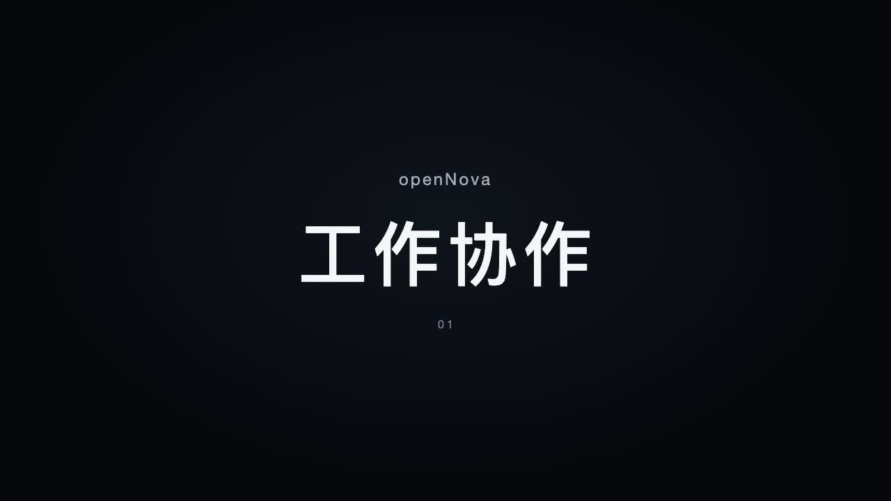
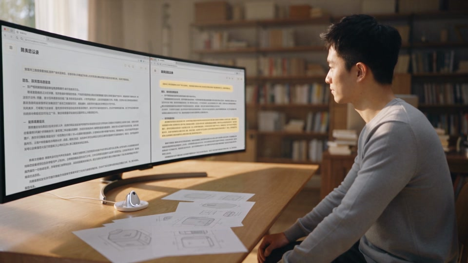
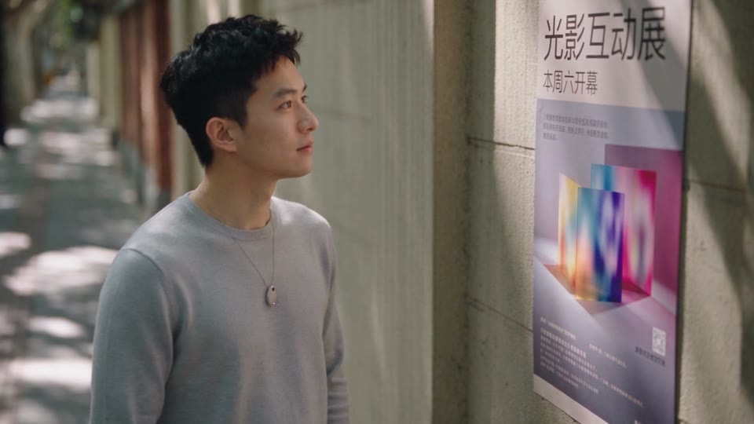
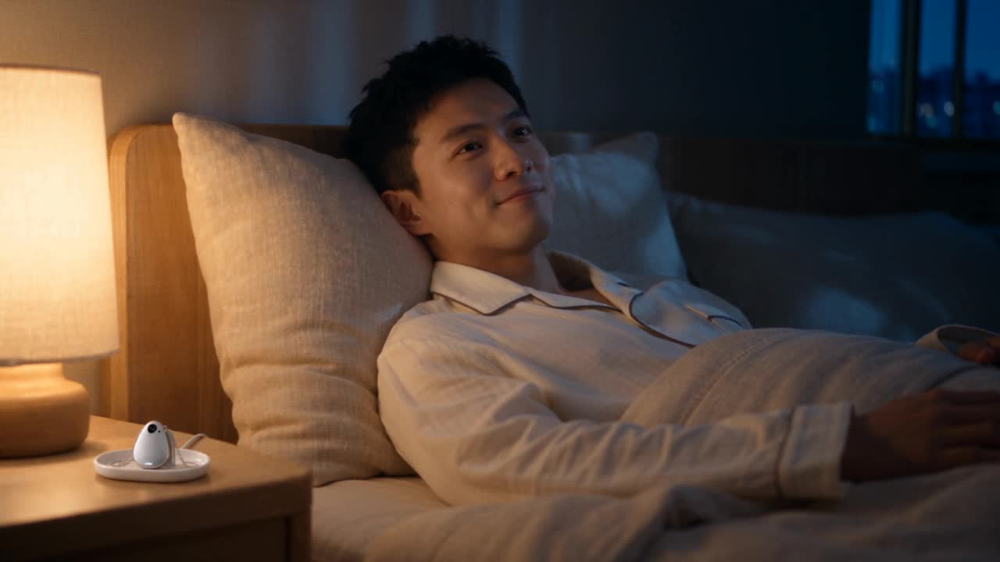
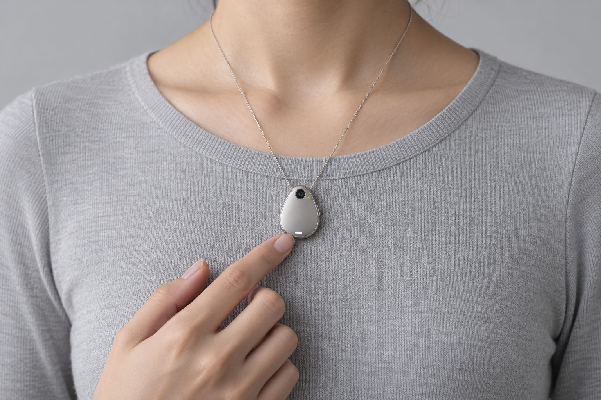
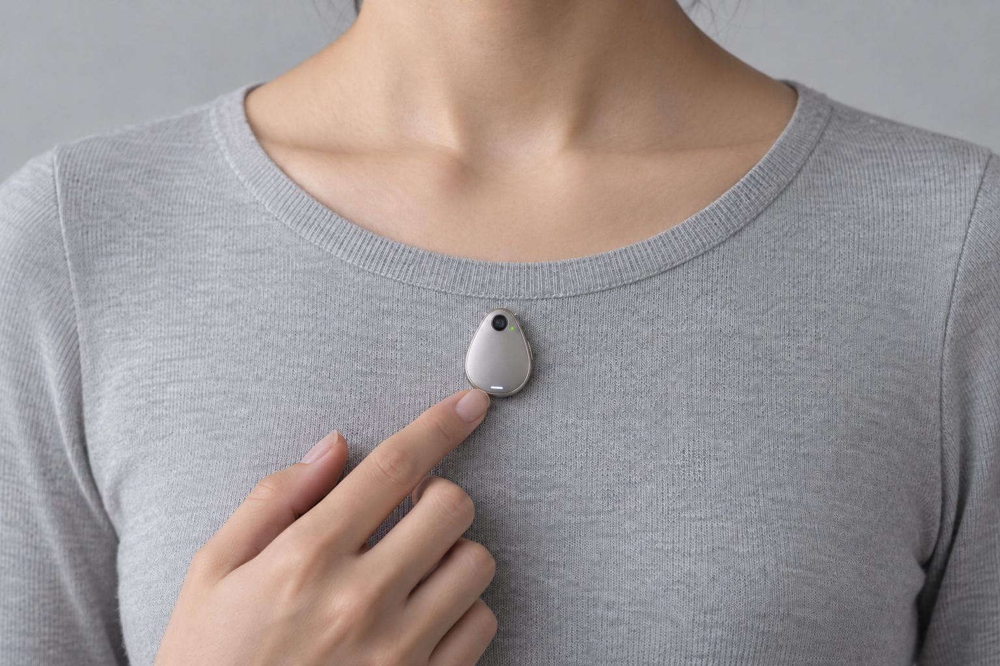
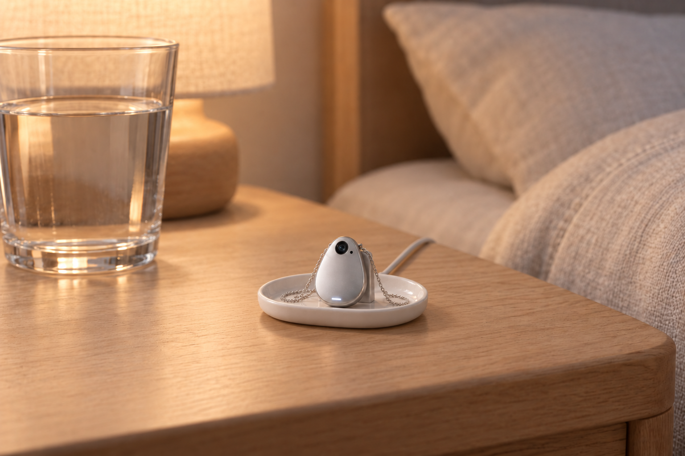
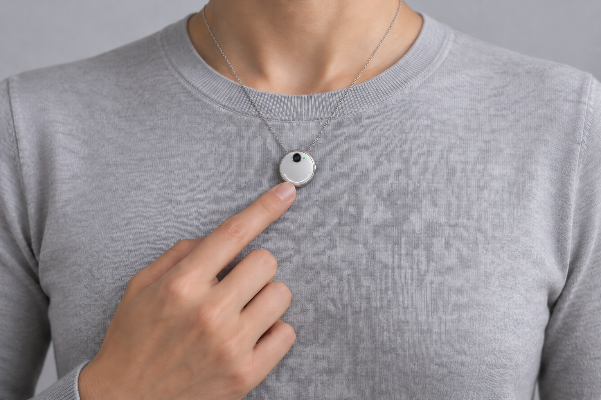
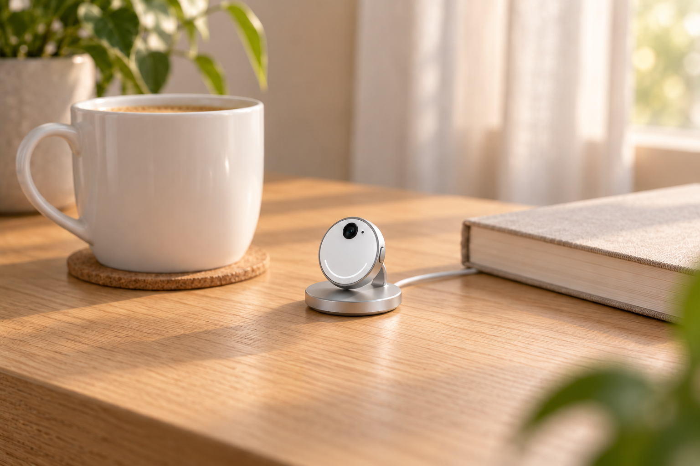

# openNova 产品概念文档

版本：0.9 讨论稿 · 2026 年 10 月 5 日

本文用于讨论 openNova 的产品定位、核心体验与外观方向，为后续工业设计和体验原型提供共同起点。

**openNova 是一个与你共同做事、随身延续、共同回顾的 AI 个人助手。它通过软硬件结合，让同一个助手持续理解你的目标，并把讨论推进成可以检查的成果。**

## 产品定位与理念

### 产品愿景

让每个人拥有一位随身同行、随时交流的 AI 个人助手，协作工作，陪伴生活。

我们希望借鉴 JARVIS 参与工作的方式，以及 Joi 在不同情境下延续交流的体验。科幻感来自自然的回应、连贯的协作和恰当的出现时机；工业设计让这些能力成为一件愿意长期放在身边的物品。电影研究与角色分析见[前期方向研究](../research/jarvis-joi-product-direction.md)。

### 首批用户与价值主张

**首批用户假设：经常在阅读、讨论、创作与决策之间切换的创业者、产品设计者和独立创作者。** 这一选择用于让初稿足够具体，尚未经过用户访谈或市场验证。

本稿关注的需求假设是：一件工作跨越多个时段和设备后，用户需要反复寻找材料、重述背景、整理决定，才能重新进入状态。openNova 希望保存这条连续的工作线索，使每次重新开始都更轻松。

面向用户的价值表达可以是：**“与你一起把事情做成。”** 用户最终拿到的是修改后的资料、明确的决定和清楚的下一步，也能感受到一个熟悉的助手在持续参与。

### 产品理念

1. **围绕同一件事协作。** 助手与用户围绕共同的文件、画面或问题讨论，回答应落实到可检查的对象和结果上。
2. **随身交流，陪伴生活。** 用户随时自然开口，就能分享日常、聊聊心事、探索兴趣；助手认真倾听、自然回应，记得用户在意的人和事。
3. **让交流与协作自然延续。** 换设备时保留目标、材料、决定和进度。不同入口适应当下情境，保持同一助手身份与交流习惯。
4. **适时主动服务。** 用户可以约定提醒和回顾时机，也可以选择安静陪同。每次主动出现都应与当前任务或明确偏好有关。
5. **建立可信、可控的记忆。** 用户能够查看、修改和删除保存的信息。助手需要区分实际记录、推测和建议，尤其是在回顾过去时。
6. **用克制的设计表达存在感。** 声音、光、画面和实体控制共同传达关注与状态；需要专注时，呈现退到背景。

### 硬件设计原则

硬件应让助手自然地融入工作与生活，其形态与交互围绕协作、随身交流和日常陪伴展开。

1. **方便随时交流。** 语音与视觉感知采用 Always On，用户自然开口即可围绕当下看到的事物交流。随身形态兼顾携带或佩戴的舒适度与续航，固定形态注重触达与放置便利。
2. **支持共同感知与协作。** 根据场景提供拾音、视觉或内容共享入口，以及查看结果和确认操作的方式，支持助手在用户授权下参与任务。
3. **支持跨场景延续。** 通过一致的交互和清晰的接续提示，让用户换设备后能继续交流与协作，减少重复操作。
4. **营造自然的陪伴感。** 通过声音、光、画面或触觉反馈表达关注与回应，并适应周围环境和用户状态。
5. **支持适时主动服务。** 以适合当前场景的方式提供提醒与帮助，通过清晰的状态提示和便捷控制，让用户随时回应、暂停或关闭感知。

具体形态可探索便携、穿戴及固定场景设备，根据上述体验需求选择单一形态或组合。

## 产品核心场景

三个场景围绕同一枚水滴助手展开：工作时归座协作，外出时随身交流，回家后继续陪伴。以下为预期体验脚本，具体连接、拾音、视觉和任务执行能力需要通过原型验证。

**完整产品概念视频（约 56 秒）：** 工作协作、随身交流、日常陪伴，三段场景前分别加入场景标题页。

[播放完整视频](assets/opennova-product-concept-film-v01.mp4) · [制作记录](../../videos/product-concept/README.md)

### 场景一 工作协作

**上午，水滴助手放在电脑旁的首饰托盘座上充电，用户正在整理产品概念方案。**

用户在电脑上打开并共享文档，直接说：“我们继续昨天的方案。”助手自然接上此前的讨论，通过声音提出需要澄清的问题；完整材料与修改对照呈现在电脑上。

用户选中一段文字：“这段太抽象，改成一个真实的使用场景。”助手围绕选中内容提出修改，用户查看并确认后写入文档。用户补充：“水滴是主方案，圆环保留为备选。”助手将这一决定记录下来。

讨论纸面草图时，用户拿起水滴对准草图：“我们看看这个连接位置。”助手结合画面与用户指明的部位继续讨论，自动记录讨论结果。讨论结束，用户将水滴放回底座。

**核心体验：** 像与同伴一起推敲问题，讨论能落实为可检查的成果；声音来自身边的水滴，材料和结果留在电脑上。

**场景演示（16 秒）：** 用户面对带鱼屏，直接提出改写任务，助手的修改建议呈现在屏幕上。

[播放演示视频](assets/scene-one-waterdrop-demo-v07.mp4) · [样片与制作记录](../../videos/scene-one/WATERDROP.md)

### 场景二 随身交流

**中午，用户从底座取下水滴，戴成吊坠或磁吸在胸前，出门散步。**

用户在一张街边展览海报前停下，随口问：“这个展览有什么好看的？”水滴自动识别海报中的文字与画面，助手介绍展览主题、日期和地点。用户接着问：“适合周末去看看吗？”

助手回答：“挺适合的，海报上写着周六开幕。你之前说喜欢能参与其中的展览，这里正好有互动光影装置，应该会对你的胃口。周末想出去换换心情，可以去逛逛。”

用户说：“听起来不错，周末再决定。”助手自动记录展览信息与这次讨论，将展览保留为周末出行备选。用户继续散步，和助手聊起刚看到的展览与周末安排。

**核心体验：** 随时交流、自动识别、自动记录，让眼前的事物自然成为共同的话题与后续安排。

**场景演示（16 秒）：** 用户佩戴水滴吊坠，在街边看展览海报，与助手自然交流周末安排。

[播放演示视频](assets/scene-two-waterdrop-demo-v01.mp4) · [样片与制作记录](../../videos/scene-two/README.md)

### 场景三 日常陪伴

**晚上，用户将水滴放回床头的首饰托盘座，细链收进盘内，主体开始充电。**

用户靠在床头说：“今天有点累，陪我聊会儿吧。”助手轻声回应：“好啊，我们随便聊聊。”

用户说：“刚才路过一家面馆，突然想起大学时和朋友吃宵夜。那时候一碗面能聊两个小时。”

助手接着说：“是不是面都吃完了，还舍不得散？你们那时候最爱聊什么？”用户笑着讲起朋友间的趣事，助手顺着故事接话，偶尔追问一句，让谈话随着用户的兴致展开。

聊了一会儿，用户随口说：“有点困了，睡了。”助手轻声回应：“好。”床头灯逐渐调暗、熄灭，用户放松地躺下。

用户说：“晚安。”助手轻声回应：“晚安，睡个好觉。”交流自然停下，水滴留在床头充电。

**核心体验：** 可以倾诉感受，也可以分享轻松的小事；像与熟悉的同伴闲聊，在自然回应中感到被倾听、被陪伴。一句话就能控制灯光等家居设备，让陪伴融入日常起居。

**场景演示（16 秒）：** 用户靠在床头，自然看向前方，与助手聊起大学时吃宵夜的回忆。用户说“有点困了，睡了。”后，助手道晚安，床头灯逐渐调暗、熄灭，用户闭眼休息。

[播放演示视频](assets/scene-three-waterdrop-demo-v03.mp4) · [样片与制作记录](../../videos/scene-three/README.md)

### 三段体验的共同要求

**Always On 是语音与视觉感知的默认方式。** 无论佩戴还是归座，用户都可以直接开口，助手结合语境判断回应时机，其余时候安静陪同。结束一段对话后仍保持可交流状态；实体控制用于主动静音、暂停与恢复。

同一枚水滴承担语音交流、轻震与状态反馈；文档、修改对照和详细记录在电脑或手机上查看。底座负责充电与支撑，拾起或归座时保留同一任务与交流进度。

水滴持续感知镜头视野内的画面，结合交流自动识别相关内容，记录信息与讨论结果。胸前视角不等于用户视线，镜头覆盖范围之外的内容需要调整观察方向。

助手应区分已确认的决定、暂存的灵感与待办，允许查看、纠正和删除。主动提醒来自用户的约定；连接不可用或操作未完成时，明确说明当前状态。首轮重点验证协作质量、自然接话的时机、佩戴交流的便利性、记忆准确性和打断感。

前期参考：[早期工作协作概念短片](../../videos/scene-one/README.md)采用旧版桌面造型，硬件与情节以本章节为准。

## 产品外观设计

### 主方案与备选

**当前以 D 水滴方案为主方向，A 微型圆环保留为备选。** 两款均包含吊坠、隔衣磁吸胸佩与居家归座三种状态。吊链和磁吸背片作为不同佩戴配件，主体保持此前认可的轮廓、材质、摄像头与状态灯，延续小巧、精致的方向。

底座让同一枚随身核心在家中拥有自然的位置：摘下、放回、充电，随后可以继续交流。以下图片由内置 ImageGen 基于原设计生成；尺寸只用于造型比例讨论，磁吸结构、充电接口与声学效果尚需原型验证。

### 主方案 D 水滴

| 吊坠款 | 磁吸胸佩款 | 首饰托盘座 |
| --- | --- | --- |
|  |  |  |

**佩戴。** 吊坠款保留细银链；磁吸款收起吊链与外露连接件，主体隔衣贴合胸前。水滴轮廓、银色表面与镜头布局保持一致。

**造型。** 银色水滴主体放在暖白色浅托盘上，后部的小型金属支撑承接背部磁吸，让镜头朝前、正面不被遮挡。细链沿支撑两侧落入盘内，充电面与链条路径分开处理。

**居家场景。** 放在床头柜或梳妆台。回家摘下项链后，吊坠归座、细链收进浅盘；睡前可以回顾一天或随意交谈，安静时灯光变暗或熄灭。

**比例目标。** 主体约宽 25 × 高 32 毫米；托盘约长 72 × 宽 52 毫米。浅盘承接项链，也为拿取留出空间；具体链条连接与背部充电结构需一起细化。

生成提示词：[吊坠款](assets/pendant-v04-d-drop-prompt.md) · [磁吸胸佩款](assets/wear-v06-d-drop-magnetic-prompt.md) · [居家归座](assets/dock-v05-d-drop-home-prompt.md)

### 备选方案 A 微型圆环

| 吊坠款 | 磁吸胸佩款 | 圆形磁吸座 |
| --- | --- | --- |
|  |  |  |

**佩戴。** 吊坠款接入细银链，连接点隐藏在主体背部；磁吸款通过衣内背片固定。两种方式都保持镜头和侧边操作区域可接近。

**造型。** 主体保留珠白面壳、细银边、上方摄像头与下半周光弧。底座采用低矮银色圆盘，背后以简洁短支撑连接充电面，让主体略微后倾、正面完整朝向使用者。电源线从背部引出。

**居家场景。** 放在书桌或客厅边桌，工作间隙随口讨论，晚上继续当天的话题。圆形主体与底盘形成统一轮廓，镜头、状态光和侧边操作保持可接近。

**比例目标。** 主体直径约 30 毫米；底盘直径约 52 毫米，组合高度约 45 毫米。拿取时，手指可从主体两侧接近，底盘需结合配重与防滑结构验证取放稳定性。

生成提示词：[吊坠款](assets/wear-v06-a-halo-pendant-prompt.md) · [磁吸胸佩款](assets/pendant-v04-a-halo-prompt.md) · [居家归座](assets/dock-v05-a-halo-home-prompt.md)

### 归座后的交互

- **放下即可确认充电。** 磁吸定位后，通过短暂灯光或轻提示确认；持续充电时保持安静。
- **继续同一个助手的交流。** 归座后延续 Always On，用户直接开口即可接着讨论、发起回顾，也可按约定获得提醒，拾起后再带走。底座先承担充电与支撑，较远距离的拾音与播放效果另行验证。
- **归座后延续感知。** 水滴在底座上继续理解镜头前的画面并参与交流，实体控制可暂停感知。

### 后续设计重点

**优先深化 D 水滴方案。** 围绕吊坠、磁吸胸佩与首饰托盘座，继续细化佩戴舒适度、镜头与按键布局、项链连接、取放和充电结构。

A 微型圆环保留现有三种状态，作为后续对照的备选方案。

此前四款佩戴造型完整保留在[第四轮外观研究](archive/appearance-v04.md)。B 圆角方形与 C 纵向胶囊保留为历史备选；早期场景短片用于说明协作体验，不代表当前外观方案。

## 首版范围与后续讨论

建议首版围绕一类完整任务展开：共同研究资料并形成成果，允许离桌讨论，再回到可检查的文档与记录。三个场景共同完成这一条体验，随后再判断向哪些生活任务扩展。

当前继续研究数字助手与随身佩戴，以 D 水滴方案及其居家充电底座为主方向，A 微型圆环保留为备选。智能眼镜和折叠视窗已淘汰；机器人、机器宠物、机械生命与数字实体不在当前候选范围内。本轮已将摄像头纳入设计；具体尺寸、佩戴结构、镜头参数与默认呈现仍需讨论，全息呈现保留为后续研究话题。

这里沿用前期片单的标签定义：“数字实体”指从数字世界实体化进入现实的程序。屏幕或 AR 中的助手形象属于呈现方式，其是否采用仍需单独确认。

下一轮最值得讨论的三个选择是：

1. **第一类用户与任务：** 是否用创业者和创作者的研究、创作流程作为起点，还是优先服务生活事务？
2. **主要佩戴方式：** 以吊坠还是磁吸胸佩为主，如何让佩戴、摘取和归座成为自然的日常动作？
3. **视觉交互：** 胸前视角能自然覆盖哪些场景，如何让自动识别、记录与交流衔接顺畅？

下一步围绕三个核心场景验证水滴主方案的佩戴、交流、视觉与归座体验；工程规格、成本、量产可行性和模型能力验证需要另行展开。
