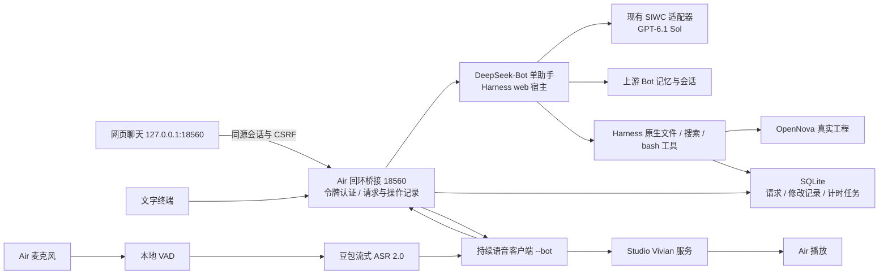

# OpenNova × DeepSeek-Bot 接入实验

更新：2026-10-14。定位：单 Bot、OpenNova 真实工程的开发接入，使用真实 DeepSeek-Bot 运行时及既有 GPT 授权。原语音 Demo 和联网模式继续保留。

当前执行策略：用户已授权 Bot 直接使用已接入工具，文件浏览、搜索、读写、Shell 执行和记忆修改无需二次确认。网页展示文件差异、命令、退出码和输出。若用户明确说“只讨论”“先给方案”或“不要保存”，Bot 应遵循该指令，不执行写入。

## 已实现的范围

| 能力 | 本次实现 |
| --- | --- |
| 常驻助手 | Air 上独立 Harness web 宿主，固定一个 OpenNova Bot；客户端退出后宿主仍在 |
| 网页聊天 | 复用原生 Bot 聊天组件；本机网页输入、历史回看、停止回复、文件/记忆操作记录 |
| 共用上下文 | 网页、终端和语音解析同一 Bot 的当前会话 part；客户端不固定旧 part ID |
| 工作协同 | 原生 glob/grep/read/write/edit 接入 OpenNova 工程，支持目录文件浏览、代码搜索、读取、新建与局部修改，保留实际差异 |
| Shell / 测试 | 原生 bash 前台执行；默认工程根目录；Node 24 PATH；输出、退出码、超时和取消可查询 |
| 记忆 | 使用上游 Bot 的 remember、recall、forget；关闭自动提取，写入/修改/删除直接生效 |
| 持久结果 | SQLite 保存请求、修改记录和任务；重复请求不重复执行，可按 ID 查询结果 |
| 独立任务 | 1–120 秒的受控计时任务，用于验证断线、重启和取消；不执行外部作业 |
| 语音入口 | `--bot` 复用本地 VAD、豆包 ASR、Vivian；完整答复结束后再交给语音合成 |
| 故障处理 | 前台请求中断不重跑；原生工具运行中重启标为 interrupted，先核对文件/命令结果；旧文件意图绑定原目录 |

当前未接入多 Bot、生产定时任务、后台作业管理、Spark 编排、专用部署流程或 Bot 模式联网搜索。Shell 已开放，能执行当前 macOS 用户有权运行的命令，工作目录不是沙箱边界。`--bot` 和 `--web` 互斥。网页复用上游 Bot 的头像、聊天气泡、Markdown、用户消息及样式，并复用 Harness 的按钮和差异组件；OpenNova 补充输入框、历史同步和操作记录面板。完整原生管理界面及 `/api/bot` 控制路由仍不开放，网页、终端和语音统一经过同一请求与执行逻辑。

## 部署结构



- Harness 固定提交：`d743267388641bc76f17c45ce8b4c231aed1d32c`，v0.2.1-alpha.2。
- DeepSeek-Bot 固定提交：`20ebc9213cbbde7249d71786765f86be00dc6663`，插件 v0.1.5。
- Bot 源码导出到 Git 忽略的 `output/deps/deepseek-bot/`；不修改两个上游仓库。
- 默认数据目录：`~/.local/share/opennova/bot-spike/`；其中 `project/` 仅保留旧测试文件；`bot/` 是上游状态，`harness/` 是独立 DSH_HOME。默认工作目录已改为当前 OpenNova 仓库根目录。
- `bridge.sqlite` 存储修改记录/任务/请求，`client.token` 为本机桥接令牌。文件由当前用户持有，不写入 Git。
- 对外实验 API 仅监听 `127.0.0.1:18560`；内部 web 宿主使用 `18561`。不应将内部宿主作为产品界面或暴露到局域网。
- 本地桥接不使用 HTTP 代理；GPT 出站沿用 `OPENNOVA_PROXY`。Vivian 仍使用原 `tts.url`，本次不改网络路径。
- `OPENNOVA_BOT_HOME`、`OPENNOVA_BOT_PORT`、`OPENNOVA_BOT_WEB_PORT` 可改变状态目录/端口（不改变工程根目录）；客户端必须使用相同配置。
- 现有 Bot 用原生分段交接迁移目录，Bot ID 和历史保留；网页与语音共同跟随当前分段。权限设为 `danger-full-access / never`，不弹二次确认。
- Shell 默认 120 秒，工具参数可调整，最大 600 秒；整轮上限 600 秒。禁用原生后台执行和超时自动转后台，停止回复会取消当前命令；不自动重跑中断命令。输出过长时界面显示截断提示与可用的完整日志路径。
- 实验配置采用 64k 上下文、4096 输出预算，这是本次部署策略，不是模型最大能力声明。

## 启动与测试

以下命令在 OpenNova 根目录执行，需已有 Node 24、已构建的固定版本 Harness，以及原 OpenNova 的 ChatGPT 授权。初次运行自动导出固定 Bot 依赖；首次下载需要访问 GitHub。无需再次提供密钥。

### 1. 启动宿主

在一个终端保持运行：

```sh
OPENNOVA_PROXY=http://127.0.0.1:7897 ./tools/bot/run.command
```

代理地址按当前环境设置；若 GPT 出站无需代理，可省略该变量。重复启动会提示已有宿主。

```sh
./tools/bot/run.command --check
./tools/bot/run.command --stop
```

`--stop` 停止宿主并保留持久状态；下次启动继续使用同一 Bot。客户端 `/quit` 只断开客户端。

### 2. 网页与文字验证

宿主启动后，打开 **http://127.0.0.1:18560/** 即可输入文本；启动脚本会自动构建网页资源。纯文字使用不依赖麦克风、ASR 或 Studio TTS。

- 网页与 `--bot` 语音、文字终端共用单个 Bot 的上下文、请求和操作记录。语音产生的对话也会显示在网页中。
- 输入完成按 Enter 发送，Shift + Enter 换行；回复过程中可点击“停止回复”。目前显示处理状态，完整回复完成后呈现文本。
- 文件、Shell 和记忆工具调用直接执行，回复实际结果；点击“操作记录”查看文件差异和命令输出、退出码。无需点击确认或输入审批编号。
- 前台只处理一个请求；语音正在回答时，网页等待该轮结束，避免两边同时改写上下文。页面关闭不会停止宿主；重开后读取已保存记录。
- 网络中断后沿用同一请求编号重试，保留另写的新草稿；保存中断且宿主空闲时可点“重试保存”。
- 网页通过回环地址、同源检查、HttpOnly Cookie 和 CSRF 校验访问；浏览器不读取 CLI 令牌，也不能调用内部原生 Bot 管理接口。
- 当前仅支持本机单用户文本聊天，不包含网页麦克风收音、网页 TTS、多 Bot 或项目切换。`--web` 参数仍指旧语音模式的联网搜索，与这个网页入口不同。

快速验收：网页说“本次测试暗号是海星742，不写记忆”，再通过 `--bot` 语音追问暗号；通过语音更正后回网页追问。文件测试可说“新建 output/bot/web-check.md，内容是网页直接执行测试”，随后读取文件，应已保存；说“仅讨论修改方案，不要保存”时则不写入。

在第二个终端：

```sh
/opt/homebrew/opt/node@24/bin/node tools/bot/client.mjs
```

| 操作 | 用法 |
| --- | --- |
| 普通对话 | 直接输入文字 |
| 查看操作记录及差异 | `/operations` |
| 查看当前记忆 | `/memory` |
| 查看任务 / 显式取消 | `/tasks` / `/cancel-task ID` |
| 查询前台结果 / 取消前台 | `/result ID` / `/cancel ID` |
| 退出客户端 | `/quit` |

建议依次测试：

1. “请浏览 services/bot，搜索默认工作目录的定义，读取相关代码并解释。”
2. “新建 output/bot/direct-check.md，内容为支持语音助手。”完成后直接读取文件，并用 `/operations` 查看差异；无需 `/approve`。
3. “请记住，验收样本 A101 的饮品是柠檬水。”直接查看 `/memory`；接着只把 A101 更正为白开水，再要求只忘记 A101，均应立即生效。建议每次验收换一个编号，避免与既有测试数据混淆。
4. “启动一个 120 秒的测试任务，名称为重连验证。”取得任务 ID，退出客户端后重开，`/tasks` 应继续显示原任务；再次启动任务并 `/cancel-task ID`，应显示 cancelled。
5. 文字告诉 Bot 一个仅本次会话使用的测试暗号，再通过语音询问；宿主重启后也可继续文字追问。

可重复运行完整真实模型探针（会消耗模型额度，仅修改 output/bot 下的测试文件和带独立样本编号的合成测试记忆）：

```sh
/opt/homebrew/opt/node@24/bin/node tools/bot/probe.mjs
```

结果保存在 `output/bot/verification/direct-live-probe.json`，未进入 Git。

### 3. 语音验证

先保持原 Vivian 服务/转发可用，再运行：

```sh
./tools/voice/run-continuous.command --bot --check --device 'MacBook Air麦克风'
./tools/voice/run-continuous.command --bot --device 'MacBook Air麦克风'
```

设备仍可替换，例如添加 `--output-device '外置耳机'` 或选择蓝牙输入输出。`--bot` 模式的代理设置放在宿主终端；语音客户端仍按既有 ASR/TTS 配置运行。

原有 `/stop`、`/mute`、`/unmute`、`/end`、`/start`、`/retry` 保留。插话或 `/stop` 取消本轮前台回复，不取消已启动的独立计时任务；独立任务使用 `/cancel-task ID`。语音和文本均直接执行工程文件、Shell 命令与记忆修改；可用 `/operations` 或网页“操作记录”查看结果。旧 `/approve`、`/reject` 接口仅为历史记录兼容保留，正常工作不再使用。

## 真实工程开发验收

网页可直接输入：

> 请读取 services/bot/settings.mjs，解释默认工作目录。然后运行 node --test services/bot/tests/project.test.mjs，告诉我通过数量和失败项。

需要验证修改闭环时，运行下列探针。它使用真实模型和原生工具，先观察失败测试，再修改实现、重新测试并写入结果；只改动独立的 output/bot/project-probe-* 目录，还会验证停止命令后对应进程退出。

```sh
/opt/homebrew/opt/node@24/bin/node tools/bot/project-probe.mjs
```

结果：`output/bot/verification/project-live-probe.json`。浏览器“操作记录”查看 Shell 命令、退出码和输出；原生文件工具显示实际修改差异，Shell 自身修改文件只记录命令与输出，尚无自动 Git 差异/撤销功能。原生运行记录仅用于查验，不提供自动重新执行按钮。

## 验证记录与边界

2026-10-14 真实工程接入验收：**118 项 Node 测试、69 项 Python 语音回归通过**。真实 GPT 调用已完成 glob/grep/read → 失败测试（exit 1）→ edit 修复 → 测试通过（exit 0）→ write 保存报告；前台取消后验证实际命令进程退出。网页已核对文件差异、命令输出和退出码，无前端错误。记录：`output/bot/project-node-tests.log`、`output/bot/project-voice-tests.log`、`output/bot/verification/project-live-probe.json`、`project-web.jpg`。

本次联调曾遇到 GPT 请求中断，重试后完整探针通过；未加入自动重放开发请求，以免重复修改。声学链路本轮仅做既有自动回归，没有重新录制麦克风。后台作业、日志实时增量和一键撤销仍待实现。

直接执行版本验证：104 项 Node 测试、68 项 Python 语音回归通过；真实模型的文件直接写入、记忆新增/更正/删除与受控任务均通过。停止发生在记忆写入准备阶段时不会继续保存或在重启后补写。自动化结果与真实模型探针记录在 `output/bot/direct-node-tests.log`、`output/bot/direct-voice-tests.log`、`output/bot/verification/direct-live-probe.json`。以下表格保留网页初版及更早的语音验收记录；其中确认/拒绝属于旧策略。

真实验证记录见 `output/bot/verification/`。本次网页截图为 `web-chat.jpg`，双向上下文记录为 `web-voice-context.json` 与 `web-ui-verification.json`。本轮已验证：真实 Harness/Bot 启动与 GPT 工具调用、确认后文件应用和重复确认、上游记忆新增/更正/删除、受控计时任务，以及现有录音经本地 VAD → 真实豆包 ASR → Bot 的文字回答。

| 验证项 | 本轮结果 |
| --- | --- |
| Node 自动测试 | 98 项通过：原 Agent 62 项 + Bot 36 项 |
| Python 语音回归 | 68 项通过 |
| 真实模型与工具 | 文件确认、记忆增删改、查询、独立任务通过 |
| 宿主重启 | 同 Bot、同会话暗号、原请求结果和任务截止时间保留；网页自动重连，重启后正确回答语音端更正的暗号 |
| 取消隔离 | 前台取消后独立任务仍 running；显式取消任务后为 cancelled |
| 文字/语音共用上下文 | 重启前文字设置暗号，重启后现有录音经 VAD/豆包 ASR 提问，Bot 正确答出 |
| 网页入口与控制隔离 | 原生聊天组件可用；同源、Cookie、CSRF、Host 校验及中文分包输入回归通过；原生管理路由仍关闭 |
| 网页真实操作 | 文本回复、差异预览、确认写入、拒绝不写入通过；网页与语音适配器双向上下文测试通过（本轮未录制麦克风） |
| 完整麦克风及播报 | 2026-10-14 恢复既有 Vivian 转发后，用户三轮真人语音测试通过：安排时间、改口调整、追问更新后的安排 |

最初预检中 Vivian 端点 `http://127.0.0.1:18000` 拒绝连接；恢复既有 SSH 转发后，完整预检通过，用户随后确认基本语音交流没有问题。本次验证覆盖收音、ASR、Bot 上下文更新和 Vivian 播放；新 Bot 模式的专项插话、外放回声、嘈杂环境和长时间运行仍需分别验证。

持久性与文件边界：

- 文件修改先记录内容摘要，随即应用并在写入前再次核对；故障恢复不会覆盖后续修改；禁止 `..`、绝对路径、软链接、硬链接和特殊文件，单文件上限 64 KiB。
- 本次测试目录由实验独占；不要让其他进程同时编辑或替换其目录。检查与 rename 不构成跨进程原子 compare-and-swap，也不构成对恶意本机进程的文件系统沙箱。接入真实共享项目时需升级文件事务方案。
- 记忆修改先记录精确原条目、作用域、主题和目标，再调用上游工具。崩溃后核对存储结果，补齐退休标记与快照失效，避免重复修改。冲突时拒绝猜测。`/operations` 会列出 failed/conflict 项；失败项不会阻塞宿主启动，应核对 `/memory` 后提出新的修改。
- 更正/删除使旧事实退出当前有效记忆，并过滤旧消息中的对应事实；Bot 的历史聊天和记忆日志仍保留副本。本次不是彻底清除个人数据的实现，也不保证改写后的语义副本都被删除。
- 已记录的直接写入意图在重启时核对并恢复；旧手动方案不会因本次升级而自动执行。
- 宿主退出时停止前台请求；重启把未完成请求标记 interrupted，不自动重复执行。任务仅以持久化截止时间计算受控计时状态，不表示外部作业恢复。
- 语音先等待完整答案，长回复截取约 560 字口播并提示查看文字，完整文本仍保留。下一阶段再评估流式输出、首句延迟和与当前 Harness 方案的体验差异。

## 工程入口

| 文件 | 职责 |
| --- | --- |
| `services/bot/launch.mjs`、`setup.mjs` | 固定依赖、独立配置、宿主启停 |
| `services/bot/web/`、`web-http.mjs` | 原生组件构建、网页交互、浏览器会话校验 |
| `services/bot/controls.mjs` | 网页/终端/语音共享请求、历史快照与操作记录 |
| `services/bot/host.mjs` | 实际 Bot 运行时、工具与桥接整合 |
| `services/bot/operations.mjs`、`requests.mjs` | 持久记录、直接文件写入、前台请求及并发准入 |
| `services/bot/memory.mjs` | 记忆直接写入事务和恢复 |
| `services/bot/lifecycle.mjs` | 生命周期、文本准入、关闭原生 Bot 控制通道 |
| `services/bot/policy.mjs`、`model-policy.mjs` | 工具范围、模型预算、旧记忆过滤 |
| `tools/bot/client.mjs`、`probe.mjs` | 交互客户端、真实接入验证 |
| `tools/voice/bot_agent.py` | 可选语音后端，连接常驻宿主 |

当前结论：Bot 在 Harness 之上的持续助手接入及基本真人语音交流已经验证。后续优先补齐 Bot 联网与真实项目工具，再推进真实任务执行和增量语音输出；新模式的专项插话与声学验证继续保留。当前整体架构、MVP 缺口及建议顺序见 [Demo 技术架构与功能进展](opennova-demo-architecture-status.md)。

重启实测可用 `tools/bot/restart-probe.mjs --before` 保存测试暗号、请求结果和计时任务，重启宿主后运行同脚本的 `--after`。两个阶段都使用真实模型，结果保存在 `output/bot/verification/restart-probe.json`。


自动测试命令（需先准备固定 Harness 构建）：

```sh
/opt/homebrew/opt/node@24/bin/node --test services/agent/tests/*.test.mjs services/bot/tests/*.test.mjs
uv run --with websockets==15.0.1 --with 'python-socks[asyncio]==3.1.1' --with sounddevice==0.5.6 --with numpy==2.2.6 --with onnxruntime==1.23.2 --python 3.11 python -m unittest discover -s tools/voice/tests
```
