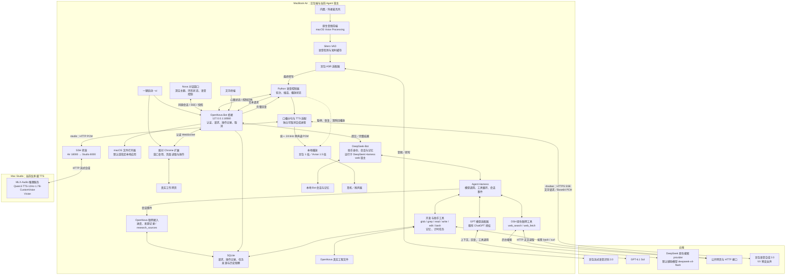

# OpenNova Demo 技术架构与功能进展

> 2026-10-25 联网接入更新：默认改为 DSH 原生 web_search / web_fetch / bash；OpenNova 监听进度、保存来源和处理语音交互。旧版研究预算和 web_request / research_exec / research_derive 只在显式 legacy 回退模式启用。启动与验收见 [原生联网验收](opennova-native-research-test-cases.md)。文末旧阶段记录保留用于历史追溯。

更新：2026-10-25，桌面开发分支。依据当前仓库实现及既有验证记录整理，包含网页共享会话、真实工程工具、一键启动、豆包云端 TTS 和 Bot 原生联网接入。完整产品范围仍以 [MVP PRD](../product/opennova-mvp-prd.md) 为准。

## 1 当前进展

当前 Demo 采用 **Air 交互与 Agent 宿主 + 云端 ASR / LLM + 可切换 TTS** 的部署方式。完整语音链路为 **本地拾音 → VAD → 豆包 ASR → DeepSeek-Bot / Harness → GPT-6.1 Sol → 豆包 VV 或 Studio Vivian → 本地播放**。文字与语音进入同一个 Bot 会话，支持连续追问和改口；已接入 OpenNova 真实工程的文件浏览、检索、读写和 Shell 测试执行，另有基础持续记忆和计时任务实验。

日常入口为根目录 `start.command`，自动使用共享 Bot。办公室可选 `--tts-provider doubao`：Air 直接访问豆包语音合成 2.0，VV 女声采用用户确认的 **1 倍原速**，无需 Studio 在线。家庭环境可选 `--tts-provider studio`：经 SSH 使用 Studio 上的 Vivian，采用此前选定的 **1.5 倍保调语速**。未指定后端且无本机配置覆盖时，默认使用 Studio；当前没有自动判断网络和切换后端。

2026-10-14，用户完成三轮语音测试：安排测试与复盘时间、调整先后顺序和时长、追问调整后的安排，反馈没有问题。这验证了本次 Bot 接入后的真人输入、上下文更新和 Vivian 播放。它不替代新 Bot 模式的专项插话、外放回声、嘈杂环境和长时间运行验收。

当前阶段可以称为“可运行的语音助手与工作协同 Demo”。距离“OpenNova 帮助打造自己”，统一联网研究已接入；主要还缺长期后台作业管理、变更撤销和后台作业可视化；双窗口、文件 / 网页引用和语音状态联动已接入。

## 2 实际部署架构

下图以一键启动使用的 `--bot` 模式为主。节点表示逻辑职责；OpenNova Bot 桥接和 Bot 运行时在同一个 Harness 宿主中装配，并非各自独立的微服务。Bot 已装配后台搜索与正文读取；旧 `--web` 入口仅保留兼容。

### 2.1 各节点职责

| 节点 | 当前方案 | 已实现的职责与限制 |
| --- | --- | --- |
| 本地音频 | Air，Swift / AVAudioEngine | 选择输入输出设备；持续拾音与播放；开启 Voice Processing；支持暂停、恢复和清除旧音频。不能据此认为已具备主人识别或完全消除同事说话声 |
| VAD | Air，Silero ONNX / CPU | 从 16 kHz 单声道音频判断语音起止，配合短时缓存及停顿规则组织发言；检测到语音不等于确认用户在对助手说话 |
| ASR | 豆包云端，Air 管理 WebSocket | 显示中间转写，最终有效文本提交 Agent；目前按发言建立识别连接 |
| 语音控制器 | Air，Python 3.11+ | 协调监听、识别、思考、播报和插话；区分旧轮次，阻止被取消回复继续播放；合成在可取消的独立子进程中进行 |
| Agent 与 Bot | Air，Node 24 | Harness 负责模型和工具运行；Bot 提供固定助手及持续会话；OpenNova 桥接负责请求与操作控制 |
| LLM | 云端 GPT-6.1 Sol | 沿用已验证的独立 ChatGPT 授权适配；当前适配只接收文本，未接入图片或视频 |
| 联网研究 | DSH 原生 DeepSeek 搜索、HTTP 读取与 bash；OpenNova 观察事件并保存来源 | 普通查询后台执行；显式开网页仍用浏览器。无额外研究次数或截止限制；搜索 60 秒、读取 30 秒，整轮 600 秒及用户取消保留 |
| 状态与数据 | Air 本地文件 + SQLite | Bot 会话和记忆、请求结果、修改记录、计时任务及来源观察保存在客户端之外；宿主重启后可读取 |
| 云端 TTS | 豆包语音合成 2.0，资源 `seed-tts-2.0` | VV 预设女声，Speaker ID 为 `zh_female_vv_uranus_bigtts`；HTTP SSE 返回 Base64 PCM，Air 解码后按 1 倍原速播放 |
| 本地 TTS | Studio，MLX-Audio / Qwen3-TTS-12Hz-1.7B-CustomVoice | Vivian 预设音色；HTTP 返回 PCM，Air 用 FFmpeg 做 1.5 倍保调变速；与云端输出统一为 24 kHz 单声道 16-bit PCM |
| Air—Studio 连接 | 既有 SSH 转发 | Air 访问本机 `127.0.0.1:18000`，转发到 Studio `127.0.0.1:8000`；沿用现有 `agent-control` 路径。本文不判断当前 Tailscale 是直连还是中继 |
| 启动编排 | Air，`start.command` + Node 启动器 | 检查 / 启动 Bot，`--ui` 检查扩展并打开双窗口，再准备 TTS 和语音；支持输入输出设备参数和 `--check` |

Agent **目前运行在 Air**，尚未迁移到 PRD 规划的 Studio 常驻服务节点。当前 Always On 指客户端运行时持续监听；Air 休眠或退出客户端后，不能继续从该麦克风交流。

VV 与 Vivian 都是预设音色，当前没有使用用户录音训练或克隆专属声音。Base 模型作为后续声音克隆路线保留；Spark 不在当前 Demo 实时链路内。EarPods、内置麦克风和蓝牙设备都是当前开发终端的可选输入输出设备，尚未使用水滴硬件。

### 2.2 Harness、Bot 与 OpenNova 的关系

| 层次 | 负责什么 | 本次采用的实现 |
| --- | --- | --- |
| Agent 运行基础 | 模型调用、工具循环、会话事件 | DeepSeek Harness v0.2.1-alpha.2 |
| 持续助手 | 固定 Bot 身份、当前会话 part、历史与记忆 | DeepSeek-Bot v0.1.5，运行在 Harness 上 |
| OpenNova 产品接入 | 语音状态、文字入口、文件与记忆执行、请求持久化、取消、结果呈现 | 本仓库 `services/bot/`、`tools/bot/`、`tools/voice/` |

引入 DeepSeek-Bot 是在 Harness 上增加持续助手能力，主推理模型仍然是 GPT-6.1 Sol。当前已启用原生 Shell，默认在 OpenNova 根目录执行；未启用多 Bot 和自主委派。

依赖固定提交与启动方法见 [Bot 接入实验](opennova-bot-spike.md)。网页复用上游 Bot 的聊天组件和样式，增加 OpenNova 的共享历史与操作记录面板。完整原生管理界面及 `/api/bot` 路由仍关闭，修改操作通过 OpenNova 工具直接执行，保留结果与差异。

### 2.3 输入、业务与输出三条链路

1. **语音输入：** 麦克风 → 原生音频处理 → VAD → 豆包流式识别 → 最终文本。ASR 中间结果用于展示和交互控制，不直接等同于正式用户请求。
2. **Agent 业务：** 用户文本 → 同一 Bot 会话 → GPT 推理及已开放工具 → 完整结果。Bot 在已接入工具范围内直接执行工程文件修改、Shell 命令和记忆修改，无需用户二次确认；网页与终端展示执行结果和差异。用户明确要求仅讨论、先给方案或不要保存时不执行写入。
3. **语音输出：** Bot 完整回复 → 去除不适合朗读的链接、代码和格式，长回复缩短口播 → 分句 → 已选择的豆包或 Studio TTS → PCM 回传 → Air 播放。完整原文仍留在文字界面。

2026-10-16 更新插话判定：VAD 候选仅启动识别；思考或播报期间，持续人声同时通过概率、时长及相对底噪的强度门槛后才暂停，并结合稳定中间转写或有效最终转写确认取消当前前台回复、合成及旧音频。“停”“等一下”等短指令保留快速路径；未确认候选失败或暂停约 1.2 秒后恢复旧播报，同一候选不反复暂停。待机起点与句首缓存保留。规则与复测流程见 [插话误触发优化](../../tools/voice/README.md#插话误触发优化2026-10-16)。这不是声纹或距离识别，清晰远处人声、轻声与咳嗽仍需现场验证。

插话不等同于取消独立任务。客户端会关闭合成 HTTP 流和工作进程；尚未确认 Studio / 云端立即停止对应计算，云端计费停止时点也未验证。

### 2.4 入口、服务与连接

| 入口 / 地址 | 当前用途 |
| --- | --- |
| `start.command` | 一键启动共享 Bot 语音，`--ui` 自动打开双窗口；`--tts-provider doubao` / `studio` 选择 TTS，`--device` / `--output-device` 选择设备 |
| `http://127.0.0.1:18560/` | 网页聊天与 OpenNova Bot 桥接；网页、文字终端和语音通过同一请求处理逻辑访问 Bot |
| `127.0.0.1:18561` | 内部 Harness web 宿主端口；不作为用户入口 |
| `tools/bot/client.mjs` | 独立文字终端；不需要麦克风和 TTS |
| `tools/voice/run-continuous.command` | 手动持续语音入口，可显式选择 `--bot` 或旧 `--web` 模式 |
| `openspeech.bytedance.com` | 豆包云端 ASR / TTS；分别使用 WebSocket 识别和 HTTPS SSE 合成 |
| Air `127.0.0.1:18000` → Studio `127.0.0.1:8000` | 仅 Studio 模式使用的 SSH 转发；本地推理服务不直接暴露为公网接口 |

一键启动先复用或启动 Bot；显式 `--ui` 在 TTS 前准备双窗口，扩展断开则降级普通文字入口。TTS / 麦克风失败保留文字入口；再次启动复用已有语音进程和窗口。`--check` 不开窗 / 不收音，默认 `--no-ui` 兼容旧行为。随后按后端准备 TTS。豆包模式会做一次不播放的短句真实合成预检，验证 Key、服务权限和完整音频流，产生少量 TTS 用量。语音退出时清理收音和播放，并关闭本次建立的 SSH 转发；Bot 和 Studio 推理服务保留。当前不是登录系统后自动运行的生产级守护服务。

GPT 的 HTTP 代理可通过 `--proxy` / `OPENNOVA_PROXY` 配置。豆包 TTS 客户端显式绕过该 HTTP 代理，但系统级 VPN / TUN 路由仍由系统决定。已有 Bot 复用其启动时的代理环境。

## 3 当前保留的三种持续模式

| 入口 | Agent 与上下文 | 工具范围 | 何时开始播报 |
| --- | --- | --- | --- |
| 手动持续入口不带 `--bot` / `--web` | 原 Harness 进程，随本次客户端运行建立会话 | 基础对话 | 增量文本达到分句条件后合成 |
| `--web` | 原 Harness 联网路径 | `web_search`、`web_fetch`、来源与预算管理 | 等待带来源的完整答复，再合成 |
| `--bot` | 独立宿主中的固定 Bot；文字、语音共享会话 | 真实工程文件浏览/搜索/读写、Shell、持续记忆、自身历史、计时任务、后台搜索/正文/来源 | 等待完整答复，再分句合成 |

`start.command` 固定使用 `--bot`。Bot 在 `web.enabled=true`、DeepSeek Key 可用时加载 `web_search` / `web_fetch`，无需另加 `--web`。`research_sources` 可回查已保存来源，即使关闭网络检索仍可使用。网页与语音显示实际阶段和来源卡片，口播不读 URL 或证据正文。旧 `--web` 参数仍是独立模式，与 `--bot` 互斥。

普通信息查询走后台检索，不导航工作窗口；“打开网站 / 看看当前页面”使用原浏览器工具。Agent 自主选择搜索、读取或 bash 获取公开接口；原始工具错误保留，失败后可继续换源。来源区分搜索链接、引用片段及网页响应，HTTP 成功不代表事实已核验。记录按请求保存，后续新抓取不覆盖旧观察；Shell 输出保留在操作记录中，不自动生成来源卡片。配置与验收见 [原生联网验收](opennova-native-research-test-cases.md)。

“ASR 流式识别”“LLM 增量输出”“TTS 流式音频”是不同环节。Bot 模式已经接入流式音频播放，但尚未把 LLM 增量回复交给 TTS；目前分句合成与播放串行进行，也没有跨句预合成。这是后续响应速度优化的明确位置。

原先不带 `--continuous` 的轮流对话模式仍保留，不是本次持续 Bot 测试入口。

## 4 已实现能力与验证边界

2026-10-25 原生联网 M1–M4：262 项 Node、103 项 Python 测试通过；真实隔离 Bot 完成北京/广州天气、国内历史行情、官方文档、来源回查、公开 JSON 保存及取消测试，并验证 legacy 回退。日常 18564 服务已升级为 version 3 / native，Studio Vivian 和蓝牙设备参数预检通过。部分站点 TLS 仍失败，Agent 可继续换源；真人语音需复测。详见 [原生联网验收](opennova-native-research-test-cases.md)。

2026-10-24：Bot 联网研究回归通过 235 项 Node 测试、101 项 Python 测试；真实隔离会话完成天气、公开链接、来源追问、重启恢复、取消及“检索→保存报告→Shell 检查”。当前 18564 开发服务已启用 DeepSeek 检索，原桌面能力与 600 秒工程时限保留。具体用例、边界与真人语音复测见 [联网研究验收](opennova-bot-research-test-cases.md)。

| 能力 | 当前进展 | 仍有的边界 |
| --- | --- | --- |
| 连续语音对话 | 本次真人三轮交流、改口和追问通过；复用既有 VAD / ASR / Vivian | 新 Bot 模式仍需独立验证插话、回声、长时间运行 |
| TTS 后端切换 | 豆包 VV 1 倍和 Studio Vivian 1.5 倍；豆包真实样音及一键预检通过 | 手动选择，不自动切换网络；云端连续真人交流听感待验收 |
| 文字与语音共享上下文 | 同一 Bot 当前会话；已验证文字设置信息、语音追问及重启后的接续 | 单用户、单 Bot；多项目切换未实现 |
| 文件修改 | 原生目录浏览/检索/读取/新建/局部编辑；直接应用并显示实际差异 | 默认 OpenNova 真实仓库；尚无版本撤销和可视化文件树 |
| Shell / 代码测试 | 原生 bash 执行，显示命令、cwd、退出码和输出；支持超时、取消和进程清理 | 前台运行，默认 120 秒，整轮 600 秒；后台作业管理、实时增量日志尚未接入 |
| 持续记忆 | 基于上游记忆存储；直接新增、更正、删除有效记忆，无需确认 | 自动提取关闭；项目/个人分类及检索策略待完善；删除有效记忆不等于清除全部历史副本 |
| 请求持久化 | SQLite 保存状态与最终结果，支持按 ID 查询；重启核对未完成操作 | 中断的前台请求标为 interrupted，不自动重新执行 |
| 独立任务 | 计时任务可在客户端退出后保留，重启保留截止时间，支持显式取消 | 仅 1–120 秒计时任务；不代表真实开发、训练或生产提醒已经实现 |
| 联网研究 | Bot 使用原生搜索、HTTP 读取和 bash；SQLite 来源观察、跨轮回查及取消；真实查询无需浏览器连接 | 部分站点仍有网络/动态内容限制；专用天气数据源、PDF/OCR 和长研究任务未实现。网页响应不等于事实已交叉核验 |
| 操作控制 | 本机认证，原生完整执行权限，读取版本冲突检查、请求去重与操作记录 | Shell 按宿主用户权限执行，工程 cwd 不是沙箱；尚无产品级项目授权界面 |

真实工程接入验收：118 项 Node 测试、69 项 Python 语音回归通过。真实 GPT 已完成工程浏览/搜索/读取、修改实现、测试失败→通过、保存报告，以及取消实际 Shell 进程；网页显示文件差异和退出码。联调中曾出现 GPT 请求中断，重试后完整探针通过。原语音验收记录保留，本轮没有重新录制麦克风。具体证据与限制见 [接入实验验证记录](opennova-bot-spike.md)。

2026-10-15 云端 TTS 接入后，一键启动器 13 项、TTS 19 项回归通过；随后豆包原速调整后的 75 项语音回归通过。豆包真实请求生成 1 倍速 VV 样音；真实一键云端 `--check` 已验证 Bot、VAD、音频设备和 TTS，未开启麦克风 / 扬声器。这些结果不代替真人听感验收，样音和测量见 [TTS 说明](../../services/tts/README.md)。

当前隔离开发目录为 `/Users/chenzhuoping/.codex/worktrees/desktop-browser-m0/openNova`；日常主工作区尚未合入本分支。开发预览使用 `output/bot/m1-home` 和 18564 / 18565，避免争用日常 Bot。默认运行数据位于 `~/.local/share/opennova/bot-spike/`：`bot/` 和 `harness/` 保存上游会话 / 记忆状态，`bridge.sqlite` 保存请求、操作记录和计时任务；原 `project/` 仅保留早期实验数据。工作目录是执行默认位置，Shell 仍按当前 macOS 用户权限运行，不是文件系统沙箱。本地 API Key 配置、模型授权与运行日志分别由忽略文件、Keychain 和本机数据目录管理，不进入 Git。

## 5 对照 MVP 的待实现功能

下表描述与 PRD 的差距，不代表这些功能都要在下一版 Demo 一次完成，也不改变 PRD 已有优先级。

| 方向 / PRD 对应项 | 已有基础 | 后续需要补齐 |
| --- | --- | --- |
| 项目上下文，A1 | OpenNova 工程根目录、目录浏览/代码搜索/读取、持续会话 | 网页 / 选区及文件引用已接入；后续补项目切换、恢复决定与任务背景 |
| 研究与学习，A2–A3 | 原生后台搜索、HTTP 与 Shell 取数、来源持久化、跨轮回查与取消 | 文本 PDF 读取、结构化研究结论与决定保存、来源质量策略和专用实时数据源 |
| 成果与文件，A4、A5.1 | 原生创建/局部编辑并保留差异 | 变更版本与撤销、成果预览/导出、实验数据与日志关联；真实共享目录的事务方案 |
| 软件研发执行，A5.2、A6 | 原生 Shell 测试/构建/检查、退出码、完成输出、超时/取消和持久请求 | 长期后台作业、增量日志、产物关联和断线任务接续 |
| 硬件设计助手，A5.5 | 可讨论方案、编辑文本 | 读取规格与参数资料，整理带来源的器件候选、BOM、选型比较与接口表；专业 CAD/EDA 属后续扩展 |
| 记忆，A7 | 直接新增、更正、删除与自身记忆召回 | 个人与项目作用域、来源和更新时间、相关记忆召回、去重与冲突处理、完整数据删除策略 |
| 自然交流，B1 | VAD、转写、轮次、插话控制、豆包 VV / 本地 Vivian | Bot 增量输出、分句预合成、推理端取消、逐段延迟测量与故障反馈；针对性声学验收 |
| 陪伴与主动反馈，B2–B3 | 基础聊天、简洁温柔风格、同会话追问 | 陪伴场景的回应长度与沉默策略；真实任务完成后主动提示；约定时间提醒属于 PRD P1 |
| 工作与交流界面，C | 深空双窗口、环形 Nova、共享历史、统一工作引用、原生语音状态与网页控制 | 任务管理、记忆浏览、设备/声音设置、流式文本 |
| 服务与权限，D | 本地配置、认证、单项目限制 | Studio 常驻 Agent、自动启动与恢复、设备接入及授权管理、更新与留存/删除设置 |
| 水滴硬件，E | Air 麦克风/耳机代替真实终端 | 音频/主控/无线方案、结构与声学样件、实体静音/按键/灯光、供电充电、端侧固件与配网；macOS 音频能力不能直接视为水滴已具备 |
| 家居控制，A5.4 | 尚未接入 | 一盏已绑定灯的开关、状态与操作回执 |
| TTS 实验与视觉 | Vivian 与豆包 VV 合成可用；当前 Agent 文本输入 | 专属声音克隆与实验工具、手动图片输入验证；Spark 训练按既定决定排除在本轮 Demo 外，持续视频/随身视觉另行规划 |

“助手协助硬件设计”和“OpenNova 自身硬件开发”是两项工作：前者扩展 Agent 的资料与成果能力，后者需要实体样件、器件、固件和测量，两者不能相互替代。

## 6 建议的后续顺序

### 第一阶段：统一 Bot 的工作入口

- Bot 联网研究已接入，继续通过真实开发任务验收资料、记忆、文件与测试的组合效果。
- OpenNova 真实工程的目录浏览、检索、读写及 Shell 已接入；网页/选区和文件引用已接入，继续补项目切换。
- 网页已支持直接执行、差异记录与中文失败提示；继续补齐版本撤销与任务结果呈现。

阶段用例：语音要求读取 OpenNova 的一段需求并查阅资料，直接修改一处文档，保存后追问修改结果。

### 第二阶段：完成一次真实开发任务

- 前台检查/测试执行已经接入；在真实需求上继续验收修改与测试闭环。
- 在已有前台 Shell 和完成输出基础上，增加后台作业、增量日志与产物管理；客户端重连后查询同一作业。
- 为文件变更增加版本记录和撤销入口。

阶段用例：读取某个小功能的代码和测试，执行修改并运行检查，返回测试结果与文件差异。这个闭环最能验证“OpenNova 帮助打造自己”。

### 第三阶段：改善语音响应与日常使用

- 给 Bot 增加面向用户的增量输出，将工具过程与可朗读答案区分；再优化分句预合成和播放缓冲。
- 记录发言结束、ASR 最终结果、模型首段、TTS 首音与实际播放时间，定位等待发生在哪一段。
- 在现有网页聊天和操作记录基础上，增加任务状态、记忆浏览和设置界面。
- 推进 Studio 常驻 Agent 与服务自动恢复，处理迁移后的授权、文件访问和客户端连接；先保持现有网络方案。

记忆分类、硬件设计工具和水滴样件可在上述基础上分别推进。以下保持既有决定：跨网/VPN 优化、咳嗽及远处同事声音的过滤暂不作为本轮优先工作；专属声音克隆、Spark 训练和持续视觉不阻塞当前 Demo。语音现有功能的回归验证仍应继续。

## 7 工程与文档入口

| 入口 | 内容 |
| --- | --- |
| [语音客户端](../../tools/voice/README.md) | 启动、设备选择、音频控制与回归测试 |
| [ASR 工具](../../tools/asr/doubao_asr.py)、[VAD](../../tools/asr/vad.py) | 豆包连接与本地语音检测 |
| [原生音频](../../tools/voice/native/AudioBridge.swift)、[语音状态机](../../tools/voice/continuous.py) | 收放音、播放控制、轮次与打断 |
| [Bot 宿主](../../services/bot/host.mjs)、[操作状态](../../services/bot/operations.mjs)、[记忆](../../services/bot/memory.mjs) | 持续助手、工具与持久状态 |
| [Bot 语音适配](../../tools/voice/bot_agent.py)、[终端](../../tools/bot/client.mjs) | 语音和文字进入同一 Bot |
| [Agent 服务](../../services/agent/README.md) | GPT 授权适配、原 Harness 与联网模式 |
| [TTS 服务](../../services/tts/README.md) | 豆包 VV / Studio Vivian 切换、推理部署与验证 |
| [Bot 接入实验](opennova-bot-spike.md) | 当前实验启动方法与验证记录 |
| [语音链路设计](opennova-voice-pipeline-design.md)、[开发环境部署](opennova-mvp-development-deployment.md) | 链路目标与搭建过程；较早规划的实施现状以本文为准 |
| [MVP PRD](../product/opennova-mvp-prd.md) | 完整产品功能、软硬件定义与目标架构 |

## 7 桌面 M4 状态（2026-10-19）

`start.command --ui` 已串联 Bot、双窗口、TTS 与原生语音，保留设备和后端参数。浏览器扩展负责两个 Chrome 窗口的首次布局与缺失窗口补齐；仅首次新建时按实际尺寸校正，重复启动保留用户布局，不重开历史文件。网页顶部“打开工作窗口”复用同一协调器。语音仍由终端拥有，网页不另开麦克风；退出语音后文字入口保留。

真实 Chrome 已验证窗口复用、文件引用不被自动开窗抢占、显式返回工作网页；豆包链路一键启动及原生音频控制通过。当前执行环境麦克风返回全零信号，真人语音与声学听感未计为通过。Studio 当次连通情况、测试计数和逐项验收见 [M4 验证记录](opennova-desktop-interaction-test-cases.md#m4一键启动与双窗口)。

## 2026-10-25：通用联网研究执行（历史方案，现仅 legacy 回退）

后台研究扩展为 DeepSeek 搜索 → 网页 / 公开 HTTP 接口 → 原生研究脚本 → 来源与结果关联。Bot 可自行选择调用路径，查询不要求工作浏览器在线。新增 `web_request`、`research_exec`、`research_derive`，支持国内编码、必要 Referer、统一预算、取消和历史回查。普通工程 Shell 保持原权限；其中自行联网的响应不自动成为已记录 HTTP 来源。详细边界、验证与回退见 [通用联网研究验收](opennova-research-execution-test-cases.md)。

R6–R11 实施验证更新（2026-10-25）：日常 Bot 已启用研究 version 2；Node 259、Python 103、Harness HTTP 74 项通过。重复股票取数 8/9，历史日期 1/1；北京天气本次未能核实，真人语音现场验收待完成。详情见 [通用研究验收记录](opennova-research-execution-test-cases.md)。
