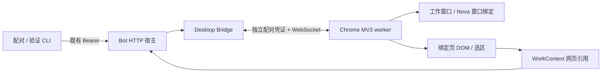

# OpenNova M0 浏览器接入验证

2026-10-18。范围为开发计划任务 1、2：Chrome 扩展、本机连接、双窗口绑定、页面与选区读取。M1 的 Agent 浏览器工具、本地文件打开，以及后续 Nova UI / 语音接线尚未实现。

## 实现和部署



扩展连接本机环回地址；普通 Demo 不启用桥接。独立验证服务使用 `127.0.0.1:18562`，调用与 Bot 宿主相同的 HTTP 鉴权、Desktop Controller 和 WebSocket 实现；不启动模型、ASR、TTS 或麦克风。验证服务右侧是测试输入框，完整 Bot 对话入口在生产宿主 `--desktop` 下仍复用现有网页。

### 独立测试步骤

在本次 M0 工作区根目录执行（Node.js 24）：

```bash
npm ci --prefix services/bot/desktop
node tools/desktop/probe.mjs
```

代码更新后需在扩展管理页点击“重新加载”，单纯重启浏览器可能仍使用已缓存的后台模块。

首次安装：在 Chrome 打开 `chrome://extensions`，启用开发者模式，选择“加载未打包的扩展程序”，选本工作区的 `extensions/browser` 文件夹。打开扩展详情中的“扩展程序选项”。

另开一个终端，在同一工作区执行：

```bash
node tools/desktop/setup.mjs --probe
```

将服务地址 `http://127.0.0.1:18562` 和刚生成的配对码填进扩展设置页，点击“配对”。配对码 60 秒内有效且只能用一次；超时重新执行 setup。需要读取外部网页时，点击“授权 HTTP(S) 页面读取”，或在 Chrome 扩展详情中按站点管理权限。临时 `activeTab` 权限不足以支持长期后台协作。

```bash
node tools/desktop/client.mjs --probe windows
node tools/desktop/client.mjs --probe open http://127.0.0.1:18562/fixture
node tools/desktop/client.mjs --probe read
node tools/desktop/client.mjs --probe context
node tools/desktop/client.mjs --probe status
```

也可以在扩展设置页点击“打开 / 复用双窗口”“读取工作页”“刷新状态”。页面加载期间可能返回 `work_page_unavailable`，待正文出现后重试。明确绑定其他已打开的网页时，点击该页工具栏上的 OpenNova 扩展图标。

真实网站验证：

```bash
node tools/desktop/client.mjs --probe open https://xueqiu.com/S/SZ000988
# 等页面正文显示后执行：
node tools/desktop/client.mjs --probe read
```

结束验证时在 probe 终端按 Ctrl+C。配对凭证保存在 Git 忽略的 `output/desktop-m0` 和扩展私有存储中；关闭验证服务不会影响原有语音 Demo。

### 接入既有 Bot 宿主

先完成上述依赖安装，再从同一工作区运行 `node services/bot/launch.mjs --desktop`。setup / client 命令去掉 `--probe`，使用原 Bot 的 `127.0.0.1:18560`。已有未带 `--desktop` 启动的宿主需先正常停止再启动；M0 不自动中断正在运行的对话。当前只提供 CLI / 扩展验证操作，还不能在 Bot 对话中说“打开网页”来调用该桥接。

## 验证记录

实际环境：macOS，独立 Chrome for Testing **156.0.8078.4**，加载工程中的真实 MV3 扩展。未更改日常 Chrome 的扩展、标签页或登录状态。日常 Chrome **155.0.8059.84** 的手动安装流程保留给用户验收，不将测试版通过等同于所有 Chrome 版本通过。

| 用例 | 测试操作 | 实际结果 |
| --- | --- | --- |
| 配对与鉴权 | 一次性码、超时、错误 Origin、无认证 WS | 自动测试通过；真实设置页配对并建立 WS 成功 |
| 双窗口复用 | 连续两次 windows | 返回相同窗口和标签页 ID；不重复创建 |
| 页面快照 | 读取 fixture | 返回标题、正文、链接和按钮；密码、textarea、隐藏文本标记未进入正文 |
| 选区保留 | 选择 fixture 文本，点击右侧输入框 | 仍引用左侧同一 workTabId 与选中文字 |
| SPA 跳转 | 点击“SPA 跳转”，用旧 PageRef 再读 | URL / 标题更新，revision 0→1，选区清空，旧引用返回 stale_page |
| 目标替换 | 点击“替换链接”后重新读取 | 被替换链接 ref 改变，未替换目标 ref 保留；动画不让整页引用失效 |
| 超长正文 / 选区 | 点击“显示超长正文”并全选长段落 | 正文 12000 字符、选区 4000 字符，均标明截断 |
| 超长链接集合 | 注入 100 个约 7000 字符的测试链接 | 曾触发包过大断线；修复后限制总包大小并标明 targetsTruncated |
| 框架边界 | fixture 包含跨域 iframe | 主页面可读；返回 cross_origin_iframe_not_read，不冒充已读取框架内容 |
| 雪球 | 打开华工科技 SZ000988 公共页面 | 实际读取成功，重定向到 www.xueqiu.com；正文 4705 字符、100 个目标，包含公司名称和行情文本，无需登录。图表画布未解析，未操作关注或交易 |
| 普通文章 | Chrome 官方“声明权限”文章 | 实际读取成功，2774 字符、100 个目标；普通页面读取路径成立 |
| worker 恢复 | 强制停止扩展 worker，等待 alarm | 观测到断开，17.6 秒后重连；命令记录数量 48→48，绑定保持，没有重放 |
| 浏览器重启 | 关闭测试浏览器，再以同一独立 profile 启动 | 配对仍有效；session 绑定清空，新建工作标签页 ID 与旧值不同，没有误绑恢复页 |
| 同 URL SPA 导航 | history.pushState 保持 URL，只改变页面状态 | 修复后 Chrome 实测 revision 1→2，旧 PageRef 返回 stale_page |
| 误入 Nova 页面 | 工作页手工导航到 Nova，或通过 open 打开 Nova | 均拒绝当作工作内容读取；返回 chat_page_cannot_be_work_page |
| 旧连接迟到消息 | 替换已认证 WS，旧端延迟完成关闭并发送 context | 真实 WebSocket 回归通过；旧端消息不再改变当前上下文 |
| 切换加载中的标签页 | A 开始导航后切换到已经加载的 B | 回归通过；A 的加载状态不阻塞 B，导航失败可恢复 |
| 文件上下文边界 | 文件引用期间收到后台浏览器事件 | 单元测试通过；M0 只预留 context 接口，实际文件打开属于 M1 |

自动化回归：本次 77 项 Node 测试通过（含原有 Bot 回归）。

```bash
OPENNOVA_HARNESS_ROOT=/Users/chenzhuoping/Documents/work/project/deepseek-harness \
node --test services/bot/tests/*.test.mjs extensions/browser/tests/*.test.mjs
```

独立工作树需要显式指向已有 Harness；在正常项目布局下可使用既有默认路径。真实浏览器的截图与原始快照放在本工作区 `output/playwright/`，不提交含完整网页内容的临时输出。

## 明确边界

- 首版仅按需读取绑定标签页的顶层 DOM；iframe、Canvas 图表、图片 OCR、PDF 内嵌阅读器和原生应用内容没有接入。
- 站点拒绝注入、权限不足或浏览器内置页面会返回不可读状态；不会绕过登录、验证码或页面权限。
- 页面还在加载时，快照的 `loading` 标识表示内容可能继续变化。
- 已发送命令遇到断线、超时或取消返回 `unknown`；服务和 worker 不会自动重放。结果不能据此宣称“网页操作没有发生”。
- M0 命令去重记录最多 2048 个，达到上限明确报 `command_journal_full`；M1 再接入现有持久操作记录。快照正文不写入命令日志。
- 新 UI、LLM 工具、点击 / 填写 / 滚动执行、语音协作、一键打开原生文件均留在对应后续里程碑。

参考：[Playwright 扩展测试说明](https://playwright.dev/docs/chrome-extensions)、[Chrome 权限说明](https://developer.chrome.com/docs/extensions/develop/concepts/declare-permissions)。

## 审查与后续整理

独立代码审查提出的四项重要问题已修复，并先复现失败、再通过回归。最终 77 项测试通过；fixture、同 URL SPA、聊天页排除和超长链接包另经过 Chrome 实测。实际窗口 top / height 对齐，右侧宽 400、间隔 12；小屏上下排列规则有自动测试，尚未做实际小屏验收。

两项非阻塞整理留待后续：展开较紧凑的状态处理代码；增加跨版本协议协商。目前宿主和扩展应来自同一份 M0 代码。

本次实现保留在隔离分支 `codex/desktop-browser-m0`，既有 Bot 代码先以单独基线提交保存，M0 单独提交；未合并或推送。测试宿主与真实 Bot 共用桥接实现，但不建立第二个业务会话。命令记录上限、CFT 测试环境和未实现的后续能力均按上述边界处理。
