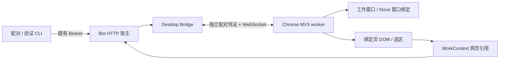

# OpenNova M0 / M1 桌面协作验证

2026-10-18。M0 验证记录保留如下；M1 已接入 Agent 浏览器工具、本地文件打开与共享工作引用。新版 Nova UI、语音界面接线和一键桌面启动仍属于 M2–M4。M1 启动和验收见文末。

## 实现和部署



扩展连接本机环回地址；普通 Demo 不启用桥接。独立验证服务使用 `127.0.0.1:18562`，调用与 Bot 宿主相同的 HTTP 鉴权、Desktop Controller 和 WebSocket 实现；不启动模型、ASR、TTS 或麦克风。验证服务右侧是测试输入框，完整 Bot 对话入口在生产宿主 `--desktop` 下仍复用现有网页。

### 独立测试步骤

在本次 M0 工作区根目录执行（Node.js 24）：

```bash
npm ci --prefix services/bot/desktop
node tools/desktop/probe.mjs
```

代码更新后需在扩展管理页点击“重新加载”，单纯重启浏览器可能仍使用已缓存的后台模块。

首次安装：在 Chrome 打开 `chrome://extensions`，启用开发者模式，选择“加载未打包的扩展程序”，选本工作区的 `extensions/browser` 文件夹。打开扩展详情中的“扩展程序选项”。

另开一个终端，在同一工作区执行：

```bash
node tools/desktop/setup.mjs --probe
```

将服务地址 `http://127.0.0.1:18562` 和刚生成的配对码填进扩展设置页，点击“配对”。配对码 60 秒内有效且只能用一次；超时重新执行 setup。需要读取外部网页时，点击“授权 HTTP(S) 页面读取”，或在 Chrome 扩展详情中按站点管理权限。临时 `activeTab` 权限不足以支持长期后台协作。

```bash
node tools/desktop/client.mjs --probe windows
node tools/desktop/client.mjs --probe open http://127.0.0.1:18562/fixture
node tools/desktop/client.mjs --probe read
node tools/desktop/client.mjs --probe context
node tools/desktop/client.mjs --probe status
```

也可以在扩展设置页点击“打开 / 复用双窗口”“读取工作页”“刷新状态”。页面加载期间可能返回 `work_page_unavailable`，待正文出现后重试。明确绑定其他已打开的网页时，点击该页工具栏上的 OpenNova 扩展图标。

真实网站验证：

```bash
node tools/desktop/client.mjs --probe open https://xueqiu.com/S/SZ000988
# 等页面正文显示后执行：
node tools/desktop/client.mjs --probe read
```

结束验证时在 probe 终端按 Ctrl+C。配对凭证保存在 Git 忽略的 `output/desktop-m0` 和扩展私有存储中；关闭验证服务不会影响原有语音 Demo。

### 接入既有 Bot 宿主

先完成上述依赖安装，再从同一工作区运行 `node services/bot/launch.mjs --desktop`。setup / client 命令去掉 `--probe`，使用原 Bot 的 `127.0.0.1:18560`。已有未带 `--desktop` 启动的宿主需先正常停止再启动；M0 不自动中断正在运行的对话。M1 已支持在 Bot 文本对话中调用该桥接；下文 M0 记录描述当时的验证范围。

## 验证记录

实际环境：macOS，独立 Chrome for Testing **156.0.8078.4**，加载工程中的真实 MV3 扩展。未更改日常 Chrome 的扩展、标签页或登录状态。日常 Chrome **155.0.8059.84** 的手动安装流程保留给用户验收，不将测试版通过等同于所有 Chrome 版本通过。

| 用例 | 测试操作 | 实际结果 |
| --- | --- | --- |
| 配对与鉴权 | 一次性码、超时、错误 Origin、无认证 WS | 自动测试通过；真实设置页配对并建立 WS 成功 |
| 双窗口复用 | 连续两次 windows | 返回相同窗口和标签页 ID；不重复创建 |
| 页面快照 | 读取 fixture | 返回标题、正文、链接和按钮；密码、textarea、隐藏文本标记未进入正文 |
| 选区保留 | 选择 fixture 文本，点击右侧输入框 | 仍引用左侧同一 workTabId 与选中文字 |
| SPA 跳转 | 点击“SPA 跳转”，用旧 PageRef 再读 | URL / 标题更新，revision 0→1，选区清空，旧引用返回 stale_page |
| 目标替换 | 点击“替换链接”后重新读取 | 被替换链接 ref 改变，未替换目标 ref 保留；动画不让整页引用失效 |
| 超长正文 / 选区 | 点击“显示超长正文”并全选长段落 | 正文 12000 字符、选区 4000 字符，均标明截断 |
| 超长链接集合 | 注入 100 个约 7000 字符的测试链接 | 曾触发包过大断线；修复后限制总包大小并标明 targetsTruncated |
| 框架边界 | fixture 包含跨域 iframe | 主页面可读；返回 cross_origin_iframe_not_read，不冒充已读取框架内容 |
| 雪球 | 打开华工科技 SZ000988 公共页面 | 实际读取成功，重定向到 www.xueqiu.com；正文 4705 字符、100 个目标，包含公司名称和行情文本，无需登录。图表画布未解析，未操作关注或交易 |
| 普通文章 | Chrome 官方“声明权限”文章 | 实际读取成功，2774 字符、100 个目标；普通页面读取路径成立 |
| worker 恢复 | 强制停止扩展 worker，等待 alarm | 观测到断开，17.6 秒后重连；命令记录数量 48→48，绑定保持，没有重放 |
| 浏览器重启 | 关闭测试浏览器，再以同一独立 profile 启动 | 配对仍有效；session 绑定清空，新建工作标签页 ID 与旧值不同，没有误绑恢复页 |
| 同 URL SPA 导航 | history.pushState 保持 URL，只改变页面状态 | 修复后 Chrome 实测 revision 1→2，旧 PageRef 返回 stale_page |
| 误入 Nova 页面 | 工作页手工导航到 Nova，或通过 open 打开 Nova | 均拒绝当作工作内容读取；返回 chat_page_cannot_be_work_page |
| 旧连接迟到消息 | 替换已认证 WS，旧端延迟完成关闭并发送 context | 真实 WebSocket 回归通过；旧端消息不再改变当前上下文 |
| 切换加载中的标签页 | A 开始导航后切换到已经加载的 B | 回归通过；A 的加载状态不阻塞 B，导航失败可恢复 |
| 文件上下文边界 | 文件引用期间收到后台浏览器事件 | 单元测试通过；M0 只预留 context 接口，实际文件打开属于 M1 |

自动化回归：本次 77 项 Node 测试通过（含原有 Bot 回归）。

```bash
OPENNOVA_HARNESS_ROOT=/Users/chenzhuoping/Documents/work/project/deepseek-harness \
node --test services/bot/tests/*.test.mjs extensions/browser/tests/*.test.mjs
```

独立工作树需要显式指向已有 Harness；在正常项目布局下可使用既有默认路径。真实浏览器的截图与原始快照放在本工作区 `output/playwright/`，不提交含完整网页内容的临时输出。

## 明确边界

- 首版仅按需读取绑定标签页的顶层 DOM；iframe、Canvas 图表、图片 OCR、PDF 内嵌阅读器和原生应用内容没有接入。
- 站点拒绝注入、权限不足或浏览器内置页面会返回不可读状态；不会绕过登录、验证码或页面权限。
- 页面还在加载时，快照的 `loading` 标识表示内容可能继续变化。
- 已发送命令遇到断线、超时或取消返回 `unknown`；服务和 worker 不会自动重放。结果不能据此宣称“网页操作没有发生”。
- M0 命令去重记录最多 2048 个，达到上限明确报 `command_journal_full`；M1 再接入现有持久操作记录。快照正文不写入命令日志。
- M1 已加入 LLM 工具、点击 / 填写 / 滚动和原生文件打开；M2 已完成新版 UI（见下文），语音界面控制和一键桌面启动仍留待后续里程碑。

参考：[Playwright 扩展测试说明](https://playwright.dev/docs/chrome-extensions)、[Chrome 权限说明](https://developer.chrome.com/docs/extensions/develop/concepts/declare-permissions)。

## 审查与后续整理

独立代码审查提出的四项重要问题已修复，并先复现失败、再通过回归。最终 77 项测试通过；fixture、同 URL SPA、聊天页排除和超长链接包另经过 Chrome 实测。实际窗口 top / height 对齐，右侧宽 400、间隔 12；小屏上下排列规则有自动测试，尚未做实际小屏验收。

两项非阻塞整理留待后续：展开较紧凑的状态处理代码；增加跨版本协议协商。目前宿主和扩展应来自同一份代码；更新宿主时同时重新加载扩展。

本次实现保留在隔离分支 `codex/desktop-browser-m0`，既有 Bot 代码先以单独基线提交保存，M0 单独提交；未合并或推送。测试宿主与真实 Bot 共用桥接实现，但不建立第二个业务会话。命令记录上限、CFT 测试环境和未实现的后续能力均按上述边界处理。


## M1：文字驱动网页与原生文件协作

本次沿用隔离分支 `codex/desktop-browser-m0`；没有更改主工作区中的运行版本。

### 开发验证启动

两个终端均先执行以下环境设置，避免与现有 Demo 的 18560 端口和会话混用：

```bash
cd /Users/chenzhuoping/.codex/worktrees/desktop-browser-m0/openNova
export PATH="/opt/homebrew/opt/node@24/bin:$PATH"
export OPENNOVA_HARNESS_ROOT=/Users/chenzhuoping/Documents/work/project/deepseek-harness
export OPENNOVA_BOT_HOME="$PWD/output/bot/m1-home"
export OPENNOVA_BOT_PORT=18564
export OPENNOVA_BOT_WEB_PORT=18565
```

第一个终端运行 `node services/bot/launch.mjs --desktop`，保持运行。已有宿主若来自更新前的代码，先 Ctrl+C 正常停止后重启。

第二个终端运行 `node tools/desktop/setup.mjs`，在同一工作区的扩展设置中填写 `http://127.0.0.1:18564` 和一次性配对码。更新代码后在 `chrome://extensions` 重新加载扩展，授权 HTTP(S) 站点读取，再执行：

```bash
node tools/desktop/client.mjs windows
```

右侧打开真实 Bot 网页，可直接输入文字。网页与语音/终端仍走同一个 Bot 会话和前台请求队列；本阶段没有新增网页麦克风或语音状态控制。没有扩展连接时，本地文件工具仍可用。

### 简单验收案例

| 输入 / 操作 | 预期 |
| --- | --- |
| “帮我打开雪球上的华工科技” | 从雪球首页站内搜索、核对实际证券链接后打开，返回真实标题和网址 |
| “看看最新公告” | 点击公告栏目后读取当前列表；区分列表时间和公告正文日期 |
| 在左页选一段文字，回到右侧输入“解释选中的这段话” | 输入区上方保留选区；本轮使用发送时的引用 |
| “打开 docs/research/opennova-desktop-interaction-test-cases.md” | 使用本机默认应用，显示文件卡片与“打开请求已发送”；不再要求批准 |
| “用预览打开 output/desktop-m1/M1 PDF test.pdf” | 测试文件存在时以 Preview 打开；只报告打开请求，说明 PDF 正文未接入 |
| 点文件卡片“再次打开” | 通过已登记 fileId 打开同一文件，网页不能传任意路径或 Shell |
| 回复期间停止，或人为切换工作页 | 未执行命令被取消；旧目标失败；已发送但不确定的操作不会自动重放 |

`output/desktop-m1` 是本次实测生成、Git 忽略的测试文件目录，不是交付依赖。其他机器可使用自行创建的 TXT、PDF、DOCX 文件代替。

### M1 实测记录

- Chrome for Testing 156：真实填写搜索框、点击表单、滚动 600 px、点击链接产生的新标签页跟踪均通过。普通输入框只提供角色与名称，输入值不进入页面正文；密码字段未接入。
- 实际 GPT-6.1 Sol / DeepSeek-Bot：从雪球首页搜索华工科技，核对并读取 `https://www.xueqiu.com/S/SZ000988`，返回真实证券页面标题；继续点击“公告”并读到列表标题与显示时间。没有进行登录、关注或交易。
- 选区与网页入口：在证券页选中公告标题、切到 Nova 后，实际模型仅按该选区解释。网页发送文字请求打开并读取测试 TXT，页面显示文件卡片；“再次打开”回执成功，后台网页读取没有抢占文件引用。
- 原生文件：TXT 在 TextEdit 显示；PDF 在默认 WPS 和指定 Preview 打开，Preview 可见测试正文；DOCX 指定 WPS 后可见测试窗口。Pages 返回 dispatched 但首次使用停在许可欢迎页，未代用户接受许可；这也验证了 dispatched 不等于已呈现。
- 本地打开采用 `/usr/bin/open` 参数数组和最小环境；源代码使用 `-t`，指定应用仅允许已列明的编辑器。10 秒超时、宿主中断和发送后取消标记 unknown，历史命令不自动重放。
- 文件引用记录磁盘版本；修改后显示已更新、删除后标记失效。PDF / Office / 图片只接入打开能力，不解析正文或原生应用选区。
- 自动回归：Bot / 扩展 102 项、Agent 62 项、ASR 26 项、语音 63 项、TTS 10 项、setup 3 项通过；网页资源构建成功。Node SQLite 的实验性提示是运行时提示。

仍需知道的边界：仅普通顶层 DOM；对 JS 自行弹出的无关联窗口不自动绑定，可手工点击扩展图标选择。跨版本协议协商、命令去重日志超过 2048 条的轮换、新版界面和语音状态同步未在 M1 扩展。实测原始回执保存在本工作区 `output/playwright`、`output/desktop-m1`，不提交网页正文与账号信息。


### M1 审查修复

独立审查发现点击后的手工切页可能被误认为点击目标。已用失败回归复现并修复：只有原绑定或同一命令实际触发的新标签页可以作为后续引用，用户另选页面返回 `context_changed`，同时保留点击已经发出的事实。另两项导航 / 取消问题按用户影响提升为本次必须修复：无关标签页和子框架导航不再中断有效操作；取消或失败的点击会清除待跟踪弹窗。三项回归通过，真实 Chrome 的输入、点击、滚动和相关弹窗回执再次通过。

最终回归共 266 项通过（102 Bot/扩展 + 62 Agent + 102 Python），网页构建和 `git diff --check` 通过。代码保留在隔离分支，尚未合并或推送。开发与验证时原生应用自动排列、网页版语音控制和新的深空 UI 均未计入完成范围。


## M2：深空 Nova 对话窗口

M2 继续位于隔离分支 `codex/desktop-browser-m0`，启动环境和命令沿用上文“M1：开发验证启动”。宿主与扩展使用同一工作树的最新代码；重新启动宿主、在 Chrome 扩展页重新加载扩展，再刷新 Nova 页面即可。现有日常 Demo 工作区尚未合并本分支。

### 已实现

- 深蓝背景、青色约 72 px 环形 Nova；连接、思考 / 工作和空闲状态来自真实 Bot。移除项目侧栏与独立操作面板。
- 同一会话内显示语音、网页、终端消息；文件修改、浏览器操作、Shell 和记忆记录按请求归属展示，点击展开差异、输出和错误。早期无请求编号的记录保留在折叠的“其他操作记录”中。
- 输入区上方显示工作网页 / 选区或文件引用。清除选区保留网页身份；扩展的新选区有独立 ID，后台旧快照不会把已清除的引用加回来。
- 文件卡片展示名称、目录、打开方式和回执，并可重新打开。服务重启只恢复“上次关联文件 / 历史打开记录”，不重开文件、不声称应用当前在前台，不把打开成功当成正文已读。
- 事件通道保留最近 512 条事件，以宿主 epoch + 序号恢复；事件失效、断网或宿主重启后重新取快照，5 秒轮询兜底（后台页 15 秒）。持久请求和操作继续存于原 SQLite，没有自动重放工具。
- 未发送草稿与待确认发送记录保存在当前网页的 sessionStorage；刷新可恢复，重复发送沿用原请求编号。语音状态桥接属于 M3，本阶段显示“语音未启动”，网页不启用麦克风或重复播报。

### 验收方法

| 操作 | 预期 |
| --- | --- |
| 打开 Nova，缩窄到约 400 px | 环形 Nova、消息、输入区保持可见，没有固定侧栏或整页横向滚动 |
| 输入“读取一个测试 TXT，复制到新文件并增加一行，再用 Shell 核对、打开新文件” | 实际执行，无二次确认；每项操作显示在本轮消息内，文件卡片显示打开回执 |
| 展开“写入文件”或“执行命令” | 可读差异 / 输出；展开位置不会被自动跟随滚动挤走 |
| 在工作页选文字、回到 Nova，再点清除选区 | 保留网页名称和地址，只移除选区；重新选中同一段可再次引用 |
| 中文输入法组合期间按回车；再用 Shift + Enter | 组合态回车不发送；Shift + Enter 换行 |
| 暂时断网并输入草稿，恢复后刷新 | 草稿保留；恢复不会新增重复请求 |
| 回复期间刷新，或点“停止回复” | 刷新继续显示同一请求；停止走服务端取消，环形回到空闲 |
| 开启系统“减少动态效果” | 环形动画停止；文字状态和操作结果仍可读取 |
| 重启 Bot 宿主 | 网页自动重连；已完成历史不倒退，文件引用标为历史，不新增打开记录 |

### 本次验证记录

2026-10-18，在 Chrome for Testing 156、400 × 850 窗口验证：

- 真实 GPT-6.1 Sol / DeepSeek-Bot 从网页收到请求，读取测试 TXT，写入 `output/desktop-m1/M2 窗口验收.txt`，用 Shell 读回核对，调用文件打开器；实际磁盘内容包含“M2 对话窗口验证通过”，网页显示六项对应操作与文件卡片。
- 独立 UI fixture 通过真实 HTTP / SQLite / Requests / SSE 链路检查 55 条历史分页、长代码与表格、差异和 Shell 输出展开、组合态回车保护、键盘焦点、Shift + Enter、离线草稿刷新、清除选区、任务中刷新、停止回复、reduced-motion。fixture 替代模型推理和外部打开，不计为真实模型实测；组合态测试为 DOM 事件模拟，不冒充真人输入法验收。
- 修复窄屏下上游悬浮操作按钮越界；实测页面宽 400 px，消息滚动区内容宽与可视宽均为 389 px，长代码和差异仅在各自内容区滚动。
- 修复展开操作详情时自动跟随滚动抢走阅读位置：修复前标题上跳 194 px，修复后位移为 0。
- 真实宿主重启后 epoch 改变，网页自行重连；请求数 7→7，文件打开记录 3→3，文件引用恢复为 `historical:true`，没有重放或再次调用打开器。
- 独立代码审查没有发现额外必须修复的问题；M3 的语音播放 / 控制与 M4 的统一启动不在本次审查范围。此前 M0/M1 仅复查本次改动涉及的引用和恢复逻辑，其他行为通过现有回归验证。

最终回归 279 项通过（Bot / 扩展 115 + Agent 62 + ASR 26 + 语音 63 + TTS 10 + setup 3），网页构建通过。测试日志与截图保存在 `output/playwright/m2-*`，均为 Git 忽略的本机验收材料。控制台在主动断网、重启和重新取得网页会话时出现的连接中断 / 401 是对应恢复测试的预期记录；未观察到应用 JavaScript 异常。

当前边界：M2 不提供网页语音启停 / 静音 / 插话控制，不改变 VAD 或 TTS；原生应用仍只支持文件打开与已有文本读取，不跟踪前台窗口或读取未保存内容。服务与扩展应同步更新；多版本协议协商和 2048 条浏览器命令日志轮换继续后置。

## M3：语音与环形 Nova 联动

M3 继续保留在 `codex/desktop-browser-m0` 隔离工作区。实现已完成；真实麦克风说话与插话听感仍待现场验收。M4 已提供下方统一 `--ui` 启动入口；日常 Demo 主工作区未切换到本分支。

### 启动当前开发版

如果 `http://127.0.0.1:18564/` 已可访问且是更新后的宿主，直接启动下面的语音进程。宿主没有运行时，先按本页“M1：开发验证启动”配置环境并运行 `node services/bot/launch.mjs --desktop`。浏览器 / 原生文件工作能力沿用 M1，网页对话沿用 M2。

另开终端执行（本机开发路径；两端必须使用同一个 Bot home 和端口）：

```bash
cd /Users/chenzhuoping/.codex/worktrees/desktop-browser-m0/openNova
export OPENNOVA_BOT_HOME="$PWD/output/bot/m1-home"
export OPENNOVA_BOT_PORT=18564
export OPENNOVA_CONFIG=/Users/chenzhuoping/Documents/work/project/openNova/config/voice.local.json
export OPENNOVA_SECRETS_FILE=/Users/chenzhuoping/Documents/work/project/openNova/config/secrets.local.json
uv run tools/voice/conversation.py --continuous --bot --tts-provider doubao \
  --device 'MacBook Air麦克风' --output-device 'MacBook Air扬声器'
```

家中 Studio / Vivian：把 `--tts-provider doubao` 改成 `--tts-provider studio`，沿用配置文件中的 TTS URL；原有 Studio 连接需已就绪。设备参数可以改为当前实际设备名，例如 `SRS-XB100`。先列设备可用 `uv run tools/voice/conversation.py --list-devices`。豆包默认 1 倍速、Studio 默认 1.5 倍速均保留；本阶段未更改 VAD、降噪、插话阈值或 TTS 分段策略。配置与密钥文件只在本机读取，不复制进 Git。

打开或刷新 [Nova 对话窗口](http://127.0.0.1:18564/)。语音进程连接后自动出现麦克风按钮、“结束 / 开始”和“重连”。没有语音进程时仍可文字对话，网页不会自行请求麦克风权限或合成音频。终端 `Ctrl+C` 或 `/quit` 关闭语音；Bot 网页和已打开的文件应用保留。

### 联动规则

| 实际链路状态 | 界面表现 |
| --- | --- |
| 原生收音就绪 | 环形轻微呼吸，显示“正在聆听”；底部独立显示麦克风状态 |
| ASR 识别中 | “正在识别”，一条实时草稿随完整转写修订替换；final 仍只由现有语音链路提交一次 |
| Bot 执行 | “正在思考 / 正在工作”，结果与网页输入进入同一历史 |
| 等待 TTS 或队列耗尽但合成未结束 | “等待语音”，不把 Bot 文本已完成当成声音播放完成 |
| 原生队列正在播放 | 环形脉动、“正在播报”；静音麦克风不停止播报 |
| 插话候选暂缓播放 | “暂缓播报”；沿用原有联合确认和自动恢复逻辑 |
| 停止回复 | 清空当前播放队列，取消对应请求；旧请求的停止和回执不能影响新回复 |
| 语音进程断开或心跳超过 6 秒 | “语音未启动”，禁用语音控制，文字保持可用 |

这些动画表示活动状态，不是音量波形；系统“减少动态效果”开启时停止动画。原始收音不上传到网页；临时转写只保留在内存快照与事件通道中，最终消息走原有持久会话。

语音桥使用现有本机 Bearer 认证；网页控制继续经过同源 Cookie / CSRF 校验。控制按实例、请求与播放代次绑定，重复编号不重复执行；每次只交付一个待执行原生指令，停止优先。重连音频先暂停收音，再恢复当前用户意图；在重连期间静音或结束，不会意外重新聆听。进程被新实例接管后，旧实例会停止收音与播报并退出。

### 验收流程

1. 启动语音并刷新网页，观察“麦克风聆听中”。说“帮我打开 OpenNova 的 MVP 产品需求文档”：草稿持续更新，最终只出现一条语音请求，实际文件由默认应用打开。
2. 在网页输入“第 4 章标题是什么？读取文档后回答”：沿用同一会话与文件引用。网页不会再播一份重复音频。
3. 语音让 Nova 做一段较长介绍，等“正在播报”后点“停止回复”：声音停止、历史文字保留、环形退出播报；即使 Bot 文本已生成完，也仍可停止声音。
4. 播报期间点麦克风按钮静音：只停止收音；再点恢复。点“结束”则停止本次交流，之后点“开始”才能继续收音。
5. 点“重连”，立即点“结束”；重连完成后应保持结束。静音时重连也应保持静音。重连不是重启 Bot，不丢失会话。
6. 退出语音，确认网页显示“语音未启动”，仍可文字对话。再次运行同一语音命令后自动恢复状态，不重放历史语音。

### 本次实测与边界

2026-10-18：

- 真实 Bot 宿主 18564、原生 MacBook Air 麦克风 / 扬声器和 Chrome for Testing 400 × 850：网页静音、结束、重连、重连期间结束的实际回执通过；页面无横向溢出。重连后结束最初触发已关闭连接写入，已补回归并修复，重测未再出现。
- 用系统合成的中文测试 WAV 运行真实 VAD / 豆包 ASR → GPT-6.1 Sol / Bot → `document_open` → 豆包 TTS：识别最终文本正确，只提交一轮，实际打开 `docs/product/opennova-mvp-prd.md`，合成 PCM 336,716 字节；该次文件测试使用 `--no-play`。随后真实网页追问读取磁盘，第 4 章回答为“产品架构”。这属于测试音频输入，不冒充真人麦克风验收。
- 单独运行真实 GPT → 豆包 TTS → 原生播放队列，测试中暂停麦克风采集：观测 `buffering → playing → idle`，网页在 Bot 已完成后点击停止，原生剩余帧数归零，管线记录 `interrupted`，没有重复播报。状态来自真实原生回执；未据此宣称听感质量通过。
- 独立审查的三项必须修复问题均已补充失败回归再修复：控制队列满时仍取消 Agent；终端旧停止不取消新请求；被替换的旧语音进程不再继续收音。原生 Swift helper 编译通过。另修复取消发布任务时 HTTP 恰好返回导致退出等待的问题，实际重跑确认播放队列清空、语音进程正常退出、网页回到“语音未启动”。系统减少动态效果下，实际播报时环形 animation 为 none。
- 自动回归：186 项 Node（Bot / 扩展 / Agent）、100 项语音、26 项 ASR、19 项 TTS、3 项 setup，共 334 项；网页构建通过。证据位于本机 Git 忽略目录 `output/voice/m3` 与 `output/playwright/m3-*`。

本次执行环境的实际麦克风持续返回全零信号，因此真人说话、远场噪声与插话听感没有验收结论。请在自己的终端按上述流程验收；M3 不把“音频引擎已开启”当成有效收音。Studio/Vivian 分支沿用原实现与自动回归，本次真实 TTS 服务验证使用豆包。语音自动拉起、窗口排列及日常 Demo 的统一启动留待 M4。

## M4：一键启动与双窗口

2026-10-19：M4 代码已实现，继续保留在 `codex/desktop-browser-m0` 隔离分支。日常主工作区未切换，未推送 GitHub。Chrome 扩展、宿主和网页资源应一起更新；本次开发预览为 `http://127.0.0.1:18564/`。

### 当前这台机器直接启动

已生成一个本机专用入口（Git 忽略，里面只有路径和端口，没有密钥）。它选择独立的开发 Bot home / 18564 端口，读取主工作区既有配置和密钥文件，不复制这些文件。入口固定使用已配对的 Chrome for Testing 和原配置目录，重启电脑后也能恢复扩展连接：

```sh
# 家中：Studio / Vivian，蓝牙麦克风和音响
/Users/chenzhuoping/.codex/worktrees/desktop-browser-m0/openNova/output/desktop/start-m4.command --tts-provider studio --device 'SRS-XB100' --output-device 'SRS-XB100'

# 办公室：豆包 VV，设备省略时使用系统默认输入输出
/Users/chenzhuoping/.codex/worktrees/desktop-browser-m0/openNova/output/desktop/start-m4.command --tts-provider doubao
```

需要指定 GPT 代理时，在命令前加 `OPENNOVA_PROXY=http://127.0.0.1:7897`，或使用 `--proxy`。复用的 Bot 沿用原启动环境，不会在当前任务中热切换代理。耳机或麦克风名称变化时先加 `--list-devices` 查看；可用 `--no-ui` 覆盖本机入口默认的 `--ui`，仅启动终端语音。

本机入口等价于在隔离目录设置以下环境后运行根目录脚本；换电脑时不要照抄本机绝对路径：

```sh
cd /Users/chenzhuoping/.codex/worktrees/desktop-browser-m0/openNova
export OPENNOVA_BOT_HOME="$PWD/output/bot/m1-home"
export OPENNOVA_BOT_PORT=18564
export OPENNOVA_BOT_WEB_PORT=18565
export OPENNOVA_HARNESS_ROOT=/Users/chenzhuoping/Documents/work/project/deepseek-harness
export OPENNOVA_CONFIG=/Users/chenzhuoping/Documents/work/project/openNova/config/voice.local.json
export OPENNOVA_SECRETS_FILE=/Users/chenzhuoping/Documents/work/project/openNova/config/secrets.local.json
export OPENNOVA_BROWSER_EXECUTABLE='/Users/chenzhuoping/Library/Caches/ms-playwright/chromium-1248/chrome-mac-arm64/Google Chrome for Testing.app/Contents/MacOS/Google Chrome for Testing'
export OPENNOVA_BROWSER_USER_DATA_DIR="$PWD/output/playwright/m0-cft-profile"
./start.command --ui --tts-provider studio
```

以后合入日常工作区，使用该工作区的 `./start.command --ui` 即可。默认仍是 `--no-ui`；`--device`、`--output-device`、`--tts-provider`、`--tts-voice`、`--studio-host`、`--studio-tts-dir` 与 `--tts-port` 保留。启动顺序：Bot → 扩展及窗口 → TTS → 原生语音。

### Chrome 首次设置

1. 安装 Chrome，在 `chrome://extensions` 开启开发者模式，“加载已解压的扩展”，选择当前工作区的 `extensions/browser`。
2. 用 `--ui` 启动。未配对时终端显示当前服务地址和 60 秒一次性配对码；在 OpenNova 扩展的设置页填写并配对。长期凭据不放入网页 URL 或终端日志。
3. 配对码过期时，在相同环境变量下运行 `node tools/desktop/setup.mjs` 重新生成。配对完成后再次运行启动命令，或点击 Nova 顶部的“打开工作窗口”。
4. 已配对的 Chrome 关闭时，启动器会打开所配置的浏览器并等待扩展连接。专用浏览器通过 `OPENNOVA_BROWSER_EXECUTABLE` 和 `OPENNOVA_BROWSER_USER_DATA_DIR` 同时指定；启动时加载当前工程扩展。未配置时仍打开日常 Google Chrome。仍未连接则打开普通文字入口，语音和文件协作继续可用；同一次 Bot 运行期间不反复新增文字页。手动关掉降级文字页后可用终端打印的 URL 再打开。

开发实测使用独立 Chrome for Testing 配置，以免改动日常 Chrome 登录状态；配对属于该浏览器配置。日常 Google Chrome 需按以上步骤单独安装并配对。旧 Bot 如果未启用桌面能力，不会被启动器自动终止；结束当前任务后，在同一环境中执行 `tools/bot/run.command --stop`，再以 `--ui` 启动。

2026-10-19 现场修正：此前入口没有指定浏览器配置，重启后打开了未配对的日常 Chrome，触发 `browser_disconnected`，也没有执行双窗口排列。本机入口现已绑定既有测试浏览器配置；如果缓存中的浏览器被删除或升级迁移，需更新可执行文件路径，保留原配置目录中的配对状态。界面顶部“已连接”指对话服务连接，不代表浏览器扩展或语音已连接。

修正验证：Node 216 项回归通过（`OPENNOVA_HARNESS_ROOT` 使用实际 Harness 目录）。真实浏览器从关闭状态启动，扩展由断开恢复为连接并创建双窗口；网页输入“帮我打开雪球网站”后工具完成，工作页标题为“雪球 - 聪明的投资者都在这里”。当前 Air 屏幕上的工作窗口边界为 `(85,33)-(1058,956)`，对话窗口为 `(1070,33)-(1470,956)`，上下对齐、间距 12、右侧宽 400。再次正常退出并重新启动测试浏览器，自动连接及开窗仍通过。本次未重新验收真人语音或 TTS 音质。

2026-10-19 另发现该浏览器配置只有本机地址的持久站点权限。雪球页面可正常打开并肉眼查看，但扩展读取正文返回 `permission_required_or_restricted_page`，当次未扩大权限。

2026-10-20 经用户明确确认，在独立 Demo 浏览器中完成 HTTP(S) 网站读取和修改权限授权。实际读取雪球首页成功（`readable: true`），随后正常退出浏览器，确认控制通道断开，再通过同一启动逻辑恢复双窗口。重启后站点权限仍保留；在 Nova 对话框输入“请打开雪球首页，并实际读取页面正文，告诉我页面标题和两个你读到的导航栏目”，打开与读取两个工具均完成，返回标题“雪球 - 聪明的投资者都在这里”和栏目“基金”“资讯”。日常 Chrome 的权限未修改，启动命令不变。本次验证使用文字入口，语音未重新启动。

2026-10-20 工作窗口前置修正：此前 `browser_open` 只激活标签页，没有聚焦该标签页所在窗口，因此网页已打开但仍可能被其他应用遮挡。现在显式打开网页会聚焦实际工作窗口；窗口已最小化时恢复普通状态，保留原有位置和尺寸。后台读取、页面刷新和启动器复用窗口不会因此抢占焦点。

本次 Node 220 项回归通过，日志为 `output/voice/m4/work-window-focus-tests.log`，覆盖普通、最小化、最大化窗口及取消/后台读取边界。真实 Chrome for Testing 中，在扩展管理页重新加载代码后再重启浏览器：隐藏浏览器、让 Codex 留在前台，调用实际打开接口后雪球窗口出现在 Codex 前方；最小化工作窗口后，读取正文和复用双窗口保持最小化，显式打开网页则恢复原有左侧位置和尺寸。右侧 Nova 窗口保持原布局。本次只验证窗口链路，未启动麦克风或重新验收语音听感。

更新扩展代码后应在 `chrome://extensions` 点击 OpenNova 的“重新加载”；本机实测单纯退出再启动浏览器仍可能运行缓存的旧模块。开发版扩展需要保持开发者模式开启。

2026-10-20 跳转后读取修正：15:40 的失败记录表明，`browser_open` 返回了 `https://xueqiu.com/` 的中间文档；网站随后进入 `https://www.xueqiu.com/`，文档编号已改变，`browser_read` 因旧引用返回 `context_changed`。权限正常，原策略却要求页面变化后直接停止，无法继续读取。

- 打开后等待 DOM 可读（interactive / complete）且页面引用与顶层导航事件连续 500 ms 稳定，最多等待 8 秒；不要求慢速图片等子资源全部结束。未稳定时只报告导航已发送、页面待就绪，不把中间引用当作稳定结果。
- 晚到跳转仍可能超过等待窗口。读取因引用失效被拒绝时，如果当前仍是同一绑定、同一标签页且页面可读，返回 `currentPage` 和恢复标记，不自动替换目标。模型核对新网址仍符合本轮目标后，用新引用继续读取；指令限制最多恢复两次。文件切换、其他标签页切换不会提供这条恢复路径；点击、填写和滚动仍拒绝旧引用，不自动重放。
- 自动回归 224 项通过，包含延迟跳转、页面未就绪、只读恢复、文件/标签页切换边界。真实 Bot 输入“打开雪球，看看首页上有什么栏目”，打开与读取均成功，返回基金、7×24、视频、资讯、达人、私募、ETF 等栏目。另用本机页面在 2.2 秒后跳转，实测先读旧引用失败，再由模型核对并使用新引用读取成功，回答目标页的“天文观察”“机器人制作”，没有重新打开网站。

验证日志在 Git 忽略目录 `output/voice/m4/redirect-regression.log`、`xueqiu-redirect-live.json` 与 `delayed-redirect-live.json`。本次验证走真实文本 Agent 和浏览器链路，未将其计为真人语音验收；窗口前置行为继续保留。

### 关闭工作页面与工作窗口（2026-10-20）

新增 `browser_close`，文字和语音共用同一工具，无需二次确认。`scope=tab` 关闭当前工作引用对应的标签页；`scope=window` 关闭该标签页所在的工作窗口及其标签页，保留 Nova 对话窗口、Bot 和语音进程，不退出整个浏览器应用。

执行前核对绑定、标签页、文档及导航版本；页面已切换或命令已取消时不继续关闭，结果未知时不重放。指定名称必须匹配当前工作引用；本版未增加跨所有窗口查找同名标签页的能力。页面正文没有读取权限时，只要工作引用仍有效，也可以关闭。

关闭后清理旧引用和选区。有剩余工作标签页时接续其引用；最后一页或整个工作窗口关闭时，引用清空。手动点 × 同样修复绑定。再次打开网页或点击“打开工作窗口”会补齐工作窗口，复用原 Nova 对话窗口。

| 用例 | 操作 | 预期 |
| --- | --- | --- |
| 关闭当前指定页面 | 打开并核对华工科技后，说“关闭华工科技这个页面吧” | 关闭该标签页，操作记录完成，无需确认 |
| 关闭当前页 | 说“关闭这个页面” | 只关闭当前工作标签页，其余标签页保留 |
| 关闭工作窗口 | 打开雪球后说“关闭浏览器” | 整个工作窗口关闭；右侧 Nova 对话窗口保留 |
| 关闭后继续工作 | 接着说“再打开雪球，读取一下首页标题” | 自动恢复工作窗口，正常打开和读取，无需重启 Demo |
| 手动关闭 | 点击工作页/窗口的 ×，再让 Nova 打开雪球 | 不使用已失效的标签页编号，正确恢复 |
| 多标签页和旧引用 | 当前工作窗口有多个标签页；关闭一页后再次提交旧引用 | 剩余页保留，旧引用拒绝执行 |

本次 235 项 Node 回归通过，包含新增关闭链路测试，以及现有 Agent、网页工具、窗口与启动器回归。真实 GPT + Chrome for Testing 验证：“关闭华工科技这个页面吧”调用 `browser_close(scope=tab)` 完成；重新打开雪球后，“关闭浏览器”调用 `scope=window` 完成，工作引用变为 `none`，扩展仍连接；随后再次打开并读取首页成功。开关前后的 Nova 对话窗口编号相同，工作窗口编号更新，界面显示“关闭工作页面 · 已完成”。

证据：`output/voice/m4/close-regression.log`、`close-tab-live.json`、`close-window-live.json`。当前 Bot 和扩展已重新加载，启动命令不变。本次现场语音进程原本处于关闭状态，验证使用真实文本入口，不计作麦克风与 TTS 的真人验收；可按上述四句核心指令复测语音。

### 重新打开 Nova 对话窗口（2026-10-20）

新增 `nova_show`，文字和语音共用同一工具。用户说“打开 Nova 对话窗口”“把 Nova 显示出来”时调用：已关闭则重新创建右侧对话窗口；已有窗口则置前，最小化时恢复。重复调用复用同一窗口，保留用户调整后的尺寸和位置。此操作不要求工作网页引用，不打开工作窗口，也不切换当前关联文件或页面。

此前启动器可以补齐窗口，但 Agent 没有对应工具，因此会回答“无法置前”。现在通过已配对扩展执行 `chat.show`，使用本机服务地址；扩展重载导致窗口绑定丢失时，先查找既有专用对话窗口，找不到再创建。

| 用例 | 操作 | 预期 |
| --- | --- | --- |
| 关闭后唤回 | 保持语音终端运行，点击 Nova 窗口 ×，说“打开 Nova 对话窗口” | 新建对话窗口并置前，继续显示同一会话历史 |
| 最小化后恢复 | 最小化 Nova，再说“把 Nova 显示出来” | 恢复已有窗口，不创建副本 |
| 重复请求 | 连续要求打开 Nova | 复用同一窗口 |
| 文件协作中唤回 | 关联文档后关闭 Nova，再要求打开 | 关联文件保留，不切回网页 |
| 工作窗口也已关闭 | 关闭两个窗口，浏览器应用和语音仍运行，再要求打开 Nova | 仅恢复对话窗口 |
| 浏览器已退出或扩展断开 | 在控制通道断开时要求打开 | 报告 `browser_disconnected`，不误报成功；本版不通过此工具启动整个浏览器 |

248 项 Node 回归通过，覆盖工具注册、认证路由、扩展命令、取消、重复命令、丢失窗口编号和窗口恢复。真实 GPT + Chrome for Testing 验证：手动关闭后请求“打开 Nova 对话窗口”，实际调用 `nova_show` 并创建新窗口；手动最小化后请求“把 Nova 对话窗口显示出来”，恢复原窗口；再次调用窗口编号不变。界面显示“打开 Nova 对话窗口 · 已完成”，关联的 `验证清单.md` 和原会话历史保留，没有打开工作网页。

证据位于 Git 忽略目录 `output/voice/m4/show-nova-regression.log`、`show-nova-live.json`、`show-nova-restore-live.json`。本机 Bot 和扩展已加载更新，启动命令不变。现场语音进程原本未连接，本次使用实际文本 Agent 验证共用工具链，未将麦克风和 TTS 计作真人验收；语音测试需先保持 Demo 终端运行。

### 复用与降级规则

| 情况 | 实际行为 |
| --- | --- |
| 重复 `--ui` | 复用同一 Bot、已有语音会话和两个 Chrome 窗口；缺失窗口补齐；不重放历史文件打开 |
| 已有语音会话 | 第二次启动只准备界面后退出，沿用原终端的设备和 TTS；更换设备前先在原终端 `/quit` |
| 用户移动窗口 | 重复启动保留现有位置；首次新建的两个窗口按 Chrome 实际尺寸校正 |
| 明确要求打开网页 | 激活目标标签页并前置其工作窗口；最小化时恢复，保留窗口位置和尺寸 |
| 关闭页面 / 关闭浏览器 | 分别关闭当前工作标签页 / 工作窗口，清理旧引用，保留 Nova 对话；再次打开自动恢复 |
| 打开 / 显示 Nova 对话窗口 | 缺失时创建；存在时置前、最小化时恢复；保留会话历史和工作引用，不打开工作网页 |
| 关联文件已存在 | 自动开窗不抢文件引用；点击“打开工作窗口”明确返回网页引用并聚焦工作窗口 |
| Studio / TTS / 麦克风失败 | Bot 和文字窗口保留，终端给出错误；修复后重新运行相同启动命令，Studio 不可用时可显式选豆包 |
| 扩展未连接 / 未安装 | 网页协作降级；普通文字、语音和本地文件打开仍可使用 |
| 开窗请求发出但回执丢失 | 提示结果未确认；不自动再打开额外文字页，重新启动仅核对和补齐窗口 |
| `/quit` / Ctrl+C | 关闭本次收音、播放与新建 SSH 转发；已有 Bot、Studio 服务、浏览器和文件应用保留 |
| `--check` / `--list-devices` | 不打开窗口、不收音；`--check` 会启动缺失的 Bot / TTS 依赖，豆包模式含短句合成预检 |

### 本次验证结果

- 自动回归：Node 213 项（含启动器 19 项），Python 语音 100 项、ASR 26 项、TTS 19 项、安装 3 项；网页构建和 `git diff --check` 通过。完整证据保存在本机 `output/voice/m4/`。
- 冷启动：真实 Bot 从停止状态启动，扩展开出两个 Chrome 窗口，豆包 TTS 短句预检通过，原生音频进入聆听；网页同步静音，退出后显示语音未启动。
- 窗口：实际尺寸为工作窗口 2938×1410、对话窗口 400×1410，初始顶部同为 30，间距 12；移动后重复启动保留窗口编号与移动后的布局。仅操作测试浏览器窗口，未排列原生文件应用。
- 上下文：恢复 PRD 文件引用后重新创建窗口，引用仍为文件；重复启动没有新增文件打开记录；网页“打开工作窗口”恢复浏览器引用，未出现报错。400 px 对话窗口无横向溢出。
- 家中链路：本机入口 `--tts-provider studio --check` 成功复用 Bot、连接 Studio、确认 Vivian / VAD / 音频桥可用，退出后清理本次 SSH 转发；未开始收音或播放。
- 降级：扩展缺失、TTS SSH 失败、音频入口失败、并发启动及中断清理均由本地进程夹具验证；不会实际修改路由器、关闭用户应用或暴露密钥。
- 本次执行环境内置麦克风连续返回全零信号，因此没有把真人语音、误唤醒、回声或插话听感计为通过。M3 的真实 ASR 文件输入和原生播放回执记录仍可参考。

### 合并前现场验收

开发计划 UI-01、UI-06 的程序控制、UI-07 的重连 / 快照、UI-08 的两条服务启动、UI-14/15 的启动不抢文件引用 / 不重放已经有自动或实机证据。此前 M0–M3 的网页操作、文件打开、工程工具与共享会话结果沿用本页已有记录；本次没有把全部 15 项真人端到端清单重新计为通过。

现场还需：用实际麦克风说“打开 OpenNova 的 PRD”，再用文字追问；切到浏览器选区后语音讨论；播报时停止、静音和插话；分别听 Studio 与豆包；连续运行一段时间，观察误触发与重连。首次使用系统麦克风的 macOS 权限仍由用户在系统提示中授予。

审查修复：重复开窗期间的真实标签页切换和扩展工具栏绑定会在窗口核对之后继续执行，避免旧快照覆盖新页面；新增两项竞态回归均先失败再通过。仅新建工作窗口引起的自动焦点事件受抑制。
