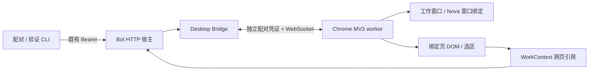

# OpenNova M0 / M1 桌面协作验证

2026-10-18。M0 验证记录保留如下；M1 已接入 Agent 浏览器工具、本地文件打开与共享工作引用。新版 Nova UI、语音界面接线和一键桌面启动仍属于 M2–M4。M1 启动和验收见文末。

## 实现和部署



扩展连接本机环回地址；普通 Demo 不启用桥接。独立验证服务使用 `127.0.0.1:18562`，调用与 Bot 宿主相同的 HTTP 鉴权、Desktop Controller 和 WebSocket 实现；不启动模型、ASR、TTS 或麦克风。验证服务右侧是测试输入框，完整 Bot 对话入口在生产宿主 `--desktop` 下仍复用现有网页。

### 独立测试步骤

在本次 M0 工作区根目录执行（Node.js 24）：

```bash
npm ci --prefix services/bot/desktop
node tools/desktop/probe.mjs
```

代码更新后需在扩展管理页点击“重新加载”，单纯重启浏览器可能仍使用已缓存的后台模块。

首次安装：在 Chrome 打开 `chrome://extensions`，启用开发者模式，选择“加载未打包的扩展程序”，选本工作区的 `extensions/browser` 文件夹。打开扩展详情中的“扩展程序选项”。

另开一个终端，在同一工作区执行：

```bash
node tools/desktop/setup.mjs --probe
```

将服务地址 `http://127.0.0.1:18562` 和刚生成的配对码填进扩展设置页，点击“配对”。配对码 60 秒内有效且只能用一次；超时重新执行 setup。需要读取外部网页时，点击“授权 HTTP(S) 页面读取”，或在 Chrome 扩展详情中按站点管理权限。临时 `activeTab` 权限不足以支持长期后台协作。

```bash
node tools/desktop/client.mjs --probe windows
node tools/desktop/client.mjs --probe open http://127.0.0.1:18562/fixture
node tools/desktop/client.mjs --probe read
node tools/desktop/client.mjs --probe context
node tools/desktop/client.mjs --probe status
```

也可以在扩展设置页点击“打开 / 复用双窗口”“读取工作页”“刷新状态”。页面加载期间可能返回 `work_page_unavailable`，待正文出现后重试。明确绑定其他已打开的网页时，点击该页工具栏上的 OpenNova 扩展图标。

真实网站验证：

```bash
node tools/desktop/client.mjs --probe open https://xueqiu.com/S/SZ000988
# 等页面正文显示后执行：
node tools/desktop/client.mjs --probe read
```

结束验证时在 probe 终端按 Ctrl+C。配对凭证保存在 Git 忽略的 `output/desktop-m0` 和扩展私有存储中；关闭验证服务不会影响原有语音 Demo。

### 接入既有 Bot 宿主

先完成上述依赖安装，再从同一工作区运行 `node services/bot/launch.mjs --desktop`。setup / client 命令去掉 `--probe`，使用原 Bot 的 `127.0.0.1:18560`。已有未带 `--desktop` 启动的宿主需先正常停止再启动；M0 不自动中断正在运行的对话。M1 已支持在 Bot 文本对话中调用该桥接；下文 M0 记录描述当时的验证范围。

## 验证记录

实际环境：macOS，独立 Chrome for Testing **156.0.8078.4**，加载工程中的真实 MV3 扩展。未更改日常 Chrome 的扩展、标签页或登录状态。日常 Chrome **155.0.8059.84** 的手动安装流程保留给用户验收，不将测试版通过等同于所有 Chrome 版本通过。

| 用例 | 测试操作 | 实际结果 |
| --- | --- | --- |
| 配对与鉴权 | 一次性码、超时、错误 Origin、无认证 WS | 自动测试通过；真实设置页配对并建立 WS 成功 |
| 双窗口复用 | 连续两次 windows | 返回相同窗口和标签页 ID；不重复创建 |
| 页面快照 | 读取 fixture | 返回标题、正文、链接和按钮；密码、textarea、隐藏文本标记未进入正文 |
| 选区保留 | 选择 fixture 文本，点击右侧输入框 | 仍引用左侧同一 workTabId 与选中文字 |
| SPA 跳转 | 点击“SPA 跳转”，用旧 PageRef 再读 | URL / 标题更新，revision 0→1，选区清空，旧引用返回 stale_page |
| 目标替换 | 点击“替换链接”后重新读取 | 被替换链接 ref 改变，未替换目标 ref 保留；动画不让整页引用失效 |
| 超长正文 / 选区 | 点击“显示超长正文”并全选长段落 | 正文 12000 字符、选区 4000 字符，均标明截断 |
| 超长链接集合 | 注入 100 个约 7000 字符的测试链接 | 曾触发包过大断线；修复后限制总包大小并标明 targetsTruncated |
| 框架边界 | fixture 包含跨域 iframe | 主页面可读；返回 cross_origin_iframe_not_read，不冒充已读取框架内容 |
| 雪球 | 打开华工科技 SZ000988 公共页面 | 实际读取成功，重定向到 www.xueqiu.com；正文 4705 字符、100 个目标，包含公司名称和行情文本，无需登录。图表画布未解析，未操作关注或交易 |
| 普通文章 | Chrome 官方“声明权限”文章 | 实际读取成功，2774 字符、100 个目标；普通页面读取路径成立 |
| worker 恢复 | 强制停止扩展 worker，等待 alarm | 观测到断开，17.6 秒后重连；命令记录数量 48→48，绑定保持，没有重放 |
| 浏览器重启 | 关闭测试浏览器，再以同一独立 profile 启动 | 配对仍有效；session 绑定清空，新建工作标签页 ID 与旧值不同，没有误绑恢复页 |
| 同 URL SPA 导航 | history.pushState 保持 URL，只改变页面状态 | 修复后 Chrome 实测 revision 1→2，旧 PageRef 返回 stale_page |
| 误入 Nova 页面 | 工作页手工导航到 Nova，或通过 open 打开 Nova | 均拒绝当作工作内容读取；返回 chat_page_cannot_be_work_page |
| 旧连接迟到消息 | 替换已认证 WS，旧端延迟完成关闭并发送 context | 真实 WebSocket 回归通过；旧端消息不再改变当前上下文 |
| 切换加载中的标签页 | A 开始导航后切换到已经加载的 B | 回归通过；A 的加载状态不阻塞 B，导航失败可恢复 |
| 文件上下文边界 | 文件引用期间收到后台浏览器事件 | 单元测试通过；M0 只预留 context 接口，实际文件打开属于 M1 |

自动化回归：本次 77 项 Node 测试通过（含原有 Bot 回归）。

```bash
OPENNOVA_HARNESS_ROOT=/Users/chenzhuoping/Documents/work/project/deepseek-harness \
node --test services/bot/tests/*.test.mjs extensions/browser/tests/*.test.mjs
```

独立工作树需要显式指向已有 Harness；在正常项目布局下可使用既有默认路径。真实浏览器的截图与原始快照放在本工作区 `output/playwright/`，不提交含完整网页内容的临时输出。

## 明确边界

- 首版仅按需读取绑定标签页的顶层 DOM；iframe、Canvas 图表、图片 OCR、PDF 内嵌阅读器和原生应用内容没有接入。
- 站点拒绝注入、权限不足或浏览器内置页面会返回不可读状态；不会绕过登录、验证码或页面权限。
- 页面还在加载时，快照的 `loading` 标识表示内容可能继续变化。
- 已发送命令遇到断线、超时或取消返回 `unknown`；服务和 worker 不会自动重放。结果不能据此宣称“网页操作没有发生”。
- M0 命令去重记录最多 2048 个，达到上限明确报 `command_journal_full`；M1 再接入现有持久操作记录。快照正文不写入命令日志。
- M1 已加入 LLM 工具、点击 / 填写 / 滚动和原生文件打开；M2 已完成新版 UI（见下文），语音界面控制和一键桌面启动仍留待后续里程碑。

参考：[Playwright 扩展测试说明](https://playwright.dev/docs/chrome-extensions)、[Chrome 权限说明](https://developer.chrome.com/docs/extensions/develop/concepts/declare-permissions)。

## 审查与后续整理

独立代码审查提出的四项重要问题已修复，并先复现失败、再通过回归。最终 77 项测试通过；fixture、同 URL SPA、聊天页排除和超长链接包另经过 Chrome 实测。实际窗口 top / height 对齐，右侧宽 400、间隔 12；小屏上下排列规则有自动测试，尚未做实际小屏验收。

两项非阻塞整理留待后续：展开较紧凑的状态处理代码；增加跨版本协议协商。目前宿主和扩展应来自同一份代码；更新宿主时同时重新加载扩展。

本次实现保留在隔离分支 `codex/desktop-browser-m0`，既有 Bot 代码先以单独基线提交保存，M0 单独提交；未合并或推送。测试宿主与真实 Bot 共用桥接实现，但不建立第二个业务会话。命令记录上限、CFT 测试环境和未实现的后续能力均按上述边界处理。


## M1：文字驱动网页与原生文件协作

本次沿用隔离分支 `codex/desktop-browser-m0`；没有更改主工作区中的运行版本。

### 开发验证启动

两个终端均先执行以下环境设置，避免与现有 Demo 的 18560 端口和会话混用：

```bash
cd /Users/chenzhuoping/.codex/worktrees/desktop-browser-m0/openNova
export PATH="/opt/homebrew/opt/node@24/bin:$PATH"
export OPENNOVA_HARNESS_ROOT=/Users/chenzhuoping/Documents/work/project/deepseek-harness
export OPENNOVA_BOT_HOME="$PWD/output/bot/m1-home"
export OPENNOVA_BOT_PORT=18564
export OPENNOVA_BOT_WEB_PORT=18565
```

第一个终端运行 `node services/bot/launch.mjs --desktop`，保持运行。已有宿主若来自更新前的代码，先 Ctrl+C 正常停止后重启。

第二个终端运行 `node tools/desktop/setup.mjs`，在同一工作区的扩展设置中填写 `http://127.0.0.1:18564` 和一次性配对码。更新代码后在 `chrome://extensions` 重新加载扩展，授权 HTTP(S) 站点读取，再执行：

```bash
node tools/desktop/client.mjs windows
```

右侧打开真实 Bot 网页，可直接输入文字。网页与语音/终端仍走同一个 Bot 会话和前台请求队列；本阶段没有新增网页麦克风或语音状态控制。没有扩展连接时，本地文件工具仍可用。

### 简单验收案例

| 输入 / 操作 | 预期 |
| --- | --- |
| “帮我打开雪球上的华工科技” | 从雪球首页站内搜索、核对实际证券链接后打开，返回真实标题和网址 |
| “看看最新公告” | 点击公告栏目后读取当前列表；区分列表时间和公告正文日期 |
| 在左页选一段文字，回到右侧输入“解释选中的这段话” | 输入区上方保留选区；本轮使用发送时的引用 |
| “打开 docs/research/opennova-desktop-interaction-test-cases.md” | 使用本机默认应用，显示文件卡片与“打开请求已发送”；不再要求批准 |
| “用预览打开 output/desktop-m1/M1 PDF test.pdf” | 测试文件存在时以 Preview 打开；只报告打开请求，说明 PDF 正文未接入 |
| 点文件卡片“再次打开” | 通过已登记 fileId 打开同一文件，网页不能传任意路径或 Shell |
| 回复期间停止，或人为切换工作页 | 未执行命令被取消；旧目标失败；已发送但不确定的操作不会自动重放 |

`output/desktop-m1` 是本次实测生成、Git 忽略的测试文件目录，不是交付依赖。其他机器可使用自行创建的 TXT、PDF、DOCX 文件代替。

### M1 实测记录

- Chrome for Testing 156：真实填写搜索框、点击表单、滚动 600 px、点击链接产生的新标签页跟踪均通过。普通输入框只提供角色与名称，输入值不进入页面正文；密码字段未接入。
- 实际 GPT-6.1 Sol / DeepSeek-Bot：从雪球首页搜索华工科技，核对并读取 `https://www.xueqiu.com/S/SZ000988`，返回真实证券页面标题；继续点击“公告”并读到列表标题与显示时间。没有进行登录、关注或交易。
- 选区与网页入口：在证券页选中公告标题、切到 Nova 后，实际模型仅按该选区解释。网页发送文字请求打开并读取测试 TXT，页面显示文件卡片；“再次打开”回执成功，后台网页读取没有抢占文件引用。
- 原生文件：TXT 在 TextEdit 显示；PDF 在默认 WPS 和指定 Preview 打开，Preview 可见测试正文；DOCX 指定 WPS 后可见测试窗口。Pages 返回 dispatched 但首次使用停在许可欢迎页，未代用户接受许可；这也验证了 dispatched 不等于已呈现。
- 本地打开采用 `/usr/bin/open` 参数数组和最小环境；源代码使用 `-t`，指定应用仅允许已列明的编辑器。10 秒超时、宿主中断和发送后取消标记 unknown，历史命令不自动重放。
- 文件引用记录磁盘版本；修改后显示已更新、删除后标记失效。PDF / Office / 图片只接入打开能力，不解析正文或原生应用选区。
- 自动回归：Bot / 扩展 102 项、Agent 62 项、ASR 26 项、语音 63 项、TTS 10 项、setup 3 项通过；网页资源构建成功。Node SQLite 的实验性提示是运行时提示。

仍需知道的边界：仅普通顶层 DOM；对 JS 自行弹出的无关联窗口不自动绑定，可手工点击扩展图标选择。跨版本协议协商、命令去重日志超过 2048 条的轮换、新版界面和语音状态同步未在 M1 扩展。实测原始回执保存在本工作区 `output/playwright`、`output/desktop-m1`，不提交网页正文与账号信息。


### M1 审查修复

独立审查发现点击后的手工切页可能被误认为点击目标。已用失败回归复现并修复：只有原绑定或同一命令实际触发的新标签页可以作为后续引用，用户另选页面返回 `context_changed`，同时保留点击已经发出的事实。另两项导航 / 取消问题按用户影响提升为本次必须修复：无关标签页和子框架导航不再中断有效操作；取消或失败的点击会清除待跟踪弹窗。三项回归通过，真实 Chrome 的输入、点击、滚动和相关弹窗回执再次通过。

最终回归共 266 项通过（102 Bot/扩展 + 62 Agent + 102 Python），网页构建和 `git diff --check` 通过。代码保留在隔离分支，尚未合并或推送。开发与验证时原生应用自动排列、网页版语音控制和新的深空 UI 均未计入完成范围。


## M2：深空 Nova 对话窗口

M2 继续位于隔离分支 `codex/desktop-browser-m0`，启动环境和命令沿用上文“M1：开发验证启动”。宿主与扩展使用同一工作树的最新代码；重新启动宿主、在 Chrome 扩展页重新加载扩展，再刷新 Nova 页面即可。现有日常 Demo 工作区尚未合并本分支。

### 已实现

- 深蓝背景、青色约 72 px 环形 Nova；连接、思考 / 工作和空闲状态来自真实 Bot。移除项目侧栏与独立操作面板。
- 同一会话内显示语音、网页、终端消息；文件修改、浏览器操作、Shell 和记忆记录按请求归属展示，点击展开差异、输出和错误。早期无请求编号的记录保留在折叠的“其他操作记录”中。
- 输入区上方显示工作网页 / 选区或文件引用。清除选区保留网页身份；扩展的新选区有独立 ID，后台旧快照不会把已清除的引用加回来。
- 文件卡片展示名称、目录、打开方式和回执，并可重新打开。服务重启只恢复“上次关联文件 / 历史打开记录”，不重开文件、不声称应用当前在前台，不把打开成功当成正文已读。
- 事件通道保留最近 512 条事件，以宿主 epoch + 序号恢复；事件失效、断网或宿主重启后重新取快照，5 秒轮询兜底（后台页 15 秒）。持久请求和操作继续存于原 SQLite，没有自动重放工具。
- 未发送草稿与待确认发送记录保存在当前网页的 sessionStorage；刷新可恢复，重复发送沿用原请求编号。语音状态桥接属于 M3，本阶段显示“语音未启动”，网页不启用麦克风或重复播报。

### 验收方法

| 操作 | 预期 |
| --- | --- |
| 打开 Nova，缩窄到约 400 px | 环形 Nova、消息、输入区保持可见，没有固定侧栏或整页横向滚动 |
| 输入“读取一个测试 TXT，复制到新文件并增加一行，再用 Shell 核对、打开新文件” | 实际执行，无二次确认；每项操作显示在本轮消息内，文件卡片显示打开回执 |
| 展开“写入文件”或“执行命令” | 可读差异 / 输出；展开位置不会被自动跟随滚动挤走 |
| 在工作页选文字、回到 Nova，再点清除选区 | 保留网页名称和地址，只移除选区；重新选中同一段可再次引用 |
| 中文输入法组合期间按回车；再用 Shift + Enter | 组合态回车不发送；Shift + Enter 换行 |
| 暂时断网并输入草稿，恢复后刷新 | 草稿保留；恢复不会新增重复请求 |
| 回复期间刷新，或点“停止回复” | 刷新继续显示同一请求；停止走服务端取消，环形回到空闲 |
| 开启系统“减少动态效果” | 环形动画停止；文字状态和操作结果仍可读取 |
| 重启 Bot 宿主 | 网页自动重连；已完成历史不倒退，文件引用标为历史，不新增打开记录 |

### 本次验证记录

2026-10-18，在 Chrome for Testing 156、400 × 850 窗口验证：

- 真实 GPT-6.1 Sol / DeepSeek-Bot 从网页收到请求，读取测试 TXT，写入 `output/desktop-m1/M2 窗口验收.txt`，用 Shell 读回核对，调用文件打开器；实际磁盘内容包含“M2 对话窗口验证通过”，网页显示六项对应操作与文件卡片。
- 独立 UI fixture 通过真实 HTTP / SQLite / Requests / SSE 链路检查 55 条历史分页、长代码与表格、差异和 Shell 输出展开、组合态回车保护、键盘焦点、Shift + Enter、离线草稿刷新、清除选区、任务中刷新、停止回复、reduced-motion。fixture 替代模型推理和外部打开，不计为真实模型实测；组合态测试为 DOM 事件模拟，不冒充真人输入法验收。
- 修复窄屏下上游悬浮操作按钮越界；实测页面宽 400 px，消息滚动区内容宽与可视宽均为 389 px，长代码和差异仅在各自内容区滚动。
- 修复展开操作详情时自动跟随滚动抢走阅读位置：修复前标题上跳 194 px，修复后位移为 0。
- 真实宿主重启后 epoch 改变，网页自行重连；请求数 7→7，文件打开记录 3→3，文件引用恢复为 `historical:true`，没有重放或再次调用打开器。
- 独立代码审查没有发现额外必须修复的问题；M3 的语音播放 / 控制与 M4 的统一启动不在本次审查范围。此前 M0/M1 仅复查本次改动涉及的引用和恢复逻辑，其他行为通过现有回归验证。

最终回归 279 项通过（Bot / 扩展 115 + Agent 62 + ASR 26 + 语音 63 + TTS 10 + setup 3），网页构建通过。测试日志与截图保存在 `output/playwright/m2-*`，均为 Git 忽略的本机验收材料。控制台在主动断网、重启和重新取得网页会话时出现的连接中断 / 401 是对应恢复测试的预期记录；未观察到应用 JavaScript 异常。

当前边界：M2 不提供网页语音启停 / 静音 / 插话控制，不改变 VAD 或 TTS；原生应用仍只支持文件打开与已有文本读取，不跟踪前台窗口或读取未保存内容。服务与扩展应同步更新；多版本协议协商和 2048 条浏览器命令日志轮换继续后置。
