# OpenNova MVP 开发环境部署方案

日期：2026-10-12。状态：豆包 ASR 蓝牙麦克风试音通过；本地 VAD 与 Studio Vivian 已部署。OpenNova 在 Air 的独立 ChatGPT 授权、GPT-6.1 Sol 真实推理与 DeepSeek Harness 多轮会话已通过；完整 VAD → ASR → Agent → Vivian 链路已用两段测试录音验证。真人连续交流待现场试用，Studio 常驻 Agent 与 MVP 主服务尚未部署。

当前可运行的终端 Demo 见 [语音对话说明](../../tools/voice/README.md)：Air 承担 VAD、ASR 适配、Harness 和独立授权，Studio 承担 Vivian 推理，Air 以 1.5 倍速播放。该安排复用 Air 已可用的 Keychain，首轮采用轮流说话；下文的 Studio 常驻架构仍是目标部署。当前 Harness 实测为 Air 已构建提交 `ddefc45fbc7f8e46dd73185e68295696d1297887`，区别于早期选型基线，不修改其上游源码。

采用 **Air 交互与开发、Mac Studio 常驻 Agent 服务和本地 TTS、云端 ASR 与 LLM** 的部署方式。DGX Spark 保留为后续训练与实验节点，日常语音交流不依赖 Spark 在线。

本方案落实 [技术 Demo 预研方案](opennova-technical-demo-research.md) 与 [整体语音链路](opennova-voice-pipeline-design.md)，作为开始搭建 MVP 开发环境的执行依据。先完成 Vivian 语音服务与文字 Agent 两个独立验证，再接通完整语音闭环。

## 1 部署目标与设备分工

| 位置 | 首轮承担的工作 | 部署内容 |
| --- | --- | --- |
| MacBook Air | 开发操作、拾音、播放、查看结果与确认操作 | 浏览器交互端、SSH 连接；后续补充原生音频入口 |
| Mac Studio | 常驻运行、项目与任务执行、本地声音合成 | DeepSeek Harness、OpenNova 服务、MLX-Audio TTS、项目工作区、会话与任务存储 |
| 云端 | 语音识别、语言推理与图片理解 | 豆包流式语音识别模型 2.0、GPT-6.1 Sol |
| DGX Spark | 后续音色微调与模型实验 | 本阶段不部署；直接克隆效果不足时再制定训练方案 |

第一版支持单用户、单个活跃语音会话。TTS 先采用单模型实例、单路生成和有上限的等待队列，优先保证声音质量、连续播放与打断。

### 1.1 部署拓扑



[查看可编辑图源](assets/opennova-mvp-deployment.mmd)

图中表示目标部署。当前 ASR/VAD 先由 Air 的 Python 客户端独立验证，Studio 已运行独立 MLX TTS 进程。后续 OpenNova 接入、会话管理、ASR 适配、Harness 和 TTS 适配放在一个 Node 服务内；MLX 推理继续保留独立 Python 进程。

### 1.2 第一阶段的完成形态

在 Air 打开交互界面，可以输入文字、查看 Agent 读取项目和执行检查的结果，也可以输入一段台词，让 Studio 使用 Vivian 生成并返回音频。两个独立路径稳定后，继续实现“说话 → 识别 → Agent → Vivian 语音回复”。

本阶段先覆盖桌面软件闭环。水滴硬件的声学与器件预研继续独立推进；Spark 训练、本地 ASR、持续视觉和完整多设备接入不作为开发环境的前置条件。

## 2 现有环境与需要补齐的部分

以下来自 2026-10-11 的本次及同日只读检查；容量与端口属于检查时快照，实际部署前重查。

| 项目 | 已核实情况 | 部署处理 |
| --- | --- | --- |
| 本次操作入口 | Air，Apple Silicon / arm64 | 远程操作明确使用 `agent-control`，避免把 Air 当成 Studio |
| Studio 硬件 | M5 Max、40 核 GPU、64GB 统一内存 | 作为 MLX TTS 推理与 Agent 服务主机 |
| Studio 系统与空间 | macOS 27.0.1；内部数据卷约 351GiB 可用 | 代码、模型缓存、音色和状态使用内部存储 |
| SSH | Air → `agent-control` 只读连接成功 | 复用现有连接，地址由 SSH 配置解析 |
| Node / npm | Node 24.21.0、npm 11.19.0 | 复用 Node 24；显式配置服务运行路径 |
| Python / uv | uv 0.12.19；已有 uv 管理的 Python 3.12.14 | TTS 使用独立 Python 3.12 环境；系统默认 Python 3.9.6 不用于此项目 |
| Git / 编译工具 | Git 2.55.0；Command Line Tools 路径存在 | 构建时验证工具链可用性，不重装整个工作站 |
| pnpm / FFmpeg | 本次指定 PATH 下未发现 | 补齐固定版本 pnpm；FFmpeg 用于录音整理与格式转换 |
| OpenNova 仓库 | Studio 已有 `~/Documents/project/openNova`，远程为 `jornel83/openNova`；检查时工作区干净，HEAD 为 `e5f2755` | 先核对代码与文档版本，再同步；不重复克隆或覆盖目录 |
| MLX / TTS | 已建立 Python 3.12.14 隔离环境并下载固定 BF16 模型；真实合成、回环 HTTP 服务与 Air 取回音频通过 | Vivian 流式回传已通过；继续验证现场播放与插话 |
| 云端服务 | 豆包 ASR 已完成真实 API 与蓝牙麦克风试音；Air 独立订阅授权与 GPT-6.1 Sol 真实推理通过 | Studio 独立授权仍待完成 |

Air 上本轮 PRD 与研究文档仍有未跟踪文件，Studio 的现有检出并不包含这些本地修改。同步前应明确纳入版本管理的文件；模型、录音、凭据与运行日志独立保存。

## 3 技术组件与版本基线

### 3.1 Agent 与交互服务

| 组件 | 首轮方案 | 实施要点 |
| --- | --- | --- |
| JavaScript 运行时 | 已有 Node 24.21.0 | OpenNova 和 Harness 使用相同主版本 |
| 包管理 | pnpm 11.28.5 | 与评估的 Harness 提交一致，保留锁文件 |
| Agent Harness | DeepSeek Harness 源码开发 | 固定提交 `d743267388641bc76f17c45ce8b4c231aed1d32c` 作为起始基线 |
| OpenNova 服务 | TypeScript；一个接入与编排服务 | 持有 Harness runtime，管理语音会话、任务归属、操作确认和 TTS 播报 |
| 交互界面 | 先复用 Harness Web 验证文字能力；再增加 OpenNova 语音界面 | Air 浏览器访问 Studio；语音界面和协议需要开发 |
| LLM | GPT-6.1 Sol，Responses API | 先验证文字流和工具回传，再验证图片输入 |
| 状态存储 | 复用 Harness 会话存储；OpenNova 的轮次、任务映射和基础记忆建议使用 SQLite | 单服务写入，文件置于 Studio 本地；不重复维护两套对话事实 |

所选 Harness 提交声明 Node `^22.19.0 || >=24.0.0`、pnpm `11.28.5`，现有 Node 满足版本要求。上游处于开发者预览阶段，因此固定提交并在升级时复核适配接口。来源：[版本要求](https://github.com/deepseek-ai/deepseek-harness/blob/d743267388641bc76f17c45ce8b4c231aed1d32c/package.json)、[开发说明](https://github.com/deepseek-ai/deepseek-harness/blob/d743267388641bc76f17c45ce8b4c231aed1d32c/docs/development.md)。

GPT-6.1 Sol 的文字与图片输入、流式输出和工具调用通过 Responses API 接入。本次优先验证官方 Sign in with ChatGPT 授权路径，使用 OpenNova 自己的登录与订阅权限；实际结果见 [订阅接入验证记录](opennova-chatgpt-subscription-verification.md)。当前 Codex 会话可以使用该模型，不代表 OpenNova 已完成接入。[官方模型说明](https://developers.openai.com/api/docs/models/gpt-6.1-sol)

订阅授权需要独立的模型适配工作：账号登录、令牌刷新、模型目录，以及订阅路径的请求参数与工具格式均需验证。先完成一次真实文本响应，再接入 Harness；API Key 保留为明确选择的独立计费方案，不自动回退。

Harness 优先通过插件与 Core/Web 控制面适配，不假定 SDK 已完整提供取消、追加输入和实时事件。首个兼容性验证必须包含“模型发起工具调用 → 本地执行 → 结果回传 → 模型汇报”。[SDK 限制](https://github.com/deepseek-ai/deepseek-harness/blob/d743267388641bc76f17c45ce8b4c231aed1d32c/packages/sdk/client/README.md#known-limitations-and-deferred-work)

### 3.2 本地 TTS

| 组件 | 首轮方案 | 实施要点 |
| --- | --- | --- |
| 模型 | Qwen3-TTS-12Hz-1.7B-CustomVoice / Vivian | 当前 MVP 默认音色；Base 保留给后续自定义声音克隆 |
| Mac 推理后端 | MLX-Audio，原生 Apple Silicon 环境 | 独立 Python 进程，不依赖 Docker 提供 Metal 推理 |
| 模型格式 | `mlx-community/Qwen3-TTS-12Hz-1.7B-CustomVoice-bf16` | 独立合成、试听与流式回传已完成；继续验证现场播放与稳定性 |
| Python | uv 管理的 Python 3.12.14 | 项目独立 `.venv` 与 `uv.lock` |
| 服务接口 | 先验证 MLX-Audio 自带语音接口；OpenNova 在其外部统一请求与取消状态 | 仅监听 Studio 回环地址，模型常驻、启动后预热 |
| 音色配置 | `voice=Vivian`、中文、固定聊天语气指令、模型 revision 和生成参数 | 沿用已选样音配置；无需参考录音，完整参数见 TTS 运行说明 |
| 输出语速 | Air 默认 1.5 倍，保持音调 | 测试客户端通过 FFmpeg `atempo` 流式处理；`--speed 1` 可恢复原速，Studio 原始生成参数不变 |

MLX-Audio 提供 TTS、server 可选依赖。CustomVoice / Vivian 已在现有 Python 3.12 环境中独立生成样音，并通过 HTTP 音色与语气参数传递、流式回传及断流后新请求验证；现场插话与立即停播仍待实现。既有 Base 流式基线不能代替 Vivian 实测。[依赖定义](https://github.com/Blaizzy/mlx-audio/blob/e66ad2ff4eb96ce1149000187b30370cbcd707aa/pyproject.toml)、[Qwen 实现说明](https://github.com/Blaizzy/mlx-audio/blob/e66ad2ff4eb96ce1149000187b30370cbcd707aa/mlx_audio/tts/models/qwen3_tts/README.md)

当前已下载并用于验证的固定版本：

- MLX-Audio 提交：`e66ad2ff4eb96ce1149000187b30370cbcd707aa`。
- CustomVoice 模型 revision：`52f4770fd9726457eae3d3b6aa92047a25a10776`；从固定快照目录加载，路径见 [TTS 运行说明](../../services/tts/README.md)。
- 原 Base 模型 revision：`a6eb4f68e4b056f1215157bb696209bc82a6db48`，继续保留；模型文件大小不等于峰值运行内存，分别记录磁盘与内存占用。

Vivian 沿用本次温柔、自然、放松的聊天语气，继续覆盖工作协同、日常陪伴、数字和中英混读。后续如需 Base 自定义声音克隆，再从约 20 分钟录音中挑选干净短片段并校对转写；当前接入无需等待参考录音或训练。

**流式音频输出不等于可持续追加文本。** 首版由 OpenNova 把 LLM 文本按适合朗读的语义段提交，限制待合成段数；播放器逐块播放。首段等待、跨段韵律与长句稳定性分别测量。

### 3.3 ASR 与本地音频

ASR 已确定采用豆包流式语音识别模型 2.0，使用实时双向流式接口，接收中间和最终转写。先验证账号开通、实际模型/资源配置、中文术语、停顿改口、延迟和用量；Qwen 保留为备选，不阻塞首轮实施。依据见 [ASR 选型记录](opennova-asr-tts-selection.md)。

Air 先采用浏览器拾音、AudioWorklet 播放/处理和本地 VAD。VAD 可评估 Silero ONNX 的浏览器接入，部署前验证所选模型与运行时组合；音频建议统一为单声道 16kHz PCM 上行，保留语音开始前的短缓存及话中停顿。[Silero VAD](https://github.com/snakers4/silero-vad)

先验证按键发起交流，再加入持续拾音、设备指向判断、轮次判断和插话。浏览器闭环完成后，针对锁屏、后台驻留与设备切换评估原生音频入口；网页前台运行通过不等于 Always On 已完成。

## 4 目录、代码与数据安排

以下为 Studio 建议布局；已有目录复用，其余在实施时建立。

```text
~/Documents/project/
├── openNova/                       # 已有仓库：承载文档与后续应用代码
│   ├── apps/                      # 拟新增：服务与交互界面
│   ├── services/tts/               # 拟新增：TTS 环境定义与适配
│   ├── packages/                  # 拟新增：协议、Harness 插件
│   └── docs/
└── deepseek-harness/               # 拟新增：独立上游源码检出，固定提交

~/AgentWorkstation/
├── config/opennova/                # 本机配置；凭据使用 Keychain 或受限文件
├── state/opennova/                 # 会话、任务映射、基础记忆
├── artifacts/opennova/voices/      # 参考录音、转写、音色配置
├── artifacts/opennova/tts-runs/    # 选定样音与测量结果
├── models/opennova/                # 可重新下载的模型缓存
├── logs/opennova/                  # 有轮转与保留上限的日志
└── tmp/opennova/                   # 有生命周期的临时文件
```

`openNova` 保存自己的插件和服务适配；Harness 独立检出便于跟踪上游变更。起步时可通过明确记录的本地工作区依赖开发，后续固定打包版本。若必须修改 Harness 核心，单独记录补丁及原因。

建议在 Air 操作编辑器、主要代码构建与任务执行放在 Studio 的同一开发检出中；两台机器各自有独立修改时，通过明确提交与分支同步。当前文档未提交部分需要先整理，不能仅靠一次拉取假定已同步。

代码、依赖锁文件与非敏感配置模板进入 Git。参考录音、模型、凭据、数据库、日志和生成音频放在运行目录；音色配置中的非敏感参数可另存模板。重要声音素材、会话状态和实验结果需独立备份。遵循 infra 的 [数据位置约定](https://github.com/jornel83/infra/blob/main/docs/architecture.md)，内部存储优先于外接交换盘。

## 5 连接方式与服务运行

### 5.1 服务端口

| 服务 | 计划监听地址 | 使用方式 |
| --- | --- | --- |
| OpenNova 接入服务 | Studio `127.0.0.1:8787` | 承载界面静态文件、API 与语音 WebSocket；需要开发 |
| MLX-Audio TTS | Studio `127.0.0.1:8000` | 仅供 OpenNova 服务调用 |
| Harness 原生 Web | Studio `127.0.0.1:3080` | 首轮文字链路验证及开发排查使用 |

本次 Studio 监听快照未见上述端口占用，启动前仍需检查。Harness Web 的默认端口来自 [上游运行说明](https://github.com/deepseek-ai/deepseek-harness/blob/d743267388641bc76f17c45ce8b4c231aed1d32c/README.md)；8787 是 OpenNova 的拟定端口。

开发期建议通过现有 SSH 连接转发服务。对应 Studio 服务启动后，可在 Air 执行：

```sh
ssh -N -o ExitOnForwardFailure=yes \
  -L 127.0.0.1:8787:127.0.0.1:8787 \
  -L 127.0.0.1:3080:127.0.0.1:3080 \
  agent-control
```

Air 从 `http://localhost:8787` 访问 OpenNova，从 `http://localhost:3080` 访问 Harness 验证界面。麦克风在 Air 采集；TTS 在 Studio 合成并回传 Air 播放。浏览器麦克风需要安全上下文，localhost 可用于本地开发；直接访问 Studio 的普通 HTTP 内网地址可能无法获取麦克风权限。[浏览器采集约束](https://developer.mozilla.org/en-US/docs/Web/API/MediaDevices/getUserMedia)

网页与语音 WebSocket 使用同源入口，经 SSH 加密传输；开发服务器如单独运行，需要配置到同一后端的代理。接入服务仍校验会话身份与 Origin。未来独立硬件直接接入时，再配置设备认证与 HTTPS/WSS。

### 5.2 常驻运行

先前台启动逐项调试；闭环通过后，将 Node 服务与 TTS 服务分别交给 macOS `launchd` 管理。首轮可用登录用户的 LaunchAgent，实现登录后的驻留与崩溃恢复；机器重启后无人登录时是否可用，需要另行验证，不能视为自动获得开机常驻能力。

服务配置使用可确认的运行时绝对路径，显式设置工作目录、模型缓存位置和日志路径；不依赖交互式 shell 的 PATH。Studio 当前 Node 路径为 `/opt/homebrew/opt/node@24/bin/node`，Python 使用项目 `.venv` 中的解释器。

进程存在、端口可连接、模型加载完成和真实合成成功是不同状态。服务需要暴露存活与就绪状态，TTS 完成预热后才接受正常播报。状态接口、日志字段及启动脚本属于后续实现内容。

### 5.3 取消、任务与故障

- 用户插话时 Air 立即停播并清空本地队列；服务为新一轮建立新的播放代次，过滤所有旧音频。
- 同时向 TTS 后端请求取消，分别验证停止输出与停止计算；不能仅凭 HTTP 连接关闭认定推理已停止。MLX-Audio 已有生成循环取消检查，具体响应粒度仍需实测。[服务实现](https://github.com/Blaizzy/mlx-audio/blob/e66ad2ff4eb96ce1149000187b30370cbcd707aa/mlx_audio/server.py)
- 停止朗读与取消工作任务使用不同操作。Air 断线后，已启动的普通后台任务可由 Studio 继续管理；重连查询原状态，不重复提交。
- TTS 进程失败时保留文字与任务结果；Studio 整体离线时展示断线状态。本地 TTS 不代表云端 ASR 和 LLM 也可离线使用。
- 服务重启后先核对任务实际结果，状态不明的写操作不自动重放。

## 6 搭建顺序与每步产物

| 阶段 | 具体工作 | 进入下一阶段前应拿到的结果 |
| --- | --- | --- |
| 0 环境准备 | 核对 Studio 检出与未提交文件；补齐 pnpm、音频工具；建立运行目录；固定依赖基线 | 环境版本记录、目录清单、代码同步结果；确认模型下载与云端服务网络可达 |
| 1 本地 TTS | 已将默认请求切换至 CustomVoice / Vivian；继续验证现场播放与跨句稳定性 | 已选音色配置、冷启动/预热后速度、内存与连续合成记录 |
| 2 文字 Agent | 构建固定 Harness；接入 GPT-6.1 Sol；验证流式文本、图片和工具回传；接入项目工作区 | 能读取项目、解释内容、提出修改，确认后修改并运行一次检查，依据回执汇报 |
| 3 语音闭环 | 增加 Air 拾音与播放、Studio ASR 适配、文本分段及 TTS 调度 | 在耳机条件下完成真实的 ASR → Agent → Vivian TTS 对话，显示转写与任务状态 |
| 4 Always On 专项 | 加入本地 VAD、轮次与指向判断；验证外放回声、插话、静音、断线与重连 | 记录误响应/漏响应、实际停声、旧音频过滤；明确浏览器与原生入口的边界 |
| 5 驻留与日常使用 | 配置服务管理、就绪检测、日志上限、状态备份和恢复；验证并发开发负载 | Air 断开后任务可核对，重连不重复执行；服务恢复、内存与音频稳定性有实测记录 |

阶段 1、2 互不依赖，可分别推进；阶段 3 依赖两者和一个可调用的 ASR 服务。阶段 1 若性能不足，先对照文本分段与后端配置，再试听量化版本；变更精度或模型要保留前一基线。

### 6.1 首轮安装与启动入口

以下用于明确目标 Studio 部署入口。TTS 安装与独立服务已执行，详见 [TTS 运行说明](../../services/tts/README.md)；Air Harness 终端 Demo 已运行，Studio Harness 与 OpenNova 主服务仍待实施。

1. **Harness：** 补齐与仓库要求一致的 pnpm，固定源码提交，按上游流程运行 `pnpm install --frozen-lockfile`、`pnpm run build`，再通过 `pnpm dsh web --no-open` 验证原生 Web。配置 OpenAI 模型适配后才能验证选定 LLM。
2. **TTS：** 已建立 Python 3.12 项目并固定 MLX-Audio 与依赖；默认下载与 HTTP 探针已切换为固定 CustomVoice 模型路径、Vivian 与语气指令，流式回传已通过。Base 从服务模型缓存卸载，磁盘权重保留；显式使用 `--voice-profile base` 可做克隆测试。详见 TTS 运行说明。
3. **OpenNova：** 开发接入服务、语音界面、Harness 插件和 TTS 调度。项目启动命令在工程落地后写入 README，不能直接用 Harness Web 启动成功代替产品语音服务完成。

MLX-Audio 自带接口可用于前期验证；其分块音频格式、采样率与取消行为需适配到播放器。若接口不满足低延迟控制，再包装 Python 生成接口，不提前同时维护两套推理服务。

## 7 首轮验证记录与待准备项

### 7.1 最小验证记录

| 验证对象 | 记录内容 |
| --- | --- |
| 目标音色 | 同一批中文台词的原始输出、Vivian 与语气参数、模型/后端版本、人工试听结论；Base 克隆另存参考片段与转写 |
| TTS 实时性 | 冷启动与预热后首段音频时间、实际出声时间、生成耗时/音频时长（RTF）、跨段停顿、内存峰值 |
| 完整对话 | 用户说完 → ASR 最终结果 → 本轮提交 → 第一段可播报文本 → 合成音频 → 实际出声 |
| 打断 | 用户开始插话 → 本地停声；取消后旧音频是否重现，推理是否结束 |
| 工作闭环 | 实际修改差异、命令退出状态、失败回执、断线后的任务结果和重连行为 |

TTS 长句持续生成的 RTF 应小于 1，才有持续实时播放的基础；还需检查每段输出节奏与播放器缓冲。首声、停声和端到端延迟先建立本机基线，再确定体验阈值，不以公开演示替代测量。端到端指标在 Air 同一时钟测量；跨主机日志通过请求标识关联，避免直接相减未校准时间。

### 7.2 实施前需要准备的材料

- OpenNova 的 ChatGPT 官方登录授权与 GPT-6.1 Sol 模型权限；若订阅路径不可用，再明确选择独立计费的 API Key 方案。另需已开通豆包实时 ASR 2.0 的账号与凭据。登录凭据仅保留在 Studio 的受保护存储中，前端和文档不保存令牌或密钥。
- Vivian 已选音色的模型版本与语气配置已记录；约 20 分钟声音素材仅在后续 Base 克隆时准备参考片段与人工校对转写。
- 第一项工作验证任务：建议在独立测试工作区修改一个小功能，展示差异、确认应用并运行检查，再逐步接入 OpenNova 正式工作区。

Vivian 接入无需真人参考录音。当前终端 Demo 已完成 LLM 接入、Harness 会话与文件输入语音闭环，豆包 ASR 账号与实时接口也已通过独立验证。

下一步现场试用 SRS-XB100 的连续语音对话，再推进工具调用、Studio 常驻迁移以及插话与回声消除。文件输入闭环记录见 `output/voice/complete-loop-20261012/conversation.json`，不以该测试代替真人外放验证。
