# OpenNova 技术 Demo 预研方案

日期：2026-10-11。阶段：Agent Harness 底座、主 LLM 与本地克隆 TTS 首选已确定，Demo 与本地 TTS 专项待实施验证。

基于 [MVP PRD](../product/opennova-mvp-prd.md) 第 4 章产品架构，首先构建一个可语音协作开发的桌面助手，验证自然交流、工具执行和上下文接续；同时开展水滴硬件的声学、空间与功耗预研，为第 5 章硬件定义提供依据。

本轮 Demo 以 Air 为交互端、Studio 为服务与任务执行端，基于 DeepSeek Harness 开发，主 LLM 确定为 GPT-6.1 Sol。语音采用本地拾音与语音检测、云端 ASR，TTS 通过参考录音克隆指定音色。本地 TTS 首选已确定为 Qwen3-TTS-12Hz-1.7B-Base，推理部署在 Mac Studio，优先采用 MLX-Audio；Spark 留作后续训练与实验，不接入首轮实时链路。具体搭建顺序见 [MVP 开发环境部署方案](opennova-mvp-development-deployment.md)。

## 1 预研目标与范围

### 1.1 核心验证目标

围绕“OpenNova 帮助打造自己”的工作协同方向，验证以下体验：

> 用户通过语音讨论一个小功能，助手读取项目、提出修改、展示差异，在确认后执行修改与检查；用户可以随时插话，后台任务继续运行，完成后返回可核对的结果。

日常陪伴共用这套交流与记忆能力。本轮覆盖连续追问、改口、插话、结束交流，以及明确偏好在新会话中的接续。

预研需要回答三个问题：

1. 语音交流是否自然、及时，能否正确处理停顿、改口和打断？
2. 助手能否围绕正确的项目完成实际操作，并在失败、断线和切换话题后保持状态一致？
3. 水滴的目标形态是否有机会承载拾音、外放、联网和供电要求，需要调整哪些硬件条件？

### 1.2 本轮范围

| 工作范围 | 本轮内容 |
| --- | --- |
| 桌面技术 Demo | 文字与语音交流、项目上下文、文件读取与修改、检查任务、任务状态、基础记忆 |
| 模型图片输入验证 | 手动提供图片或截图，验证 Harness 图片传递、多轮理解与后续工具操作 |
| 语音专项验证 | 轮次判断、流式识别与合成、外放回声、打断、免固定唤醒词的误响应与漏响应 |
| 硬件并行预研 | 器件空间堆叠、近似布局的声学样件、开发板功耗与供电测量 |

本轮排除 Spark 节点接入、模型训练与微调、GPU 调度、候选模型发布和实验资源隔离。ASR、LLM、TTS 服务调用仍是交流链路的组成部分。本地 TTS 先在 Studio 验证目标音色与实时性能，与文字 Agent 验证分别推进，通过后接入语音闭环。PRD 的完整 MVP 范围另行维护。

持续视觉、户外随身交流、完整家居接入及量产硬件开发不纳入本轮。Agent Harness 先满足闭环所需能力，Master Agent 内部机制继续留待软件定义讨论。

### 1.3 Agent Harness 技术选型

**已确定采用 [DeepSeek Harness](https://github.com/deepseek-ai/deepseek-harness) 作为 Agent Harness 底座。** OpenNova 围绕其插件与事件接口开发服务适配层，优先复用模型适配、工具调用和会话日志能力。LLM、ASR、TTS 分别选型，Harness 的选择不绑定具体模型。

首轮采用以下接入方向：

- **Studio 常驻运行：** OpenNova 服务持有 Harness runtime，Air 连接该服务；交互界面的退出与运行时生命周期分开管理。
- **以插件扩展为主：** 优先通过 TypeScript 插件与配置组合接入所需能力，具体服务接口在首轮验证中确定。
- **保留产品职责：** OpenNova 管理设备与语音状态、任务归属、操作确认以及记忆保存与删除规则，并与 Harness 的事件和状态关联。
- **固定依赖版本：** 实施时锁定版本或提交，记录新增插件与必要核心改动，升级后复核关键接口。

接口评估依据为官方提交 `d743267388641bc76f17c45ce8b4c231aed1d32c`。其内部 Agent 接口提供取消、追加输入和实时文本事件，但 SDK 尚未完整暴露这些控制；首轮优先验证 Core/Web 插件控制面的服务适配，而非仅围绕 SDK 的 `run()` 封装。参见 [架构与扩展接口](https://github.com/deepseek-ai/deepseek-harness/blob/d743267388641bc76f17c45ce8b4c231aed1d32c/docs/architecture.md) 和 [SDK 当前限制](https://github.com/deepseek-ai/deepseek-harness/blob/d743267388641bc76f17c45ce8b4c231aed1d32c/packages/sdk/client/README.md#known-limitations-and-deferred-work)。

### 1.4 LLM 技术选型与接入验证

**已确定采用 GPT-6.1 Sol 作为主 LLM。** 同一模型承担文字交流、图片理解、工作任务推理与工具调用。首轮围绕该模型建立完整基线，模型与接入参数通过配置管理。

| 接入项 | 已确定的方向 | 需要验证的内容 |
| --- | --- | --- |
| 模型与接口 | 模型标识为 `gpt-6.1-sol`，使用 OpenAI Responses API | 模型配置、推理参数映射、流式文本与错误处理 |
| 工具与会话 | 经 DeepSeek Harness 调用工具并回传结果 | 工具结果关联、多轮上下文，以及取消请求后的状态 |
| 图片理解 | 将用户手动提供的图片或截图与文字一起传给模型 | 图片实际传递、细节与关系识别、多轮追问，以及结合图片继续工具操作 |
| 语音衔接 | ASR 将语音转为文字；TTS 合成面向用户的回复 | 第一段可播报文本延迟、中文连续交流与打断后的状态 |

GPT-6.1 Sol 支持文本与图片输入，不直接支持音频或视频输入；其 Chat Completions 接口不支持工具调用，本 Demo 使用 Responses API。依据：[GPT-6.1 Sol 官方模型说明](https://developers.openai.com/api/docs/models/gpt-6.1-sol)。

接入优先评估 DeepSeek Harness 的 [pi-ai 模型适配插件](https://github.com/deepseek-ai/deepseek-harness/blob/d743267388641bc76f17c45ce8b4c231aed1d32c/packages/llm/llm-pi-ai/README.md)。需验证所固定版本对 GPT-6.1 Sol 的模型配置、Responses 协议、图片载荷、流式事件及工具结果关联的支持。

鉴权优先验证官方 Sign in with ChatGPT 订阅授权；先确认账号资格、可用模型目录与一次完整响应，再开发 Harness 适配。当前尚未完成真实账号调用，记录见 [订阅接入验证](opennova-chatgpt-subscription-verification.md)。

图片验证先选取界面截图、架构图和器件资料图片，检查小字、连接关系及多轮指代，并记录误读与人工纠正。该验证用于判断后续产品能力边界；PRD 中图纸视觉理解和摄像头能力的范围另行评审。持续摄像头采集与实时视频理解保留为后续预研项。

记录实际模型版本、推理设置、任务完成情况、第一段可播报文本延迟、中文连续交流体验，以及每个完成任务的实际用量和成本。只将面向用户的回复文本送入 TTS，推理事件与工具事件分别处理。

### 1.5 ASR 与 TTS 选型建议

云端 ASR 已确定采用豆包流式语音识别模型 2.0 的实时双向流式接口；本地 VAD 优先评估 Silero VAD，本地 ASR 暂不推进。

**本地克隆 TTS 首选已确定为 Qwen3-TTS-12Hz-1.7B-Base。** 用户试听公开中文样音后确认符合要求。现有约 20 分钟目标声音录音且可补录，先选取参考片段、校对转写并验证直接克隆；按工作协同、日常陪伴、中英混读与长句试听，再在 Studio 验证首段音频、连续播放及打断。是否微调由直接克隆效果决定。

本地 TTS 专项的输出为目标音色样音、固定参考配置、Studio 运行与实时性能记录。部署方向已确定为 Studio 原生 MLX 推理，验证通过后接入；CosyVoice 3.5 Flash 或豆包声音复刻 2.0 保留为备选，两者仍待试听与接入。公开样音通过不代表目标声音和端到端性能已通过。

Always On 由持续拾音、回声消除、语音检测、发言结束判断、设备指向判断与打断机制共同实现。VAD 筛出候选人声后送往云端识别，OpenNova 再结合会话判断是否回应。静音、云端连接和长期记录分别管理。

候选比较、参考录音要求与费用口径见 [ASR 与 TTS 选型建议](opennova-asr-tts-selection.md)。输入、会话、Agent、合成与播放的完整设计，以及插话、取消和恢复机制见 [整体语音链路技术方案](opennova-voice-pipeline-design.md)。

## 2 优先预研的技术问题

P0 表示首轮需要重点验证；P1 表示基础闭环建立后紧接着验证。这里的优先级用于安排预研顺序。

| 优先级 | 预研方向 | 关键问题 | 最小验证 |
| --- | --- | --- | --- |
| P0 | 实时语音链路 | 中文夹杂英文术语能否准确识别；停顿与改口是否被过早截断；流式回复能否及时出声；取消后是否仍有旧音频播放 | 接通一组 ASR、LLM、TTS 服务，覆盖停顿、改口、追问与插话，记录分阶段延迟与真实播放状态 |
| P0 | 免固定唤醒词 | 如何区分有人说话、说完一句话、正在对助手说话；首次交流与连续接话是否需要不同判断 | 对比明确呼叫、自然提问、家人交谈、电视对白和结束交流后的闲谈，分别记录误回应与漏回应 |
| P0 | 外放拾音与打断 | 助手播放时能否听清用户；是否把自身播报识别成新指令；双向讲话时能否及时停止播放并保留用户表达 | 在 0.5、1、1.5 米及不同音量、噪声和朝向下测试外放与插话 |
| P0 | Agent Harness 工作闭环 | 能否识别正确对象、使用工具、处理版本变化与执行失败，并依据实际回执汇报 | 完成一个小功能修改，再加入文件版本冲突、检查失败和工具错误的变体 |
| P0 并行 | 水滴硬件可行性 | 麦克风、扬声器、声腔、电池、主板和天线能否共同容纳；持续可交流状态的功耗是否可接受 | 建立器件体积与功耗表，制作空间堆叠和声学样件，测量典型运行状态 |
| P1 | 后台任务与会话接续 | Air 断开后任务能否继续；重连是否重复执行；旧任务结果与新话题是否串联；服务重启后能否核对真实状态 | 在 Studio 运行普通后台任务，测试关闭界面、断线重连、取消、服务重启和迟到结果 |
| P1 | 持续记忆与项目上下文 | 能否区分备选与决定、项目记录与个人偏好；纠正和删除后是否继续使用旧信息 | 用两个项目和少量人工标注记录，测试保存、回顾、纠正、删除与新会话接续 |

### 2.1 自然语音交流

语音活动检测（VAD）、发言结束判断和设备指向判断需要分别验证。VAD 判断是否存在语音，轮次判断决定何时回应，设备指向判断决定是否应该回应。

现有框架提供轮次检测与打断机制，可作为实现起点；中文表达、家庭背景声及目标设备上的效果仍需实测。可参考 [LiveKit 轮次与打断文档](https://docs.livekit.io/agents/logic/turns/)。

免固定唤醒词单独建立测试集，区分首次发起交流与已有会话中的接话。Apple 将无关键词情况下的设备指向判断作为独立研究问题；该研究主要针对触控调用后的语音，其结果不能直接外推为全天免唤醒已解决。参见 [Device Directed Speech Detection](https://machinelearning.apple.com/research/device-directed-speech)。

测试至少包含：

- 停顿：“把这个方案……先列成提纲。”
- 改口：“用英文，哦不，用中文。”
- 插话：助手播报时说“等一下，先看第二个方案”。
- 结束：“先这样”“不聊了”，随后转向与他人交谈。
- 非指向或指向不明的语音：电视对白、与家人交谈、没有足够上下文的“关灯”等短句。

按键启动可用于建立链路基线；安静环境中的按键 Demo 不能替代免唤醒验证。

### 2.2 工具执行与任务状态

Harness 的验证以实际文件差异、检查结果和工具回执为依据。模型声称完成、提前口头确认或生成了一份修改建议，都不能代替实际执行结果。

任务与会话分别维护标识。任务 A 运行期间切换到话题 B，A 的结果仍归属原任务；已取消轮次的音频晚到时应被丢弃。需要区分三种操作：

- **停止播报：** 停止播放并取消剩余合成，后台任务保留。
- **结束交流：** 结束当前对话交互，已提交任务的状态仍可查询。
- **取消任务：** 向执行器发送取消请求，按实际回执报告结果。

恢复连接时先查询原任务，避免重复提交。Studio 服务重启后的验证重点是找回并核对任务的真实状态；能否从中断位置继续执行，取决于具体任务是否支持恢复。

### 2.3 记忆与上下文

先用可查看、可编辑的少量结构化记录验证记忆语义，再决定是否需要复杂检索。记录应能关联项目、来源及有效状态。

测试集中同时包含已确认决定、备选方案、个人偏好和一次性要求。纠正后的记录应替代旧值；删除的信息不能经旧摘要重新作为有效记忆使用；“本次不保存”不应产生长期记忆。

## 3 桌面 Demo 设计

### 3.1 系统架构

桌面 Demo 按 **Air 交互端、Studio 常驻服务、云端模型服务**组织。图中展示计划实现的模块与调用关系；本地 TTS 位于 Studio，使用独立 Python 推理进程，完成音色、部署与实时性验证后接入。Spark 训练与实验不在本轮图中展开。

[查看可编辑图源](assets/opennova-demo-system-architecture.mmd)

实线表示桌面 Demo 的计划调用与结果返回，虚线表示云端 TTS 备选关系。Qwen3-TTS-12Hz-1.7B-Base 已确定部署于 Studio，云端 TTS 保留为备选；ASR 已选豆包流式语音识别模型 2.0，接入效果待验证。图中模块均不代表已经部署完成。

Studio 内的方框表示逻辑职责；接入、会话、适配与 Harness 首版可以在同一服务进程中实现，MLX TTS 使用独立 Python 进程。文字与手动图片经会话管理直接进入 Harness；语音先经 ASR 转写并确认轮次。TTS 接收面向用户的回复，打断由会话管理协调、Air 本地执行停播；后台工作任务通过独立任务状态管理。

### 3.2 最小组成

| 部分 | Demo 职责 |
| --- | --- |
| Air 交互界面 | 文字、音频与手动图片输入，显示转写、回复、修改差异、操作确认、任务状态和成果；播放语音 |
| Studio 会话管理 | 常驻持有 Harness runtime，关联会话、轮次和任务，协调 ASR、Harness、TTS 与界面事件，处理打断和重连 |
| ASR 服务与适配 | 接收音频，展示中间转写，将确认的本轮文本交给 Harness |
| DeepSeek Harness 与 OpenNova 适配层 | 基于插件和事件接口组织项目上下文、模型调用与工具操作，对接任务和基础记忆，返回文字、状态和成果 |
| TTS 服务与适配 | 将回复文本分段合成，管理音频流与取消，丢弃失效轮次的输出 |
| 工具执行与状态存储 | 在 Studio 的示例工作区读取文件、生成和应用差异、运行检查，保存任务回执及成果位置 |
| 模型服务 | 通过 Responses API 接入 GPT-6.1 Sol；ASR 使用云端服务，Qwen TTS 在 Studio 使用 MLX-Audio 推理；Studio 管理适配与会话，验证通过后接通完整语音链路 |

三条链路沿用产品架构的职责划分：

- ASR 输入链路：Air 音频 → ASR 服务 → 本轮确认文本 → Harness。
- Agent 业务链路：文字或转写及关联图片 → Harness → GPT-6.1 Sol 与工具 → 文字、任务状态和成果。
- TTS 输出链路：需播报文本 → TTS 服务 → Air 音频播放。

会话管理贯穿三条链路。文字输入可直接进入业务链路；关闭语音或 TTS 失败时，界面仍可查看文字结果和任务进度。

### 3.3 主演示流程

建议采用一个范围明确的示例任务，例如“为示例项目增加按状态筛选任务列表的功能”。首轮使用独立示例工作区，任务规模控制在能够检查完整差异与执行结果的范围内。

1. 用户说明需求，助手读取相关代码与说明，围绕同一对象讨论修改。
2. 助手生成修改差异，用户查看并确认后应用。
3. 助手运行项目检查，界面显示任务状态。
4. 执行期间用户插话或切换话题，助手停止当前播报并接收新表达，原任务保持可查询。
5. 检查结束后，助手展示真实结果与相关文件；检查失败时说明失败情况并保留可继续处理的状态。
6. 用户关闭 Air 界面后重新连接，通过原任务标识找回结果。
7. 用户明确保存一条偏好或项目决定，在新会话中查询、纠正并删除该记录。

任务正确性既检查正常流程，也检查异常情况：工具失败不能报告成功，文件发生版本变化不能直接覆盖，迟到结果不能落入错误项目，重连不能重复执行原操作。

### 3.4 语音验证入口

先用耳机或受控音频建立软件基线，随后接入真实外放设备测试回声和打断。豆包 ASR 使用固定的中文、英文术语和交流样例建立基线；TTS 验证固定音色、实际首声延迟、连续播报与取消行为。本地 Qwen Base 的音色与 Studio 推理验证沿用同一组台词，便于比较优化前后的表现。

首轮只选择足够支持验证的一组模型和工具接口。框架选择服务于这些验证，不提前展开多 Agent 组织或完整平台建设。

### 3.5 首个验证任务

首先验证 DeepSeek Harness 与 Studio 服务之间的控制接口。使用文字输入和模拟语音控制事件，即可先检查事件、轮次与任务关系；真实 ASR、TTS 在后续语音阶段接入。

| 验证项 | 最小操作 | 需要观察的结果 |
| --- | --- | --- |
| 实时文本输出 | 提交一条输入，订阅文本增量和状态事件 | 在完整回复结束前收到可供 TTS 使用的文本，并能关联对应会话与轮次 |
| 轮次与任务控制 | 执行中追加改口、取消指定轮次，另设一个独立后台任务 | 新输入进入预期轮次；取消有明确终态；停止播报事件不误取消后台任务；失效输出可被识别和丢弃 |
| 工具操作确认 | 读取示例文件，提出修改，等待界面确认后应用并运行检查 | 确认前不应用修改；真实差异与检查回执可查看；拒绝和失败均被正确反馈 |
| 客户端断开与重连 | Air 发起普通任务，断开连接，再连接 Studio 查询原任务 | Studio runtime 继续运行；原会话与任务可找回；不重复提交操作 |

本任务输出最小可运行适配程序、事件样例和接口缺口清单。客户端重连验证完成后，第三阶段继续检查 Studio 服务重启、后台任务状态核对与记忆接续。

## 4 水滴硬件并行预研

水滴预研与桌面软件 Demo 并行开展。现有草稿中的主体约宽 25 × 高 32 毫米是外观比例参考，厚度及内部堆叠尚未确定；0.5–1.5 米是声学测试起点，均不能当作已经证明可实现的规格。

| 方向 | 最小工作 | 预期产出 |
| --- | --- | --- |
| 空间与结构 | 梳理麦克风、扬声器、声腔、电池、主板、天线、按键与充电部件的尺寸，制作简易堆叠 | 空间冲突清单、厚度与布局候选、需要调整的外观条件 |
| 声学布局 | 使用接近目标布局的样件，测试归座、握持、不同朝向、距离和音量下的拾音与外放 | 可交流条件、回声与遮挡问题、麦克风和扬声器布局建议 |
| 功耗与供电 | 测量可交流待机、连续对话、Wi-Fi 重连及边充边聊等状态，记录所用器件与配置 | 实测功耗表、电池容量与续航估算条件、充电与温升问题 |
| 实体控制 | 验证本地静音、停止播放和状态反馈在服务异常时仍能响应 | 本地控制职责与需要补入硬件定义的要求 |

回声消除、降噪与 VAD 的边界可参考 [Espressif Audio Front End 文档](https://docs.espressif.com/projects/esp-sr/en/latest/esp32/audio_front_end/README.html)，其中包含麦克风输入与播放参考通道的说明。该参考用于识别验证项目，不代表已选定芯片或方案。

电脑或开发板的声学表现不能直接代表水滴整机。样件用于发现空间、声学和功耗冲突，完整续航、无线性能及整机温升需要在后续硬件上继续验证。

## 5 推进顺序

| 阶段 | 工作内容 | 阶段结束时应得到的结果 |
| --- | --- | --- |
| 第一阶段 Harness 接口与文字工作闭环 | 固定 DeepSeek Harness 版本，接入 GPT-6.1 Sol，完成 3.5 节服务接口验证，再接入示例任务所需工具，实现差异、确认、检查与真实回执，并验证手动图片输入 | 最小服务适配、事件样例、接口缺口，以及可重复执行的小任务、图片理解样例和异常记录 |
| 第二阶段 语音与外放 | 在已验证的适配接口上接入独立 ASR、TTS 链路，测试真实语音轮次、打断、外放与免唤醒 | 端到端延迟、打断、识别与误回应的基线，明确主要卡点 |
| 第三阶段 任务和记忆接续 | 扩展后台任务与接续验证，检查 Studio 服务重启后的真实状态核对，并加入基础记忆管理 | 任务不重复执行、结果归属正确、有效记忆可接续的验证记录 |
| 并行 硬件摸底 | 完成器件堆叠、声学样件与功耗测量 | 对第 5 章尺寸、拾音、供电和本地控制要求的具体建议 |

免唤醒或小型声学样件遇到困难时，保留可复现的条件与失败样例，用于评估交互或硬件调整。桌面链路的其他验证可继续推进。

## 6 记录方式与预研产出

### 6.1 关键记录

| 观察项 | 记录口径 |
| --- | --- |
| 对话响应延迟 | 从用户实际说完到助手实际出声；同时记录 ASR 确认、LLM 首段、TTS 首包和播放时间，统计中位数与 P95；普通问答与工具任务分开统计 |
| 打断延迟与完整性 | 从用户开始插话到实际停播；检查新表达是否完整、旧音频是否再次播放 |
| 免唤醒效果 | 误回应次数与背景测试时长、明确对助手讲话的漏回应次数与总次数；按首次发起、连续接话和背景声场景区分 |
| 工作任务结果 | 依据文件差异、检查结果和工具回执记录完成情况，同时记录人工纠正与失败原因 |
| 接续与状态一致性 | 是否重复执行、是否丢失任务或成果、结果是否归属错误、取消状态是否与执行器一致 |
| 记忆正确性 | 有效记录能否找回，备选是否被当作决定，纠正和删除后是否仍使用旧信息 |
| 硬件测量 | 记录器件、布局、距离、音量、网络及电源条件，再关联声学表现、功耗与温升数据 |

功能正确性以可观察行为判断，例如旧音频不能复播、原任务不能重复提交、失败不能报告成功。体验数值先建立基线，再据此确定下一轮目标，避免用单次顺畅演示代表稳定可用。

### 6.2 预研完成后的产出

1. **可运行 Demo：** 启动说明、配置方式、示例工作区，以及文字和语音演示流程。
2. **验证记录：** 样例、运行条件、模型与组件版本、关键指标、失败现象和复现方式。
3. **技术取舍：** 哪些组件可继续使用，哪些问题需要专项攻克，采用或暂缓某个方案的依据。
4. **硬件输入：** 空间堆叠、声学与功耗记录，以及对第 5 章的修改建议。

每项结论应注明适用条件，区分已验证、待解决和本轮未覆盖。例如 Air 与 Studio 之间的任务接续，只能支持这条链路的结论；水滴独立音频终端与其他执行节点仍需后续验证。
