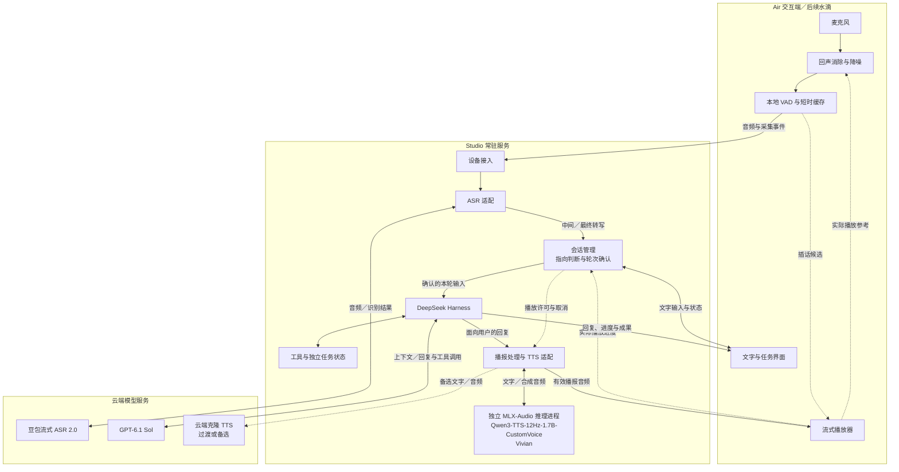

# OpenNova 整体语音链路技术方案

日期：2026-10-12。状态：豆包 ASR 真人试音通过；VAD 与 Studio Vivian 已部署；独立 ChatGPT 授权、DeepSeek Harness / GPT-6.1 Sol 两轮会话和完整语音文件输入闭环已通过。真人连续交流与播放中插话仍待验证。当前可运行入口见 [语音对话 Demo](../../tools/voice/README.md)，使用 Vivian 1.5 倍速。

OpenNova 的语音部署方向为本地音频处理、云端 ASR、Studio 常驻 Agent 服务，以及本地 TTS，支持工作协同与日常陪伴。语音交流按 ASR 输入、Agent 业务、TTS 输出三条链路组织，由会话管理协调轮次、播放与任务。本文细化 [MVP PRD](../product/opennova-mvp-prd.md) 第 4 章，并作为 [技术 Demo 预研方案](opennova-technical-demo-research.md) 的语音专项设计。

已确定 DeepSeek Harness、GPT-6.1 Sol，以及当前默认 TTS **Qwen3-TTS-12Hz-1.7B-CustomVoice / Vivian**，语气保持温柔自然。ASR 采用豆包流式语音识别模型 2.0 的实时双向流式接口，本地 ASR 暂不推进。Base 保留为后续自定义声音克隆路线；现有约 20 分钟录音可供后续验证，不阻塞 Vivian 接入。

本地 TTS 已部署在 Mac Studio，使用 MLX-Audio；Spark 留作后续训练与实验，不作为实时语音链路依赖。实施顺序见 [MVP 开发环境部署方案](opennova-mvp-development-deployment.md)。当前终端 Demo 在 Air 运行原生 Voice Processing、VAD、ASR 适配与 Harness，复用本机独立授权，Studio 合成 Vivian。`--continuous` 模式持续拾音并支持增量播报、候选暂停、确认插话后取消旧输出，以及内置 / 蓝牙设备选择；无此参数时保留原轮流模式。原生启动、PCM 采集与静音播放已通过，AEC 声学效果、真人插话完整性和 Studio GPU 停算仍待验证。

**下文架构与模块职责描述目标链路，不代表全部已部署。** Studio 常驻会话服务、工作任务、长期记忆和多设备接入仍待实现；当前代码边界与运行命令以 [语音对话 Demo](../../tools/voice/README.md) 为准。

## 1 部署与模块职责

| 位置 | 模块 | 职责 |
| --- | --- | --- |
| Air 交互端，后续扩展至水滴 | 音频前端 | 持续拾音、回声消除、降噪、语音检测、短时缓存；本地静音与快速停播 |
| Air 交互端，后续扩展至水滴 | 播放器与界面 | 播放流式音频、报告实际播放进度；显示转写、文字回复、任务和连接状态 |
| Studio | 接入与语音会话管理 | 管理设备连接、输入归属、发言结束、设备指向、打断和输出入口 |
| Studio | ASR 适配 | 管理云端识别会话，将厂商回调转换为一致的转写与状态事件 |
| Studio | DeepSeek Harness 与任务服务 | 组织上下文、调用 GPT-6.1 Sol 与工具，维护真实任务状态和成果 |
| Studio | 播报处理与 TTS 适配 | 提取适合朗读的回复，管理音色、流式合成、取消和迟到音频 |
| 云端 | ASR 与 LLM 模型服务 | 完成语音识别与语言推理；厂商凭据保留在 Studio |
| Studio | Qwen3-TTS-12Hz-1.7B-CustomVoice / Vivian，MLX-Audio 推理 | 独立合成、音色试听与 HTTP 流式回传已完成；Base 权重与历史基线保留 |
| 云端，备选 | 克隆 TTS 服务 | 供桌面 Demo 过渡或本地方案未达标时选用；明确配置，不自动切换音色与服务 |

图中的模块是逻辑职责。首版 Studio 使用同一 Node 服务进程组织接入、会话与适配，MLX 推理使用独立 Python 进程。会话管理负责交流控制；Master Agent 的业务规划与内部机制另行设计。

## 2 输入链路

### 2.1 持续拾音与声学处理

未静音时，交互端保持采集能力；助手正在播报时也继续采集，以支持插话。回声消除（AEC）尽量靠近采集与播放设备运行，使用实际播放音频及其时间关系作为参考，减少把助手的声音识别为用户指令。

Air 优先复用音频框架的语音处理能力。原生实现可评估 AVAudioEngine 的 Voice Processing；网页采集可作为受控 Demo 入口，但后台运行、设备切换与外放回声需单独验证。避免在多层重复叠加降噪或自动增益，导致轻声和尾字受损。[Apple 音频处理接口](https://developer.apple.com/documentation/avfaudio/avaudioionode/setvoiceprocessingenabled%28_%3A%29)

本地 VAD 优先评估 Silero VAD。它负责判断是否有人声，不能判断是否在对助手讲话，也不替代 AEC。可用 ONNX 运行；其支持的 8 kHz 与 16 kHz 输入需要由采集端统一适配。[Silero VAD](https://github.com/snakers4/silero-vad)

建议以单声道、16 kHz、16 bit PCM 作为首轮 ASR 上行格式，设备原始采样率不同则在声学处理后重采样。网络发送块与 VAD 推理窗口分别组织，按所用组件要求配置；TTS 下行保留模型服务返回的采样率信息，再适配播放设备。

### 2.2 VAD 与云端识别衔接

使用有限长度的内存环形缓存，建议先试验 300 ms 的语音起点前缓存，再根据漏首字情况调整。检测到候选人声时启动或复用识别任务，先发送缓存，再连续发送当前音频，云端建连期间的缓存也必须有上限。

一个识别任务开启后，应保留话中停顿与必要的尾部静音，直到服务端断句或客户端完成收尾。不能只拼接 VAD 标记为人声的片段，否则会改变时序、破坏断句并增加漏字。单次短暂停顿也不立即关闭识别连接。

Always On 指本地持续可交流。云端 ASR 连接可按活动窗口复用、超时后重建，保活遵循具体服务协议。豆包连接的发送节奏、结束标志和超时按实时接口协议实现，不能假定普通网络心跳可以保持识别任务永久有效。[豆包实时 ASR 接口](https://docs.volcengine.com/docs/DoubaoVoice/LargemodelstreamingautomaticspeechrecognitionAPI?lang=zh)

### 2.3 转写与输入确认

ASR 适配区分中间转写、句段最终转写和请求结束。中间转写更新界面，同一片段的新版本替换旧版本，不追加成多条用户消息。

服务端认为一句话结束，只说明识别片段结束。会话管理仍需合并用户的停顿、补充和改口。例如“用英文……不，改成中文”应尽量作为一个输入处理，而不是在“英文”出现时已经发起工作。

每个输入只提交一次业务请求。重复回调、断线重连和迟到修订不能自动再次执行操作；提交后的重要修订需作为明确的新输入处理。热词与 ASR 上下文只发送当前项目所需的少量术语和近期交流，不发送整个项目或全部长期记忆。

## 3 Always On 与轮次管理

进入 Agent 业务链路前，需要完成三个不同判断。

| 判断 | 回答的问题 | 首轮处理方式 |
| --- | --- | --- |
| 语音活动 | 有没有人在说话 | 本地 VAD，结合 AEC 后的输入 |
| 设备指向 | 是否在对 OpenNova 说话 | 结合是否处于交流中、明确呼叫、最近上下文与用户操作；指向不明的背景话语保持安静 |
| 发言结束 | 用户是否已经说完 | 综合持续静音、ASR 最终片段、表达是否完整、是否继续改口 |

**首次发起、连续接话、结束交流后三种情境分别处理。** 明确呼叫和界面主动进入交流可以作为强信号；已有对话中的接话可使用近期上下文。明确说“先这样”“不聊了”后退出活跃交流，后台任务结果继续显示在电脑端，普通结果不自动出声。

免固定唤醒词仍是主要技术难点。单凭 VAD、声纹或一句可识别的命令，都不能证明是在对助手讲话。首版从状态与上下文规则建立基线；边界样例可评估额外的指向或语义判断，但不能将通用 LLM 判断当成已验证的全天免唤醒方案。按键入口用于对照测试和失败回退，产品目标仍保留自然开口。

结束发言的等待使用同一条时间线计算。服务端已经等待的断句时间计入总预算，避免本地再完整等待一遍，造成明显迟钝。连续长句允许 ASR 返回多个最终片段，但在用户继续发言时不据此直接提交业务。超过输入时长或缓存上限时，明确提示本轮未完整接收，不执行残缺命令。

轮次和打断设计可参考 [LiveKit 的轮次处理](https://docs.livekit.io/agents/logic/turns/)。是否采用完整框架取决于接入验证；其默认设置不能直接视为 OpenNova 中文家庭环境的最终参数。

## 4 Agent 处理与语音表达

### 4.1 Agent 业务输入

会话管理将确认的输入、当前项目、相关对象和轮次信息交给 DeepSeek Harness，经已选定的 GPT-6.1 Sol 处理。文字输入直接进入相同业务入口。语音适配不承担工作任务的意图分流或工具规划。

普通交流可直接返回回复；耗时工作交由有独立标识的任务跟踪。播报进度依据实际任务事件，只有收到执行器的成功回执才能说“已完成”。代码、差异、日志和成果留在界面，语音表达当前结论与需要用户决定的事项。

新语音输入与正在运行的工作保持明确关系：继续讨论、修正任务、停止播报和取消任务分别处理。任务修正如何作用于运行中的 Harness 是待验证的控制接口，不假设一次取消模型请求就能安全取消或保留所有工具操作。

### 4.2 可播报文本与 TTS

Harness 将面向用户的回复增量交给播报处理模块；推理事件、原始工具参数和调试日志不进入 TTS。播报处理保留文本意义，处理 Markdown、长链接和代码展示边界，不机械地朗读所有界面内容。

当前使用 Qwen CustomVoice 的 Vivian 预设，工作协同与日常陪伴共用温柔自然的聊天语气。音色配置关联模型 revision、`voice=Vivian`、语气指令与生成参数，具体配置见 [TTS 运行说明](../../services/tts/README.md)。后续 Base 克隆另行保存参考录音与转写。[官方预设音色接口](https://github.com/QwenLM/Qwen3-TTS#custom-voice-generate)

**音频分块输出与增量文本输入分别验证。** 能边生成边返回音频，不代表服务能够在同一请求中持续接收 LLM 后续文字。Studio 使用 MLX-Audio，需在 CustomVoice / Vivian 模式下确认这些能力以及结束、取消语义；首版按语义分段提交文本，接收流式音频。

若后端支持双向流式，按其协议持续提交文字并接收音频；若只接受完整文本，则先由播报处理模块缓冲到适合朗读的语义片段，再顺序提交，限制队列长度，并测试片段衔接与语气一致性。不得把每个 Token 单独合成。正式接入方式由首声延迟、连续播放和声音效果共同决定。

语气控制沿用 Vivian 试听时的 `instruct`；已确认 HTTP 接口将其传递至模型生成方法，流式生成听感继续验证。Base 克隆与云端模型分别配置，不能直接复用 CustomVoice 的音色与表达参数。云端备选按服务要求单独注册音色；音色准备不在每轮对话重复进行。

### 4.3 播放与用户已听内容

Vivian 输出默认使用 **1.5 倍速**。当前 Air 测试客户端在播放前使用连续的 FFmpeg `atempo` 流式变速，保持 24kHz 单声道与原音调；Studio 返回原始 PCM。正式播放器接入时沿用这项偏好，原始音频时长与变速后播放时长分别记录，AEC 使用变速后实际播放的音频作为参考。

交互端收到第一段可播放音频后使用有上限的缓冲开始播放，持续接收后续音频。队列积压时限制合成超前量；若推理后端不支持暂停生成，则通过限制新增文本或取消旧播报处理，不允许无限积压。

分别记录“已生成文字”“已合成音频”“已实际播放”。播放器回传开始、进度、停止和结束事件。没有准确的字词时间对齐时，记录已完整播放片段及中断片段的估计位置，不伪称知道用户听到了哪个字。

后续回复应知道上次播报被打断，不能假设整段已被听到；工作成果、工具回执和完整文字仍保留各自状态。交付状态可以作为会话上下文附加信息，不能为了截断语音历史而删除真实任务记录。

## 5 插话与控制行为

插话采用本地快速响应、Studio 协调取消的方式。推荐时序如下：

1. AEC 后的可信人声出现，交互端立即暂停当前播放，并继续收集用户语音。停声不等待云端识别或取消回执。
2. Studio 结合语音持续时间、转写和当前交流判断是否是真正插话。明显噪声或无接话意图的短促附和可判为误触发；该策略需用中文样例调节。
3. 确认真正插话后，令当前播报失效，清除待播队列，停止继续向旧 TTS 会话追加文字，并发送取消请求。若本地按键明确要求停止，可直接完成此步。
4. 新输入完成后建立新轮次。旧播报的迟到音频在 Studio 与交互端同时过滤，旧回复剩余文字也不能再次进入播放器。
5. 若判为误触发且尚未取消合成，可以从暂停位置恢复；已经取消则不直接复用旧队列。是否重播由会话管理明确发起。

| 用户行为 | 音频行为 | Agent 与任务行为 |
| --- | --- | --- |
| “先别说了”或停止播放按键 | 取消当前播报 | 已提交工作默认继续，文字结果可查看 |
| “等一下，改成中文” | 停旧播报，接收新输入 | 新轮次处理修正；是否修改后台工作由具体语义决定 |
| “取消刚才那个任务” | 停止相关播报 | 向明确的任务发送取消请求，按执行器回执报告结果 |
| “先这样，不聊了” | 结束当前交流与播报 | 保留已提交任务；普通完成消息留在界面 |
| 麦克风静音 | 停止采集，丢弃未提交音频缓存与该次识别输入 | 已提交任务保留；播放开关独立，不自动取消任务 |

Studio 本地 TTS 适配需将取消请求传给实际推理后端，分别确认停止返回音频与停止计算。若后端不能立即中止当前生成，先让旧请求失效并丢弃输出，同时限制旧任务占用；不能把接口已返回取消当作 GPU 已释放。用户侧停声始终由交互端保证。

云端备选按厂商协议取消：CosyVoice 提供 `streaming_cancel()`；豆包提供 `CancelSession`。服务取消用于收回生成资源，本地失效标记和停播保证用户不再听到旧内容。[CosyVoice SDK](https://help.aliyun.com/zh/model-studio/cosyvoice-python-sdk/)、[豆包取消协议](https://docs.volcengine.com/docs/DoubaoVoice/WebSocketBidirectionalStreaming-V3?lang=zh)

停止播报不必自动终止 Harness。只有确认当前生成不再需要、且不会误取消独立任务时，才停止相应模型生成；否则过滤其语音输出，继续接收任务回执。这个边界需要在 Harness 接口验证中重点检查。

## 6 连接与状态一致性

### 6.1 传输建议

首版在受控室内网络中，Air 与 Studio 通过有身份校验的 WebSocket 传输二进制音频和结构化控制事件；开发期使用 SSH 隧道保护传输，后续设备直接接入时配置 HTTPS/WSS。音频与控制队列分别限流，停止播放在本地执行。保留采集时间、音频序号、采样率和输入标识，重连时明确标注缺失区间。

Studio 分别管理云端 ASR 连接与 TTS 服务连接。接入本地 TTS 时，经 Studio 回环地址调用独立推理进程，明确请求标识、音频格式、结束与取消事件；具体传输协议随推理后端验证确定。云端 TTS 备选使用独立适配和配置。若后续弱网、多设备或远程接入成为主要瓶颈，再评估 WebRTC 与 LiveKit 的媒体传输能力。传输框架不接管工作任务状态。

### 6.2 标识与状态

建议保留以下关联关系，不把一次网络连接等同于完整对话。

| 标识 | 用途 |
| --- | --- |
| 会话标识 `session_id` | 关联交流上下文，可跨短暂重连 |
| 输入标识 `input_id` | 关联采集片段、ASR 修订和输入提交，防止重复处理 |
| 轮次标识 `turn_id` | 关联已确认输入与对应回复 |
| 播报标识 `speech_id` 与播放代次 | 关联音频、播放进度和失效状态，拦截旧音频 |
| 任务标识 `task_id` | 独立跟踪工作执行、取消与成果 |

连接、麦克风、播放、交流和任务状态分别维护。系统应能表达“正在播报且正在拾音”“麦克风已静音但任务仍运行”“交流已结束但任务待确认”，不使用互斥的单一状态机代替所有状态。

### 6.3 失败与恢复

| 情况 | 处理建议 |
| --- | --- |
| ASR 超时或断线 | 当前输入标记为未完整接收；不提交残缺命令。恢复后建立新识别任务，提示用户补说 |
| TTS 失败 | 保留文字与任务结果，提示语音暂不可用；不把任务成功变成任务失败 |
| Studio TTS 进程失败或资源不足 | Agent 服务仍可用时继续显示文字；不自动切换云端音色，不让未完成实验替换服务版本 |
| Air 与 Studio 断开 | 交互端停止网络音频播放与上传，清除待提交语音；Studio 保留任务状态 |
| 重新连接 | 查询原会话与任务状态，建立新播放代次；不自动重放历史语音或重复执行任务 |
| 晚到结果 | 按输入版本、轮次和播报有效性处理；已结束轮次不因晚到音频重新出声 |
| 切换输入输出设备 | 重新建立音频格式与回声参考，重置音频/VAD 状态，明确提示短暂不可交流 |

日常交流的原始采集音频默认仅用于当次处理和有限内存缓存，不写入 OpenNova 长期记录。用户专门提供的声音克隆参考录音、转写和参考提示作为音色资产单独保存与管理。非静音的人声仍可能被上传给云端 ASR，再由会话管理决定是否回应；不能把本地 VAD 描述为只上传对助手说的话。云服务的数据保留规则需按最终账号配置确认。文字与工作记录遵循 PRD 的保存设置。

## 7 组件选择与验证顺序

| 组件 | 当前方向 | 下一步需要确认 |
| --- | --- | --- |
| 音频前端 | 复用端侧框架的 AEC、降噪与采集播放 | 耳机和外放条件下的回声、双向讲话及设备切换 |
| 本地 VAD | Silero VAD 候选 | 漏首字、轻声、短促附和、背景电视和播放时的检测 |
| 云端 ASR | 豆包流式语音识别模型 2.0，已确定 | 中文术语、否定与改口、出字与最终结果延迟、真实用量 |
| 会话编排 | Studio 中独立于 Harness 业务规划的交流控制模块 | 指向判断、轮次提交、打断与状态一致性 |
| Agent | DeepSeek Harness＋GPT-6.1 Sol，已确定 | 文本增量、任务并行期间接收新输入、取消接口的实际边界 |
| 本地 TTS | Qwen3-TTS-12Hz-1.7B-CustomVoice / Vivian，Studio / MLX-Audio 推理 | 已选音色的中文与长句、流式接口、首声、连续播放、增量输入及取消 |
| 云端 TTS 备选 | CosyVoice 3.5 Flash 与豆包声音复刻 2.0 | 需要过渡基线或本地方案未达标时，再验证音色与接入 |
| 本地播放器 | 可取消的流式播放与进度回传 | 立即停播、旧包丢弃、长回复队列和真实播放进度 |

模型依据、录音准备与接入约束见 [ASR 与 TTS 选型建议](opennova-asr-tts-selection.md)。ASR 继续验证已选豆包 2.0；TTS 默认请求已切换 CustomVoice / Vivian，流式回传通过；完整实时对话仍需联调。

本地 TTS 已完成 Vivian 参数固定与 Studio HTTP 流式回传，下一步验证现场播放、中文场景稳定性与会话联调，分别保存样音、配置和测量记录。Base 克隆与微调按后续需要安排。服务验证满足要求后接入完整链路；Spark 的后续训练与日常语音服务分开管理。

桌面 Demo 按原范围推进：先验证 Harness 文本增量和任务控制，再在耳机条件下接通 ASR → Agent → TTS；随后验证播报与插话、桌面外放，最后扩大到免固定唤醒词和持续运行。文字工作闭环与 Studio TTS 分别验证，通过后接通语音；云端 TTS 保留为明确选择的备选。

每轮记录用户实际说完、输入提交、第一段可播报文字、第一段合成音频、实际出声，以及插话开始与实际停声的时间。以交互端时间测量端到端响应和停播，跨机器分段指标需处理时钟差异。按普通问答、工具任务、冷连接和连接复用分别统计中位数与 P95；同时记录误回应、漏回应、关键语义错误、播放中断及实际用量。先得到可复现基线，再确定体验阈值。
