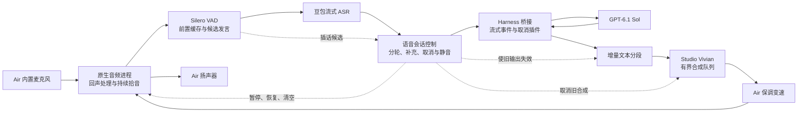

# OpenNova 下一版语音交互设计

日期：2026-10-12。状态：用户已确认技术设计并授权开发；代码与自动化 / 真实服务文件验证已完成，现场声学验证待进行。本文保留设计约束，实际验证范围以[语音运行说明](../../../tools/voice/README.md)为准。

## 1 目标与本版范围

把已经可运行的轮流说话 Demo，升级为支持持续拾音、自然分轮、逐句回复和插话控制的桌面语音助手。

用户已确认的四组目标：

| 目标 | 本版交付行为 |
| --- | --- |
| 听完整 | 开头和尾部不因切换状态丢失；短句、话中停顿、同轮补充和改口得到正确处理 |
| 更早回应 | 模型给出适合朗读的短句即可开始合成；当前句播放时准备下一句 |
| 能够打断 | 思考和播报期间继续拾音；插话先在 Air 暂停声音，确认后撤销旧回复并接收新表达 |
| 交流可持续 | 支持静音、恢复、停止播报和结束；单轮服务故障后仍能接收下一次表达 |

目标环境是当前 MacBook Air 内置麦克风与扬声器。耳机作为对照路径。会话由用户显式启动；本版持续监听限于程序运行、电脑唤醒且用户未静音的期间。

沿用 Air 的 Silero VAD、豆包流式 ASR 2.0、DeepSeek Harness / GPT-6.1 Sol 独立订阅授权，以及 Studio 的 Qwen CustomVoice / Vivian。默认 1.5 倍保调语速、已有语气和模型版本保持不变。Agent 继续在 Air 运行，本版只增加语音需要的流式输出和取消控制。

全天免唤醒、背景对话指向判断、锁屏后台、多种蓝牙设备兼容、Studio Agent 迁移、工作工具、长期记忆、声音克隆训练均后置。

## 2 现有基础与核实结果

| 部件 | 已实现 | 当前限制 |
| --- | --- | --- |
| `tools/asr/vad.py` | Silero ONNX、300 ms 前置缓存、短时人声过滤、静音结束检测 | 默认固定 800 ms 静音收尾；不知道语句是否说完或是否在对助手讲话 |
| `tools/voice/capture.py` | 实时上行、最终识别校验、截断与积压保护 | 一轮结束就关闭输入；模型回复和播报期间听不到用户 |
| `services/agent/provider-core.mjs` | 已把模型增量转换为 Harness 文本流 | `worker.mjs` 等待 `harness.run()` 完成后才返回整段文本 |
| Harness 固定版本 | `agent/assistant-stream` 提供尝试标识与文本增量；Core Agent 提供 `cancel()` 与 `whenIdle()` | 当前 SDK 协议没有中途取消方法，不能假定存在 `harness.cancel()` |
| `tools/voice/playback.py` | Vivian PCM 流式回传、1.5 倍保调播放 | 逐句串行调用，缺少预取、播放代次和插话控制 |
| `conversation.py` | 多轮会话、转写与状态、文件测试 | 单轮异常导致整段会话退出；没有独立静音和停播操作 |

最近一次两轮文件测试记录在 `output/voice/global-proxy-check-20261012/conversation.json`：Agent 完整回复约 16.0 / 3.8 秒，TTS 首段可播放音频约 0.87 / 0.86 秒。样本未播放到扬声器，不能作为实际出声延迟或稳定性统计。优化时需要新增模型首字和首声测量。

## 3 技术路径选择

| 路径 | 优点 | 代价与适用范围 |
| --- | --- | --- |
| 继续只用 Python / sounddevice | 改动较小，现有采集与播放可复用 | 不能仅靠打开双向音频获得可靠 AEC；不足以覆盖本版内置扬声器插话目标 |
| **增加 macOS 原生音频辅助进程，保留 Python 编排（推荐）** | 收音和播放进入同一音频引擎，接入系统 Voice Processing；保留现有 ASR、VAD 与 TTS 适配 | 新增 Swift 构建与进程协议；必须在 Air 上验证真实声学效果 |
| 转为浏览器音频前端 | 可同时增加交互界面 | 引入前后端媒体连接及浏览器生命周期；扩大本次改动范围 |

采用推荐路径。Air 原生辅助进程使用 AVAudioEngine，启动前开启 Voice Processing，输入和播放共用该引擎。Apple 文档说明该模式面向回声处理；能成功开启接口不等于已通过本机声学验证。[Apple Voice Processing](https://developer.apple.com/documentation/avfaudio/avaudioionode/setvoiceprocessingenabled(_:))、[AVAudioEngine 说明](https://developer.apple.com/videos/play/wwdc2019/510/)。

Harness 保留现有 SDK 的启动、提交和会话结算；增加 OpenNova 自有插件，通过 Core 事件输出实时文本、通过 Core 取消正在生成的对话。插件与 worker 使用受限本地 Unix socket，不修改 Harness 上游源码或伪造 SDK 方法。

## 4 组件与职责

- **原生音频进程：** 独占本次会话的采集和播放；处理音频格式转换、Voice Processing、暂停/清空和设备状态。送往 Python 的音频统一为单声道 16 kHz PCM；TTS 原始音频仍按其 24 kHz 格式接入并正确转换。实时音频回调不执行网络、阻塞 I/O 或无界分配。
- **Python 会话控制：** 维护拾音、输入与输出状态；协调 ASR、Agent、TTS；响应终端操作；限制所有队列。原始收音默认只在有界内存缓存中流转。
- **Harness 桥接：** 只转发目标会话、当前尝试的用户可见文本。错误、工具事件、推理内容不送往 TTS。SDK 的完整结果仍负责成功校验。
- **TTS 调度和播放：** 按语义分段，在播放当前句时提前准备下一句；同时只允许一个 Studio 合成请求，限制待合成文本及已缓冲音频。

监听、模型生成和播放是可重叠状态，不再用“播放时必定关闭麦克风”的串行流程表达。

## 5 详细交互行为

### 5.1 拾音与分轮

1. 用户启动程序后先完成设备、模型和服务检查，准备成功再明确显示“正在聆听”。
2. 保留现有前置缓存与短时人声过滤。持续采集与每轮 ASR 生命周期分离，切换轮次不重启整个麦克风。
3. ASR 的中间文本仅用于展示与结束判断；最终成功转写才提交给 Agent。中间文本按完整修订替换，不能把修订误当作新增字串。
4. 提供普通停顿和延长等待两档结束策略。普通停顿以现有 800 ms 为对照；当最新文本明显未完成、含补充引导或改口时延长等待，同时设置最大等待上限。具体初始参数进入实施计划并可配置，不能把固定关键词规则描述为完整语义理解。
5. 收尾前重新开口继续同一轮；ASR 已结束后再次开口则形成新的输入，带上前文，取消尚在生成的旧回复。默认每次只允许一个 Agent 对话生成任务。
6. 输入达到现有时长限制、音频积压或 ASR 提前失败时，说明本轮未提交并重新进入聆听，不把截断内容交给模型。

示例：“我想先优化……语音交互”“用英文……不，改成中文”“等一下”“不是这个”。验证同时覆盖短句被保留与长句不过早提交。

### 5.2 增量回复与连续播放

1. 使用 Harness 的实时 assistant-stream 事件；每段标记会话、应用轮次、模型尝试和递增序号，不能混入其他会话或已撤销尝试。
2. 缓冲到适合朗读的短句后提交 TTS，不对每个 Token 发起合成。超过单段上限时在合理边界切分；模型正常结束时排空最后一段，不能漏掉无标点结尾。
3. 当前句音频到达后立即进入播放器，同时准备后续句。原始文字完整保留，朗读视图不改变原回答的事实与数字。
4. 播放仍使用 Vivian 和默认 1.5 倍保调语速。跨段音量、语调和停顿需现场试听；不能因流式接口成功就宣称听感连续。
5. 部分内容可能在模型最终完成前已经播出。若随后发生失败，立即停止剩余播报，标记“回复中断”，保留已显示的部分文字；不能把部分播报记录成完整成功，也不自动从头重播。

### 5.3 插话与停止

1. 检测到可信人声候选时，Air 先暂停本地播报并缓存用户开头；暂停不依赖云端识别返回。
2. 结合持续人声和识别结果确认插话。确认后提升播放代次、清空旧播放队列、停止后续文本入队并取消旧生成；新表达完整识别后再提交。
3. 短促噪声或无有效转写的候选不提交新问题。若旧回复尚有效且仍在缓存范围内，恢复暂停的播报；否则保持安静并回到聆听，不能恢复已明确取消的旧回复。
4. 明确停止操作立即使旧播报失效。迟到的模型文字、TTS 音频和播放完成回调均经过代次校验，不能让旧回复重新出声。
5. 思考阶段的补充输入同样取消旧生成，再在同一 Harness 会话接续；无需销毁整个 Harness 进程来模拟日常插话。
6. Harness 的生成结束和用户实际听到的内容分别记录。下一轮附加“上一段播报被打断”的上下文，保留原始会话事实；不宣称知道逐字听到的准确位置。
7. 取消 TTS 分别记录本地停声、HTTP 连接关闭以及服务端请求释放。关闭连接不等于 MLX 已停止计算；若后端不能及时释放，适配层只保留最新需求、避免继续堆积，实测不足则列为未完成项。

本版没有后台工作工具。控制接口仍区分停止播报与取消工作任务，避免后续接工具时把两者混为一谈。

### 5.4 用户控制与异常恢复

终端提供可见的操作提示：停止当前回复、静音/恢复、结束交流、重新开始交流和退出。具体按键在实现时统一定义，并与 Ctrl+C 退出区分。

| 操作/事件 | 行为 |
| --- | --- |
| 静音 | 停止把麦克风音频交给 VAD/ASR，清理尚未提交的收音；恢复后重新开始缓存，不上传静音期间内容 |
| 停止当前回复 | 停止播报和剩余对话生成，清空相关队列，保留会话并继续聆听 |
| 结束交流 | 停止当前输出，退出活跃交流状态；本版通过明确操作重新进入，避免承诺尚未实现的免唤醒指向判断 |
| ASR 失败 | 取消当前识别，显示本轮未提交；恢复到可再次说话的状态 |
| Agent 请求失败 | 显示受控错误，保留已有上下文；不自动重复提交用户输入，下一轮可再试 |
| TTS 失败 | 保留文字，标记语音未完成；本轮不重复播放，允许下一轮继续 |
| 设备断开或权限拒绝 | 停止音频与当前输出，明确提示需要恢复设备；设备恢复后重新建立音频格式与 AEC 状态 |
| 持续全零输入 | 提示检查麦克风与权限；不把正常安静简单判为设备故障 |
| Ctrl+C/进程退出 | 清理本次麦克风、播放器、ASR、TTS 连接以及自有子进程和 socket |

服务配置错误、授权失效或启动失败进入明确的不可用状态，避免自动反复登录、重启或切换计费路径。

## 6 接口与状态约束

- 应用层标识包括 `session_id`、`turn_id`、`playback_generation`、`segment_id`；Harness 原有 attempt 标识与之关联，但不与用户轮次混用。
- 原生音频控制至少支持采集开关、PCM 入队、暂停、恢复、清空和关闭；反馈音频、播放开始/结束、设备状态和受控错误。帧有长度与格式约束，队列有容量上限。
- Python 与 worker 的 JSON 行协议扩展为请求、文本增量、最终结果、取消完成和错误；控制读取不被正在等待的 Agent 请求阻塞。
- OpenNova Harness 插件在当前 runtime 内订阅 `agent/assistant-stream`，保留目标 Agent 句柄，调用其 `cancel()` 并等待 `whenIdle()`；不修改持久化事件格式。
- worker 为本次 runtime 建立独占本地 socket，目录限制为当前用户可访问，退出时移除；只接受本次会话的标识，不新增可被局域网访问的控制端口。
- 静音、取消与退出优先于排队的音频和文本。恢复后不能提交旧 ASR 最终结果，队列满时必须显式终止相应轮次，不能静默丢字后继续回答。
- 默认不保存用户原始收音。离线测试与显式选定输出目录的测量产物仍保存在 Git 忽略的 `output/`。

## 7 实施拆分与验证

以下是技术设计中的工作包，不是已执行的实施计划。

| 顺序 | 工作包 | 必须看到的结果 |
| --- | --- | --- |
| 1 | Harness 流式事件与取消桥接 | 首个文本片段早于整轮结束；取消后同一会话能继续；迟到片段被过滤 |
| 2 | 文本分段、TTS 预取和可取消播放 | 首句及时合成；长回复完整有序；中断后无旧音频复播；失败不重播部分回答 |
| 3 | 原生双向音频与 AEC | 同一引擎边播边录；现场验证助手不自触发、用户插话不被回声处理吞掉 |
| 4 | 持续采集、轮次和用户控制 | 短句/停顿/改口测试通过；静音真正阻断上行；单轮失败后能继续 |
| 5 | 集成、测量与运行说明 | 自动化回归、真实云端和 Studio 文件测试、Air 外放现场测试分别记录 |

确定性测试应在无麦克风、无云端依赖下覆盖：静音、短句、前后字保留、ASR 修订、候选误触发、分段边界、队列积压、取消竞态、旧回调、服务失败后第二轮、进程清理。先写能复现缺失行为的测试，再实现相应功能。

Harness 桥接使用固定上游版本做真实集成验证，不能只用伪造事件宣布接口可用。文件测试继续覆盖 VAD → 豆包 → GPT → Vivian，不把测试录音结果视为麦克风或 AEC 结果。

现场样例至少包括：

- 用户安静时连续播报；确认未将助手声音当作新问题。
- 用户在句首、句中、句尾插话；确认及时停声且新表达开头完整。
- “好”“不”“等一下”等短句，以及停顿后补充、同轮改口。
- 轻声、键盘声、咳嗽和短促附和；记录误触发和漏响应。
- 静音期间讲话、恢复后讲话、停止后旧音频晚到。
- ASR、模型或 TTS 单轮失败后再次交流。

每轮记录：用户实际说完、输入提交、模型首字、首段文字提交 TTS、首个 PCM、播放开始/结束、插话开始与实际停声。跨机器耗时以 Air 的统一时钟为主；软件播放回执与真实扬声器声学测量分别标记。

先用相同场景比较优化前后，再设最终体验门槛。首声目标不能用网络稳定时的一个样本保证；也不能用 `isVoiceProcessingEnabled=true` 代替外放验证。尚未现场通过的能力必须标为待验证。

## 8 代码边界与现有工作保护

新增职责集中在 `tools/voice/` 的会话控制、原生音频桥接、文本分段和播放调度，以及 `services/agent/` 的流式/取消插件。豆包适配增加中间转写回调；Silero 与已有模型版本继续复用。实际文件名、接口参数和测试步骤在技术设计确认后的实施计划中固定。

保留当前可运行入口和文件测试路径；现有单轮捕获测试继续用于该路径，新持续模式增加独立测试，不简单删除原有保护断言。调试中的 Node 24 选择、代理支持和受控错误提示应一并整理，已有未提交变更单独核对来源。`skills/`、`tools/video/` 等无关工作不纳入此次修改。

实施完成后同步 `tools/voice/README.md`、`services/agent/README.md` 和部署方案，分别说明已通过的自动测试、真实服务测试和仍需要用户现场完成的验证。

## 9 技术依据

- 本仓库：[当前对话入口](../../../tools/voice/conversation.py)、[本地 VAD](../../../tools/asr/vad.py)、[播放实现](../../../tools/voice/playback.py)、[Harness 桥接](../../../services/agent/worker.mjs)。
- DeepSeek Harness 固定提交 `ddefc45fbc7f8e46dd73185e68295696d1297887`：本地 `packages/sdk/client/README.md` 明确 SDK 无 mid-turn cancel；`packages/core/agent/src/runtime-types.ts` 定义 `agent/assistant-stream`、`cancel()` 和 `whenIdle()`。
- [Apple AVAudioEngine Voice Processing](https://developer.apple.com/documentation/avfaudio/avaudioionode/setvoiceprocessingenabled(_:))：原生语音处理入口。
- [Apple WWDC19 AVAudioEngine](https://developer.apple.com/videos/play/wwdc2019/510/)：输入输出共同启用 Voice Processing，切换模式时引擎需停止，实际设备渲染与离线渲染的区别。

## 10 自查

- 四组已确认需求分别落到分轮、流式播报、双向音频与取消、控制和恢复工作包。
- 当前已实现能力与本版计划能力分开标注；未声称 AEC、取消和持续拾音已经通过。
- 取消链路覆盖模型、文本队列、TTS、播放器及迟到事件；生成成功与实际播出分开记录。
- 本版不迁移部署、不更换模型、不扩大到工具或长期记忆；不改变无关文件。
- 需重点实测的工程风险：Air 外放下的 AEC 与插话完整性、Harness 插件和 SDK 的同会话取消协同、MLX 断流后的计算释放和新请求延迟。
