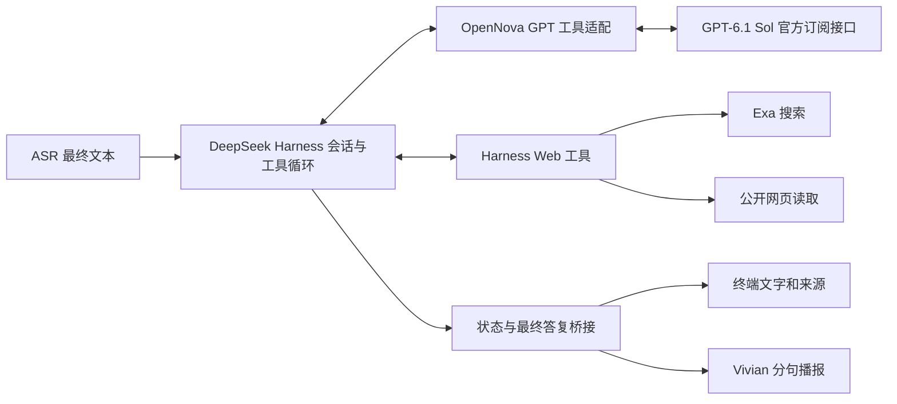

# OpenNova 联网搜索设计

日期：2026-10-13。状态：供本次开发计划使用的设计草案；尚未实现。

## 目标与范围

复用 DeepSeek Harness 已有的 `web_search`、`web_fetch`，让当前持续语音 Demo 可以查询公开资料、阅读网页、基于来源回答，并在检索过程中被打断。保留 GPT-6.1 Sol、OpenNova 独立 ChatGPT 订阅授权、Air 执行 Agent、Studio 执行 Vivian 的部署方式。

本轮包含：自定义工具协议适配、Exa 搜索后端接入、公开 HTML / 文本网页读取、来源展示、搜索状态反馈、超时和取消，以及现有对话回归。Exa 是首个拟接后端，依据是固定 Harness 已有适配；不代表已验证其中文效果或本账号可用性。首次真实检索前需要有效 Exa API Key。

本轮不扩展文件修改、Shell、工作目录操作、登录网页、浏览器自动化、PDF 解析、视觉、跨进程长期记忆或多 Agent；不迁移到 Studio 常驻 Agent，不更换 ASR、TTS 或音色。

## 当前事实

- Harness 固定 `d743267388641bc76f17c45ce8b4c231aed1d32c`（0.2.1-alpha.2），pnpm 11.28.5；Air 使用 Node 24，Python 3.11+。
- `services/agent/voice.patch.yml` 叠加在 `sdk-minimal` 上，没有 Web 插件。
- `provider-core.mjs` 拒绝 tools、tool 消息和非文字块；当前 DevKit 的 `streamResponse` 只提供文字事件。
- `stream-worker.mjs` 会过滤名称含 KEY / TOKEN / SECRET / PASSWORD 的环境变量，搜索密钥不能靠任意环境变量透传。
- `continuous.py` 把单轮 attempt ID 变化当作异常，并要求所有文本增量拼接等于最终回复。正常工具回合包含多个模型步骤，必须调整这项约束。
- 官方订阅接口支持按其协议组织的 function/custom tools；本机账号的真实工具往返仍需验证。现有文字调用成功不等于工具协议已经通过。

## 架构与职责

Harness 继续拥有会话历史、工具执行和多步骤循环；模型适配器只负责协议转换，语音控制器只负责交互和播放。不得在 Python 中另写一个检索 Agent 循环。

GPT 适配保留工具调用 ID、参数、执行结果、必要的 provider replay 数据及失败状态。函数定义按官方支持的 namespace 方式组织；只暴露 `web_search`、`web_fetch`。工具结束原因映射为 Harness 的 `tool-calls`，最终自然语言回复为 `stop`；中断流不能伪装为已完成。

DevKit 当前没有原始事件接口。拟以版本管理中的小补丁增加 `streamItems`，复用其内部 `authenticated` 请求封装和令牌刷新；补丁在隔离的生成目录构建，不修改现有固定源检出。补丁、上游提交和构建清单共同确定扩展产物，现有 `streamResponse` 保持可用。工具验证通过后再让联网模式加载该产物。

Web 插件复用 `dsh-web`、`dsh-tool-web`、`dsh-web-search-exa`、`dsh-web-fetch-http`，并加载工具超时策略。OpenNova 插件只补产品所需的预算、事件和配置，不复制上游搜索实现。

## 配置与初始预算

这些数值是首版实施起点，验证记录中应保留实际耗时，不能把超时上限当成响应速度承诺。

| 项目 | 初始规则 |
| --- | --- |
| 启用方式 | 持续模式显式 `--web`；默认关闭，旧启动命令继续使用已验证的文字模式 |
| 模式兼容 | `--web` 只支持持续模式和新增文字验证入口；旧轮流模式收到该参数时明确报错 |
| 搜索后端 | 首先接 Exa；`config/voice.local.json` 的顶层 `web` 保存非敏感配置 |
| 搜索密钥 | `EXA_API_KEY` 优先，其次 Git 忽略的 `config/secrets.local.json` 的 `web.exa_api_key`；模板留空 |
| 每次搜索 | 单个查询，最多 5 个来源；每轮最多 2 次搜索 |
| 网页读取 | 每轮最多 3 次；单页给模型最多 12,000 字符；沿用上游响应大小限制 |
| 模型步骤 | 每轮最多 6 次模型请求，正常工具循环与模型重试分开记录 |
| 时间预算 | 搜索 15 秒、单页 10 秒；从第一项 Web 工具开始计时，检索预算共 45 秒；用户输入提交至 Agent 完成最多 90 秒，TTS 排空另计 |
| 超限 | 工具级失败回传结构化结果；总预算或模型步骤上限触发取消并给出受控错误，下一轮可继续 |

缺少密钥或扩展产物时，联网模式在启动检查中明确报错，文字模式仍可使用。只有 Exa 对应密钥获准进入搜索运行时；不得放开全部 KEY / TOKEN 类变量。日志、启动事件和会话不记录密钥。

GPT、搜索和公开网页请求使用已配置的外网代理；回环、局域网 TTS 维持既有路由。代理和 VPN 环境下需验证搜索与网页抓取两条请求链，不能以 GPT 请求成功替代它们的检查。

## 回答和语音行为

模型按问题和历史决定是否调用工具；用户明确要求联网或最新信息时应检索。失败、过期资料、只有摘要或来源冲突时，回答应说明对应局限。网页内容作为资料处理，不能改变工具权限或执行网页中的指令。

终端显示搜索和阅读状态、最终文字、来源编号、标题、URL，以及已提供的发布日期。记录抓取时间时明确区分它和发布日期；不补造日期。最终引用只能指向本次或同会话已取得的来源，保存来源与问题、工具调用的关联。

首版对 **开启 `--web` 的会话** 使用 `settled-answer` 输出模式：工具循环期间缓冲模型正文，只展示受控状态；完整轮次通过校验后，再发布最终答复并分句合成。它适用于该模式下所有回答，包括没有调用搜索的闲聊，因此首声可能晚于现有模式。默认文字模式继续保留当前增量播报。这是首版明确的延迟取舍，后续再做可证明为最终答复阶段的实时文本发布。

检索实际开始且等待达到 2 秒时，最多播报一次“我查一下，稍等。”；快速结束则省略。提示和最终答复共用播放代次、暂停与取消机制，提示不计入模型最终回答。工具参数、原始网页、推理内容、Markdown 和长 URL 不直接朗读。

联网模式 `reply.text` 是完整展示文字，`reply.speechText` 是去除链接及引用标记后的播报文字，`reply.sources` 是结构化来源。终端和记录保留来源，语音只朗读自然语言结论。模型输出的未知引用不得被当作有效来源展示。

## 取消与失败

每个状态、结果和播放任务都携带当前请求 ID；模型步骤额外携带 turn / step / attempt 标识。同一请求的正常工具步骤变化不触发“模型重新生成”错误；同一步骤的失败重试不能自动重播文字。

`/stop` 或有效语音插话先清空本地播放，再取消 Harness 当前轮次；取消传播至搜索、抓取、LLM、TTS 客户端。等待实际退出或取消结算后接受下一条模型请求；迟到结果不能进入新问题、来源列表或播放器。HTTP 连接取消不等于远端已经停止计费或释放算力。

搜索工具只能访问公开网页，保留上游 URL、重定向和地址限制。对空结果、401 / 429、网络超时、网页 403、不可读内容分别给出可理解的状态；不自动切换付费账号、不自动重新授权、不循环重试旧回答。

## 验收证据

先验收官方订阅工具往返，再验收文字搜索，再接语音。固定夹具证明协议和取消行为，真实外网验证证明当前账号、搜索后端和代理可用；两类证据分别记录。

- 工具定义 → GPT 调用 → Harness 执行 → 对应 call ID 的结果回传 → 最终回答，完整成功。
- 最新版本查询有实际检索记录及来源；指定公开链接可读取；同会话能追问来源。
- 空结果、失效密钥、配额和超时不会制造已搜索的假象；超限可结束而不挂起。
- 搜索、网页读取、模型续答、提示播报和最终播报期间均可取消；新问题不混入旧结果。
- 中文、英文及中英混合至少各 3 个实际检索问题；评估结果相关性、日期和来源可核验性，不预先宣称 Exa 质量领先。
- 现有无工具流式聊天、蓝牙 / 内置参数、静音、停止和重连行为回归通过；真实外放及插话另做现场验收。

## 依据

- [官方订阅接口能力限制](https://developers.openai.com/siwc/token-sharing-open-source/preview-limitations)，2026-10-13 查阅。
- [官方订阅模型与推理](https://developers.openai.com/siwc/token-sharing-open-source/models-and-inference)。
- [Harness Web 工具](https://github.com/deepseek-ai/deepseek-harness/blob/d743267388641bc76f17c45ce8b4c231aed1d32c/packages/web/tool-web/README.md)。
- [Harness Exa 后端](https://github.com/deepseek-ai/deepseek-harness/blob/d743267388641bc76f17c45ce8b4c231aed1d32c/packages/web/web-search-exa/README.md)。
- [Exa 搜索 API](https://exa.ai/docs/reference/search)。
