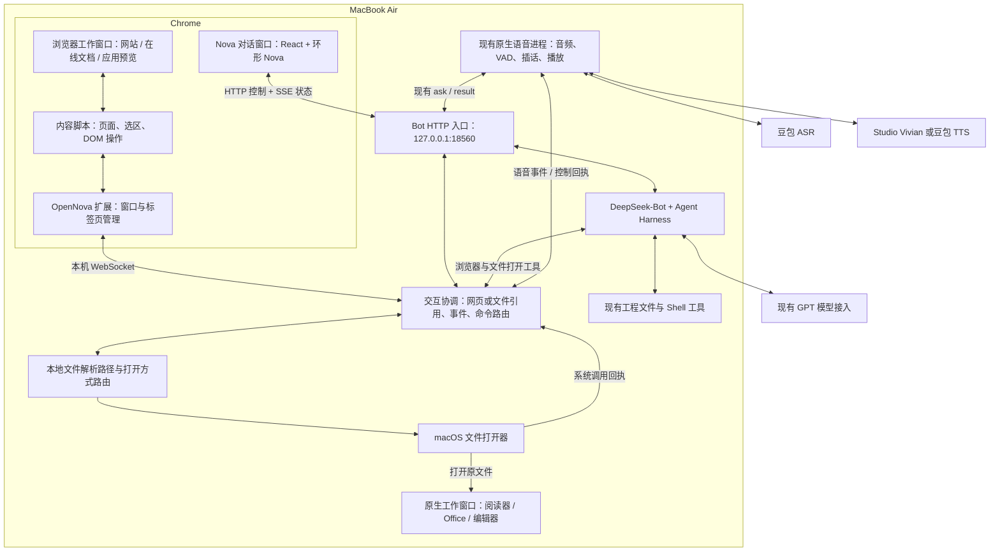

# OpenNova 双窗口交互技术方案

日期：2026-10-18  
状态：技术方案草案，尚未实施；产品交互依据已确认的 [PRD 6.6](../../product/opennova-mvp-prd.md#66-用户端界面)。  
配套：[开发计划](../plans/2026-10-18-desktop-interaction.md)

## 1. 要实现的体验

电脑端保留“当前工作窗口＋Nova 对话窗口”两类角色。工作窗口既可以是浏览器中的真实页面，也可以是打开原文件的本地应用；Nova 对话窗口持续承载交流与反馈。首版提供浏览器页面协作，以及通过 macOS 调用本地应用打开文件。

首条完整验收链路：

1. 用户说“帮我打开雪球上的华工科技”，左侧打开对应的真实页面，右侧反馈打开结果。
2. 用户说“看看最新公告”，Nova 在当前页面寻找公告入口，打开并读取实际内容。
3. 用户选中一段文字，再说“解释一下这一段”，右侧展示引用并解释。
4. 用户改用文字追问，延续同一段会话；点击“停止回复”，当前回复、相关前台工具和播报停止。

新增本地文件体验：用户说“打开 OpenNova 的 PRD”，Nova 在工程中定位文件，调用系统默认应用打开原文件，在右侧显示文件名、路径与打开结果。用户继续问“解释第 4 章”时，Markdown / 纯文本沿用已有文件读取工具取得已保存内容；PDF、Office 等文件首版先支持打开给用户查看，正文解析另行接入。

这一版本以网页协作为主，增加本地文件打开。代码仍通过现有文件与 Shell 工具编辑、测试；前端开发成果可在工作窗口打开本地预览。原生应用内部的选区同步、点击编辑、IDE/CAD 自动操作、全桌面焦点跟踪、截图视觉定位与视频理解后置。

## 2. 当前工程可以复用什么

以下为 2026-10-18 对当前工作目录的代码核对，不代表尚未提交的代码已经发布。

| 模块 | 当前状态 | 本次处理 |
| --- | --- | --- |
| `services/bot/web/` | React 聊天、中文输入、历史消息、操作记录、取消；每 1 秒轮询，后台每 5 秒轮询 | 改造为右侧 Nova 界面，继续复用消息与差异组件 |
| `services/bot/host.mjs`、`requests.mjs` | DeepSeek-Bot / Harness 共用会话，单个前台请求，文件与 Shell 直接执行 | 增加浏览器工具、页面上下文和交互事件 |
| `controls.mjs`、`web-http.mjs` | 统一控制入口；网页使用本地 Cookie 与 CSRF，CLI 使用独立凭证 | 扩展状态和控制接口，保留现有鉴权边界 |
| `tools/voice/continuous.py`、`continuous_run.py` | 原生音频、VAD、ASR、插话、TTS 与终端控制已接通 | 增加结构化状态和网页控制适配，不重写音频算法 |
| `tools/voice/bot_agent.py` | 语音提交给同一个 Bot；最终回答生成后进入 TTS | 保留请求归属与取消，避免网页再提交一次语音消息 |
| `tools/voice/start.mjs`、`start.command` | 检查 / 启动 Bot，连接 Studio 或豆包 TTS，启动语音 | 增加双窗口启动、扩展连接检查和恢复 |
| 浏览器操作 | 目前未接入；Bot 宿主显式设置 `browser:false` | 新增 OpenNova 浏览器桥接，验证后挂入工具清单 |
| 本地文件打开 | 已有文件定位、读取和 Shell；尚无统一文件打开工具、应用路由及界面回执 | 复用文件定位，增加 macOS 文件打开器与文件引用 |

当前 Bot 入口也没有挂载旧语音 `--web` 入口的专用 `web_search/web_fetch`。网页协作不能仅靠打开该开关实现。本轮先通过真实页面及站内搜索完成操作，通用联网搜索整合单独安排。

## 3. 技术路线

**建议：现有 React 对话网页 + Chrome 扩展 + 本地 Bot 协调服务 + macOS 文件打开器。** 浏览器负责网页协作；macOS 文件打开器负责将原文件交给默认或用户指定的已安装应用。开发首版以 macOS、Chrome 120+ 为目标；这是技术建议，不表示已经确认用户的默认浏览器。

| 路线 | 适用性与代价 | 本轮选择 |
| --- | --- | --- |
| Chrome 扩展接入真实浏览器 | 可关联窗口 / 标签页、读取 DOM 和选区，用户继续使用原浏览器中的网站登录状态；需要首次安装与站点权限设置 | 推荐 |
| 独立自动化浏览器 | 便于自动化验证，但需要管理独立浏览器配置与登录状态；作为技术探针或后续替代适配器 | 不作为首版默认入口 |
| Electron 桌面壳 | 可统一管理窗口和内嵌页面，但增加打包、升级与网页容器适配工作 | 后续需要桌面产品化时再评估 |

Chrome 的窗口 API 支持创建、调整窗口位置和尺寸；内容脚本可在获得站点权限后读取和操作页面 DOM。这与“原网站工作窗口 + 独立 Nova 窗口”的要求吻合。[窗口 API](https://developer.chrome.com/docs/extensions/reference/api/windows)、[内容脚本](https://developer.chrome.com/docs/extensions/develop/concepts/content-scripts)

选择独立自动化浏览器时不能默认复用日常 Chrome 配置：Chrome 136 起，远程调试启动参数要求非默认用户数据目录。Electron 可以通过 WebContentsView 承载网页，但本项目目前没有桌面壳，因此暂不增加这一层。[Chrome 调试行为说明](https://developer.chrome.com/blog/remote-debugging-port)、[Electron WebContentsView](https://www.electronjs.org/docs/latest/api/web-contents-view)

普通网页互相打开链接，并不足以让 Nova 读取另一个网站的内容。这里的扩展承担页面连接与操作，React 网页承担对话展示。

本地文件通过服务端调用系统打开机制，不依赖聊天网页直接跳转 `file://`，也不新增把整个文件系统暴露给浏览器的 HTTP 文件服务。首版使用 `/usr/bin/open` 的参数数组调用；系统按文件关联选择应用，可用已安装应用的 bundle ID 显式指定。行为依据本机 `man open`；macOS 的相关原生接口见 [NSWorkspace](https://developer.apple.com/documentation/appkit/nsworkspace)。

## 4. 总体架构与部署

交互协调模块嵌入现有 Bot 进程，不新增常驻业务服务器，不引入另一套会话数据库。浏览器扩展只连接本机 Bot；Studio 仍按当前方案提供可选 TTS 服务。localhost 通信绕过代理，现有外部模型与 TTS 网络配置沿用。

## 5. 七个开发模块

### 5.1 Nova 对话界面

- 改造 `services/bot/web/`，复用 React、esbuild、DeepSeek-Bot 消息与代码差异组件，保留来源许可证。
- 顶部为约 72 px 的环形 Nova 与短状态文字；中部为对话；底部为当前网页 / 选区或文件引用、输入框和语音控制。
- 去掉常驻左侧栏与独立操作面板。工具反馈归入对应消息，默认一句进度；文件差异、命令输出和错误详情可展开。
- 不展示推理过程，不用工具内部名称充当主要提示。显示“正在打开页面”“正在读取公告”等实际阶段。
- 文字输入默认只产生文字回复；语音发起的回复继续由现有语音进程播报。网页收到同一条消息不重复播放 TTS。
- 新增“开始 / 结束交流”“麦克风静音 / 恢复”“停止回复”。未运行语音进程时准确显示“语音未启动”，文本聊天仍可用。

### 5.2 工作窗口与扩展

- 网页协作时左侧为普通 Chrome 窗口，保留地址栏与原站界面；右侧以独立 popup 窗口打开本机 Nova 页面。打开本地文件时由对应原生应用承载工作内容，右侧 Nova 窗口继续保留；不会把本地应用嵌入 Chrome。
- 扩展持有明确的 `workWindowId/workTabId/chatWindowId`。切到右侧输入文字不改变工作页面绑定。
- 初次排列左宽右窄、等高对齐；建议右侧宽 400 CSS px、窗口间距 12 px，按可用屏幕空间调整。小屏支持上下排列；仅在首次打开或用户请求重新排列时调整位置。
- 用户在工作窗口切换标签页时更新引用；其他浏览器窗口不自动加入协作。用户可通过扩展入口“设为工作页面”显式绑定另一个页面。
- 请求打开新内容时复用工作窗口。站点自身打开新标签页时，只关联当前操作实际产生的目标，不能把广告或无关弹窗当作结果。
- 重复启动复用现有窗口；浏览器重启后先核对标签页再恢复绑定，不能复用失效数字 ID。后台工作完成只展示结果入口。

首版自动排列只覆盖两个 Chrome 窗口。原生应用的位置、标签页或新窗口策略由应用决定，用户可自行调整；不承诺原生窗口自动等高对齐或 Nova 始终置顶，也不为此引入辅助功能窗口控制。工作窗口是一类呈现角色，打开本地文件后可能存在多个实际应用窗口。

扩展采用 Manifest V3。首次设置申请需要的 HTTP(S) 站点访问能力，持久授权后不为每次读取和点击再询问。若用户只授权部分站点，则未授权目标显示“页面已打开，尚未接入”，由用户在扩展设置补充权限。`activeTab` 需要用户手势且跨站跳转会失效，因此不能单靠它实现连续语音协作。[activeTab](https://developer.chrome.com/docs/extensions/develop/concepts/activeTab)、[权限 API](https://developer.chrome.com/docs/extensions/reference/api/permissions)

### 5.3 工作对象与上下文

分成轻量引用与按需读取，避免每个页面变动都把整页送给模型。

| 对象 | 内容与更新规则 |
| --- | --- |
| 页面引用 | `bindingId`、`tabId`、`documentId`、`revision`、URL、标题、可读状态；切页与跳转时更新 |
| 选区 | 文字、来源页面与范围描述；非空选区更新，切到 Nova 输入框时保留；页面导航、重新绑定或用户清除时失效 |
| 页面快照 | 按需提取可见文字、链接、控件的角色 / 名称 / `ref`；正文最多 12,000 字符、选区最多 4,000 字符，截断必须标明 |
| 文件引用 | 文件标识、规范化路径、名称、类型、文件大小 / 修改时间、打开方式与回执；文本内容仍需另外读取，不能从“已请求打开”推导出“已读懂” |
| 本轮上下文 | `/ask` 接纳请求时固定引用与选区，分别保存用户原话和引用数据；语音、文字走同一路径 |
| 工程上下文 | 继续由现有工作目录与会话管理；本轮不增加项目列表或任务管理系统 |

点击前校验绑定、文档和目标引用。用户在执行期间换页时返回 `context_changed`；同页目标被替换时返回 `stale_target`，重新读取后才能继续。已接纳请求的引用不因后续事件被悄悄替换。

网页文字作为引用资料输入，不得覆盖用户指令。只读取绑定的工作页面；不采集其他窗口的正文、浏览历史、密码字段或网站 Cookie。首版覆盖普通 DOM 页面；跨域 iframe、Canvas、复杂在线编辑器和浏览器内置 PDF 阅读器需明确返回能力限制，不假定能完整读取。

统一 `WorkContext` 以 `kind: none/browser/file` 标记本轮引用对象。经 Nova 发起且系统接受的文件打开请求会将引用切到该文件，并清除旧网页选区；失败则保留原引用。浏览器后台事件可以更新页面缓存，但不能覆盖文件引用。用户明确返回工作网页，或主动聚焦已绑定的浏览器工作窗口时，才切回网页引用。

文件引用表示“本轮关联的文件”，不是对原生应用当前屏幕的实时观测。用户在 Word、阅读器或 IDE 内手动切文件、选中文字及未保存的编辑，首版不会自动同步。重新读取文本文件前核对修改时间 / 大小并读取当前保存版本，不把旧摘要冒充当前内容；找不到文件时标记引用失效。

### 5.4 Agent 浏览器工具

在 OpenNova 宿主注册工具并加入 `policy.mjs` 的允许列表、模型工具配置和执行记录；不直接打开上游未验证的整套浏览器功能。

| 工具 | 输入 / 输出 | 首版职责 |
| --- | --- | --- |
| `browser_open` | 已知 URL → 导航结果与页面引用 | 打开或复用工作页面；URL 来自用户、已知站点入口或实际读取到的链接 |
| `browser_read` | 页面引用 → 带来源的正文、控件与链接 | 读取页面，返回可用目标 `ref` |
| `browser_click` | 页面引用 + `ref` → 实际回执 | 点击当前有效元素，跟踪跳转或新标签页 |
| `browser_fill` | 页面引用 + `ref` + 文本 → 实际回执 | 填写站内搜索等普通输入框；提交通过明确的点击动作 |
| `browser_scroll` | 页面引用 + 方向 / 距离 → 实际回执 | 滚动并按需重新读取 |

“打开雪球上的华工科技”优先打开雪球站点，使用站内搜索找到并核对实际目标，再进入个股页面。不能拼接猜测出的证券 URL 后直接宣称完成。通用网页搜索 API 可后续补入同一 Bot 工具链。

操作沿用用户已授权的直接执行方式；不恢复文件审批或每次点击确认。每次工具调用关联 `requestId/commandId`，支持超时、取消与结果记录。“已打开”依据导航回执，“已读取”依据实际取得的内容，两个结果分别表述。

浏览器连接中断后，不自动重放状态未知的点击、输入或提交。先读取当前页面核对。停止回复会取消未执行命令；已发生的页面变化不能声称已撤销。

### 5.5 语音与界面同步

保留 Python + macOS 原生音频。网页不重新打开麦克风，也不接入另一套浏览器 ASR/TTS。

新增 Python `ui_bridge.py` 与 Bot 端语音通道：上报结构化状态、ASR 临时转写、实际播放起止；接收带编号的控制命令，交回现有 `Conversation.control()` 或 `/retry` 分支执行并返回结果。不能解析终端日志来猜状态。

状态分成独立字段，避免“正在思考但麦克风仍在听”被一个枚举掩盖：

| 字段 | 取值 / 含义 |
| --- | --- |
| `capture` | `off / listening / muted / error` |
| `recognition` | `idle / recognizing`，临时转写只更新一条草稿 |
| `agent` | `idle / thinking / working`，来自当前 Bot 请求 |
| `playback` | `idle / buffering / playing / paused / error`，来自实际音频阶段 |
| `connected` | 原生语音进程是否在线；断连不可继续显示“正在聆听” |

环形 Nova 优先表达错误、正在播报、识别、思考、倾听等主要状态；麦克风开关始终独立显示。支持减少动画偏好。最终 ASR 只通过现有语音调用提交一次，临时转写不能触发 Agent。

临时转写以 `voiceInstanceId/captureEpoch/utteranceId` 标识同一段发言，最终提交后关联 `requestId`。Agent 已生成文字但 TTS 仍在缓冲或播放时，仍保留“停止回复”；不能只根据 Bot 是否忙碌决定按钮是否出现。

网页和终端的“停止回复”统一取消当前 Bot 前台请求，并清理语音播放队列；“静音”只停收音，保留既有播放语义；“结束交流”停止拾音及当前语音回复。单个前台请求的现有约束保留，网页忙时保留草稿，避免与语音同时启动第二个任务。

### 5.6 本机事件、连接与启动

**网页通道：** 扩展 `/snapshot`，增加当前页面、语音状态与事件游标。新增 `POST /web/events`，通过 `fetch` 读取 SSE 流，沿用 Cookie、CSRF 与同源检查；不因实时化取消当前鉴权。没有 SSE 时可退回快照轮询。

**事件格式：** `{hostEpoch, seq, type, requestId?, payload}`。事件覆盖 `request.updated / operation.updated / work.context / voice.state / voice.transcript / voice.control.result`。`work.context` 统一承载网页与文件引用，浏览器内部页面更新先经协调模块处理，不能直接抢占当前引用。Bot 重启更新 `hostEpoch`；内存保留最近 512 条事件，游标过期或 epoch 不同则重新取快照。快照和游标必须对应同一状态，不能在重新连接时漏掉完成事件。

**扩展通道：** 本机 `ws://127.0.0.1:18560/browser/bridge`，与 HTTP 共用端口。单独的扩展配对凭证、固定扩展 Origin 校验、连接后限时认证；凭证不进入 URL、网页脚本或日志。首次由本机启动器生成一次性配对码，用户在扩展设置输入；后续自动连接。网页的站点内容无法直接调用 Shell 或扩展桥接接口。

连接期间每 20 秒交换心跳；断线退避重连，并使用扩展启动事件和 30 秒 alarm 恢复。只有用户正在使用 OpenNova 时维持连接，关闭协作后释放。Chrome 官方支持通过 WebSocket 活动维持 service worker；仍需处理休眠与进程终止，不能依赖内存变量永久存在。[WebSocket 官方说明](https://developer.chrome.com/docs/extensions/how-to/web-platform/websockets)、[service worker 生命周期](https://developer.chrome.com/docs/extensions/develop/concepts/service-workers/lifecycle)

**原生语音通道：** 复用 CLI Bearer 鉴权，新增 `/voice/publish`、`/voice/poll`、`/voice/ack`，轮询等待上限 15 秒；纯文本模式无语音连接时不派发控制。命令包含 `id`（命令编号）与 `voiceInstanceId`，重复投递不重复执行，旧进程回执不能覆盖重启后的状态。

**启动方式：** 后续 `start.command` 增加 `--ui` 与 `--no-ui`；首版 `--ui` 为显式启用，保留现有命令兼容。流程为检查 Bot → 检查扩展并打开窗口 → 检查 TTS → 启动语音。TTS 或麦克风失败时保留可用的文字聊天窗口，提示对应状态；扩展失败时文本与语音仍可运行，页面能力显示未连接。`--check` 保持只检查、不打开窗口、不启用麦克风。

关闭对话窗口保留 Bot 会话；“结束交流”显式停止收音和播报；退出启动器释放它启动的音频与连接。默认不关闭用户的工作网页或原生应用，也不重复打开历史文件。重新打开对话窗口通过快照恢复引用和实际服务状态；历史文件引用标注为上次关联，不宣称原生窗口仍然打开。

### 5.7 本地文件定位与打开

| 工作对象 | 首版打开方式 | Nova 首版可获得的内容 |
| --- | --- | --- |
| 在线文档 / 报告 | 浏览器工作窗口打开原始 URL | 浏览器实际可读的页面与选区 |
| 本地 PDF、图片 | 调用系统默认阅读器；用户明确指定已安装浏览器 / 阅读器时按指定应用打开 | 文件身份与打开回执；不自动解析 PDF、OCR 或图片内容 |
| 本地 Word、Excel、PPT | 系统关联应用，或用户指定的已安装 Office / WPS 等应用 | 文件身份与打开回执；不读取应用内部选区或未保存内容 |
| Markdown、纯文本、源代码 | Markdown / TXT 使用默认编辑器；源代码默认走文本编辑器打开方式，用户也可指定已安装编辑器 | 沿用已有文件读取工具取得磁盘上的文本；不代表能控制编辑器 |

新增 `document_open({path, applicationId?})` 工具，接入同一个 Bot 的允许列表、取消链路和操作记录。定位使用现有 `glob/grep` 与项目上下文：名称唯一时直接打开；多个同名文件且上下文不能消歧时，列出文件名和所属目录让用户选择。应用指定属于打开方式，不需要再次批准同一操作。

打开流程为：定位实际文件 → 校验路径与支持类型 → 选择默认 / 指定应用 → 发起系统打开 → 返回回执 → 更新文件引用。仅处理本机可访问的文档、图片与文本文件；远程 Studio 路径返回 `file_not_local`，不假定同路径在 Air 上存在，也不自动同步下载。

服务端将项目相对路径解析为规范化绝对路径并检查存在性；中文、空格和特殊字符通过参数数组传递，不拼接 Shell。源代码默认用 `open -t` 交给文本编辑器，避免沿用可能执行脚本的文件关联；指定应用必须是编辑器。文件打开器不承接脚本执行、安装包、应用包或任意自定义 URL scheme；代码执行继续使用已有 Shell 工具。缺失文件、无权限、应用未安装、类型不支持均返回明确错误，不自动安装应用或更改系统文件关联。

打开记录采用 `dispatched/failed/cancelled/unknown`：系统接受请求后提示“已请求用默认应用打开 ××”，保留“打开请求已发送”的文件卡片；不能据此声称应用已渲染、已读取正文或定位到第几页。打开调用时限为 10 秒，超时或进程异常而结果不确定时不自动重试。相同命令 ID 只发送一次；用户新的“再打开一次”请求可以重新发起，默认不强制创建应用新实例。

取消发生在发出请求前则不打开；请求已交给系统后，停止回复不关闭用户的应用或撤销已打开文件。原生应用中的自动编辑、选区获取、光标控制、窗口排列，以及 PDF / Office 正文解析，均不纳入本次扩展。

## 6. 首版边界与主要技术难点

| 难点 | 本轮处理与验证 |
| --- | --- |
| 网页打开了，但没有可读正文 | 区分导航成功与读取成功；真实站点验证登录态、动态加载和访问限制 |
| 用户切页后 Agent 操作错对象 | 明确绑定、页面版本、目标引用；旧命令失败，不能直接套用到新页面 |
| 网页状态与实际声音不一致 | 由音频进程提供状态和回执；TTS 缓冲不显示为播放，断连显示离线 |
| 插话、网页停止与页面点击同时发生 | 统一请求取消，丢弃过期命令；状态未知的写操作不自动重试 |
| 扩展休眠、Bot 重启、网页刷新 | 心跳、重新配对状态核对、epoch / 游标恢复；不重复执行或重复播报 |
| 双窗口体验在 MacBook Air 小屏上拥挤 | 实机核对 400 px 对话窗口、缩放、中文长消息和上下排列 |
| 文件打开与内容读取被混淆 | 分别展示文件引用、系统打开回执和实际读取结果；未接入格式不生成正文摘要 |
| 原生应用打开后网页后台更新抢走引用 | 网页 / 文件统一对象类型，后台刷新只更新缓存；本轮引用保持不变 |
| 打开进程退出但应用未完成加载 | 只报告系统调用结果，未知状态不重放；实机检查默认应用与缺失应用路径 |

本轮交付范围：真实页面打开 / 读取 / 基础操作、本地文件定位与应用打开、统一网页 / 文件引用、Nova 界面、语音状态与控制、窗口启动恢复。暂不包含原生应用内部协作、PDF / Office 新解析器、LLM 增量播报改造、VAD/TTS 音质算法、跨网加速、全桌面视觉控制、多项目管理系统、移动端或 Electron 打包。

## 7. 开发顺序与验收

| 里程碑 | 可交付结果 | 通过条件 |
| --- | --- | --- |
| M0 浏览器技术验证 | 可配对的最小扩展与本机桥接 | 在真实 Chrome 打开页面、读取标题 / 正文 / 选区；切页后旧引用失效；记录雪球可读性结论 |
| M1 双窗口文字协作 | 基础浏览器工具 + 本地文件打开 + 统一工作引用 | 文字完成网页案例；可打开本地 PRD / PDF / Office 测试文件并准确区分打开与读取结果 |
| M2 Nova 界面 | 深空样式、圆环、消息内操作反馈、实时事件 | 去除常驻侧栏；刷新可恢复消息、网页 / 文件引用和工具结果；旧版本文件 / Shell 能力可用 |
| M3 语音界面一体化 | 真实语音状态、临时转写、网页控制 | 语音完成网页和本地文件打开任务；文字接续；停止终止当前可取消工作，不关闭已打开的原生应用 |
| M4 一键启动与验收 | `--ui` 启动、浏览器布局、重连、测试说明 | 重复启动不重复开浏览器窗口或历史文件；断线后恢复；家中 Studio 与办公室豆包两种 TTS 路径均可用 |

依赖顺序以 M0 → M1 → M2 → M3 → M4 为主。M0 是前置技术关口：若雪球因站点访问限制暂不可读，必须记录真实原因，用可访问网页验证通用通路；雪球业务案例不能因此标记通过。M2 的视觉样式可在 M0/M1 期间准备，但不应先投入大规模界面开发掩盖浏览器接入的不确定性。

本次只产出方案和计划，以上里程碑均未开始实施。
