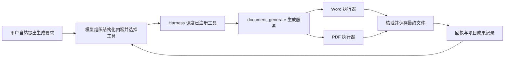

# OpenNova A2 文档生成工具方案

日期：2026-11-17。状态：正式 `document_generate` 与固定 Word／PDF 执行器已实现并注册到前台 Agent Harness，本文主体记录首批新建契约。此后已交付前台分版修订、逐结论引用及[后台文件研究](../../research/opennova-a2-background-research.md)。本文记录当前实现及未完成边界；历史能力探针见 [生成验证](../../research/opennova-document-generation-verification.md)，当前实现和分项验收见 [A2 文档工具接入](../../research/opennova-a2-document-tools.md)，后续顺序见 [A2 计划](../plans/2026-11-16-a2-research-learning.md)。

## 1. 目标和范围

用户自然提出“把这些内容整理成 Word”或“生成一份多页 PDF”，模型组织内容后调用稳定的生成工具，返回真实成果文件。日常生成复用仓库内固定版本的代码，无需模型每次重新编写 Python／Swift 生成器。

首版提供一个 `document_generate` 工具，以 `format=docx|pdf` 选择两个格式执行器。Markdown 沿用现有文本写入能力。输入交互继续只有“直接说文件名或路径”和“引用当前文件”，不新增选择器、上传或生成向导。

首版覆盖基础中文报告：标题、章节、段落、项目符号与编号列表、表格、页眉、页码、自然分页及 PDF 续页表头。复杂公式、图表、任意 Office 模板、批注修订、原 PDF 原位编辑和跨应用排版保真保留后续范围。本次验证目录中的脚本是提炼实现与测试的参考，生产运行不读取 `output/verification/`。

## 2. 职责与执行链路

| 层次 | 职责 |
| --- | --- |
| 模型 | 理解需求、撰写和组织内容、选择格式，调用工具并依据真实回执解释结果；事实与引用需要实际来源 |
| Agent Harness | 向模型暴露工具定义，组织调用、信号取消、工具历史及错误传播；不负责排版算法 |
| OpenNova 生成服务 | 校验输入、冻结项目与内容版本、调用固定执行器、核验二进制文件、提交成果、记录状态和处理重复请求 |
| Word／PDF 执行器 | 按同一内容结构生成对应格式，处理字体、样式、换行、分页、表格与页码；不自行调用大模型或执行内容中的指令 |
| 项目和界面层 | 当前返回输出路径、成果版本与验证状态，并按有效绑定选择最终文件；完整打开/引用/编辑接续后续完善，长期资料关联沿用已有规则 |

在 OpenNova 的工具扩展层注册，不修改上游 Harness。通用 `read/write/edit/bash` 继续用于现有工作；在已支持的 Word／PDF 生成范围内，模型优先调用正式生成工具。工具失败时返回具体限制，不以临时脚本自动绕过版本检查或冒充成功。

## 3. 首版工具契约

当前前台接口如下；可复制示例与运行限制见 [工具说明](../../../tools/documents/README.md)：

| 输入 | 约定 |
| --- | --- |
| `format` | `docx` 或 `pdf`；一次调用生成一个格式，同一内容快照可分别生成两个格式 |
| `specPath` | UTF-8 JSON 内容文件，模型可用现有 `write` 准备；生成服务固定实际字节及 SHA，校验 schema 后执行。它是工具数据，不是第三种用户文件入口 |
| `outputPath` | 必填目标路径，与格式扩展名一致；相对路径按本轮冻结的项目工作目录解析，也可用本机绝对路径；不临时读取前台 cwd。后台默认交付到独立任务目录，也可使用提交时明确指定的交付位置 |
| `expectedTarget` | 当前只接受 `absent`，省略时同此默认值；已有目标返回 `document_target_exists`，任何替换参数返回 `document_replace_not_supported`。基于旧版本/哈希的替换属于待开发能力 |

`spec` 使用 `schemaVersion=1`，包含标题与可选副标题、顺序内容块、版式选项及来源引用。内容块为 heading、paragraph、list、table；表格所有单元格均为字符串，各行及可选 `summary` 的列数与 columns 一致。汇总行列数错误返回 `document_summary_columns_mismatch` 和字段/期望列数/实际列数详情；工具保留和核验输入数值，不负责任意表格的自动求和。

来源字段支持 `sourceId`、可选 `sha256`、`observationId` 和 `locator`。宿主检查文件来源身份/哈希、网页观察记录及项目归属，不存在或版本不符时返回错误；保存的 `locatorVerified=false` 不表示定位正确。逐结论引用使用 M2 已接入的 claims，无资料来源的新写作允许空引用，已有来源也不自动证明模型结论正确。

只接受受支持的页面尺寸、字体预设和页眉页脚字段；正文和表格全部作为数据转义，不把任意 Python、Swift、Shell、OOXML 或文件内指令作为执行代码。当前限制为 spec 512 KiB、512 个内容块、200,000 字符、2,000 数据行、12 列、64 MiB 产物及默认 120 秒生成时限；额外字段长度和 PDF 分页限制见工具说明。超限返回错误，不能静默截掉末段或末行。

当前请求、项目及取消信号由宿主提供，不能由模型参数覆盖；后台由任务宿主提供提交时的绑定。返回值包括：

- `operationId` 和执行状态（完成、失败、取消或中断）。
- `artifact`：实际路径、格式、大小、SHA、保存版本、项目/请求、内容 spec 快照和哈希及生成器版本；后台回执另关联任务、执行轮次和分配版本。
- `generation`、`contentValidation`、`layoutValidation` 分别记录结果、范围与限制。Word 只校验内容和格式结构，实际版式 `not_checked`；PDF 可通过自动几何检查，但两种格式的 `layoutValidation.visual.status` 均为 `not_checked`，不能从 OOXML 推断实际 Word 页数。
- 可核实的页数、检查摘要、警告及可恢复错误；失败且未提交成果时不返回虚假的可用文件。

## 4. 固定执行器与环境

| 执行器 | 已实现路线 | 范围与边界 |
| --- | --- | --- |
| Word | Python 标准库 ZIP／OOXML 固定模块读取通用 spec；保留可编辑标题、列表、表格、页眉页脚 | 已去除样本硬编码，支持 XML 转义、长段落/长单元格、中文字体预设和有效包关系，重新打开检查顺序内容；未内置 Word 渲染器 |
| PDF | Swift CoreText／CoreGraphics 固定排版执行器及 PDFKit 本地读回 | 自动换行、自然分页、跨页表头、完整末行/汇总行、字体及字符边界检查；无法放入单页的高表格行和超过两行的页眉显式失败，不静默裁切 |

共享内容规范与基本版式约定，不强求 DOCX 与 PDF 在不同排版器中页数完全一致。默认 A4，另支持 Letter；两种尺寸已纳入固定执行器和 Harness 离线测试，具体内容、真实模型及视觉证据分别记录。

执行器及测试位于 `tools/documents/`，服务、runner 与 schema 位于 `services/bot/documents/`。命令/脚本存在性由 runner 探测，完整 Python/Swift 执行环境通过实际运行确认，PDF 检查系统中文字体；命令存在不代表编译环境与字体预检已经完成。生成失败不阻塞文字聊天。当前未安装新的第三方生成库；后续若有明确缺口，再评估并声明新增依赖。

Codex bundled Python、LibreOffice、PDFium 等只属于独立 QA 环境，不能作为默认生产路径。Word 内容／结构核验在现有标准库即可执行；实际渲染能力未接入前必须返回版式未核验。PDF 本地读回与几何检查复用系统框架，逐页视觉检查单独记录。

## 5. 保存、取消与成果绑定

1. 接受调用时固定本轮项目/对象绑定、内容 spec、来源版本、输出位置和 `expectedTarget=absent`。callId 与请求/参数指纹用于重复调用判定，保存 spec 哈希与生成器版本；同标识但参数变化返回冲突。相同调用重放复用原快照/结果，不重新读取后来变化的 spec。
2. 在隔离临时位置生成，先做文件存在性、格式、内容结构和必要的内容完整性检查。检查失败时保留可定位错误，不把半成品发布为成果；普通正文不能因排版被静默删除，表格行序和数值必须保持。
3. 提交前重新核对取消信号和目标父目录身份，用受控字节副本与原子无覆盖硬链接发布；即使目标在生成期间被创建也不能覆盖。记录稳定版本前移除临时发布链接，避免 ctime 误变。文本专用 `writeFile/proposeFile` 不承载 DOCX/PDF；当前没有替换动作，修改前版本保留和替换协议留待后续。
4. 明确提交点：提交前取消不发布；已经成功提交后收到取消也如实返回“文件已保存”及实际状态，不回滚或误报文件不存在。重启恢复通过操作日志、成果哈希与提交状态对账，不盲目重跑生成或重复覆盖。
5. 记录成果与来源，只有最终成功提交且原请求绑定仍有效、用户未切换项目/对象时才选择最终文件。当前生成器本地核验不会把内部 spec 或临时文件激活为当前对象，也不把它们作为交付成果；后台成果登记也保留前台选择。
6. 当前可按用户要求用新路径生成另一份文件；基于保存 spec 的完整编辑接续、版本化替换和外部修改冲突处理仍待实现。首版拒绝替换，不用旧 spec 覆盖已有文件；任意外部 Word/PDF 的保真编辑也不属于当前范围。

`document_open` 沿用已有能力，只表示打开请求已发送。长期加入项目资料仍需对应关联意图；保存生成记录和临时当前文件不等于自动增加长期资料。

## 6. 核验与现有边界修复

本地内容核验已是生成工具的一部分，不依赖把整份输出再次发给模型。此前 6 页 PDF 的 `document_read` 90 秒超时尚未修复，仍需 M1 独立定位，验证按范围提问、必要时分段及有限恢复；不能靠缩短问题宣称附件已裁剪。生成采用本地核验只是避免依赖该整份读回，不代表原生阅读问题已经解决。

当前固定执行器的核验不调用普通 `document_read`，因此没有内部预览抢占对象的步骤。普通 `document_read` 的读取后选择行为没有改动；后续如果增加原生视觉/语义内部调用，需要另行实现不激活对象的策略并记录实际范围，不能由少数页抽查推断逐页通过。

固定执行器和服务/Harness 离线测试已覆盖不同内容、中文/特殊字符、跨页段落/表格、末行和声明的汇总值、结构可编辑/文本可检索，以及取消、重复请求、目标冲突、项目/对象变化和重启。真实模型验收单独核对 `document_generate` 轨迹、产物及独立视觉结果，保留原始失败；错误参数被正确拒绝和离线 fixture 成功都不能替代真实模型生成通过。最终证据以本轮接入记录为准。

本轮真实 `/ask` 复测已生成 Word 与多页 PDF，并确认最终对象、磁盘版本和哈希一致。Word 最终拆行修复由复测冻结 spec 重新生成并完成独立内容及 4 页视觉检查，不算第三次模型请求；真实复测 PDF 的 3 页及额外执行器长表 PDF 的 6 页也分别完成视觉检查。必要全量回归、最后改动后的定向回归及构建/doctor 已通过，具体证据和适用范围见接入记录。独立视觉结论只适用于这些样本，工具运行时仍返回 `visual=not_checked`。2026-11-18 已修复用户 TC02 的中文临时路径问题并用原内容通过实际 Bot 复测，用户随后确认本机 PDF 阅读器打开、浏览和重新打开通过；本批手动验收已结束。完整编辑及其他未交付能力继续按计划开发和验收。

## 7. 与现有模块的衔接

| 位置 | 复用或新增工作 |
| --- | --- |
| `services/bot/host.mjs`、`policy.mjs` | 已通过 `moduleTools → defineTool`、允许列表和前台作用域注册生成工具；注入请求绑定和服务依赖 |
| `services/bot/documents/generator.mjs`、现有项目对象服务 | 已实现冻结 binding、callId 幂等、新建无覆盖提交、取消和最终对象保护；普通 file-reader 行为未改变 |
| `services/bot/operations.mjs` | 已复用操作记录与状态存储；二进制提交由生成服务独立实现，不修改 ≤64 KiB 文本载荷接口 |
| `services/bot/tasks/agent-plugin.mjs`、`tasks/execution.mjs` | 后台文件研究已注册同一生成服务；只读、验收、仅补汇总任务不暴露生成写入能力 |
| `services/bot/tasks/documents.mjs`、`team/reports.mjs` | documents 模式支持冻结的研究输入。按可信生成回执收集成果，显式支持用户指定的外部输出路径，不扩大为任意外部扫描 |

前台生成和后台文件研究复用同一生成服务。后台使用独立工具权限和任务回执，沿用现有项目与成果记录。
