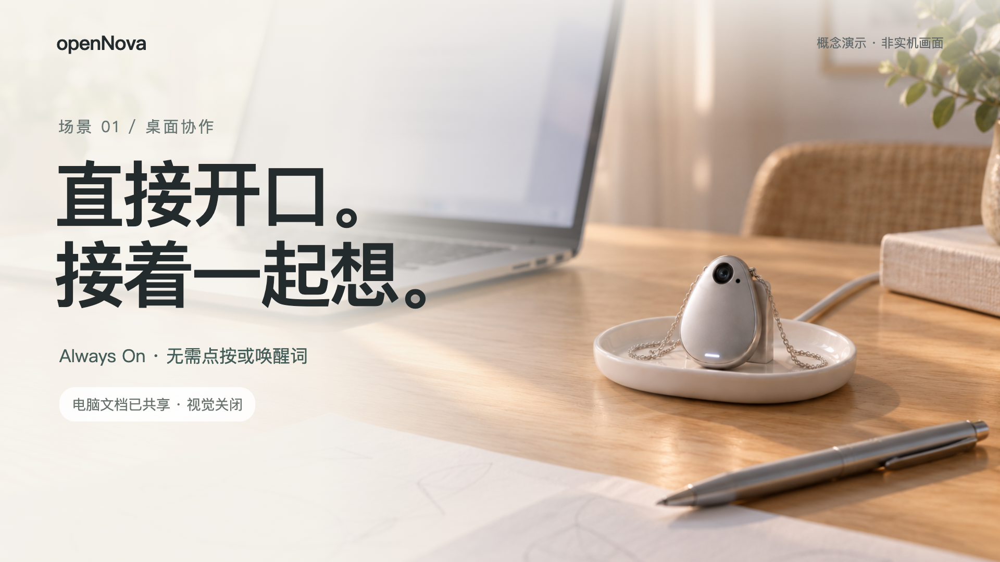

# 水滴主方案 · 场景一

**Seedream 人物参考图已生成（2026-10-05）：** [查看年轻男主原图](../../docs/product/assets/character-v02-young-man-seedream.png)。同一方舟账号以 `doubao-seedream-5-0-pro-260628` 纯文生图生成，原图为 1856×2320 PNG，已原样保存并验证复制前后的 SHA-256 一致。人物胸前无设备，后续与底座图分别提供人物和产品参考。参数和提示词见[人物图记录](../../docs/product/assets/character-v02-young-man-seedream-prompt.md)，响应保存在 `out/seedream-character-v01/`。用户已确认该人物图；v07 使用此原图与底座图提交视频，下方 v06 保留此前失败记录。

当前目标样片规格为 **16 秒、720p、16:9、原生声音**，使用 Seedance 2.5。默认配置是 `seedance-sample-v07.json`，按顺序引用 [年轻男主人物图](../../docs/product/assets/character-v02-young-man-seedream.png) 和 [D 水滴居家底座设计图](../../docs/product/assets/dock-v05-d-drop-home.png)。两图均以 `reference_image` 传入，不作为视频首帧；第一张约束人物外形与服装，第二张约束水滴、细链、浅托盘和短支撑。提示词明确胸前不佩戴设备，桌面只有一套水滴底座组合。男主目视带鱼屏，通过自然语言让助手改写产品介绍；桌面无键盘鼠标，画面以人物交流为焦点。

**v07 已生成：[播放最新 16 秒样片](out/seedance-2-5-sample-v07/waterdrop-seedance.mp4)。** 2026-10-05，使用用户确认的 Seedream 男主原图与水滴底座图，沿用 469 字符提示词；两图均为 `reference_image`，人物原图逐字节保留。任务 ID：`cgt-20261005092726-wnky9`。实测 16.064 秒、1280×720、24 fps，H.264 视频与 AAC 32 kHz 双声道音轨，文件 7,928,416 字节；完整解码通过，音频均值 −23.4 dB、峰值 −4.2 dB。

**v07 画面检查：** 约 2/6/10/14 秒抽帧呈现年轻男主、短黑发和灰色上衣，面向超宽显示器、双手留在膝边；桌面未见键盘、鼠标或笔记本，胸前未见第二台设备。后半段屏幕出现左右并列的文档与高亮建议。桌边是一套小型银色水滴及低矮暖白椭圆托盘。

**v07 可见偏差与检查范围：** 显示器左缘被画面裁切，未完整入画；屏幕中文仍有生成痕迹。约 10 秒抽帧中水滴周边出现较大范围白色轮廓光，没有严格限于底部短白灯。细链和后部支撑因尺寸较小难以确认。仅抽帧核对外观、姿态及画面，无法据此保证全程一致；音轨存在且非静音，台词、声源归属和语气自然程度未进行听验。

**v06 双参考图请求被拒绝，未返回任务 ID 或成片。** 2026-10-05，使用用户确认的男生图和底座图提交一次请求，返回 HTTP 400，错误码 `InputImageSensitiveContentDetected.PrivacyInformation`。原文：`The request failed because the input image 'content[1]' may contain real person.` 请求内容第 0 项为文字，第 1 项为男生参考图，第 2 项为底座参考图，因此本次错误明确指向 AI 生成的男生参考图。平台没有提供更具体的判定依据。Request ID：`021791162378670fc7578b59e843c90e5af4aa62e8cfda921d1d9`。配置和完整报错保存在 `out/seedance-2-5-sample-v06`，未再次提交；当时最新可用视频为 v04。

**官方肖像素材限制（2026-10-05 核对）：** [Seedance 2.5 教程](https://docs.volcengine.com/docs/ark/seedance-2-5)说明不可直接上传含真人人脸的参考图或视频，需使用平台支持的肖像素材流程。[肖像素材指南](https://docs.volcengine.com/docs/ark/seedance-portrait-asset-guide?lang=zh)列出同账号近 30 天内部分方舟模型原始产物的信任机制，包括 Seedream 5.0 lite/pro 文生图输出，并说明不支持跨平台产物信任。本次人物图由内置 image_gen 生成，不属于该方舟原始产物范围。若采用 Seedream 文生图路径，需要重新生成并确认人物，不能承诺保留当前这张图的完全相同面容。

**v05 年轻男主版本未生成成功。** 仅修改 v04 的人物外形描述，16 秒时长、对白、镜头和产品参考不变。当前人物设定为原创虚构的约 25 岁成年男性，清爽俊朗、黑色短碎发、无胡须，穿灰色上衣。2026-10-05，首次任务 `cgt-20261005084424-yfwn4` 及明确原创虚构角色后的第二次任务 `cgt-20261005084909-zxjrx` 均返回 `OutputVideoSensitiveContentDetected.PolicyViolation`，平台提示生成结果可能涉及版权限制，未说明具体触发内容，两次均无成片。测试记录分别保存在 `out/seedance-2-5-sample-v05` 和 `out/seedance-2-5-sample-v05-retry1`；未继续提交，当时最新可用成片为下方 v04。

**v04 已生成：[播放历史 16 秒样片](out/seedance-2-5-sample-v04/waterdrop-seedance.mp4)。** 2026-10-05，使用已确认的 466 字符提示词及底座参考图提交一次任务，未另行修改输入。任务 ID：`cgt-20261005082426-bhjue`。实测时长 16.064 秒，1280×720、24 fps，含非静音双声道音轨，完整解码检查通过。

**v04 画面检查：** 约 2/6/10/14 秒抽帧均呈现男性面向超宽屏、双手置于腿上；未见键盘、笔记本或可明确识别的鼠标。人物和屏幕为画面主体，水滴与低矮椭圆浅托盘占比较小，后两帧底部白灯亮起，未见摄像头采集灯点亮。

**仍有偏差及检查范围：** 水滴机身比参考图略瘦尖，后部支撑细节难以确认；屏幕中文有生成变形，建议以覆盖式浮窗呈现。左下纸面有类似产品效果图的白色轮廓，无法确认是否额外实物。抽帧不能证明全程符合要求；音频仅完成音轨与非静音检查，未对台词内容、声源归属及语气自然度进行听验。

**v03 已生成：[播放 16 秒样片](out/seedance-2-5-sample-v03/waterdrop-seedance.mp4)。** 任务 ID：`cgt-20261004232458-yprcu`。实测时长 16.064 秒，1280×720、24 fps，含双声道音轨，完整解码检查通过。画面以人物交流为主体，没有采用产品设计图作为首帧。

**v03 可见偏差：** 模型仍生成了键盘，显示器未清楚呈现超宽带鱼屏比例；底座变成较高的支座，镜头旁绿灯在回应时亮起，与浅托盘和关闭视觉的要求不符。这一版是测试样片，尚不能视为所有设计要求均已实现；对白内容与自然程度仍以播放听感为准。

## 早期 Remotion 概念片（历史版本）

以下 48 秒内容为早期剪辑版，画面规格 1920×1080，30 fps；不代表当前 Seedance 样片的时长或镜头方案。



| 全片时间 | 场景内容 |
| --- | --- |
| 0–8 秒 | 接续昨天的方案，直接开口交流。 |
| 8–20 秒 | 把抽象描述改成真实使用场景，在电脑上确认改稿。 |
| 20–28 秒 | 确认 D（水滴）为主方案，A（圆环）保留为备选。 |
| 28–42 秒 | 用户主动开启视觉，查看连接位置和链条走向，再关闭视觉。 |
| 42–48 秒 | 视觉关闭后，语音交流继续。 |

语音采用 Always On 交互：无点按唤起、无唤醒词。视觉由用户主动开启，关闭视觉不结束语音讨论。

本片使用合成中文配音与生成场景图，展示概念交互，并非实机演示。

## 本地预览

在 `videos/scene-one` 目录运行：

```sh
npm run dev -- --no-open
```

预览地址：[WaterdropDesktopCollaboration](http://localhost:3000/WaterdropDesktopCollaboration)。

字幕位于 `public/waterdrop/captions.json`，按全片绝对时间记录；配音时间及音量校验见 `public/waterdrop/audio/voiceover.json`。

## 可编辑素材

主时间线与五个分镜位于 `src/waterdrop`。字幕已内联到时间线，便于在 Studio 编辑；改动时同步维护字幕 JSON。桌面与手持草图场景位于 `public/waterdrop`，同目录保存生成提示词；圆环备选图沿用已确认的方案 A。

中文语音使用 macOS Reed 与 Tingting，台词和生成方式见 `scripts/make-waterdrop-voiceover.py`。主时间线包含配音和字幕，单独的分镜用于编辑画面。旧版 `DesktopCollaboration` 保留在同一项目中。

## Seedance 原生有声样片

2026-10-04 实测生成成功：[播放样片](out/seedance-2-0-sample-v01/waterdrop-seedance.mp4)。成片约 10.08 秒，1280×720、24 fps，含双声道音轨，完整解码检查通过。任务 ID：`cgt-20261004215753-bqlbj`。抽帧确认水滴、托盘和镜头推进呈现正常；中文台词及声音自然程度仍以播放听感为准。

`scripts/seedance_video.py` 调用火山引擎方舟国内接口，当前默认配置为 `seedance-sample-v07.json`，模型为已开通的 `doubao-seedance-2-5-260628`，目标为 16 秒、720p、16:9 的有声视频。新版明确男性主角、目视 32:9 带鱼屏、双手放膝上；桌面只有显示器、草图和水滴底座组合，无键盘鼠标或笔记本。男性说“把这段产品介绍，改成一个真实的使用场景。”，助手回复“好，修改建议放在屏幕上了，你看看。”。视觉重心为人物和文档，提示词中不使用 Always On 等术语。

当前 `@图片1` 为 `../../docs/product/assets/character-v02-young-man-seedream.png`，`@图片2` 为 `../../docs/product/assets/dock-v05-d-drop-home.png`。参考图分别约束人物与产品，房间、人物目视屏幕和镜头构图由文字决定。历史 v04/v05 仅使用底座图，v03 使用吊坠佩戴图，v02 是 10 秒底座参考图方案；v01 与上方 Seedance 2.0 成片保留供对比。

v04 的提示词优化依据：[官方 2.5 提示词指南](https://docs.volcengine.com/docs/ark/seedance-2-5-prompt-guide?lang=zh)建议明确素材用途、按时间或镜头分段、尽量正向描述；[2.5 教程](https://docs.volcengine.com/docs/ark/seedance-2-5)给出台词 `{}`、音效 `<>` 的书写方式；[创建任务接口](https://docs.volcengine.com/docs/ark/create-video-generation-task-api?lang=zh)建议中文提示词不超过 500 字。将双手放在膝上、正面体现屏幕横向比例、区分男性口型与设备女声，是针对本项目偏差的具体调整，不代表官方保证这些细节一定正确。

2026-10-04，历史 v02 已实际测试三次，均接受请求并进入生成，最终均返回 `OutputVideoSensitiveContentDetected.PolicyViolation`：平台认为生成的视频可能涉及版权限制。平台未指出具体触发内容，不能据此确定是提示词、参考设计、人物或其他元素所致。三次均没有视频可播放，尚未验证新版对白的自然程度及构图效果。

| 测试 | 任务 ID | 本地记录 | 结果 |
| --- | --- | --- | --- |
| 第一次 | `cgt-20261004223822-jbx3g` | `out/seedance-2-5-sample-v02/task.json` | 输出审核失败 |
| 相同输入复测 | `cgt-20261004224320-k2mie` | `out/seedance-2-5-sample-v02-retry1/task.json` | 同样的输出审核失败 |
| 用户要求再次测试 | `cgt-20261004231754-v1xg3` | `out/seedance-2-5-sample-v02-retry2/task.json` | 同样的输出审核失败 |

以上三次使用同一份 v02 提示词、参考图和参数。`task.json` 保存完整错误码及请求 ID，可用于向方舟核查。错误含义见[方舟官方错误说明](https://docs.volcengine.com/docs/ark/error-codes?lang=zh&redirect=1)。

脚本仅依赖 Python 3 标准库。以下命令在 `videos/scene-one` 目录运行：

```sh
# 校验配置与参考图片，不调用 API、不产生生成费用
python3 scripts/seedance_video.py --dry-run

# 新建一条视频；优先读取 ARK_API_KEY，未设置时终端隐藏输入密钥
python3 scripts/seedance_video.py --submit --output-dir out/seedance-new-sample

# 恢复已有任务的查询/下载，不新建任务
python3 scripts/seedance_video.py --resume --output-dir out/seedance-2-5-sample-v07
```

密钥不写入脚本、配置或任务文件；无需把密钥放在命令行参数里。生成会消耗方舟账户额度。脚本只提交一次，不自动重试创建请求；已有任务记录的目录拒绝重复提交。中断等待不会取消远端任务。请求结果不明确且没有任务 ID 时，应先到方舟控制台核对任务记录，再决定是否重新提交。

生成结果保存在指定输出目录：`task.json` 记录任务及结果，`config.json` 保存不含密钥的生成配置，`waterdrop-seedance.mp4` 是成功后的本地视频。`out/` 已被 Git 忽略。输出链接有时效，脚本在任务成功后立即下载。

离线验证：`python3 -m unittest discover -s scripts -p 'test_seedance_video.py'`。

接口依据：[创建视频任务](https://docs.volcengine.com/docs/ark/create-video-generation-task-api?lang=zh)。参考图以 Base64 编码传入，角色为 `reference_image`；声音由模型同步生成。
